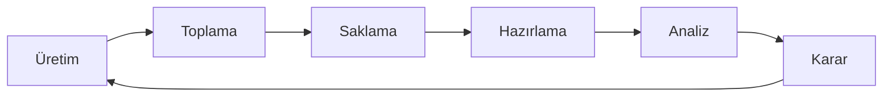

# Veri Analitiği ve İstatistiksel Analize Giriş

Yazılım her tıklamayı, sensör her ölçümü, araç her konumu kaydedebilir. Kayıt arttıkça depolama büyür; ancak bu büyüme tek başına daha iyi bir karar üretmez. Veri analitiği, ham kaydın hangi soruya cevap vereceğini ve bu cevabın hangi eyleme bağlanacağını belirleme işidir. İstatistiksel analiz de aynı hattın devamında, cevabın rastlantıdan ayrılıp ayrılmadığını yoklar.

## Ham kayıt neden tek başına yetmez

**Veri**, bir olaya veya ölçüme ait, henüz yorumlanmamış kayıttır. Bağlam eklenmeden okunduğunda çoğu zaman tek başına bir karar vermez.

Örneği netleştirmek için aşağıdaki tablo, kurmaca bir teslimat aracının iki anlık konum kaydını gösterir:

| record_id | recorded_at | latitude | longitude |
|----------:|-------------|---------:|----------:|
| 1 | 08:12:00 | 41.0100 | 29.0000 |
| 2 | 08:12:30 | 41.0205 | 29.0000 |

Bu tablo ne bir uyarı ne bir hız ihlali ne de bir rota önerisidir; yalnızca iki anda nerede olunduğunu söyler. Satırlar bu halde bırakılırsa diskte durur: sistem ne sürücüye sesli uyarı gönderir ne de bir sonraki turda hız sınırını değiştirir.

İşlenmemiş veri, gürültü demek değildir. Gürültü, ölçümün içindeki istenmeyen sapmadır; ham veri ise henüz bir soruya bağlanmamış kayıttır. Kayıtların bir kısmı daha sonra hatalı veya eksik çıkabilir; bu ayıklama, analize hazırlık adımında yapılır.

## Aynı kayıttan dört anlam çıkar

Aynı iki satır, üst üste dört farklı anlama dönüşebilir. Klasik adlandırmada bu sıra DIKW diye bilinir: data, information, knowledge, wisdom. Bu yazıdaki karşılıkları veri, enformasyon, içgörü ve karardır.

**Enformasyon**, verinin düzenlenip anlam taşıyacak biçimde okunmasıdır. Bu enlemde bir derece yaklaşık 111 kilometredir. İki satır arasındaki 0,0105 derecelik fark yaklaşık 1,17 kilometre eder. Otuz saniye, saatin 120'de biridir; 1,17 kilometre bu payla çarpılınca hız yaklaşık 140 km/sa bulunur. Böylece "Hız yaklaşık 140 km/sa" cümlesi artık ham koordinat değil, enformasyondur.

**İçgörü**, enformasyonun bağlamla birleşmesidir. Bu kesitte yasal hız sınırı 90 km/sa ise araç sınırın üzerindedir. Sınır bilinmeden 140 km/sa tek başına ihlal sayılmaz; bir yolda olağan, başka bir yolda tehlike olabilir. **Alan bilgisi** (domain knowledge), verinin üretildiği işin kurallarını ve fiziksel karşılığını bilmektir. Hesap "yüksek" demez; yüksekliği bağlam söyler.

**Karar**, bu içgörüyle ne yapılacağının seçilmesidir. Seçenekler arasında sürücüye uyarı göndermek, o kesitte hızı sınırlamak veya olayı yalnızca kayda geçirmek vardır. Seçimin uygulanması eylemdir. DIKW'deki bilgelik basamağı burada soyut bir erdem değil, bağlama uygun eylemi seçme adımıdır.

| Basamak | Bu örnekte karşılığı |
| --- | --- |
| Veri | 08:12:00 ve 08:12:30 anlarındaki enlem ve boylam |
| Enformasyon | Hız yaklaşık 140 km/sa |
| İçgörü | Kesit sınırı 90 km/sa; araç sınırın üzerinde |
| Karar | Sürücüye uyarı gönder veya bu kesitte hızı sınırla |

*Şekil 1: Ham konum kaydı, hız hesabı ve yol kuralıyla birleşerek uyarı veya hız sınırı gibi bir eyleme dönüşür.*

## Değer, yaşam döngüsünde üretilir

Veri bir kez yazılıp rafa kalkmaz; değer, kaydın bir karara bağlandığı döngüde ortaya çıkar. Verilen karar yeni kayıt üretir ve döngü sürer.

*Şekil 2: Kayıt üretimden karara ilerler; kararın sonucu yeni veri üreterek döngüyü sürdürür.*

Döngüyü adım adım okumak, sonraki bölümlerde karşılaşılacak terimlerin iskeletini kurar:

**Üretim**, kaydın ortaya çıktığı andır: sensör ölçer, uygulama bir olayı yazar, bir işlem veritabanına satır ekler.

**Toplama**, bu kayıtların bir araya getirilmesidir; kaynak bir anket, bir cihaz veya bir web servisi olabilir.

**Saklama**, kayıtların kaybolmadan durduğu yerdir.

**Hazırlama**, eksik, hatalı veya birbirine uymayan değerlerin analize girecek biçime çekilmesidir.

**Analiz**, özetin, ilişkinin veya olası sonucun çıkarıldığı adımdır.

**Karar**, çıktının bir eyleme bağlanmasıdır. Uyarı gönderildiyse, uyarının dikkate alınıp alınmadığı da yeni bir kayıttır.

Her halka ayrı bir iştir. Toplama yöntemleri, hazırlama adımları ve analiz türleri serinin ilerleyen yazılarında ayrıntılandırılır.

## Analitik üç alanın kesişiminde durur

Veri analitiği, veriyi sorulara cevap verecek biçimde incelemek ve bu cevapları karara bağlamaktır. Üç alan birlikte durmadığında sonuç ya hesaplanamaz ya da yanlış işe uygulanır.

**Bilgisayar bilimi** kaydı toplar, saklar ve işler. Konum satırları bir tabloda durmuyorsa hız da hesaplanamaz.

**İstatistik**, dağılımı, değişkenliği ve "bu sonuç rastlantı olabilir mi?" sorusunu ele alır. Tek bir 140 km/sa değeri bir olay cümlesi kurar; bir araç grubunun bu aşımı sistemli yapıp yapmadığı ancak birçok kayıtla anlaşılır.

**Alan bilgisi**, sayının yazılımda, işletmede veya fiziksel sistemde ne anlama geldiğini bilir. Hız sınırını, aracın görevini ve uyarının sürücüyü nasıl etkileyeceğini hesap tek başına söylemez.

**Veri bilimi**, bu üç alanı yazılımla tekrar edilebilir hale getirir: aynı soru, yeni veri geldikçe yeniden cevaplanır. İstatistiksel analiz cevabın güvenilirliğini ölçer; analitik ise sorunun kendisidir.

## Dört soru, dört analitik

İki satır tek bir olayı gösterir; karar ise çoğu zaman birçok kaydın birlikte okunmasıyla verilir. Aynı teslimat kayıtları dört ayrı soruya açılır. Soru değişince bakılan şey de değişir; her soru bir öncekinin cevabını kullanır. Bu dörtlü, analitik olgunluk sırası olarak da adlandırılır.

| Analitik | Soru | Örnek okuma |
| --- | --- | --- |
| Betimsel (descriptive) | Ne oldu? | Geçen hafta 128 hız aşımı kaydı var. |
| Tanısal (diagnostic) | Neden oldu? | Aşımlar yağmurlu günlerde ve aynı rampada toplanıyor. |
| Tahminsel (predictive) | Ne olabilir? | Yarın sabah bu rampada aşım olasılığı yüksek görünüyor. |
| Yönlendirici (prescriptive) | Ne yapılmalı? | Yağmurlu günlerde bu rampanın hız üst sınırı düşürülsün. |

Betimsel sonuç bir sayıdır. Tanısal sonuç bir açıklama adayıdır; adayın veriye dayanıp dayanmadığı ayrıca yoklanır. Tahminsel sonuç henüz olmamış bir durumu söyler ve yanılabilir. Yönlendirici sonuç bir eylem önerir; öneri tahmini ve alan kuralını birlikte kullanır. "Olasılık yüksek" cümlesi tek başına hız sınırını değiştirmez; sınırı değiştirmek ayrı bir karardır.

Betimsel ve tanısal analitik kaydı enformasyona ve içgörüye taşır. Tahminsel ve yönlendirici analitik, içgörüyü henüz olmamış duruma ve eyleme bağlar.

## Bilişim sistemlerinde veri hangi biçimde gelir

Karar döngüsüne giren kayıtlar tek biçimde durmaz. Biçim, hangi işlemin anlamlı olacağını önceden haber verir.

| Biçim | Ne taşır | Örnek |
| --- | --- | --- |
| İşlem kaydı | Aynı alanların tekrarlandığı satırlar | Sipariş, konum, stok hareketi |
| Olay günlüğü (log) | Zamanı belli olaylar | Uygulama hatası, kapı açılması |
| Sensör ölçümü | Aralıklarla gelen sayılar | Hız, sıcaklık, ivme |
| Metin, görüntü ve ses | Tablo hücresine doğrudan sığmayan içerik | Kullanıcı yorumu, kamera karesi |

**Log**, bir sistemin zaman sırasıyla tuttuğu olay kaydıdır. İşlem kaydı ve log çoğu zaman tabloya yakındır. Metin, görüntü ve ses ise önce bir ölçüme veya etikete çevrilmeden ortalama, hız veya karşılaştırma hesabına girmez. Bu biçimlerin nasıl toplanıp hazırlanacağı, döngünün toplama ve hazırlama halkalarında ele alınır.

## Yazılım, mühendislik ve otonom sistemde aynı çerçeve

Teslimat aracı örneğinde kurulan çerçeve, kaynağa göre değişmez; değişen yalnızca kaydın nereden geldiği ve eylemin kime veya neye gittiğidir.

Bir mobil uygulamada veri, oturum ve hata kayıtlarıdır. Betimsel soru, son sürümde çökme sayısının ne olduğudur. Yönlendirici karşılığı, çökmeler tek bir ekranda toplanıyorsa o sürümü kademeli açmak veya durdurmaktır.

Bir mühendislik ölçümünde veri, hattın veya tezgâhın sensöründen gelir. Ortalama sıcaklık normal görünüp kısa süreli sıçramalar malzemeyi bozuyorsa, tek başına ortalama kararı yanıltır. Sapmanın ayırt edilmesi, ölçümün nasıl özetleneceği ve kaydın nasıl hazırlanacağı ile ilgilidir.

Bir otonom veya yarı otonom araçta veri, konum ve hız gibi ölçümlerdir. Karar, kayıt bir merkeze vardıktan sonra da verilebilir; ölçümün alındığı cihazda da verilebilir. Sıra iki durumda da aynıdır: ölçüm hıza, hız yol kuralıyla birlikte bir içgörüye, içgörü gaz veya uyarı gibi bir eyleme bağlanır. Eylemin sonucu yeni ölçüm üretir ve döngü kapanır.
