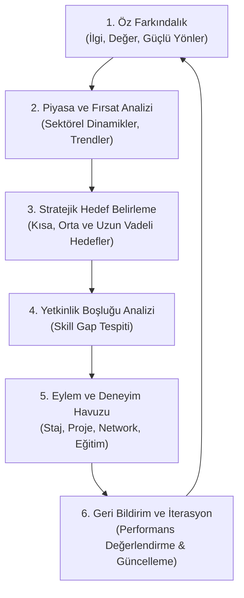
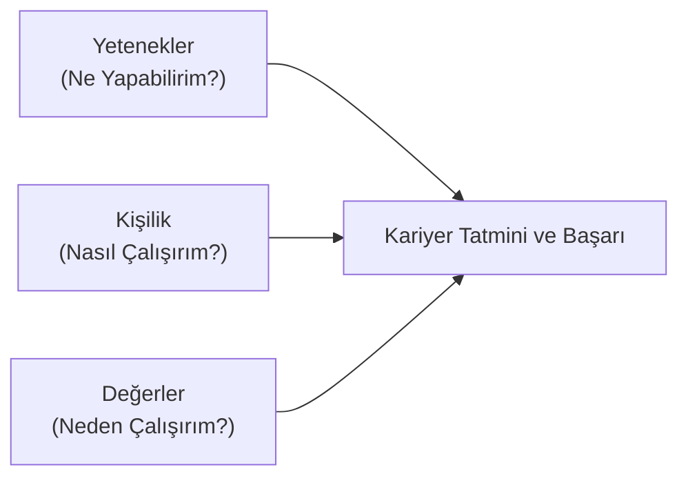
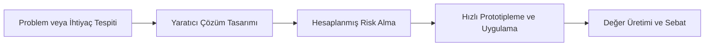

# Girişimcilik ve Kariyer Planlamaya Giriş: Öz Farkındalık ve Stratejik Yol Haritası

Kariyer, bireyin yaşamı boyunca üstlendiği rollerin, edindiği deneyimlerin ve yarattığı katma değerin bütüncül bir bileşimidir. Günümüzün hızla değişen iş gücü piyasasında kariyer yolculuğu, tesadüflerin ve harici yönlendirmelerin belirlediği pasif bir akış olmaktan çıkmış; stratejik öngörü, bilinçli tercihler ve derin bir öz farkındalık gerektiren dinamik bir inşa sürecine dönüşmüştür. Diploma ve akademik not ortalaması, iş dünyasının kapısını aralamada asgari bir giriş bileti işlevi görürken; o kapıdan içeri girdikten sonra kalıcı bir değer üretmek ve mesleki tatmin sağlamak, bireyin kendi yetkinlik sermayesini nasıl yönettiğine bağlıdır.

Erken dönemde başlatılan kariyer planlaması, bireyin mezuniyet sonrasında karşılaşacağı belirsizlik dalgasını bertaraf etmesini sağlar. Kendi güçlü ve zayıf yönlerini, mesleki ilgi alanlarını ve kişisel değerlerini üniversite eğitiminin ilk evrelerinde keşfeden bir profesyonel adayı; eğitim sürecini yalnızca teorik dersleri tamamlama zorunluluğu olarak değil, hedeflenen kariyer profiline hizmet eden modüler bir laboratuvar olarak kurgulayabilir.


*Şekil 1: Sürekli döngüsel bir mekanizma olarak stratejik kariyer planlama modeli.*

---

## 1. Kariyer Planlamanın Stratejik Önemi ve Değişen Paradigma

Geleneksel kariyer anlayışı, tek bir uzmanlık alanında edinilen diplomanın ömür boyu güvence sağladığı ve kurumsal hiyerarşide dikey olarak yükselmenin nihai başarı kriteri sayıldığı doğrusal bir model üzerine kuruluydu. Ancak küreselleşme, yapay zekâ destekli otomasyon ve iş modellerindeki hızlı dönüşüm, bu statik yapıyı kökten sarsmıştır. Günümüzde iş unvanlarının ortalama ömrü kısalırken, bireylerin meslek hayatları boyunca birden fazla sektör ve disiplin arasında geçiş yapması kural haline gelmiştir.

Bu yeni paradigmada kariyer planlaması, reaktif (*tepkisel*) bir kriz yönetimi değil; proaktif (*ön alıcı*) bir strateji tasarımıdır.

* **Reaktif Yaklaşım:** Bireyin mezuniyet gününe kadar kariyer üzerine derinlemesine düşünmemesi, iş ilanlarına rastgele başvurması ve piyasanın sunduğu ilk seçeneğe mecbur kalmasıdır. Bu durum çoğu zaman düşük iş tatmini, yetkinlik-iş uyumsuzluğu ve erken mesleki tükenmişlik ile sonuçlanır.
* **Proaktif Yaklaşım:** Bireyin eğitim sürecinin başından itibaren hedef sektörlerin beklentilerini araştırması, gerekli yetkinlik portföyünü bilinçli pratiklerle doldurması ve kendi alternatif rotalarını önceden çizmesidir. Proaktif yaklaşım, piyasadaki dalgalanmalara karşı bireye dayanıklılık kazandırır.

| Boyut | Reaktif Kariyer Anlayışı | Proaktif / Stratejik Kariyer Anlayışı |
| :--- | :--- | :--- |
| **Zamanlama** | Mezuniyet sonrası veya işsizlik anında başlar. | Üniversitenin ilk gününden itibaren kurgulanır. |
| **Gelişim Odağı** | Sadece zorunlu ders müfredatıyla sınırlıdır. | Projeler, stajlar ve yan yetkinliklerle zenginleştirilir. |
| **Piyasa Algısı** | "Bana kim iş verecek?" sorusu hakimdir. | "Hangi probleme özgün bir çözüm üretebilirim?" odaklıdır. |
| **Kriz Reaksiyonu** | Belirsizlik karşısında panik ve pasifleşme görülür. | Yeni yetkinlik kazanarak (reskilling) hızla uyum sağlanır. |

---

## 2. Öz Farkındalık (*Self-Awareness*): Kariyer Pusulasının İnşası

Sağlıklı bir kariyer inşasının temel koşulu, dış dünyadaki fırsatları taramadan önce bireyin kendi içsel envanterini dürüstçe çıkarabilmesidir. Bireyin neyi iyi yaptığını, neyi yaparken zorlandığını ve hangi çalışma ortamında kendini gerçekleştirebileceğini bilmemesi; pusulası olmayan bir geminin okyanusta sürüklenmesine benzer.

Öz farkındalık üç temel eksende yapılandırılır:

1. **Bilişsel Kapasite ve Yetenekler:** Bireyin soyut düşünme, sayısal akıl yürütme, sözel akıcılık veya mekânsal algılama gibi zihinsel süreçlerdeki doğal öğrenme hızıdır. Hangi alanlarda daha az çaba ile daha derin kavrayışa ulaşıldığının tespiti, teknik uzmanlaşmanın yönünü tayin eder.
2. **Kişilik Özellikleri ve Davranış Kalıpları:** Bireyin sosyal ilişkilerdeki tutumu, belirsizlik karşısındaki stres toleransı, detaylara odaklanma derecesi ve özerklik arzusudur. Yüksek risk toleransına sahip bir karakter start-up ekosisteminde parlarken, yüksek kural ve düzen ihtiyacı duyan bir karakter regülasyon odaklı denetim kurumlarında daha başarılı olabilir.
3. **Değerler Hiyerarşisi:** Bireyin hayat kararlarını yöneten temel etik ve motivasyonel çıpalardır. Finansal refah, bağımsızlık, toplumsal fayda, iş-yaşam dengesi, prestij veya yaratıcılık gibi değerler; hangi sektörlerin ve çalışma şartlarının bireye uzun vadeli doyum sağlayacağını doğrudan belirler.


*Şekil 2: Mesleki tatminin kesişiminde yer alan öz farkındalık sacayağı.*

---

## 3. Bireysel SWOT Analizi Metodolojisi

İşletmelerin stratejik planlamasında kullanılan SWOT analizi, bireysel kariyer yönetimine uyarlandığında objektif bir öz değerlendirme ve aksiyon aracı sunar. Bu matris; bireyin içsel faktörleri (Güçlü ve Zayıf Yönler) ile dışsal çevre faktörlerini (Fırsatlar ve Tehditler) aynı düzlemde karşılaştırmasını sağlar.

```
                    İÇSEL FAKTÖRLER (Bireyin Kontrolünde)
           +--------------------------------+--------------------------------+
           |       GÜÇLÜ YÖNLER (S)         |        ZAYIF YÖNLER (W)        |
           | • İleri düzey veri görselleme  | • Yabancı dil akıcılığında açık|
           | • Hızlı prototipleme becerisi  | • Kalabalık önünde konuşma kayg|
           | • Yüksek öz-disiplin ve odak   | • Zaman yönetiminde erteleme   |
           +--------------------------------+--------------------------------+
                    DIŞSAL FAKTÖRLER (Piyasa ve Çevre Koşulları)
           +--------------------------------+--------------------------------+
           |        FIRSATLAR (O)           |         TEHDİTLER (T)          |
           | • Sektörde yapay zeka uzmanı aç| • Rutin görevlerin otomasyona d|
           | • Ulusal/uluslararası staj fonl| • Sektördeki aşırı mezun yığılm|
           | • Açık kaynak topluluk ağları  | • Küresel ekonomik daralma     |
           +--------------------------------+--------------------------------+
```

### Bireysel SWOT Matrisinin Stratejik Çıkarımları
* **SO Stratejileri (Güçleri Kullanarak Fırsatları Yakalama):** Sahip olunan güçlü yetkinliklerin piyasadaki açıklarla eşleştirilmesidir (Örnek: Hızlı prototipleme gücünü kullanarak yapay zekâ alanındaki start-up projelerine erken dahil olmak).
* **WO Stratejileri (Zayıflıkları Gidererek Fırsatlardan Yararlanma):** Fırsatların gerektirdiği kritik eksikliklerin 90 günlük somut eylem planlarıyla kapatılmasıdır (Örnek: Küresel staj fırsatlarından faydalanabilmek için yoğun İngilizce pratik programına girmek).
* **ST Stratejileri (Güçleri Kullanarak Tehditleri Bertaraf Etme):** Piyasadaki risklerin bireysel uzmanlık derinliğiyle aşılmasıdır (Örnek: Otomasyon tehdidine karşı, yapay zekânın ikame edemediği analitik sentez ve liderlik becerilerini parlatmak).
* **WT Stratejileri (Zayıflıkları Savunarak Tehditlerden Korunma):** Bireyin en savunmasız olduğu alanlarda risk azaltıcı tedbirler almasıdır.

---

## 4. Üniversite Yaşamında Kariyer Ekosistemi ve Fırsat Havuzları

Kariyer inşası soyut bir düşünce egzersizi değildir; sahada fiziksel ve dijital ağlarla etkileşime geçmeyi gerektirir. Üniversite yılları, risk alma maliyetinin en düşük ve hata yaparak öğrenme imkanının en yüksek olduğu ayrıcalıklı bir zaman aralığıdır.

Bu dönemde aktif biçimde değerlendirilmesi gereken temel ekosistem bileşenleri şunlardır:

### 4.1. Üniversite Kariyer Merkezleri
Kariyer merkezleri, akademik dünya ile profesyonel sektörler arasında kurumsal köprü işlevi görür. Öğrencilere özgeçmiş inceleme, kariyer danışmanlığı, sektör buluşmaları, vaka analizleri ve simüle mülakat olanakları sunar. Bu hizmetlerden son sınıfta iş ararken değil; birinci sınıftan itibaren mentörlük ve yön tayini almak üzere faydalanılmalıdır.

### 4.2. Dijital Yetenek Platformları ve Ulusal Staj Programı
Cumhurbaşkanlığı İnsan Kaynakları Ofisi (CBİKO) koordinasyonunda yürütülen *Yetenek Kapısı* ve *Ulusal Staj Programı* gibi platformlar; liyakat temelli, şeffaf ve objektif kriterlerle staj ve istihdam fırsatlarına erişim sağlar. Öğrencilerin akademik başarılarını, sosyal projelerini ve teknik sertifikalarını bu sistemlerde eksiksiz ve güncel tutması, fırsat eşitliği zemininde kritik kapıları aralar.

### 4.3. Öğrenci Kulüpleri, Açık Kaynak Toplulukları ve Ağ Kurma (*Networking*)
Profesyonel ağ kurma (*networking*), yüzeysel bir kartvizit değişimi değildir; güvene ve karşılıklı değer üretimine dayalı sürdürülebilir ilişkiler inşa etmektir. Bir öğrenci kulübünde sponsorluk yönetmek, bütçe çıkarmak veya teknik bir zirve organize etmek; kurumsal dünyadaki proje yönetimi ve kriz çözme reflekslerinin birebir simülasyonudur. Açık kaynak projelere katkı sunmak ve teknik topluluklarda aktif rol almak ise küresel ölçekte doğrulanabilir bir portfolyo yaratır.

---

## 5. Girişimcilik Zihniyeti (*Entrepreneurial Mindset*): Kendi Hayatının İcracısı Olmak

Girişimcilik, yalnızca sıfırdan bir şirket kurup sermaye arayışına girmekle sınırlı dar bir iktisadi faaliyet değildir; bir düşünme ve problem çözme biçimidir. Modern dünyada ister kendi start-up'ını kuran bir kurucu olsun, ister kurumsal bir holding bünyesinde maaşlı çalışan bir profesyonel olsun; herkesin bir **girişimcilik zihniyetine** sahip olması beklenir.

Kurum içinde girişimci reflekslerle hareket etme becerisine **İç Girişimcilik (*Intrapreneurship*)** adı verilir. İç girişimciler; çalıştıkları kurumda mevcut süreçleri sorgulayan, darboğazları tespit eden, maliyet tasarrufu veya yeni gelir kalemi yaratacak projeleri inisiyatif alarak geliştiren anahtar personellerdir.


*Şekil 3: Girişimcilik zihniyetinin çekirdek değer döngüsü.*

### Girişimcilik Zihniyetinin Dört Temel Sütunu
1. **Fırsat Odaklılık:** Şikayet etmek yerine aksayan yönlerde iş fırsatı görmek.
2. **Hesaplanmış Risk Yönetimi:** Belirsizlikten korkmamak; riskleri analiz ederek ölçülebilir adımlar atmak.
3. **Öğrenme Çevikliği ve Hata Dayanıklılığı (*Resilience*):** Başarısızlığı bir son değil, sistemin eksiklerini gösteren değerli bir veri olarak okuyabilmek.
4. **Kaynak Becerikliliği (*Resourcefulness*):** Kısıtlı bütçe ve imkanlarla azami katma değeri üretebilecek yaratıcı baypas yolları kurgulamak.

---

## 6. Stratejik Kariyer Planlamasında 4 Yıllık Eylem Çerçevesi

Üniversite yaşamı boyunca atılacak adımların zamansal bir plan dahilinde yapılandırılması, son sınıfta yaşanabilecek mezuniyet kaygısını ortadan kaldırır:

* **1. Aşama (Keşif ve Farkındalık):** Öz farkındalık testlerinin tamamlanması, ilgi duyulan mesleklerin ve çalışma modellerinin taranması, öğrenci kulüplerinde aktif rol alma ve yabancı dil altyapısının tahkimi.
* **2. Aşama (Temel İnşa ve Deneyim Arayışı):** Sektörün temel yazılım ve araçlarının öğrenilmesi, ilk kısa dönemli staj veya laboratuvar çalışmalarına dahil olma, akademik ve sektörel mentörlerle temas kurma.
* **3. Aşama (Derinleşme ve Portfolyo Üretimi):** Uzun dönemli stajlar, yarışmalar (hackathon, proje pazarları vb.), bitirme tezinin sektör ihtiyacına yönelik seçilmesi ve somut proje portfolyosunun GitHub, Behance veya LinkedIn üzerinde tescillenmesi.
* **4. Aşama (Geçiş ve Profesyonel Ağ):** Hedef şirket listelerinin çıkarılması, profesyonel mülakat simülasyonları, STAR formatında başarı hikayelerinin hazırlanması ve mezuniyet öncesinde iş tekliflerinin müzakere edilmesi.

Kariyer, hazır bulunan bir menzil değil; doğru araçlarla, bilinçli tercihlerle ve kesintisiz emekle yürünürken açılan kişisel bir ustalık patikasıdır.
