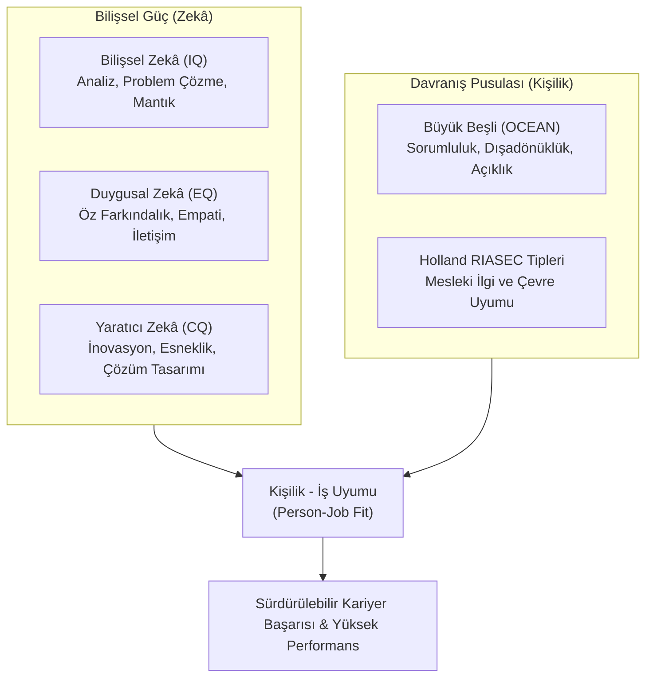
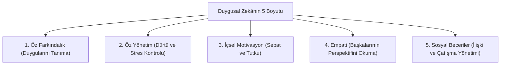
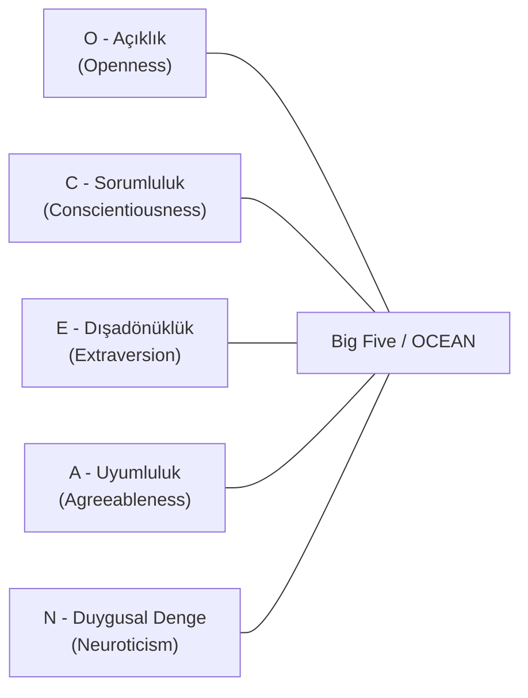

# Zekâ ve Kişilik: Kariyer Başarısında Potansiyel, Karakter ve Mesleki Uyum

Kariyer başarısı, salt yüksek bir akademik dereceye veya üstün bir bilişsel zekâya indirgenemeyecek kadar çok boyutlu bir dengedir. İş dünyasına adım atan profesyonellerin ilk gözlemlediği gerçeklerden biri; okul hayatında en karmaşık sınavları tam puanla geçen bazı bireylerin ilk kurumsal krizde çözümsüz kalması, buna karşılık ortalama akademik başarıya sahip ancak duygusal dayanıklılığı ve iletişim uyumu yüksek meslektaşlarının hızla liderlik pozisyonlarına yükselmesidir. Bu durum, kariyer performansının iki temel motoru olan **zekâ** ve **kişilik** dinamiklerinin doğru kavranmasını zorunlu kılar.

Metaforik bir yaklaşımla zekâ; bir otomobilin kaputunun altındaki motorun beygir gücüdür. Aracın ne kadar hızlı ivmelenebileceğini, zorlu yokuşları hangi süratle tırmanabileceğini belirler. Kişilik ise o otomobilin direksiyonudur; aracın hangi yöne sürüleceğini, virajlarda savrulup savrulmayacağını ve nihai menzile ulaşıp ulaşamayacağını tayin eder. Yüz beygir gücündeki bir araç doğru direksiyon hakimiyetiyle hedefine varırken, beş yüz beygir gücündeki bir yarış otomobili yanlış direksiyon kırıldığında ilk virajda şarampole yuvarlanabilir. Dolayısıyla kariyer inşasında başarı; yüksek bir potansiyele sahip olmak kadar, bu potansiyeli doğru bir karakter pusulasıyla iş ortamına entegre edebilme sanatıdır.


*Şekil 1: Bilişsel potansiyel ile kişilik dinamiklerinin kariyer başarısındaki kesişimi.*

---

## 1. Zekâ Nedir? Kapasite, Öğrenme ve Sonuç Üretme Gücü

Geleneksel psikolojide zekâ; bireyin soyut veya somut kavramlar arasındaki ilişkileri kavrama, mantıksal muhakeme yürütme ve edindiği bilgileri belirli bir amaca yönelik olarak kullanma kapasitesi olarak tanımlanır. Ancak iş dünyası ve kariyer yönetimi açısından zekâ; kafada depolanan ansiklopedik verilerin veya sertifikaların niceliği değildir. Zekânın iş hayatındaki reel karşılığı; **karşılaşılan yeni, karmaşık ve belirsiz bir problemi ne kadar sürede doğru analiz edip somut bir katma değere ve uygulanabilir sonuca dönüştürebildiğinizdir.**

Kariyer odaklı zekâ üç temel bileşenin etkileşimiyle işler:
1. **Öğrenme Hızı ve İçselleştirme:** Yeni bir yazılımı, piyasa regülasyonunu veya sektörel metodolojiyi başkalarının haftalarca zorlandığı yerde kısa sürede kavrayabilme yetisidir.
2. **Problem Çözme ve Sentez:** Eldeki eksik verilerle büyük resmi görebilme, karmaşık sistemlerde darboğazı izole edebilme ve mantıklı çıkarımlar yapabilme kapasitesidir.
3. **Çevresel Uyum (*Adaptability*):** Değişen pazar koşullarında veya beklenmeyen kriz anlarında eski ezberleri terk edip yeni duruma hızla intibak edebilme esnekliğidir.

Kuramların ortak paydası şudur: Zekânın genetik ve biyolojik bir altyapısı bulunmakla birlikte, bilişsel pratikler, kaliteli deneyimler ve entelektüel çevre ile yaşam boyu geliştirilebilir bir kapasitedir.

---

## 2. Kariyerde Üç Zekâ Formu: IQ, EQ ve CQ

Modern iş hayatında bireylerin başarısını belirleyen tek bir zekâ katsayısı yoktur. Farklı kariyer eşiklerinde farklı zekâ formları belirleyici hale gelir:

### 2.1. Bilişsel Zekâ (IQ - *Intelligence Quotient*)
Analitik düşünme, mantıksal akıl yürütme, matematiksel kavrayış ve bellek gücüdür. Kariyerin başlangıç aşamasında mülakatları geçmeyi, teknik sınavları başarmayı ve işin operasyonel kurallarını hızla kavramayı sağlar. IQ, kapıyı aralayan asgari teknik eşiktir. Ancak hiyerarşik basamaklarda yukarı çıkıldıkça herkesin teknik bilgisi birbirine yaklaştığından, IQ tek başına ayırt edici bir başarı faktörü olmaktan çıkar.

### 2.2. Duygusal Zekâ (EQ - *Emotional Quotient*)
Kişinin kendi duygularını tanıması, yönetmesi, başkalarının duygularını anlaması (empati) ve bu kavrayışı insan ilişkilerinde yapıcı bir iş birliğine dönüştürebilme gücüdür. Daniel Goleman'ın araştırmaları, iş dünyasında üst düzey yöneticileri ve fark yaratan liderleri ortalama çalışanlardan ayıran temel yetkinliklerin yüzde 85'inin duygusal zekâ kaynaklı olduğunu ortaya koymuştur. EQ, kariyer kapısından girdikten sonra o masada kalıcı olmayı ve ekibi krizlerden başarıyla çıkarmayı sağlar.


*Şekil 2: Daniel Goleman'ın kurumsal duygusal zekâ modeli.*

### 2.3. Yaratıcı ve Kültürel Zekâ (CQ - *Creative / Cultural Quotient*)
Mevcut prosedürlerin ve standart formüllerin tıkandığı kriz noktalarında kutunun dışında düşünebilme, sıra dışı bağlar kurabilme ve farklı kültürel arka planlardan gelen paydaşlarla ortak zemin yakalayabilme becerisidir. Yapay zekânın standart analizleri saniyeler içinde tamamladığı 21. yüzyıl pazarında, var olmayan bir ürünü veya süreci sıfırdan tasarlayan yaratıcı zekâ (CQ), en yüksek prim yapan kariyer çarpanıdır.

| Metrik | Ne İfade Eder? | Sahadaki Rolü | Eksikliğinde Ne Yaşanır? |
| :--- | :--- | :--- | :--- |
| **IQ (Bilişsel)** | "Bu problemi mantıksal olarak nasıl çözerim?" | İşe alım, teknik hesaplama, veri analizi ve operasyonel kalite. | İşi öğrenememe, yavaş kavrama, teknik hatalar. |
| **EQ (Duygusal)** | "Kendimi ve ekibimi kriz anında nasıl yönetirim?" | Takım çalışması, liderlik, müzakere ve kriz yönetimi. | Ekip içi çatışma, fevrilik, toksik iletişim, erken tükenmişlik. |
| **CQ (Yaratıcı)** | "Geleneksel yollar tıkandığında hangi yeni yolu açarım?" | İnovasyon, yeni iş modelleri, stratejik dönüşüm ve esneklik. | Monotonlaşma, rekabette geriye düşme, krizde tıkanma. |

---

## 3. Howard Gardner ve Çoklu Zekâ Kuramı

1983 yılında Harvard Üniversitesi profesörü Howard Gardner tarafından geliştirilen Çoklu Zekâ Kuramı (*Multiple Intelligences*), insan zihninin tek bir genel zekâ katsayısına (g faktörü) hapsedilemeyeceğini bilimsel olarak kanıtlamıştır. Bireyleri yalnızca sözel veya sayısal başarılarıyla değerlendirmek, balığı ağaca tırmanma becerisiyle yargılamaya benzer.

Gardner modelinin kariyer planlamasındaki pratik değeri; bireyin baskın bilişsel profilini keşfederek yanlış mesleklerde ömür boyu yetersizlik duygusu yaşamaktan kurtulmasını sağlamasıdır:

1. **Mantıksal - Matematiksel Zekâ:** Sayı kalıplarını, algoritmik ilişkileri ve neden-sonuç zincirlerini anlama gücü. *(İdeal Alanlar: Yazılım mimarisi, veri bilimi, finansal denetim, aktüerya, mühendislik).*
2. **Sözel - Dilsel Zekâ:** Kelimeleri etkili kullanma, karmaşık kavramları duru bir retorikle anlatma ve yazılı ikna becerisi. *(İdeal Alanlar: Hukuk, kurumsal iletişim, gazetecilik, reklam metin yazarlığı, diplomasi).*
3. **Görsel - Uzamsal Zekâ:** Üç boyutlu nesneleri zihinde canlandırma, mekan kurgulama ve görsel kalıpları okuma kabiliyeti. *(İdeal Alanlar: Mimarlık, endüstriyel ürün tasarımı, cerrahi, oyun motoru geliştiriciliği).*
4. **Bedensel - Kinestetik Zekâ:** Zihin ile beden koordinasyonunu milimetrik hassasiyetle yönetme, nesneleri manipüle etme ustalığı. *(İdeal Alanlar: Mikrocerrahi, robotik donanım montajı, fizyoterapi, profesyonel spor).*
5. **Müziksel - Ritmik Zekâ:** Ses tonlarını, ritimleri ve armonik sapmaları doğrudan ayırt etme yetisi. *(İdeal Alanlar: Ses mühendisliği, akustik tasarımı, medya prodüksiyonu).*
6. **Kişilerarası (Sosyal) Zekâ:** Başkalarının niyetlerini, motivasyonlarını ve gizli duygularını anlama, ikna ve uzlaşma sağlama gücü. *(İdeal Alanlar: Satış yönetimi, insan kaynakları, danışmanlık, kriz arabuluculuğu).*
7. **İçsel (Özedönük) Zekâ:** Kendi sınırlarını, zayıflıklarını ve hedeflerini derinlemesine bilme, yüksek öz-yönetim ve disiplin kapasitesi. *(İdeal Alanlar: Stratejik araştırmacılık, bağımsız girişimcilik, felsefe, bağımsız yazarlık).*
8. **Doğacı Zekâ:** Doğal sistemleri, ekosistem örüntülerini ve çevresel dinamikleri sınıflandırma yeteneği. *(İdeal Alanlar: Çevre ve sürdürülebilirlik yönetimi, biyoteknoloji, tarım teknolojileri).*

---

## 4. Kişilik Nedir? Davranış Pusulası ve Phineas Gage Olayı

Kişilik; bireyi diğerlerinden ayıran, zaman içinde ve farklı ortamlarda görece tutarlılık gösteren düşünce, duygu ve davranış kalıplarının dinamik bütünüdür. İş hayatında kişilik; denetim mekanizmalarının bulunmadığı, baskının tavan yaptığı ve zor kararların alınması gerektiği anlarda bireyin sergilediği doğal reaksiyondur.

Nörobilim ve örgütsel psikoloji tarihinin en çarpıcı vakalarından biri olan **Phineas Gage Olayı (1848)**, zekâ ile kişiliğin birbirinden bağımsız iki ayrı mekanizma olduğunu somutlaştırmıştır. Bir demiryolu işçisi olan Gage, geçirdiği iş kazasında kafatasından bir demir çubuğun geçmesi sonucu beyninin ön lobunda (prefrontal korteks) ağır hasar almıştır. Kazadan sonra Gage'in mantıksal hafızası, teknik bilgisi, konuşma becerisi ve IQ seviyesi tamamen korunmuştur. Ancak eskiden nazik, disiplinli, güvenilir ve uyumlu olan Gage; kaba, fevri, sorumsuz ve ekip çalışmasına tahammülsüz bir karaktere dönüşmüştür. Sonuç olarak eski teknik zekâsına rağmen hiçbir işverenin yanında tutunamamış ve iş hayatından tasfiye olmuştur. Bu tarihi vaka; kurumların teknik zekâyı işe aldığını, ancak kişiliği ve etik duruşu yönettiğini gösteren en somut derstir.

---

## 5. Büyük Beşli (Big Five / OCEAN) Kişilik Modeli

Psikoloji literatüründe geçerliliği ve güvenilirliği küresel ölçekte en yüksek kabul edilen kuram Beş Faktör Kişilik Modelidir (OCEAN). İş dünyasında "iyi" veya "kötü" kişilik yoktur; belirli bir görevin talepleriyle örtüşen ya da örtüşmeyen kişilik profilleri vardır.


*Şekil 3: Beş Faktör Kişilik Modelinin (OCEAN) temel boyutları.*

1. **Deneyime Açıklık (*Openness to Experience*):** Entelektüel merak, sanatsal duyarlılık, hayal gücü ve yeni fikirlere açıklık düzeyidir. Bu boyutu yüksek profesyoneller Ar-Ge, inovasyon, tasarım ve strateji rollerinde fark yaratır. Rutin ve katı bürokratik ortamlarda hızla mutsuz olurlar.
2. **Sorumluluk Bilinci (*Conscientiousness*):** Öz disiplin, organize çalışma, detaycılık, sebat ve başarı odaklılıktır. Akademik ve kurumsal başarının tüm sektörlerdeki en güçlü yordayıcısıdır. Finans, denetim, cerrahi ve proje yönetimi gibi sıfır hata toleranslı alanlar bu özelliği zorunlu kılar.
3. **Dışadönüklük (*Extraversion*):** Sosyal ortamlardan enerji alma, atılganlık, konuşkanlık ve hareketlilik düzeyidir. Dışadönükler satış, pazarlama, etkinlik yönetimi ve halkla ilişkilerde parlarken; içedönükler derin odaklanma gerektiren yazılım geliştirme, veri madenciliği ve laboratuvar araştırmalarında daha yüksek verim sunar.
4. **Uyumluluk (*Agreeableness*):** Güven, nezaket, iş birliğine açıklık ve uzlaşma arzusudur. Çatışmasız ekip çalışması, müşteri hizmetleri ve eğitim süreçlerinde aranan bir niteliktir. Ancak üst düzey stratejik müzakerelerde aşırı uyumluluk, adil olmayan şartlara boyun eğme riski doğurabilir.
5. **Duygusal Dengesizlik / Nörotisizm (*Neuroticism*):** Stres, kaygı, öfke ve kırılganlık eğilimidir. Nörotisizm puanı düşük olan profesyoneller (duygusal açıdan dengeli olanlar); kriz anlarında soğukkanlı kalabilen, acil servis hekimliği, kriz iletişimi veya yatırım bankacılığı gibi yüksek baskılı ortamlarda yıkılmayan profillerdir.

---

## 6. John Holland ve RIASEC Mesleki Kişilik Kuramı

Kariyer danışmanlığının en yaygın kullanılan sistemi, John Holland'ın geliştirdiği RIASEC modelidir. Holland'a göre meslek seçimi, bireyin kişiliğini dış dünyaya yansıtma çabasıdır. Bireyin kişilik tipi ile çalıştığı iş ortamının iklimi uyumlu olduğunda (*Person-Environment Fit*); iş tatmini, verimlilik ve kurumda kalıcılık en üst seviyeye çıkar.

```
                         [R] Gerçekçi (Realistic)
                               /        \
       [C] Geleneksel (Conventional)    [I] Araştırmacı (Investigative)
             |                                |
       [E] Girişimci (Enterprising)      [A] Sanatsal (Artistic)
                               \        /
                           [S] Sosyal (Social)
```
*Şekil 4: Holland'ın mesleki kişilik altıgeni (RIASEC).*

* **Gerçekçi (R - *Realistic*):** Nesnelerle, aletlerle, makinelerle ve fiziksel dünyayla çalışmaktan hoşlanır. Soyut teoriler yerine somut çıktılara odaklanır. *(Mühendislik, pilotluk, tarım teknolojileri, şantiye yönetimi).*
* **Araştırmacı (I - *Investigative*):** Bilimsel düşünme, veri analizi, soyut problemleri inceleme ve kuram geliştirme odaklıdır. Rutin işlerden kaçınır. *(Veri analisti, biyomedikal uzmanı, akademisyen, siber güvenlik araştırmacısı).*
* **Sanatsal (A - *Artistic*):** Kurallardan, katı mesai kalıplarından ve monotonluktan hoşlanmaz; özgünlük, estetik ve yaratıcı ifade arar. *(Kullanıcı deneyimi tasarımcısı, kreatif direktör, mimar, yazar).*
* **Sosyal (S - *Social*):** İnsanları dinleme, eğitme, iyileştirme ve toplumsal fayda üretme motivasyonu baskındır. Maddi getiriden çok insani temas arar. *(Klinik psikolog, eğitmen, insan kaynakları danışmanı, sosyal hizmet uzmanı).*
* **Girişimci (E - *Enterprising*):** İnsanları yönlendirme, ikna etme, risk alma, liderlik yapma ve maddi/örgütsel başarı elde etme arzusundadır. *(Start-up kurucusu, portföy yöneticisi, pazarlama direktörü, siyaset bilimci).*
* **Geleneksel (C - *Conventional*):** Belirlenmiş kurallara, dosyalama sistemlerine, veri tabanlarına ve hiyerarşik düzene sıkı sıkıya bağlıdır. Belirsizlikten hoşlanmaz. *(Mali müşavir, veri tabanı yöneticisi, kalite kontrol denetçisi, aktüer).*

---

## 7. Kişilik-İş Uyumsuzluğunun Maliyeti ve Peter İlkesi

Bireyin yetkinliği ile çalıştığı koltuğun kişilik talepleri örtüşmediğinde, hem çalışan hem de organizasyon ağır bir fatura öder. Yüksek bir maaş ya da unvan, yanlış kişilik eşleşmesinin yarattığı tükenmişliği (burnout) telafi edemez.

İş dünyasında en sık rastlanan yönetimsel hatalardan biri, Laurence J. Peter tarafından tanımlanan **Peter İlkesi (*Peter Principle*)** mekanizmasıdır. Bu kurama göre çalışanlar, başarılı oldukları işlerde sürekli dikey olarak terfi ettirilir ve en sonunda *yetersiz ve başarısız oldukları ilk yönetim basamağında* takılıp kalırlar.

* **Örnek Vaka:** Bir yazılım şirketinde tek başına kod yazarken olağanüstü performans sergileyen içedönük ve analitik bir mühendis (I-C tipi), 'ödül' olarak takım liderliğine terfi ettirilir. Takım liderliği ise kod yazmayı değil; gün boyu insanlarla müzakere etmeyi, çatışma çözmeyi ve diplomasi yürütmeyi (E-S tipi) gerektirir. Birey yönetsel kişiliğe sahip olmadığı için hem yazılım üretiminden kopar hem de ekibi yönetemeyerek derin bir depresyona girer. Şirket ise en iyi mühendisini kaybedip kötü bir yönetici kazanmış olur.

Kariyer yolculuğunda başarının altın anahtarı; başkalarının alkışladığı popüler unvanlara körü körüne koşmak değil; kendi zekâ türünüzü ve kişilik pusulanızı dürüstçe analiz ederek sizin doğanızla rezonansa giren doğru koltuğu inşa etmektir.
