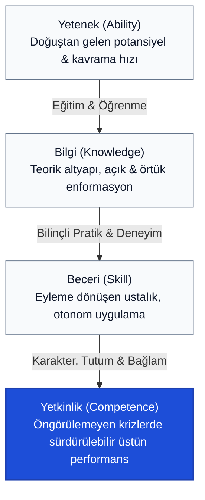
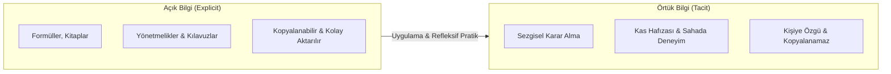
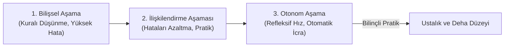
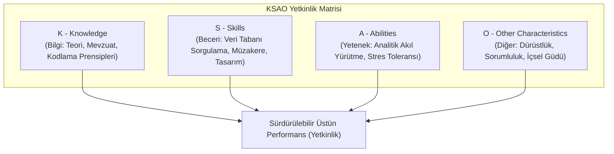
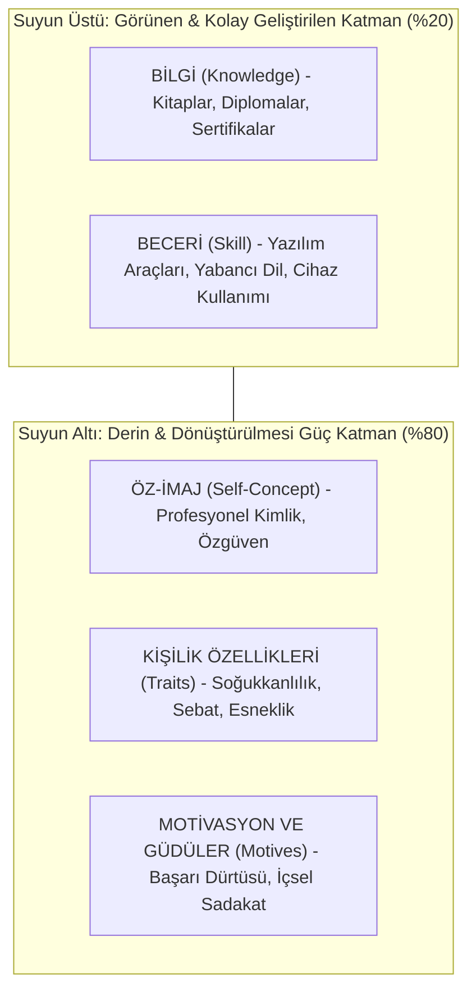
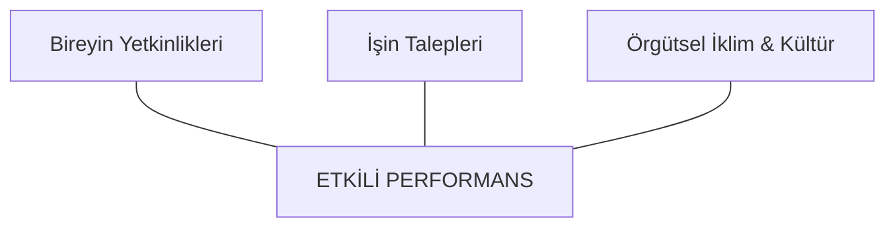
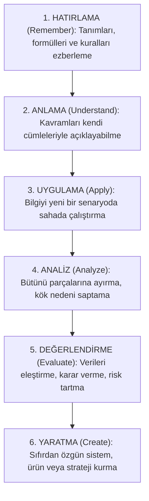
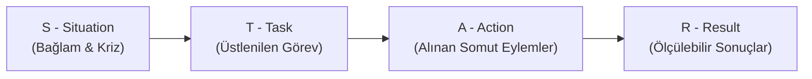
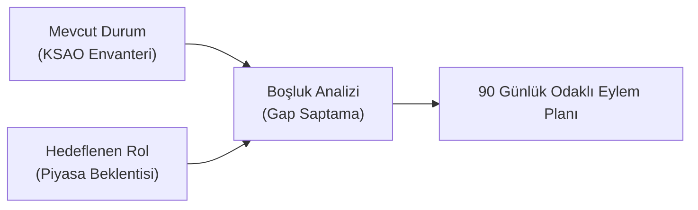

# Bilgi, Beceri, Yetenek ve Yetkinlik: Kariyer Sermayesinin Dört Temel Sütunu

İş dünyasında bireylerin profesyonel değeri sıklıkla birbiri yerine kullanılan dört kavram üzerinden tanımlanır: **Bilgi**, **Beceri**, **Yetenek** ve **Yetkinlik**. Günlük dilde eşanlamlı gibi algılanan bu kavramlar, gerçekte insan sermayesinin ve kurumsal başarının birbirinden tamamen farklı katmanlarını temsil eder. 

Bir hekim düşünelim: Tıp fakültesinden birincilikle mezun olup tüm cerrahi anatomi kitaplarını ezbere bilmesi **bilgi**dir. Yüzlerce saatlik laboratuvar ve operasyon simülasyonlarıyla neşteri titretmeden kesi atabilmesi **beceri**dir. Parmaklarının doğuştan gelen mikroskobik motor hassasiyeti ve üç boyutlu uzamsal algılama hızı **yetenek**tir. Ancak ameliyat esnasında ana arter patladığında, hastanın tansiyonu sıfıra yaklaşırken paniklemeden ekibi koordine etmesi, saniyeler içinde kanamayı durduracak doğru baypas kararını alması ve hastayı hayatta tutması **yetkinlik**tir.

2009 yılında US Airways'in 1549 sefer sayılı uçağı kalkıştan kısa süre sonra kuş sürüsüne çarparak iki motorunu birden kaybettiğinde, Kaptan Chesley Sullenberger'in uçağı Hudson Nehri'ne güvenle indirmesi bir şans eseri değildi. Kırk yıllık aerodinamik teorisi (*bilgi*), binlerce saatlik simülatör ve kokpit pratiği (*beceri*), baskı anındaki fizyolojik soğukkanlılığı (*yetenek/tutum*) ve tüm mürettebat ile yolcuları üç buçuk dakikada organize eden kriz liderliği (*yetkinlik*) kusursuz bir bileşim oluşturmuştu.

Kariyer basamaklarında yükselmek yalnızca açık bilgi depolamakla mümkün değildir; iş dünyası diplomaya giriş bileti verir, beceriye maaş öder, yeteneği takdir eder, ancak yalnızca yetkinliğe terfi ve stratejik sorumluluk verir.

*Şekil 1: Potansiyelden yüksek performansa uzanan kariyer sermayesi hiyerarşisi.*

---

## 1. Dört Temel Kavramın Analitik Ayrımı

Profesyonel gelişim tıkanıklıklarının temel nedeni, bireylerin hangi basamakta eksik olduklarını doğru teşhis edememeleridir. Bu dört kavram, yanıtladıkları temel sorular ve sahadaki görünümleriyle net çizgilerle ayrılır:

| Kavram | Temel Soru | Tanım ve Mahiyet | Örnek Durum (Yazılım Mühendisliği) |
| :--- | :--- | :--- | :--- |
| **Bilgi** (*Knowledge*) | *Ne biliyorum?* | Eğitim, araştırma ve deneyimle edinilen enformasyon ve kavramsal çerçeveler bütünü. | Python veya Go dilinin sözdizimini, veri yapılarını ve bellek yönetim kurallarını bilmek. |
| **Beceri** (*Skill*) | *Ne yapabiliyorum?* | Bilginin fiziksel veya zihinsel tekrarlarla akıcı, hatasız bir eyleme dönüştürülmüş hali. | Hatasız çalışan, testleri yazılmış bir mikroservis API mimarisi kodlayabilmek. |
| **Yetenek** (*Ability*) | *Neye yatkınım?* | Bireyin genetik, nörolojik ve biyolojik donanımıyla gelen öğrenme hızı ve doğal yatkınlık. | Karmaşık soyut mimari problemleri ve mantıksal boşlukları başkalarından çok daha hızlı sezebilmek. |
| **Yetkinlik** (*Competence*) | *Nasıl sonuç alıyorum?* | Bilgi, beceri, yetenek ve motivasyonun belirli bir bağlamda üstün iş sonucuna dönüştürülmesi. | Müşterinin eksik tarif ettiği gereksinimleri analiz edip, bütçe kısıtında ekiple birlikte teslim ederek şirkete maliyet avantajı sağlamak. |

---

## 2. Bilginin Mimarisi: Açık Bilgi ve Örtük Bilgi

Bilgi, profesyonel yapının zeminidir; ancak her bilgi aynı nitelikte değildir. Bilgi kuramcısı Michael Polanyi, 1966 yılında ortaya koyduğu *"Söylediğimizden çok daha fazlasını biliriz"* teziyle bilgiyi iki temel kategoriye ayırmıştır:

### 2.1. Açık Bilgi (*Explicit Knowledge*)
Kodlanabilen, yazılabilen, kitaplara, kılavuzlara veya veri tabanlarına aktarılabilen bilgidir. Formüller, teknik şartnameler, hukuk kuralları ve yazılım dokümantasyonu açık bilgiye örnektir. İnternet ve üretken yapay zekâ sistemleri açık bilgiye erişimi demokratikleştirmiş ve marjinal maliyetini sıfıra yaklaştırmıştır. Bu nedenle günümüz iş dünyasında tek başına açık bilgiye sahip olmak rekabetçi bir avantaj sağlamaz.

### 2.2. Örtük Bilgi (*Tacit Knowledge*)
Deneyim yoluyla kazanılan, kişiye özgü, kelimelere veya kurallara dökülmesi son derece güç olan sezgisel bilgidir. Polanyi, örtük bilgiyi bisiklet sürme analojisiyle açıklar: Hiç kimseye *"Pedala 15 Newtonluk kuvvet uygula ve yerçekimi merkezini 7 derece eğ"* denilerek bisiklet sürmesi öğretilemez. Birey düşme refleksleri, denge hissi ve kas hafızası aracılığıyla bu bilgiyi bedenselleştirir.

İş hayatında kıdemli bir mühendisin bir motorun sesinden arızanın kaynağını kestirmesi, bir cerrahın dokuya dokunduğunda tümörün sınırını hissetmesi veya başarılı bir müzakerecinin masadaki sessizlikten karşı tarafın geri adım atacağını anlaması örtük bilginin somut yansımalarıdır.

*Şekil 2: Açık bilgiden tecrübeyle kopyalanamaz örtük bilgiye dönüşüm süreci.*

> **Tarihsel Örnek: Henry Ford ve Bilgi-Yetkinlik Davası**  
> 1919 yılında Chicago Tribune gazetesi Henry Ford'u "cahil bir sanayici" olmakla itham ettiğinde Ford gazeteye hakaret davası açtı. Mahkemede gazete avukatları Ford'a Amerikan Bağımsızlık Savaşı'nın tarihleri ve fen bilimleriyle ilgili ezber sorular sormaya başladı. Ford, avukata dönerek şu tarihi yanıtı verdi:  
> *"Masamda sıralanmış elektrikli düğmeler var. İhtiyacım olduğunda ilgili düğmeye basarım; sorduğunuz bu ezber soruların cevabını saniyeler içinde masama getirecek onlarca uzmanım gelir. Benim görevim zihnimi ansiklopedik çöplüğe dönüştürmek değil; bu bilgileri organize edip otomobile dönüştürecek yetkinliği yönetmektir."*

---

## 3. Becerinin Gelişim Aşamaları ve Bilinçli Pratik (*Deliberate Practice*)

Beceri, zihindeki bilginin eyleme ve kas sistemine entegre olmasıdır. Paul Fitts ve Michael Posner'ın (1967) motor beceri edinim modeli, her profesyonel becerinin üç aşamadan geçtiğini gösterir:

1. **Bilişsel Aşama (*Cognitive Stage*):** Birey eylemin her bir kuralını zihninde bilinçli olarak düşünür. Hata oranı yüksektir, hareketler tutuktur. Örneğin araba kullanmayı yeni öğrenen birinin debriyaja basarken vites topuzuna bakması ve yola odaklanamaması bu aşamadır.
2. **İlişkilendirme Aşaması (*Associative Stage*):** Hatalar azalır, eylemler birbiriyle bağlantılanır. Birey dış uyaranlara daha açık hale gelir ancak yine de odaklanma gereksinimi duyar.
3. **Otonom Aşama (*Autonomous Stage*):** Beceri bilinçdışı otomatikleşir. Birey bilişsel kapasitesini eylemin kendisine değil, stratejik bağlama ayırabilir. Usta bir sürücünün virajları alırken müzik dinleyip yanındakiyle sohbet edebilmesi bu aşamadır.

*Şekil 3: Becerinin bilişsel safhadan otonom refleks aşamasına ilerleyişi.*

### 3.1. 10.000 Saat Yanılgısı ve Anders Ericsson
Popüler kültürde Malcolm Gladwell tarafından yaygınlaştırılan *"Herhangi bir işte 10.000 saat geçiren herkes uzman olur"* miti, psikolog K. Anders Ericsson tarafından çürütülmüştür. Ericsson, otuz yıl boyunca her pazar golf oynayan amatör bir sporcunun neden hiçbir zaman profesyonelleşemediğini incelemiştir. 

Amatörler bildikleri ve keyif aldıkları eylemleri tekrarlar; buna **rutin tekrar** denir. Gerçek ustalık ise **Bilinçli Pratik (*Deliberate Practice*)** ile kazanılır:
* **Konfor Alanının Dışında Çalışma:** Birey yalnızca en zayıf olduğu, hata yaptığı alt adımlara odaklanır.
* **Anlık ve Kesintisiz Geri Bildirim:** Bir uzman gözetiminde her hamlenin sapması ölçülür ve anında düzeltilir.
* **Yüksek Zihinsel Odaklanma:** Mekanik bir tekrar değil, her denemede bilişsel sınırların zorlandığı yorucu bir süreçtir.

---

## 4. Yetenek ve Potansiyel: Doğuştan Gelen Çarpan

Yetenek; bireyin genetik altyapısı, sinir sistemi gelişimi ve erken çocukluk çevresiyle şekillenen doğal öğrenme hızıdır. Bir alanda yetenekli olmak, o konudaki beceriyi başkalarının elli saatte edindiği bir eşikte on saatte kavrayabilme ayrıcalığı sağlar.

Ancak iş dünyasında en yaygın yanılgılardan biri, tek başına yeteneğe güvenmektir:

$$\text{Başarı} = \text{Yetenek} \times \text{Çaba}^2$$

Psikolog Angela Duckworth'ün araştırmaları, yeteneğin öğrenme hızını artıran bir çarpan olduğunu; ancak çaba ve disiplin olmadan bu çarpanın sıfırla çarpıldığını kanıtlar. Sahada en çok rastlanan hayal kırıklığı "yetenekli tembel" profilidir. Kolay öğrendiği için erken dönemde başarı kazanan yetenekli bireyler, karmaşıklaşan profesyonel hayatın ilk direnç noktasında pes etme eğilimindedir.

Kurumsal dünyada **çalışkan ve disiplinli bir vasat**, **çalışmayan bir dâhiyi** her zaman geride bırakır.

> **Saha Örneği: Kobe Bryant ve 04:00 Disiplini**  
> Basketbol tarihinin en yetenekli oyuncularından Kobe Bryant'a takım arkadaşları neden her sabah 04:00'te antrenmana başladığını sorduğunda yanıtı nettir:  
> *"Eğer ben antrenmana 04:00'te başlarsam günde dört ayrı çalışma seansı yapabilirim. Rakiplerim 09:00'da uyanırsa günde iki seans yapabilir. Yıl boyunca biriken bu antrenman farkını, onların hiçbir yeteneği beş yıl sonra kapatamaz."*

---

## 5. Yetkinliğin Anatomisi: KSAO Modeli ve Buzdağı Mimarisi

Yetkinlik (*competence*), bir işi yalnızca yapmak değil; değişken, belirsiz ve stresli koşullarda **tutarlı bir biçimde üstün performans üretebilmektir**. Modern endüstri ve örgüt psikolojisi yetkinliği iki temel kuramsal çerçeve ile çözümler.

### 5.1. KSAO Modeli
Uluslararası işe alım ve yetenek yönetiminde pozisyon profilleri KSAO mimarisiyle kodlanır:
* **K (Knowledge - Bilgi):** İşe dair prosedürel ve kavramsal donanım.
* **S (Skills - Beceriler):** Araçları ve teknikleri kullanabilme kabiliyeti.
* **A (Abilities - Yetenekler):** Problem çözme, analitik muhakeme ve bilişsel kapasite.
* **O (Other Characteristics - Diğer Özellikler):** İş ahlakı, duygusal dayanıklılık, değerler, inisiyatif alma ve mesleki tutum.

İşe alımlarda başarısızlıkların büyük bölümü, adayların K ve S boyutlarına bakılarak seçilip; O (tutum ve karakter) boyutundaki uyumsuzluklar nedeniyle işten çıkarılmasıyla sonuçlanır.

*Şekil 4: Endüstriyel psikolojide KSAO yetkinlik bileşenleri.*

### 5.2. Spencer & Spencer Yetkinlik Buzdağı Modeli (*Iceberg Model*)
Lyle Spencer ve Signe Spencer (1993), yetkinlikleri bir buzdağına benzetmiştir:

*Şekil 5: Spencer & Spencer Yetkinlik Buzdağı Modeli.*

* **Suyun Üstü (Teknik Katman):** Bilgi ve becerilerdir. Özgeçmişlerde açıkça yazılır, mülakatlarda test edilebilir ve eğitim programlarıyla kısa sürede (3 ila 6 ay) kazandırılabilir.
* **Suyun Altı (Davranışsal ve Karakter Katmanı):** Öz-imaj, kişilik özellikleri ve içsel güdülerdir. Bir bireye Python öğretmek birkaç ay sürer; ancak dürüstlük, kriz anında sorumluluktan kaçmama veya öğrenmeye duyulan açlık gibi buzdağının altındaki nitelikleri kısa eğitimlerle kazandırmak mümkün değildir.

> **Tarihsel Dönüm Noktası: McClelland ve ABD Dışişleri Bakanlığı Araştırması**  
> 1970'li yıllarda ABD Dışişleri Bakanlığı, diplomat seçiminde en yüksek genel kültür ve yabancı dil sınav puanı alan adayların saha görevlerinde başarısız olduğunu ve diplomatik krizlere yol açtığını fark etti. Harvard psikoloğu David McClelland'a başvuruldu.  
> McClelland'ın saha araştırması çarpıcıydı: En başarılı diplomatlar en yüksek sınav puanını alanlar değil; yabancı bir kültürün beden dilini doğru okuyabilen (*empati*), baskı altında öfkesini yönetebilen (*özdenetim*) ve belirsiz koşullarda inisiyatif alabilen diplomatlardı. Bu araştırma, diplomaya dayalı işe alım yerine **Yetkinlik Bazlı İşe Alım (*Competency-Based Recruitment*)** devrimini başlattı.

---

## 6. Richard Boyatzis: Etkili Performans Kesişimi

Yetkinlikler boşlukta var olamaz. Richard Boyatzis (1982), bir yetkinliğin fiilen üstün performansa dönüşebilmesi için üç halkanın kesişim noktasında yer alması gerektiğini savunur:

1. **Bireyin Yetkinlikleri:** Bireyin sahip olduğu bilgi, beceri, yetenek ve değerler.
2. **Rolün / İşin Talepleri:** Pozisyonun gerektirdiği spesifik sorumluluklar ve hedefler.
3. **Örgütsel İklim ve Kültür:** Kurumun çalışma tarzı, bürokrasi seviyesi, risk toleransı ve değerleri.

*Şekil 6: Boyatzis'in Etkili Performans Modeli kesişim kümesi.*

Eğer bir yazılımcı olağanüstü yenilikçi ve hızlı inisiyatif alan bir yapıya sahipse (bireysel yetkinlik), ancak çalıştığı kurum her kararın beş imza komisyonundan geçtiği aşırı bürokratik bir kamu organıysa (örgütsel iklim); birey ne kadar yetkin olursa olsun üstün performans üretemez. Bu durum bireyde **tükenmişlik (*burnout*)**, kurumda ise çatışma yaratır.

---

## 7. Sert Beceriler (*Hard Skills*) ve İnce Beceriler (*Soft Skills*)

İş yaşamında beceriler geleneksel olarak iki ana grupta ele alınır:

| Karşılaştırma Boyutu | Sert Beceriler (*Hard Skills*) | İnce Beceriler (*Soft Skills*) |
| :--- | :--- | :--- |
| **Tanım** | Öğrenilebilir, kural tabanlı, ölçülebilir teknik uzmanlıklar. | İnsanlar arası etkileşimi, iletişimi ve duygusal zekâyı yöneten beceriler. |
| **Örnekler** | SQL, finansal modelleme, CAD çizimi, yabancı dil, dikiş atma. | Aktif dinleme, müzakere, çatışma yönetimi, ikna, empati. |
| **Ölçülebilirlik** | Sertifikalar, teknik sınavlar ve kod testleri ile nesnel ölçüm. | Davranışsal mülakatlar, 360 derece geri bildirim ve simülasyonlar. |
| **Yarılanma Ömrü** | Hızlı tükenir (teknolojik döngüye göre ortalama 2-5 yıl). | Kalıcıdır ve kariyer boyu değerini artırarak korur. |
| **Kariyerdeki Rolü** | Mülakat masasına davet edilmeyi (kapıyı açmayı) sağlar. | Masada kalmayı, terfi almayı ve liderlik etmeyi sağlar. |

### Google Aristotle Projesi (*Project Aristotle*)
Google, yüzlerce mühendislik ekibini yıllarca analiz ederek *"En başarılı ekipleri neyin farklı kıldığını"* araştırdı. İlk hipotez; en iyi kod yazan, en yüksek IQ'lu mühendislerin toplandığı ekiplerin en başarılı olacağı yönündeydi.

Sonuçlar beklentileri altüst etti: En yüksek performans gösteren ekipler, üyelerinin teknik olarak birbirine üstünlük kurduğu değil; **Psikolojik Güvenlik (*Psychological Safety*)** ortamının sağlandığı ekiplerdi. Yani üyelerin birbirini yargılamadan dinlediği, soru sormaktan veya hata yapmaktan korkmadığı (*soft skill*) ekipler, en zeki mühendislerin çalıştığı ancak birbirini dinlemediği teknik ekipleri geride bıraktı.

---

## 8. Bilişsel Derinleşme: Bloom Taksonomisi ve Kariyer Basamakları

Benjamin Bloom ve ekibinin bilişsel öğrenme taksonomisi (Lorin Anderson ve David Krathwohl revizyonu), bir profesyonelin bilgiyle kurduğu ilişkinin derinliğini gösterir:

*Şekil 7: Bloom Taksonomisi'nin operasyonel basamaklardan stratejik değere uzanışı.*

* **Hatırlama ve Anlama:** Üniversite sınavlarının ve teorik derslerin ölçtüğü seviyedir. Bir pazarlamacının *"SEO'nun açılımını ve algoritma terimlerini bilmesi"* bu düzeydedir.
* **Uygulama:** Standart araçları talimatlara uygun çalıştırmaktır. *"Arama motoru optimizasyonu aracında anahtar kelime analizi çalıştırmak"* uygulamadır.
* **Analiz ve Değerlendirme:** Trafik düştüğünde krizin nereden kaynaklandığını hipotezlerle sınamak, rakip hamlelerini analiz edip stratejik karar almaktır.
* **Yaratma:** James Dyson'ın hava akımı formüllerini ezberlemekle kalmayıp, 5.126 başarısız prototipin ardından siklonik süpürge teknolojisini sıfırdan inşa etmesi Bloom taksonomisinin zirvesidir (*Yaratma*). İş dünyasında en yüksek çarpan, piramidin üst üç basamağında üretilir.

---

## 9. Yetkinliklerin Sahada Doğrulanması: STAR Metodolojisi

Mülakatlarda veya terfi değerlendirmelerinde *"Ben kriz anında çok soğukkanlıyımdır"* demek bir iddiadır; bunu kanıtlamak ise davranışsal bir metodoloji gerektirir. Küresel ölçekte kabul gören en güçlü doğrulama aracı **STAR Metodolojisi**dir:

*Şekil 8: Davranışsal mülakat ve yetkinlik doğrulama döngüsü.*

1. **S - Situation (Durum):** Olayın geçtiği bağlam, karşılaşılan kriz veya kısıtlar.
2. **T - Task (Görev):** Bu kriz ortamında adayın üzerine düşen spesifik sorumluluk.
3. **A - Action (Eylem):** Başkalarının değil, *adayın bizzat attığı somut adımlar*. Hangi analitik yöntemler kullanıldı, paydaşlar nasıl ikna edildi?
4. **R - Result (Sonuç):** Sürecin sonunda elde edilen ölçülebilir, sayısal çıktı ve öğrenilen dersler.

> **Amazon'un Bar Raiser Mekanizması**  
> Amazon işe alım süreçlerinde adayın gelecekteki yöneticisinin yanı sıra bağımsız bir kıdemli çalışan (*Bar Raiser*) görevlendirilir. Bar Raiser'ın tek görevi, adayın anlattığı başarı hikayelerindeki soyut ifadeleri STAR tekniğiyle deşmektir. Aday *"Biz sistemi çok iyi kurduk"* dediğinde Bar Raiser müdahale eder: *"Siz ekip olarak ne yaptınız değil; bizzat sen (A - Action) hangi satır kodu yazdın, hangi risk analizini yaptın ve bunun maliyete etkisi (R - Result) ne oldu?"* Aday eylemini ve sonucunu sayısallaştıramazsa teknik bilgisi ne olursa olsun elenir.

---

## 10. Bilen ile Sahada Çözen Arasındaki Ayrım: Charles Steinmetz Vakası

General Electric tesislerinde kurulu devasa jeneratör sistemi arızalandığında şirket içi mühendisler haftalarca çalışmasına rağmen sorunu bulamaz. Üretim durur ve fabrika günlük devasa kayıplar yaşar. Son çare olarak elektrik mühendisliğinin dâhisi Charles Steinmetz fabrikaya davet edilir.

Steinmetz iki gün boyunca jeneratörün etrafında dolaşır, dinler, notlar alır ve titreşimleri ölçer. İkinci günün sonunda cebinden bir parça tebeşir çıkarır, jeneratörün gövdesine tırmanır ve metal yüzeye büyük bir **X** işareti çizer. Yöneticilere dönerek: *"Bu noktadaki muhafazayı sökün ve altındaki armatür sargısından tam on altı tur teli kesin"* der. Mühendisler talimatı uygular ve jeneratör kusursuz biçimde yeniden çalışmaya başlar.

Birkaç gün sonra General Electric yönetimine Steinmetz'den **10.000 dolarlık** bir danışmanlık faturası gelir. O dönemde bu rakam bir servettir. GE muhasebesi faturaya itiraz eder ve detaylandırılmasını talep eder. Steinmetz revize faturayı tek bir cümleyle geri gönderir:

* *Jeneratörün üzerine tebeşirle bir çizgi çekmek:* **1 Dolar**
* *O çizgiyi nereye çekeceğini tam olarak bilmek:* **9.999 Dolar**
* *Toplam:* **10.000 Dolar**

Bu vaka, bilgi ile yetkinlik arasındaki farkın felsefi özetidir. Tebeşir çekme eylemi sıradan bir beceridir; ancak teorik bilgi, sezgi, saha tecrübesi ve teşhis kabiliyetini birleştirerek arızayı tek noktada çözebilmek gerçek yetkinliktir.

---

## 11. Yetkinlik Boşluğu Analizi (*Skill Gap Analysis*) ve T-Tipi Uzmanlık

Profesyonel hayatta hedefe ulaşmak, rastgele eğitim veya sertifika biriktirmekle değil; sistematik bir açık analiziyle mümkündür.

*Şekil 9: Yetkinlik Boşluğu Analizi (Skill Gap Analysis) mekanizması.*

1. **Piyasa İhtiyacının Taranması:** Hedeflenen pozisyon için (örneğin Kıdemli Veri Mimarı) yayınlanmış en az 25 güncel küresel iş ilanı taranır. İlanlardaki ortak kavramlar (SQL, Kafka, AWS, paydaş yönetimi) frekanslarına göre listelenir.
2. **Kişisel KSAO Eşleştirmesi:** Birey kendi mevcut envanterini dürüstçe masaya yatırır. Hangi araçları yalnızca teorik olarak biliyor, hangilerini üretim ortamında uyguladı?
3. **Boşluğun (*Gap*) İzolasyonu:** Kritik eksiklikler tespit edilir.
4. **Odaklı Eylem:** Boşluğu kapatacak 90 günlük somut bir çıktı hedefi konulur (örneğin sadece video izlemek değil, GitHub'da çalışan bir veri pipeline projesi yayınlamak).

### T-Tipi Profesyonel Modeli (*T-Shaped Professional*)
Modern iş dünyasının en çok aradığı profil T-Tipi uzmandır:
* **Dikey Çubuk (Derinlik):** Bireyin en az bir alanda dünyadaki en güncel standartlara hakim olacak kadar derin teknik bilgi ve sert beceriye (*Hard Skill*) sahip olmasıdır.
* **Yatay Çubuk (Genişlik):** Farklı disiplinlerle (hukuk, tasarım, finans, psikoloji) konuşabilme, empati kurabilme ve projeleri ortak paydada yönetebilme yeteneğidir (*Soft Skill*).

Yalnızca dikey çubuğa sahip olanlar dar bir alanda sıkışırken; yalnızca yatay çubuğa sahip olanlar hiçbir konuda somut değer üretemeyen yüzeysel genelciler olarak kalır.

---

## 12. Mühendislik ve Kariyer Karar Matrisi

| Bileşen | Odak Noktası | Tipik İfade Şekli | Kritik Hata Tuzağı | Sürdürülebilir Çözüm |
| :--- | :--- | :--- | :--- | :--- |
| **Bilgi** | Kavramsal Çerçeve | *"Bunun teorisini ve algoritmik mantığını biliyorum."* | Formülleri ezberleyip sahada uygulayamamak. | Bilgiyi anında küçük projelere aktarmak. |
| **Beceri** | Pratik Yetkinlik | *"Bu aracı kullanarak sistemi çalıştırabilirim."* | Rutin tekrarlarla yetinip bilinçli pratik yapmamak. | Konfor alanını terk ederek zorlu senaryolarda çalışmak. |
| **Yetenek** | Doğal Yatkınlık | *"Bu alandaki mantığı çok çabuk kavrayabiliyorum."* | Yeteneğe güvenip disiplinsiz ve sebat etmeden çalışmak. | Yeteneği katı çalışma etiğiyle desteklemek. |
| **Yetkinlik** | Nihai Sonuç | *"Değişen kriz koşullarında bu ekiple hedefi yakaladım."* | Süreci yönetemeden sadece şansa bel bağlamak. | STAR metodolojisiyle ölçülebilir başarılar inşa etmek. |

---

## Sonuç

Kariyer inşası, rastgele edinilmiş diplomalar veya ezberlenmiş teknik araçlar listesi değildir; bilginin beceriye, yeteneğin disiplinli pratikle ustalığa ve nihayetinde tüm bu bileşenlerin kriz koşullarında ölçülebilir bir değere dönüştürülme sanatıdır.

Kendi kariyer sermayesini yöneten bir profesyonel; suyun üstündeki açık bilgileri sürekli güncellerken, asıl farkı yaratan buzdağının altındaki tutum, etik, dayanıklılık ve iş birliği yetkinliklerini bir ömür boyu bilinçli bir çabayla inşa eder. Sullenberger'i uçağı nehre indiren, Steinmetz'e tebeşir çizgisini doğru yere çektiren şey tesadüf değildir; o çizgi, bilgiyle başlayıp sahada yoğrulan yetkinliğin ta kendisidir.
