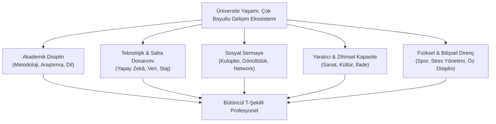
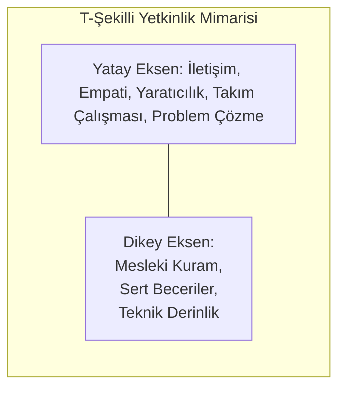
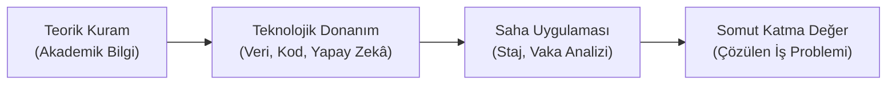
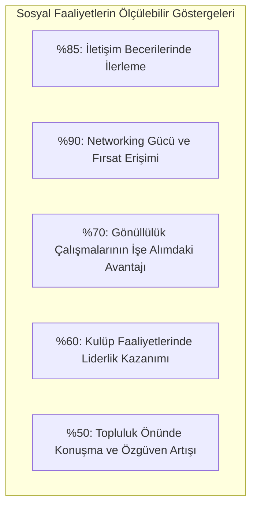
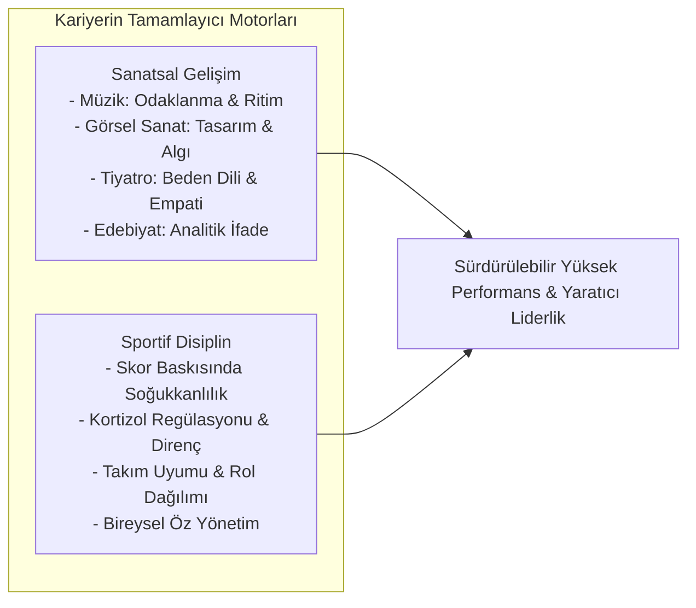
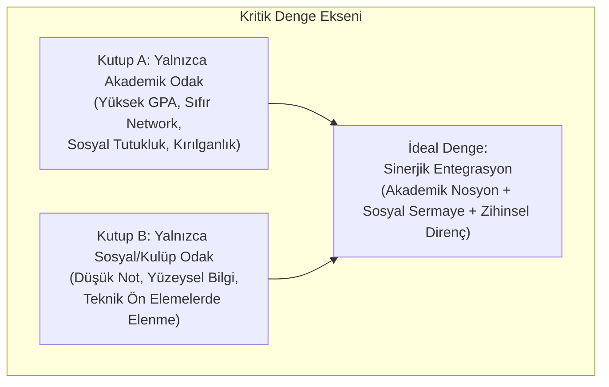
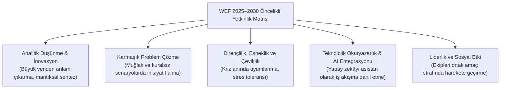
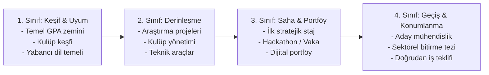

# Kariyerime Nasıl Hazırlanırım: Üniversite Yaşamında Bütüncül Yetkinlik İnşası

Üniversite eğitimi, bireyin yalnızca teorik sınavları geçerek bir diploma edindiği biçimsel bir dönem değildir. Günümüzün hızla değişen küresel iş gücü piyasasında diploma, iş arama sürecinde kapıyı aralamak için asgari bir ön koşul işlevi görür; ancak o kapıdan içeri girmeyi ve orada sürdürülebilir bir değer üretmeyi sağlayan asıl unsur, lisans yılları boyunca inşa edilen çok boyutlu yetkinlik sermayesidir.

Kariyer hazırlığı, mezuniyet gününün ertesinde iş ilanlarına özgeçmiş göndermekle başlayan ani bir eylem değildir. Üniversiteye adım atılan ilk günden itibaren akademik disiplin, sosyal ilişkiler, teknolojik donanım, sanatsal duyarlılık ve bedensel dayanıklılık ekseninde yürütülen uzun vadeli bir kişisel inşa sürecidir. Bu sürecin doğru yönetilmesi, salt ders başarısına sıkışmış ya da yalnızca sosyal aktivitelere odaklanarak akademik temelini zayıflatmış tek boyutlu bireyler yerine; hem derin teknik uzmanlığa hem de güçlü insani becerilere sahip çok yönlü profesyonellerin yetişmesini sağlar.

*Şekil 1: Üniversite ekosisteminde bütüncül kariyer inşasını oluşturan temel boyutlar.*

---

## 1. Yetkinlik Mimarisi: I-Tipi Uzmanlıktan T-Şekilli ve Pi-Şekilli Profile

Geleneksel iş gücü piyasasında bireylerden yalnızca belirli bir teknik fonksiyonda (örneğin yalnızca mekanik hesaplama veya muhasebe kaydı tutma) uzmanlaşması beklenmekteydi. Bu durum, yalnızca tek bir dikey sütuna sahip olan **I-tipi profesyonel** modelini doğurmaktaydı. Ancak yapay zekâ, otomasyon ve disiplinlerarası çalışma biçimlerinin yükselişi, tek boyutlu uzmanlığın sınırlarını belirginleştirmiştir.

Modern organizasyonlar, **T-şekilli profil** (*T-shaped professional*) olarak tanımlanan yetkinlik mimarisini talep etmektedir:

- **Dikey Eksen (Derin Teknik Uzmanlık):** Bireyin kendi ana disiplinindeki teorik sağlamlığı, araştırma kabiliyeti ve mesleki araçları kullanma becerisidir. Mühendislik analitiği, hukuk nosyonu, veri modelleme veya yazılım mimarisi bu eksende yer alır.
- **Yatay Eksen (Geniş İnsani ve Sosyal Beceriler):** Farklı disiplinlerden uzmanlarla ortak dil konuşabilme, empati kurma, kriz anında etkili iletişim yürütme, yaratıcı problem çözme ve uyum sağlama kapasitesidir.

*Şekil 2: Derin uzmanlık ile yatay insani becerilerin kesiştiği T-şekilli profil yapısı.*

| Model Türü | Özellikleri | İş Dünyasındaki Rolü | Temel Riski / Sınırı |
| :--- | :--- | :--- | :--- |
| **I-Tipi Profil** | Tek bir alanda çok derin bilgiye sahiptir; disiplinlerarası iletişim zayıftır. | Belirli teknik rutinleri icra eden uzman araştırmacı veya operatör. | Görev otomasyona devredildiğinde veya pazar değiştiğinde hızla işlevsizleşme. |
| **T-Tipi Profil** | Bir alanda derinleşirken, diğer alanlarla iş birliği kurabilecek yatay becerilere sahiptir. | Takım liderleri, proje koordinatörleri, ürün yöneticileri. | Dikey eksenin yeterince derinleştirilememesi durumunda yüzeysellik tehlikesi. |
| **Pi-Tipi (Π) Profil** | İki farklı alanda derin uzmanlığa (ör. Hukuk + Veri Bilimi) ve güçlü yatay becerilere sahiptir. | Hibrit roller, stratejik danışmanlık, teknoloji hukuku, biyomedikal liderlik. | Yüksek bilişsel efor ve eşzamanlı çift alan güncelleme zorunluluğu. |

Uygulamada, yalnızca kod yazabilen ancak kullanıcı ihtiyacını dinlemeyen veya ekip toplantılarında çatışma çıkaran bir yazılımcı, teknik bilgisine rağmen proje yönetim basamaklarına yükselemez. Buna karşılık, teknik sağlamlığını güçlü sunum becerisi ve empatiyle destekleyen bir profesyonel, sistem tasarımında vazgeçilmez bir koordinatör haline gelir.

---

## 2. Akademik Faaliyetlerin Dönüşümü: Sınav Odaklılıktan Araştırma Refleksine

Akademik başarı, yalnızca sınav dönemlerinde not tutanaklarını ezberleyerek yüksek harf notu almakla eşdeğer değildir. Üniversitede kazanılması gereken asıl akademik sermaye; karmaşık bir problemi tanımlama, literatür taraması yaparak kaynak doğrulama ve bilimsel yöntemle rasyonel bir çözüm kurgulama refleksidir.

### 2.1. Aktif Not Tutma ve Bilgi Sentezi (Cornell Metodu)
Derslerin pasif bir dinleyici olarak takip edilmesi, edinilen bilginin birkaç hafta içinde unutulmasına neden olur. Etkin bilgi inşası için yapılandırılmış not sistemleri uygulanmalıdır. Bu sistemlerin başında gelen Cornell Tekniği, çalışma kağıdını üç ana bölüme ayırır:
1. **Not Alma Alanı (Sağ Bölüm):** Ders veya okuma esnasında ana fikirlerin, formüllerin ve şemaların hızla kaydedildiği alan.
2. **İpuçları ve Anahtar Kelimeler (Sol Sütun):** Çalışma sonrasında çıkarılan anahtar kavramlar, tetikleyici sorular ve temel başlıklar.
3. **Özet Alanı (Alt Kısım):** Tüm sayfanın 2-3 cümlelik özgün bir çıkarımla kristalize edildiği sentez alanı.

Bu yöntem, bilginin pasif bir depolama yerine aktif geri çağırma (*active recall*) yoluyla uzun süreli hafızaya aktarılmasını sağlar.

### 2.2. Lisans Düzeyinde Araştırma Projeleri ve Sempozyumlar
Kuramsal bilginin eyleme dönüşmesinde **TÜBİTAK 2209-A (Lisans Araştırma Projeleri Destekleme Programı)** ve **2209-B (Sanayiye Yönelik Lisans Araştırma Projeleri)** gibi fon mekanizmaları belirleyici bir eşiktir. Bir araştırma projesine dahil olmak:
- Hipotez kurma ve veri toplama metodolojisini öğretir,
- Bütçe yönetimi, zaman planlaması ve akademik raporlama disiplini kazandırır,
- Akademik kongrelerde sözlü sunum yaparak profesyonel topluluklar önünde fikir savunma özgüvenini pekiştirir.

### 2.3. Küresel Mesleki Dil Yetkinliği
Yabancı dil (başta İngilizce), salt bir genel kültür öğesi değil; küresel literatürü, sektör standartlarını ve uluslararası teknik dokümantasyonu doğrudan kaynağından takip edebilmenin temel altyapısıdır. Dil öğreniminde hedef, yalnızca gündelik sohbet düzeyiyle sınırlı kalmamalı; mesleki alanda teknik makale okuyabilme, şartname inceleyebilme ve küresel paydaşlarla yazılı iletişim yürütebilme seviyesine ulaşmalıdır.

---

## 3. Pratik Ayaklar: Teknolojik Donanım ve Stratejik Saha Deneyimi

Kuramsal sağlamlık, güncel teknolojik araçlar ve saha tecrübesiyle desteklenmediği takdirde iş gücü piyasasında soyut bir iddia olarak kalır.

*Şekil 3: Teorik bilginin teknoloji ve staj vasıtasıyla somut değere dönüşüm zinciri.*

### 3.1. Dijital Okuryazarlık ve Yapay Zekâ Araçlarıyla Üretkenlik
Hangi disiplinde eğitim alınırsa alınsın, modern iş süreçleri veriyle yönetilmektedir. Bu bağlamda iki temel teknolojik kas geliştirilmelidir:
- **Veri Analitiği Okuryazarlığı:** Büyük veri yığınları içindeki anlamlı örüntüleri okuyabilme, temel görselleştirme araçlarını kullanabilme ve kanıta dayalı karar alma disiplini.
- **Üretken Yapay Zekâ Entegrasyonu:** Yapay zekâ modellerini rutin işleri otomatikleştiren, kod ve metin taslakları üreten bir kaldıraç olarak kullanabilme; üretilen çıktıların doğruluk ve etik sınırlarını denetleme yetkinliği.

### 3.2. Stratejik Staj Yaklaşımı ve Kurumsal Kültürü Deneyimleme
Müfredatlarda yer alan zorunlu stajları son sınıfa kadar beklemek yaygın bir planlama hatasıdır. Erken dönemde yapılan gönüllü stajlar, part-time çalışmalar ve iş gölgeleme (*job shadowing*) programları üç kritik kazanım sağlar:
1. **Kurumsal Kültürü Soluma:** Şirket içi hiyerarşi, e-posta nezaketi, toplantı disiplini ve iş takibi gibi okulda öğretilemeyen yazılı olmayan kuralları kavramak.
2. **Kariyer Tercihlerini Test Etme:** Teoride cazip görünen bir uzmanlık alanının (örneğin denetim veya yazılım geliştirme) sahadaki gerçek çalışma temposuyla bireyin karakterine uyup uymadığını erken evrede doğrulamak.
3. **Değer Üreten Stajyer Refleksi:** Şirkete "bana ne öğreteceksiniz" pasifliğiyle gitmek yerine, "mevcut operasyonel hangi tıkanıklığı hafifletebilirim" proaktifliğiyle yaklaşmak, stajın doğrudan iş teklifine dönüşmesini sağlayan temel kaldıraçtır.

---

## 4. Sosyal Sermayenin Gücü: Kulüpler, Gönüllülük ve Profesyonel Ağ

Sosyal faaliyetler, ders dışı bir eğlence veya zaman kaybı değil; iş hayatındaki performansın en somut göstergelerinden biridir. Yapılan ampirik araştırmalar, sosyal etkileşimlerin kariyer üzerindeki ölçülebilir etkisini net bir şekilde ortaya koymaktadır:

*Şekil 4: Üniversite dönemindeki sosyal katılımın kariyer gelişimine sayısal yansımaları.*

### 4.1. Kampüs Kulüpleri: Minyatür Şirket Laboratuvarı
Bir kulübün yönetim kurulunda veya komitelerinde aktif görev almak, kurumsal bir şirkette çalışmanın minyatür bir provasıdır. Kulüp yöneten bir birey:
- **Bütçe ve Sponsorluk:** Şirketlerle profesyonel görüşmeler yürütür, bütçe dengesi kurar, finansal sorumluluk alır.
- **Kriz Yönetimi:** Etkinlik gününde konuşmacının gelmemesi, salonun kilitlenmesi veya teknik arızaların çıkması gibi anlık krizlerde soğukkanlı karar almayı deneyimler.
- **Ekip Koordinasyonu:** Ücret ödenmeyen, tamamen gönüllülük esasına dayalı bir ekibi motive etmeyi öğrenir. Bu deneyim, iş hayatında maaş otoritesine dayanmayan gerçek liderlik vasfını geliştirir.

### 4.2. Sivil Toplum ve Gönüllülük: Toplumsal Fayda ve Empatik Liderlik
Sivil toplum kuruluşlarında (STK) yürütülen sosyal sorumluluk projeleri, bireye toplumsal sorunlara duyarlılık, etik muhakeme ve derin bir empati kazandırır. İnsan kaynakları yöneticileri, adayın özgeçmişindeki gönüllülük çalışmalarını; bireyin takım uyumu, toplumsal fayda üretme arzusu ve kurumsal vatandaşlık bilincinin en güçlü kanıtı olarak değerlendirmektedir.

### 4.3. Zayıf Bağların Gücü ve Değer Odaklı Networking
Sosyolog Mark Granovetter'ın ortaya koyduğu **"Zayıf Bağların Gücü" (*The Strength of Weak Ties*)** kuramı, profesyonel fırsatların en yakın arkadaş çevresinden (güçlü bağlar) değil; sempozyumlarda, kulüp etkinliklerinde ve mesleki buluşmalarda tanışılan gevşek temaslardan (zayıf bağlar) geldiğini gösterir. Yakın çevre bireyle benzer bilgi havuzunu paylaşırken, zayıf bağlar bireyi tamamen farklı ekosistemlere ve açık ilanlarda yer almayan kariyer fırsatlarına bağlar.

Sağlıklı bir networking, yapay nezaketle kartvizit dağıtmak değildir; ortak bir mesleki merak ekseninde karşı tarafa samimi bir değer sunmak ve sürdürülebilir güven ilişkisi tesis etmektir.

---

## 5. Bilişsel ve Fiziksel Dayanıklılık: Sanat ve Sporun Kariyerdeki Rolü

Kariyer hazırlığı yalnızca sol beynin analitik hesaplamalarıyla yürütülemez. Sağ beynin yaratıcı düşünme gücü ile bedenin biyolojik kondisyonu, uzun vadeli mesleki başarının gizli motorlarıdır.

*Şekil 5: Sanatsal duyu ve sportif disiplinin profesyonel performansa doğrudan katkısı.*

### 5.1. Sanatsal Faaliyetlerin Zihinsel Sermayeye Katkısı
Yapay zekânın standart şablonları hızla ürettiği bir dünyada, bireyi öne çıkaran asıl vasıf yaratıcı sezgidir:
- **Müzik:** Metronomik disiplin, sabır ve yüksek konsantrasyon kapasitesi kazandırır. Karmaşık sistemlerdeki ritmi ve uyumu kavramayı kolaylaştırır.
- **Görsel Sanatlar:** Tasarım odaklı düşünme (*Design Thinking*), estetik duyarlılık ve görsel bilgi hiyerarşisi oluşturma yetisini geliştirir.
- **Tiyatro ve Sahne Sanatları:** Beden dili kontrolü, diksiyon, sahne duruşu ve yüksek empati kazandırır; mülakatlarda, kriz toplantılarında ve ikna gerektiren sunumlarda doğrudan fark yaratır.
- **Edebiyat ve Yazma:** Kavramsal netlik, analitik muhakeme ve zengin ifade gücü sağlar; profesyonel raporlama ve strateji belgelerinde düşüncelerin berrak aktarılmasını mümkün kılar.

### 5.2. Sportif Faaliyetler ve Mental Kondisyon
Kariyer, kısa süreli bir sprint değil; kırk yıllık bir maratondur. Fiziksel ve zihinsel kondisyonu zayıf bir bireyin kurumsal baskı altında uzun süre yüksek performans göstermesi biyolojik olarak imkansızdır:
- **Zihinsel Performans ve Stres Kontrolü:** Düzenli aerobik egzersiz, stres hormonu olan kortizolü dengeler ve bilişsel tükenmişliği (*burnout*) engeller.
- **Skor Disiplini ve Hedef Odaklılık:** Spor, mağlubiyet karşısında çabuk toparlanma (*resilience*) ve yeni maça odaklanma refleksi kazandırır.
- **Öz Yönetim:** Dış bir denetim olmaksızın sabah antrenmanına gitme disiplini, iş hayatında kendi kendini motive edebilen özerk profesyonellerin temel özelliğidir.

---

## 6. Kritik Denge Modeli: Tek Boyutluluğun Tuzakları

Kariyer hazırlığında en sık düşülen hata, tek bir alana aşırı odaklanarak diğer boyutları tamamen ihmal etmektir. Bu durum iki uçlu patoloji yaratır:

*Şekil 6: Tek boyutlu aşırılıkların oluşturduğu riskler ve sinerjik denge modeli.*

1. **Yalnızca Akademik Odaklanmanın Riskleri:** Birey 3.90 gibi mükemmel bir not ortalamasına sahip olabilir; ancak hiçbir kulübe girmemiş, sosyal sorumluluk almamış ve mülakat deneyimi yaşamamışsa ikili görüşmelerde tutukluk yaşar. Ekip çalışmasına direnç gösterir ve kurumsal baskı altında erken tükenir.
2. **Yalnızca Kulüp / Sosyal Odaklanmanın Riskleri:** Birey kampüste son derece popüler olabilir, geniş bir çevre edinebilir; ancak dersleri boşlayıp not ortalamasını barajın altına düşürdüğünde, kurumsal şirketlerin otomatik tarama sistemlerinde doğrudan elenir. Teknik mülakatlarda sorulan derin soruları yanıtlayamaz.

Başarılı profesyoneller, bu iki kutbu birbirinin rakibi olarak değil, birbirini besleyen unsurlar olarak konumlandırır. Akademik bilgi kulüp projelerinde sahaya dökülür; spor ve sanattan alınan enerji ise ders çalışma disiplinini destekler.

---

## 7. Geleceğin Becerileri: Dünya Ekonomik Forumu (WEF) 2025–2030 Perspektifi

Dünya Ekonomik Forumu’nun (*World Economic Forum - WEF*) yayımladığı **Geleceğin Meslekleri Raporu (*Future of Jobs Report*)**, iş gücü piyasasının geleneksel diploma merkezli yaklaşımdan **beceri öncelikli (*skills-first*)** istihdama kaydığını teyit etmektedir.

Rapor verilerine göre, üniversite yıllarında edinilen spesifik teknik bilgilerin yarılanma ömrü 3-4 yıla inmiştir. Dolayısıyla mezunun asıl edinmesi gereken temel sermaye, değişen paradigmalar karşısında **öğrenmeyi öğrenme (*lifelong learning*)** becerisidir.

*Şekil 7: Dünya Ekonomik Forumu projeksiyonuna göre geleceğin kritik yetkinlikleri.*

İşverenler artık standart testleri çözen bireyleri değil; standart dışı durumlar karşısında hızla araştırma yapıp hipotez üretebilen, farklı kültürlerle uzlaşabilen ve etik ilkelerden sapmadan çözüm üreten adaptif zihinleri aramaktadır.

---

## 8. Dört Yıllık Stratejik Kariyer Yol Haritası

Kariyer hazırlığı tesadüflere bırakılamaz; lisans eğitiminin her akademik yılına özel stratejik hedefler tanımlanmalıdır:

*Şekil 8: Lisans dönemi boyunca uygulanacak kademeli kariyer yol haritası.*

| Dönem | Stratejik Odak Alanı | Somut Eylemler | Çıktı / Başarı Kriteri |
| :--- | :--- | :--- | :--- |
| **1. Sınıf** | **Keşif ve Uyum** | Temel dersleri sağlam tutarak yüksek not ortalaması (GPA) temeli atmak; en az iki farklı kulübün toplantılarına katılmak; yabancı dil açıklarını kapatmaya başlamak. | Minimum 3.00+ GPA zemini ve ilgi alanlarının netleşmesi. |
| **2. Sınıf** | **Derinleşme ve Proje** | TÜBİTAK veya lisans araştırma projelerine başvurmak; kulüplerde alt komite sorumluluğu almak; mesleki yazılım ve veri analitiği araçlarını öğrenmek. | İlk proje başvurusu ve tamamlanmış teknik eğitim sertifikaları. |
| **3. Sınıf** | **Saha ve Portföy** | İlk ciddi stajı gerçekleştirmek; sektör odaklı vaka yarışmalarına veya hackathonlara katılmak; GitHub, LinkedIn ve proje havuzunu somut vaka analizleriyle doldurmak. | Tamamlanmış staj değerlendirmesi ve kamuya açık dijital portföy. |
| **4. Sınıf** | **Geçiş ve Konumlanma** | Uzun dönem aday mühendislik veya yarı zamanlı rollerde çalışmak; bitirme tezini bir şirketin gerçek problemini çözecek şekilde kurgulamak; profesyonel mülakat simülasyonları yapmak. | Mezuniyet öncesinde doğrudan tam zamanlı iş teklifi (*job offer*). |

---

## 9. Dijital Ayak İzi ve Kişisel Profesyonel Marka İnşası

Modern işe alım süreçlerinde adayların yetkinliği, özgeçmiş kâğıdında yazılan iddialarla değil; internet ortamında bıraktıkları dijital ayak iziyle doğrulanmaktadır. İnsan kaynakları uzmanları ve şirket yöneticileri adayın adını dijital platformlarda taradığında somut kanıtlar görmek ister.

### 9.1. Süreci Kamuya Açık İnşa Etme (*Building in Public*)
Bir projenin sadece bitmiş halini değil, öğrenme sürecini, karşılaşılan teknik engelleri ve bu engellerin nasıl aşıldığını paylaşmak yüksek bir güvenilirlik sağlar:
- Bir ders projesini rafta unutmak yerine **GitHub** deposunda temiz dokümante edilmiş bir koda dönüştürmek,
- Okunan sektörel bir raporun kritik noktalarını **LinkedIn** üzerinde analitik bir dille özetlemek,
- Tasarım veya mimari paftalarını **Behance** ya da kişisel bir web sitesinde vaka analizi formatında sergilemek.

İş dünyası, "bu konuyu biliyorum" diyen adaya şüpheyle yaklaşırken; "bu konuyu araştırdım, şu problemi çözdüm ve süreci burada paylaştım" diyen adayı doğrudan görüşmeye davet eder.

### 9.2. Mentörlük ve Referans Sermayesi
Akademisyenler ve staj amirleriyle kurulan saygılı, meraklı ve değer üreten ilişkiler, mezuniyet anında en güçlü referans sermayesine dönüşür. Nitelikli bir yöneticinin vereceği tek bir samimi referans mektubu, yüzlerce soğuk iş başvurusundan daha hızlı sonuç üretir.

---

## 10. Sonuç ve Temel Manifesto

Üniversite yaşamı boyunca yürütülen kariyer hazırlığı, tek bir mucizevi hamleye değil; her gün kararlılıkla atılan küçük adımların birleşik getiri etkisine (*compound effect*) dayanır:

> *“Kariyer hazırlığı, üniversite hayatı boyunca atılan adımlarla başlar. Akademik başarı, sosyal çevre, sanatsal faaliyetler ve sportif etkinlikler, bireyin sadece iş başvurularında değil, hayatın her alanında daha güçlü bir profil çizmesini sağlar. Kariyer, aniden inşa edilen bir yapı değil; üniversite yıllarında temeli atılan uzun vadeli bir süreçtir.”*

Bu sürecin başarıyla tamamlanması üç temel ilkeye bağlıdır:
1. **Süreklilik:** Son dakika çabaları yerine her gün atılan planlı, küçük ve kararlı adımların uzun vadeli gücüne inanmak.
2. **Çok Yönlü Denge:** Akademik derinliği sosyal sermaye, sanatsal vizyon ve bedensel dirençle harmanlayarak tek boyutluluğun tuzaklarından kaçınmak.
3. **Özgün Değer Üretimi:** Başkalarının kariyer kalıplarını kopyalamak yerine, kendi güçlü yönlerine ve tutkularına odaklanarak iş gücü piyasasında ikame edilemez özgün bir profesyonel kimlik inşa etmek.
