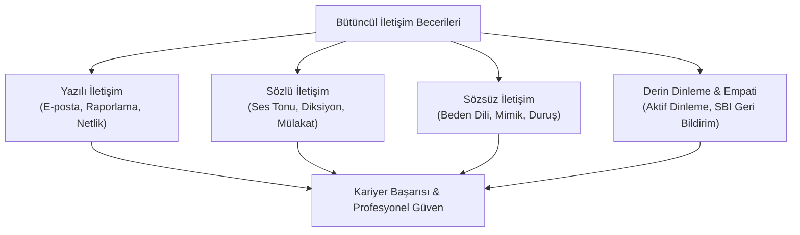
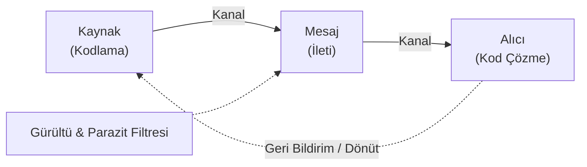
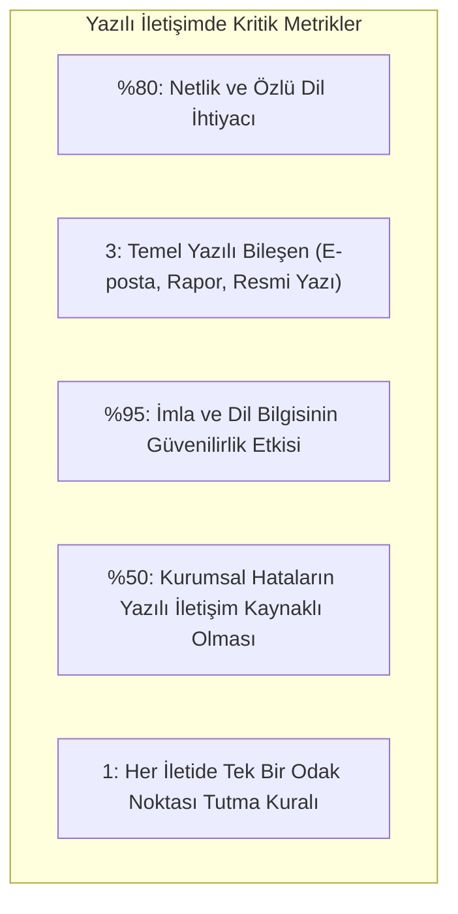
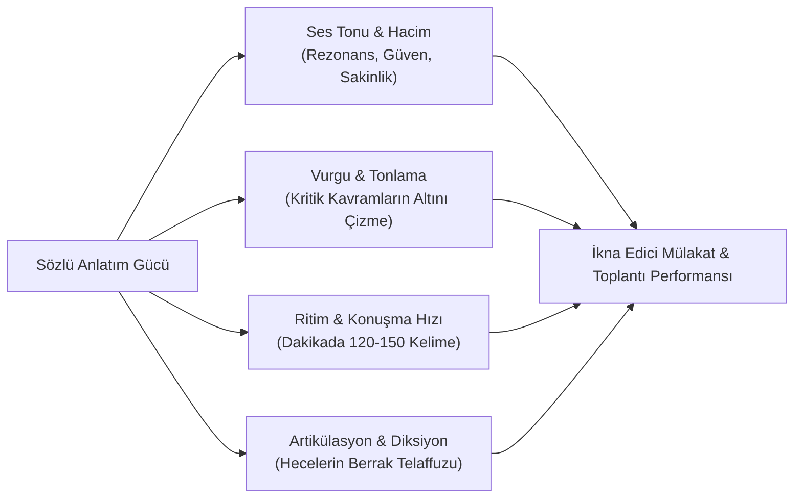
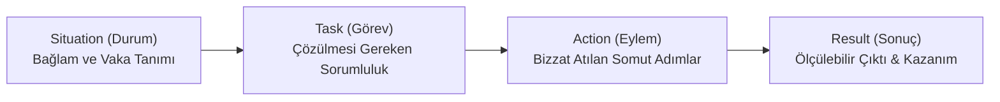
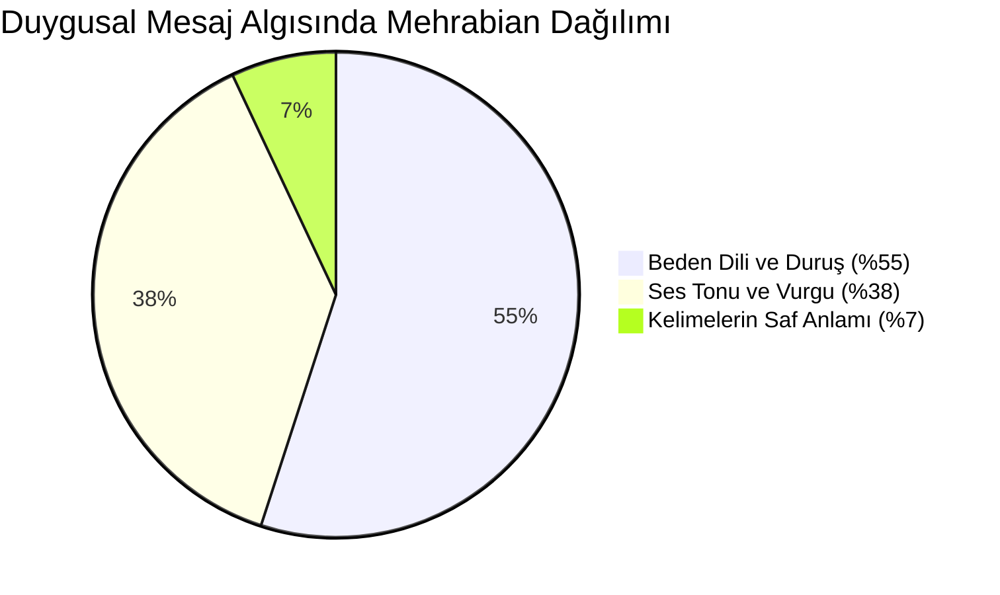
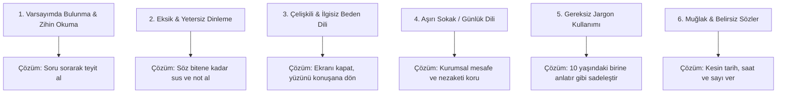
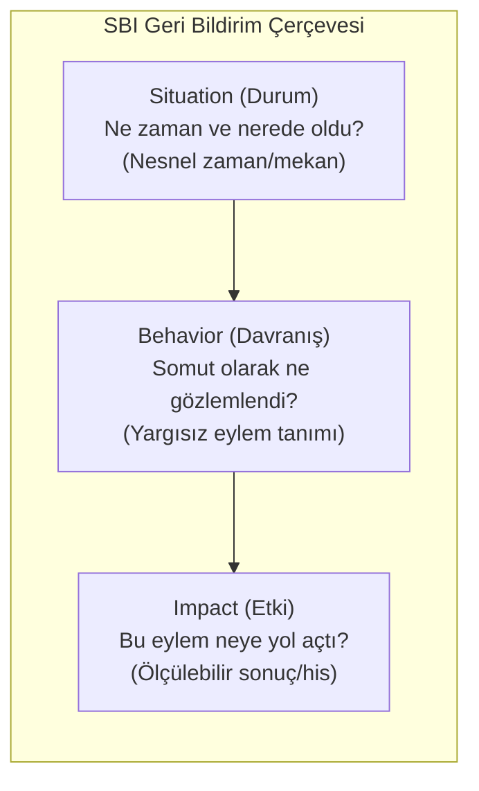

# İletişim Becerileri: İş Dünyasında Anlatım Gücü ve İlişki Yönetimi

İletişim, bireyler ve kurumlar arasında düşünce, duygu ve bilgilerin karşılıklı olarak paylaşıldığı, ortak bir anlayış ve eylem birliği üreten temel insani süreçtir. İş dünyasının giderek karmaşıklaştığı, disiplinlerarası ekiplerin ve uzaktan çalışma modellerinin yaygınlaştığı günümüzde iletişim; yalnızca teknik bilgiyi iletme aracı değil, profesyonel güvenin, liderliğin ve kurumsal başarının en belirleyici sermayesidir.

Kariyer yolculuğunda teknik yetkinlikler (kodlama, finansal modelleme, mühendislik hesaplamaları) kapıyı aralayan temel asgari koşulları oluştururken; o kapıdan içeri girmeyi, paydaşları ikna etmeyi ve kriz anlarında ekibi ayakta tutmayı sağlayan asıl güç iletişim becerileridir. Araştırmalar, kariyer başarısının ve işe alım kararlarının yaklaşık yüzde 70'inin adayın iletişim kapasitesiyle doğrudan ilişkili olduğunu göstermektedir. Bu bağlamda etkili iletişim; yazılı, sözlü ve sözsüz unsurların kusursuz bir senkronizasyonla işletilmesini gerektirir.

*Şekil 1: Profesyonel kariyer başarısını besleyen dört temel iletişim boyutu.*

---

## 1. İletişim Sürecinin Temel Mekanizması ve Bileşenleri

İletişim, tek yönlü bir mesaj fırlatma eylemi değildir; döngüsel ve dinamik bir bilgi alışverişidir. Bu sürecin sağlıklı işlemesi, kuramsal olarak tanımlanmış beş temel bileşenin uyumuna bağlıdır:

1. **Kaynak (Gönderici):** İletişimi başlatan, zihnindeki soyut düşünceyi veya veriyi belirli semboller (kelimeler, sayılar, beden dili) aracılığıyla kodlayan aktördür. Kaynağın temel sorumluluğu; amacını netleştirmek ve mesajı alıcının kavrayış düzeyine göre yapılandırmaktır.
2. **Mesaj (İleti):** Aktarılmak istenen bilginin, duygunun veya talimatın somutlaşmış halidir. Açık, yalın ve yanlış anlamalara yer bırakmayacak biçimde formüle edilmelidir.
3. **Kanal (İletim Ortamı):** Mesajın hedefe ulaştırıldığı fiziksel veya dijital köprüdür (yüz yüze görüşme, kurumsal e-posta, video konferans, resmi rapor). Yanlış kanal tercihi (örneğin kriz içeren bir konuyu kısa mesajla geçiştirmek) iletişimin doğasını bozar.
4. **Alıcı (Hedef Kitle):** Mesajı alan, sembollerin kodunu çözen ve kendi bilişsel filtrelerinden geçirerek anlamlandıran taraftır. Alıcının dikkati, önyargıları ve o anki ruh hali mesajın kaderini tayin eder.
5. **Geri Bildirim (Dönüt / *Feedback*):** Alıcının mesaja verdiği sözlü veya sözsüz yanıttır. Geri bildirim, mesajın doğru anlaşılıp anlaşılmadığını denetleyen yegane emniyet supabıdır. Geri bildirimin bulunmadığı süreçler monolog olarak kalır; gerçek iletişim düzeyine erişemez.

*Şekil 2: İletişim sürecinin döngüsel yapısı ve geri bildirim mekanizması.*

---

## 2. Profesyonel Yaşamda Beş Temel İletişim Becerisi

Kurumsal ortamlarda sağlıklı bir çalışma iklimi tesis etmek ve projeleri hedeflenen çıktılara ulaştırmak beş temel beceri sütununa dayanır:

### 2.1. Etkin Dinleme (*Active Listening*)
İletişimin en az uygulanan ancak en kritik becerisidir. Bireylerin çoğu karşı tarafı anlamak için değil, yalnızca sıradaki kendi cevabını zihninde kurgulamak için dinler. Etkin dinleme; dikkati tamamen konuşmacıya vermeyi, göz teması kurmayı, konuşmacının sözünü kesmemeyi ve konuşma bittiğinde özet teyit cümleleriyle anlaşıldığını hissettirmeyi kapsar.

### 2.2. Açık ve Anlaşılır İfade (*Clarity and Brevity*)
Karmaşık teknik kavramları gereksiz süslemelerden arındırarak sade bir dille aktarabilme yeteneğidir. Özellikle çok disiplinli ekiplerde mühendislerin, finansçıların ve tasarımcıların birbirini anlayabilmesi, herkesin ortak bir yalınlık paydasında buluşmasını gerektirir.

### 2.3. Empati Kurma (*Perspective-Taking*)
Karşı tarafın duygu durumunu, kurumsal kaygılarını ve hedeflerini onun zihinsel çerçevesinden görebilme yetisidir. Empati, karşı tarafın her fikrine katılmak demek değildir; onun neden o tepkiyi verdiğini kavrayarak rasyonel bir müzakere zemini oluşturmaktır.

### 2.4. Yapıcı Geri Bildirim Verme ve Alma
Geri bildirim, kurumsal gelişimin yakıtıdır. Başarılı profesyoneller, karşı tarafın kişiliğini değil yapılan somut eylemi hedef alan nesnel geri bildirimler sunar. Aynı zamanda kendilerine yöneltilen yapıcı eleştirileri savunmaya geçmeden gelişim fırsatı olarak karşılar.

### 2.5. Karşılıklı Saygı ve Psikolojik Güvenlik
Bireylerin fikirlerini cezalandırılma ya da alay edilme korkusu olmadan özgürce paylaşabildiği ortamlar (psikolojik güvenlik), inovasyonun ana rahmidir. Hiyerarşik konumu ne olursa olsun her paydaşa eşit saygı göstermek profesyonel olgunluğun temel göstergesidir.

| Temel Beceri | Ne İfade Eder? | Sahadaki Somut Karşılığı | Yokluğunda Karşılaşılan Risk |
| :--- | :--- | :--- | :--- |
| **Etkin Dinleme** | Anlamak amacıyla tam odaklanma. | Karşı tarafın cümlesi bitene kadar bekleyip özetle teyit almak. | Yanlış iş yapma, zaman ve bütçe israfı. |
| **Açık İfade** | Fikri en yalın formda sunma. | E-postada ana aksiyonu ilk cümlede belirtmek. | Muğlaklık, geciken onaylar, sürüncemede kalan projeler. |
| **Empati** | Karşı tarafın penceresinden bakma. | Kriz anında ekibin stresini kabul edip çözüm aramak. | Ekip içi kutuplaşma, güvensizlik ve yüksek işten ayrılma. |
| **Geri Bildirim** | Davranışı dönüştürme aracı. | Durum-Davranış-Etki (SBI) çerçevesiyle konuşmak. | Hataların kronikleşmesi veya küskünlükler. |
| **Karşılıklı Saygı** | Eşit değer ve nezaket ilkesi. | Farklı fikirlere tahammül edip dinleme nezaketi göstermek. | Fikirlerin bastırılması, toksik çalışma ortamı. |

---

## 3. Yazılı İletişim: E-posta, Raporlama ve Kurumsal Dilin Matematiksel Metrikleri

Dijital çağda iş hayatının omurgası yazılı iletişim üzerinden akar. Yazılı metinlerin en büyük riski, ses tonu ve yüz mimikleri gibi yumuşatıcı unsurlardan yoksun olmasıdır. Bu durum, özensiz yazılmış tek bir cümlenin kaba veya buyurgan algılanmasına yol açabilir.

*Şekil 3: İş dünyasında yazılı iletişimin etki alanını gösteren sayısal metrikler.*

### 3.1. Üç Temel Yazılı Bileşen
1. **Kurumsal E-posta:** Günlük operasyonların yürütüldüğü ana mecradır. Etkili bir e-posta; içeriği net özetleyen bir konu satırına, ilk paragrafta belirtilen amaca ve madde imleriyle sıralanmış eylem planına sahip olmalıdır.
2. **Operasyonel Rapor ve Yönetici Özeti:** Yöneticilerin ve yatırımcıların hızlı karar almasını sağlayan belgelerdir. Sayfalarca detaydan önce tek sayfalık bir **Yönetici Özeti (*Executive Summary*)** sunulmalıdır.
3. **Resmi Yazışmalar ve Sözleşmeler:** Hukuki bağlayıcılığı olan belgelerdir. Muğlak yorumlara açık ifadelerden kaçınılmalı, sorumluluklar ve teslim tarihleri tereddütsüz yazılmalıdır.

### 3.2. Yazılı İletişim Hatalarının Maliyeti
İstatistikler, iş yerlerindeki operasyonel aksaklıkların yaklaşık **yüzde 50'sinin** yetersiz, eksik veya muğlak yazılı iletişimden kaynaklandığını doğrulamaktadır. Özellikle "en kısa sürede", "mümkünse bir bakın" gibi zaman ve kapsam sınırı çizilmemiş ifadeler projeleri çıkmaza sokar. Profesyonel standart; "14 Kasım Cuma günü saat 17:00'ye kadar" şeklinde kesin koordinat vermektir.

Ayrıca doğru imla ve terminoloji kullanımı (yüzde 95 güven metriği), adayın veya kurumun işine gösterdiği özenin doğrudan yansımasıdır. İmla hatalarıyla dolu bir teklif veya özgeçmiş, teknik kalitesi ne olursa olsun ilk aşamada güven erozyonuna uğrar.

---

## 4. Sözlü İletişim: Ses Tonu, Vurgu ve Mülakat Dinamikleri

Sözlü iletişim; yüz yüze toplantılarda, iş mülakatlarında, müşteri müzakerelerinde ve sunumlarda düşüncelerin sese bürünmesidir. Burada belirleyici olan yalnızca kelime dağarcığı değil, sesin fiziksel ve duygusal parametreleridir.

*Şekil 4: Sözlü iletişimin temel bileşenleri ve ikna gücü üzerindeki etkisi.*

### 4.1. Sesin Dört Enstrümanı
- **Ses Tonu:** Karşı tarafa saygı ve özgüven aşılayan dengeli ton. Boğazdan sıkışarak çıkan tiz sesler gerginlik; göğüs rezonansından çıkan tok sesler ise sakinlik ve kontrol sinyali verir.
- **Vurgu ve Es Verme (Stratejik Duraklama):** Monoton konuşmalar dinleyicinin dikkatini hızla tüketir. Kritik bir veriyi söylemeden hemen önce ve söyledikten hemen sonra 2 saniyelik bir duraklama (es) yapmak, mesajın zihne kazınmasını sağlar.
- **Konuşma Hızı:** Çok hızlı konuşmak telaş ve yetersizlik hissi uyandırırken; gereğinden yavaş konuşmak dinleyicinin sıkılmasına yol açar.
- **Artikülasyon:** Kelimelerin son hecelerini yutmadan, açık ve net konuşmak profesyonel saygınlığı pekiştirir.

### 4.2. Mülakatlarda STAR Tekniği
İş mülakatlarında sorulan davranışsal sorulara ("Bize geçmişte yaşadığınız büyük bir krizi nasıl çözdüğünüzü anlatır mısınız?") verilen yapılandırılmamış ve dağınık cevaplar elenmeye sebep olur. Küresel işe alım standardı olan **STAR Tekniği**, cevabı dört mantıksal aşamada kurgular:

*Şekil 5: Mülakatlarda yapılandırılmış cevaplama çerçevesi: STAR Modeli.*

- **Situation (Durum):** Karşılaşılan kriz veya senaryo 1-2 cümleyle kısaca özetlenir.
- **Task (Görev):** Bu durum karşısında bireyin üstlendiği spesifik görev ve hedef tanımlanır.
- **Action (Eylem):** "Biz yaptık" muğlaklığı yerine, "Ben şu adımları attım, şu analizi yaptım" denilerek bireysel inisiyatif aktarılır.
- **Result (Sonuç):** Sürecin sonunda elde edilen somut, tercihen yüzdesel veya sayısal başarı ve öğrenilen ders paylaşılır.

---

## 5. Sözsüz İletişim (Beden Dili): Mehrabian Kuralı ve Mikro Davranış Kodları

İnsan beyni, evrimsel olarak sözcüklerden çok daha önce beden hareketlerini ve tehlike sinyallerini okumak üzere programlanmıştır. Bu nedenle sözsüz iletişim, mesajın inandırıcılık testinden geçtiği asıl filtredir.

### 5.1. Mehrabian İletişim Modeli
UCLA profesörlerinden Albert Mehrabian'ın çalışmaları, bir mesajın içerdiği duygusal tutarlılık test edilirken insanların algısında şu ağırlıkların devreye girdiğini ortaya koymuştur:

*Şekil 6: Duygusal ifadelerde ve çelişki anlarında algının bileşenleri.*

Bu dağılım, sözler ile beden dili çeliştiğinde insan zihninin **yüzde 93 oranında** sözsüz işaretlere (beden dili ve ses tonu) inandığını kanıtlar. Bedeninde gerginlik ve güvensizlik işaretleri taşıyan bir adayın "ben son derece rahat ve özgüvenliyim" demesi hiçbir ikna gücü taşımaz.

### 5.2. Beden Dilinin Yedi Temel Taşıyıcısı
1. **Yüz İfadeleri ve Mimikler:** Samimi bir tebessüm ve rahat kaş yapısı, karşı tarafa güven ve iş birliğine açıklık sinyali verir. Donuk veya gergin bir yüz iletişimi baştan kilitler.
2. **Jestler ve El Hareketleri:** Konuşurken ellerin masanın üzerinde, açık ve görünür tutulması şeffaflık göstergesidir. Elleri ceplere saklamak, masanın altına gizlemek veya kolları göğüste sımsıkı kavuşturmak savunmacı bir bariyer örer.
3. **Göz Teması:** Karşı tarafla konuşurken yüzde 60-70 oranında göz teması sürdürmek ilgi ve dürüstlük göstergesidir. Gözleri sürekli kaçırmak güvensizlik; hiç kırpmadan dik dik bakmak ise saldırganlık olarak algılanır.
4. **Beden Duruşu (Postür):** Dik oturuş ve rahat omuzlar profesyonel yetkinlik yansıtır. Koltuğa aşırı yayılmak lakaytlık; iki büklüm kambur durmak ise çekingenlik mesajı iletir.
5. **Giyim ve Fiziksel Görünüm:** Çalışılan sektörün ve görüşülen paydaşın kültürüne uygun, temiz ve ölçülü giyim; bireyin hem kendine hem de karşı tarafa duyduğu saygının göstergesidir.
6. **Kültürel Farklılıklar ve Kişisel Alan (Proksemik):** Farklı kültürlerde göz teması süreleri, selamlaşma biçimleri ve fiziksel mesafe algısı değişir. Çok uluslu iş ortamlarında bu sınırlara riayet etmek esastır.
7. **Sözlü-Sözsüz İleti Uyumu:** Beden hareketlerinin anlatılan konunun temposu ve önemiyle örtüşmesi, hitabetin inandırıcılık katsayısını belirler.

---

## 6. İş Hayatında En Sık Yapılan Altı İletişim Hatası ve Çözüm Yolları

İş yerlerindeki verimsizliklerin, ekip içi küskünlüklerin ve kaçan ticari fırsatların temelinde belirli kronik iletişim hataları yatar:

*Şekil 7: En yaygın altı iletişim hatası ve profesyonel çözüm formülleri.*

1. **Varsayımda Bulunma ve Zihin Okuma:** Karşı tarafa sormadan onun ne düşündüğünü tahmin ettiğini varsaymak en büyük hatadır. Panzehir: *"Doğru anladıysam siz şu noktaya dikkat çekmek istiyorsunuz, doğru mu?"* teyit kalıbıdır.
2. **Eksik Dinleme Alışkanlığı:** Konuşmacının sözünü yarıda kesip araya girmek karşı tarafa değersizlik hissi verir. Profesyonel refleks, karşı taraf duraksayana kadar dinlemektir.
3. **Uygun Olmayan Beden Dili:** Biri konuşurken cep telefonunu kurcalamak veya sürekli saate bakmak, "senin anlattığın benim için önemsiz" mesajını açıkça iletir.
4. **Aşırı Sokak ve Gündelik Dil:** İş arkadaşlarıyla samimiyet kurma adına profesyonel sınırları aşan argo veya laubali ifadeler kullanmak kurumsal ağırlığı zedeler.
5. **Gereksiz Jargon ve Yabancı Terim Kirliliği:** Kendi uzmanlık alanındaki teknik kısaltmaları herkesin bildiğini varsayarak konuşmak dinleyiciyi dışlar. Usta iletişimci, en karmaşık teoriyi en sade Türkçeyle anlatan kişidir.
6. **Muğlak ve Anlaşılmaz İfadeler:** "Bir ara bakarız", "uygun bir vakitte görüşelim" gibi cümleler iş takibini felç eder. Net randevu ve net sorumluluk tanımlanmalıdır.

---

## 7. Davranışı Dönüştüren Geri Bildirim Modeli: SBI Metodolojisi

Geleneksel iletişimde geri bildirim genellikle ya aşırı yıkıcı suçlamalarla ("Sen zaten hiçbir işi vaktinde teslim etmezsin") ya da işlevsiz genel övgülerle ("Harikasın, aynen devam et") verilir. İkisi de bireyin mesleki gelişimine katkı sağlamaz.

Davranış bilimciler tarafından geliştirilen **SBI Modeli (Situation - Behavior - Impact)**, kişiliği tartışmaya açmadan doğrudan performansı iyileştiren bilimsel bir çerçevedir:

*Şekil 8: Performansı dönüştüren bilimsel geri bildirim döngüsü: SBI Modeli.*

- **Situation (Durum):** Olayın yaşandığı kesin zaman ve ortam belirtilir: *"Dün öğleden sonraki haftalık proje değerlendirme toplantısında..."*
- **Behavior (Davranış):** Bireyin kişiliğine sıfat takmadan (ör. tembel, kaba, sorumsuz demeden) sadece kameranın kaydedebileceği somut eylem aktarılır: *"...müşterinin maliyet sorusunu tamamlarken sözünü kesip başka bir konuya geçtin."*
- **Impact (Etki):** Bu davranışın projeye, ekibe veya müşteriye yansıyan somut sonucu dile getirilir: *"...bu durum müşterinin kaygılarının önemsenmediğini hissetmesine ve toplantının gerginleşmesine sebep oldu."*

SBI modeli suçlama içermediği için karşı tarafın savunma mekanizmalarını tetiklemez; birey durumu objektif olarak görür ve davranışını hızla düzeltir.

---

## 8. Kariyer Değer Zinciri ve İletişim Manifestosu

İletişim becerisi, mesleki hayatta tek başına duran izole bir yetenek değildir; bir zincirin halkaları gibi tüm kariyer basamaklarını birbirine bağlar:

$$\text{Kariyer Değeri} = \text{Teknik Uzmanlık} \times \text{İletişim ve Anlatım Gücü}$$

Çarpım formülünden görüleceği üzere; teknik bilgi düzeyi 10 üzerinden 10 olsa bile, iletişim gücü sıfır olduğunda üretilen kariyer değeri sıfırlanmaktadır. İletişim becerisi yüksek olan bir profesyonel:
1. Mülakatlarda bilgi birikimini STAR modeliyle etkileyici bir hikayeye dönüştürür,
2. Ekip içinde çatışmaları yöneterek doğal bir lidere dönüşür,
3. Müşteriler ve paydaşlarla güven temelli sürdürülebilir iş birlikleri kurar,
4. Yeni kariyer ve terfi fırsatlarına ilk erişen isim olur.

### İletişimde Ustalık Manifestosu
Profesyonel yaşamda kalıcı iz bırakan liderlerin benimsediği temel iletişim felsefesi üç ana ilkeye dayanır:
- **Sadeleştirme Yeteneği:** En derin kavramları berrak ve anlaşılır bir sadelikle ifade edebilmek.
- **Dinleme Tevazusu:** Kendi sesini değil, muhatabının ihtiyacını, kaygısını ve söylenmeyen iletilerini keşfetmeye odaklanmak.
- **Söz ve Beden Tutarlılığı:** Konuşulan kelimeler ile sergilenen duruşun aynı dürüstlük, saygı ve güven frekansında buluşmasını sağlamak.
