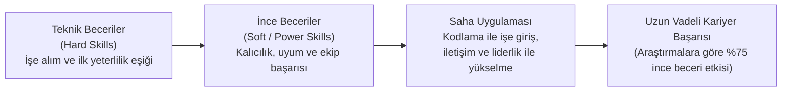
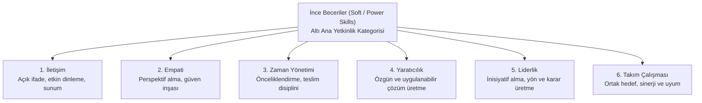
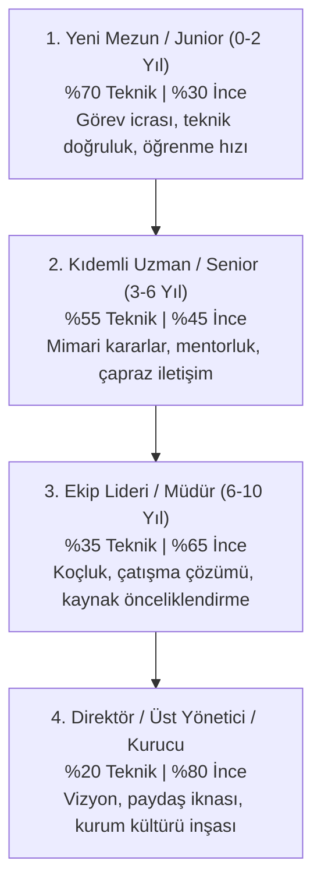
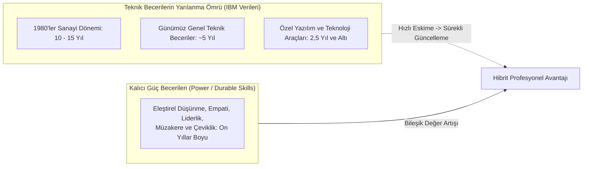
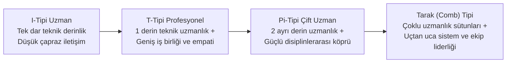

# İnce Beceriler ve Teknik Beceriler: Kariyer Başarısının Temel Bileşenleri

1999 yılında NASA tarafından Mars atmosferini incelemek üzere fırlatılan 125 milyon dolarlık *Mars Climate Orbiter* uzay aracı, gezegenin yörüngesine girmek üzereyken beklenenden çok daha alçak bir irtifaya yönelerek atmosferde parçalandı. Olayın ardından yapılan kapsamlı soruşturma, tarihin en öğretici mühendislik ve yönetim bulgularından birini ortaya çıkardı: Ne NASA mühendislerinin ne de yüklenici firma Lockheed Martin ekiplerinin matematiksel hesaplarında teknik bir hata vardı. Sorun, bir ekibin İngiliz ölçü birimini (*pound-saniye*), diğer ekibin ise metrik birimi (*newton-saniye*) kullanması ve bu kritik ayrımın ekipler arası iletişim ve doğrulama süreçlerinde yakalanamamasıydı. Zirvedeki teknik uzmanlık, iletişim ve ekip koordinasyonu gibi insani becerilerle desteklenmediğinde milyonlarca dolarlık bir projenin çöküşünü engelleyememişti.

Günümüz iş dünyasında sürdürülebilir kariyer başarısı da aynı yapısal dengeye dayanır. Bireyin profesyonel sermayesi iki temel eksende şekillenir: **Teknik Beceriler (*Hard Skills*)** ve **İnce Beceriler (*Soft Skills* / *Power Skills*)**. Teknik beceriler bireyin iş gücüne katılımında ve işe alım süreçlerinde belirleyici rol oynarken; ince beceriler bireyin işte kalıcılığını, ekip içindeki itibarını ve uzun vadeli kariyer yükselişini belirler.

*Şekil 1: Teknik ve ince becerilerin işe girişten uzun vadeli kariyer başarısına uzanan neden-sonuç akışı.*

---

## 1. Teknik Beceriler (*Hard Skills*): Dört Temel Sütun

Teknik beceriler, belirli bir mesleki görevi icra etmek için gerekli olan somut, kural tabanlı ve nesnel biçimde ölçülebilen uzmanlıklardır. Akademik müfredatlar, laboratuvar çalışmaları, mesleki kurslar ve sertifikasyon programları doğrudan bu becerilerin inşasına odaklanır. Teknik becerilerin iş dünyasındaki doğası dört ana sütun üzerinden çözümlenebilir:

### 1.1. Öğrenilebilir ve Ölçülebilir Olması
Teknik beceriler yapılandırılmış bir öğrenme yoluna sahiptir. Bir programlama dilinin sözdizimi, finansal tablo analizi, istatistiksel hipotez testleri veya bir CAD yazılımının kullanımı belirli müfredatlar çerçevesinde öğrenilebilir ve standart testlerle derecelendirilebilir.

### 1.2. Somut ve Kanıtlanabilir Olması
Bu beceri türü yoruma kapalı, doğrulanabilir çıktılar üretir. Sınav puanları, mesleki sertifikalar, açık kaynak kod depoları, teknik tasarım portföyleri veya uygulamalı vaka çözümleri işverenlerin aday yeterliliğini nesnel verilerle teyit etmesini sağlar.

### 1.3. Sektörel Örnekler ve Uygulama Alanları
Programlama dilleri (Python, SQL, C++), veri analizi ve görselleştirme, mühendislik hesaplama ve simülasyon yazılımları, yabancı dil yeterliliği, dijital pazarlama analitiği ve muhasebe standartları başlıca teknik beceri örnekleridir. Bu donanım, bireyin iş piyasasında ilk rekabet avantajını oluşturur.

### 1.4. İşe Giriş Aşamasındaki Kritik Rolü
İşe alım süreçlerinde adayların değerlendirildiği ilk katman teknik becerilerdir. Özgeçmişleri anahtar kelimeler üzerinden ön elemeye tabi tutan **Aday Takip Sistemleri (*Applicant Tracking System* - ATS)** ve ilk aşama teknik mülakatlar, adayın rolün asgari teknik barajını aşıp aşmadığını ölçer. Asgari teknik yeterlilik sağlanmadan ince becerileri sergileme fırsatına erişmek mümkün değildir.

---

## 2. İnce Beceriler (*Soft Skills*) ve Altı Ana Kategori

İnce beceriler; bireyin insanlarla etkileşim kurma, bilgiyi yorumlama, zamanı ve duyguları yönetme, belirsiz problemlere çözüm üretme biçimini belirleyen davranışsal ve ilişkisel yetkinliklerdir. Kişilik özellikleriyle doğal bir bağ kurabilir; ancak sabit ve değişmez değildir. Bilinçli pratik, geri bildirim ve saha deneyimiyle ömür boyu geliştirilebilir.

Literatürde ve kurumsal yetkinlik çerçevelerinde ince beceriler altı ana kategoride yoğunlaşır:

*Şekil 2: Profesyonel yaşamda fark yaratan altı temel ince beceri kategorisi.*

1. **İletişim:** Karmaşık teknik kavramları farklı disiplinlerdeki paydaşlara sade biçimde aktarma, aktif dinleme ve yazılı-sözlü ifade tutarlılığını koruma yetkinliğidir.
2. **Empati:** Müşterinin, ekip arkadaşının ve yöneticinin kaygılarını onların zihinsel penceresinden kavrayarak çatışmaları yapıcı müzakere zeminine çekme becerisidir.
3. **Zaman Yönetimi:** Acil ile önemli görevleri birbirinden ayırma, gerçekçi planlama yapma ve teslim tarihlerine sadık kalarak güvenilirlik üretme disiplinidir.
4. **Yaratıcılık:** Standart prosedürlerin ve rutin otomasyonun yetersiz kaldığı karmaşık senaryolarda özgün ve uygulanabilir alternatifler tasarlama kapasitesidir.
5. **Liderlik:** Resmi bir yönetici unvanı beklemeden sorumluluk üstlenme, belirsizlik ortamında net karar alma ve çevresindeki bireyleri ortak hedef etrafında harekete geçirme gücüdür.
6. **Takım Çalışması:** Bireysel egoyu ortak çıktının gerisinde tutma, farklı uzmanlık alanlarıyla uyumlu çalışma ve ekip içinde psikolojik güvenliği destekleme becerisidir.

Bu altı sütun birbirinden bağımsız çalışmaz. Zamanını yönetemeyen bir uzman ekip arkadaşlarının güvenini zedeler; empati kuramayan bir lider ise ekibin yaratıcı potansiyelini bastırır.

---

## 3. Teknik ve İnce Becerilerin Yapısal Karşılaştırması

| Değerlendirme Boyutu | Teknik Beceriler (*Hard Skills*) | İnce Beceriler (*Soft / Power Skills*) |
| :--- | :--- | :--- |
| **Temel Nitelik** | Somut, kural tabanlı, belirli bir araca veya mesleğe özgü yeterlilik. | İlişkisel, davranışsal ve bilişsel; tüm sektörlere taşınabilen evrensel yetkinlik. |
| **Kazanım Yolu** | Akademik eğitim, teknik kurslar, laboratuvarlar ve sertifikasyonlar. | Saha deneyimi, bilinçli davranış pratiği, mentorluk ve 360 derece geri bildirim. |
| **Ölçüm ve Kanıtlama** | Sınavlar, sertifikalar, teknik vaka testleri, kod ve proje portföyleri. | Davranışsal mülakatlar (STAR), referans kontrolleri ve uzun dönemli ekip gözlemi. |
| **Transfer Edilebilirlik** | Düşük veya orta; teknoloji ya da sektör değiştiğinde yeniden öğrenme gerektirir. | Çok yüksek; sektör veya unvan değişse de doğrudan değer üretmeye devam eder. |
| **Yarılanma Ömrü** | Kısa (teknolojik döngülere bağlı olarak ortalama 2,5 – 5 yıl). | Uzun ömürlü (kariyer boyunca birikerek değer kazanır). |
| **Kariyerdeki Birincil Etkisi** | İş gücüne katılım, ön eleme geçme ve işe alım eşiği. | İşte kalıcılık, terfi, kurumsal itibar ve stratejik liderlik. |

---

## 4. Sayılarla İnce Becerilerin Etkisi: Tarihsel Köken ve Güncel Veriler

İş dünyasında ince becerilerin ağırlığına dair veriler hem yüz yıllık tarihsel araştırmalar hem de güncel küresel istihdam raporları tarafından doğrulanmaktadır:

* **%75 Uzun Vadeli Başarı Etkisi ve 1918 Carnegie Kökeni:** Uzun vadeli kariyer başarısının yaklaşık yüzde 75'inin insani ve davranışsal becerilere dayandığı tespiti, kurumsal literatürde sıkça referans gösterilir. Bu bulgunun tarihsel kökeni, 1918 yılında *Carnegie Vakfı* için Dr. Charles R. Mann tarafından yayımlanan *A Study of Engineering Education* raporuna dayanır. Binlerce mühendis ve işverenle yürütülen saha anketinde; sağduyu, dürüstlük, inisiyatif ve insan ilişkileri gibi kişisel niteliklerin salt mühendislik bilgisinden yaklaşık yedi kat daha sık vurgulandığı belgelenmiştir.
* **%60 İşveren Önceliği:** Güncel işveren eğilimleri, yöneticilerin yüzde 60'ının aday değerlendirmesinde ve uzun dönemli ekip uyumunda ince becerileri teknik becerilerin önüne koyduğunu göstermektedir.
* **%90 Bireysel Kariyer Farkındalığı:** Profesyonellerin ve kariyer başındaki adayların yüzde 90'ı, uzun vadeli kariyer gelişiminde ince becerilerin kritik rol oynadığını kabul etmektedir.
* **LinkedIn Global Talent Trends Verileri (%92 ve %89):** LinkedIn tarafından küresel ölçekte binlerce insan kaynakları lideriyle yürütülen araştırmada, yetenek profesyonellerinin **yüzde 92'si** ince becerilerin teknik beceriler kadar veya daha önemli olduğunu bildirmiştir. Aynı araştırmanın en çarpıcı bulgusu ise başarısız işe alımların (*bad hires*) **yüzde 89'unun** teknik yetersizlikten değil, iletişim, uyum, esneklik ve iş birliği gibi ince beceri eksikliklerinden kaynaklanmasıdır.

Teknik bir eksiği kısa süreli eğitimlerle telafi etmek kurumlar için nispeten kolaydır; ancak ekip içinde güvensizlik üreten, geri bildirime kapalı veya sorumluluk almayan bir çalışma tarzını kısa vadede dönüştürmek son derece maliyetlidir.

---

## 5. Kariyer Basamaklarında Beceri Ağırlığının Dönüşümü

Kariyerin farklı evrelerinde teknik beceriler ile ince becerilerin iş performansına katkısı sabit kalmaz. Sorumluluk düzeyi arttıkça işin doğası doğrudan bireysel üretimden insan, kaynak ve strateji yönetimine doğru kayar.

*Şekil 3: Kariyer basamakları yükseldikçe teknik ve ince beceri dengesinin evrimi.*

Bu yapısal kayma, iş dünyasında pek çok parlak uzmanın neden belirli bir kıdemde görünmez bir kariyer tavanına (*cam tavan*) çarptığını açıklar. İlk yıllarda yüksek hızda ve hatasız teknik üretim yaparak hızla takdir toplayan profesyoneller, ekip liderliği veya kıdemli mimarlık seviyesine geldiklerinde yalnızca bireysel teknik hızlarıyla ilerleyemezler. Örneğin bir yazılım geliştirici kodlama bilgisiyle işe girer; ancak ürün ihtiyaçlarını doğru analiz etme, teknik borçları iş birimlerine ikna edici biçimde anlatma ve ekibe rehberlik etme becerileriyle liderlik rollerine yükselir.

Modern teknoloji şirketleri, insan yönetmek istemeyen ancak derin teknik katkı sunan uzmanlar için **İkili Kariyer Yolu (*Dual Career Track*)** modelini geliştirerek teknik liderlik (*Staff / Principal Engineer*) ve yöneticilik (*Engineering Manager*) hatlarını ayırmıştır. Buna karşın en üst düzey teknik liderlik rollerinde dahi ekipler arası uzlaşı kurma, yazılı savunma üretme ve üst yönetimi ikna etme gibi güçlü ince beceriler vazgeçilmez olmaya devam etmektedir.

---

## 6. Yapay Zekâ Çağı, Beceri Yarılanma Ömrü ve WEF 2025 Bulguları

Üretken yapay zekâ ve otomasyon teknolojileri, teknik ve ince beceriler arasındaki dengeyi kökten yeniden tanımlamaktadır. Bu dönüşümün merkezinde **Beceri Yarılanma Ömrü (*Skill Half-Life*)** kavramı yer alır. Bir becerinin yarılanma ömrü, o becerinin piyasa geçerliliğinin ve ekonomik değerinin yarısını kaybetmesi için geçen süreyi ifade eder.

*Şekil 4: Teknik becerilerin kısalan yarılanma ömrü ile kalıcı insani güç becerilerinin uzun vadeli değeri.*

*IBM Institute for Business Value* ve *Deloitte* araştırmaları, geçmişte 10 ila 15 yıl değerini koruyan mesleki teknik becerilerin yarılanma ömrünün günümüzde ortalama **5 yıla**, özel yazılım çerçeveleri ve teknoloji araçlarında ise **2,5 yıl ve altına** gerilediğini göstermektedir. Bu hızlı aşınma nedeniyle modern insan kaynakları literatürü, yanlış biçimde "ikincil veya yumuşak" algısı oluşturan *Soft Skills* ifadesini giderek terk etmekte; yerine **Power Skills (Güç Becerileri)** veya **Durable Skills (Kalıcı Beceriler)** kavramlarını kullanmaktadır.

### Dünya Ekonomik Forumu (WEF) Future of Jobs 2025 Raporu
Dünya Ekonomik Forumu'nun 2025 tarihli *Future of Jobs* raporu, 2030 yılına kadar mevcut temel iş becerilerinin **yüzde 39'unun** dönüşeceğini ve iş gücünün yaklaşık yüzde 60'ının yeniden eğitim gereksinimi duyacağını öngörmektedir. Raporun öne çıkardığı en kritik beceri kümeleri iki eksenin ayrılmazlığını doğrulamaktadır:

* **Yükselen Teknik ve Bilişsel Beceriler:** Analitik düşünme (şirketlerin yüzde 70'inde bir numaralı temel beceri), yapay zekâ ve büyük veri (talebi en hızlı büyüyen teknik alan), ağlar ve siber güvenlik, teknoloji okuryazarlığı ve yaratıcı düşünme.
* **Yükselen İnce ve İnsani Beceriler:** Dayanıklılık, esneklik ve çeviklik; liderlik ve sosyal etki; merak ve yaşam boyu öğrenme; empati ve aktif dinleme; yetenek yönetimi ve mentorluk.

Büyük dil modelleri saniyeler içinde kod üretebilir, teknik doküman özetleyebilir veya veri temizleyebilir; ancak belirsiz bir kriz anında etik sorumluluk alamaz, bir müşterinin gizli kaygısını sezerek güven inşa edemez ve çatışan bir ekibi ortak vizyonda birleştiremez. Dolayısıyla yapay zekâ çağının kazanan profili, teknik araçları yapay zekâ desteğiyle hızlandıran ve stratejik yönü insani güç becerileriyle belirleyen **hibrit profesyonellerdir**.

---

## 7. Google Project Oxygen: Teknik Uzmanlık ve Liderlik Gerçeği

Teknik beceriler ile ince beceriler arasındaki ilişkiyi en geniş kurumsal veri setiyle sınayan çalışmalardan biri Google'ın 2008 yılında başlattığı ve 2018'de güncellediği **Project Oxygen** araştırmasıdır. Google'ın İnsan Analitiği ekibi, *"En iyi yöneticileri diğerlerinden ayıran nedir?"* sorusuna yanıt aramak üzere 10.000'den fazla performans değerlendirmesini, çalışan anketini (*Googlegeist*) ve mülakat kaydını analiz etti.

Bir mühendislik şirketi olmanın doğası gereği başlangıç hipotezi, en derin kodlama ve teknik mimari becerisine sahip kişilerin en başarılı yöneticiler olacağı yönündeydi. Veriler ise tam tersi bir tablo ortaya koydu: **Derin teknik uzmanlık, etkili yöneticileri tanımlayan sekiz davranış içinde son sırada (8. sırada) yer aldı.** İlk yedi sıranın tamamı ince becerilerden oluşuyordu:

1. İyi bir koç olmak ve yapıcı geri bildirim sunmak.
2. Mikro yönetim yapmadan ekibi yetkilendirmek.
3. Ekip üyelerinin başarısına ve kişisel refahına samimi ilgi göstermek.
4. Üretken ve sonuç odaklı çalışmak.
5. İyi bir iletişimci olmak, aktif dinlemek ve bilgiyi şeffaf paylaşmak.
6. Kariyer gelişimini desteklemek.
7. Ekip için net bir vizyon ve strateji çizmek.
8. **Ekibe rehberlik edebilecek düzeyde temel teknik becerilere sahip olmak.** *(2018 güncellemesinde bunlara kurum içi çapraz iş birliği ve güçlü karar alma eklendi.)*

Project Oxygen iki temel gerçeği bilimsel olarak kanıtladı: Birincisi, teknik beceri yöneticinin kredibilitesi için destekleyici bir zemindir ancak liderlik başarısını tek başına belirlemez. İkincisi ve daha önemlisi, ince beceriler doğuştan gelen sabit özellikler değildir; Google en düşük puanlı yöneticilere koçluk ve iletişim eğitimleri uyguladığında bu grubun yüzde 75'inde bir yıl içinde ölçülebilir performans artışı kaydedilmiştir.

---

## 8. Kariyer Mimarisi: I, T, Pi ve Tarak (*Comb*) Şekilli Beceri Modelleri

Teknik derinlik ile ince beceri genişliğinin nasıl birleştirileceği, kariyer gelişiminde **Şekilli Beceri Modelleri (*Shaped Skill Models*)** aracılığıyla haritalandırılır. Bu modellerde dikey sütunlar derin teknik uzmanlığı, yatay üst çubuk ise iletişim, empati ve disiplinlerarası kavrayış genişliğini temsil eder.

*Şekil 5: Saf uzmanlıktan çok boyutlu liderliğe uzanan şekilli beceri evrimi.*

* **I-Tipi Uzman:** Yalnızca tek bir dar teknik alanda derin bilgiye sahiptir. Karmaşık tekil görevlerde verimli olsa da farklı departmanlarla ortak dil kurmakta zorlanır ve kendi teknik alanı otomasyonla değiştiğinde yüksek kırılganlık taşır.
* **T-Tipi Profesyonel:** Tasarım inovasyon şirketi IDEO'nun yöneticisi Tim Brown ve yönetim danışmanlığı literatürü tarafından yaygınlaştırılan bu model, bir ana disiplinde derin teknik uzmanlığı (*dikey çubuk*) farklı disiplinlerle empati kurma ve iş birliği yapma kapasitesiyle (*yatay çubuk*) birleştirir. Örneğin arka uç (*backend*) mühendisliğinde derinleşirken kullanıcı deneyimi, ürün yönetimi ve iş hedeflerini anlayabilen bir geliştirici T-tipi profile sahiptir.
* **Pi-Tipi ($\pi$) Çift Uzman:** Geniş ince beceri tabanının altında birbirini tamamlayan iki ayrı teknik alanda (örneğin veri bilimi ve kurumsal finans ya da biyomedikal mühendislik ve yapay zekâ) derinleşen profildir. İki farklı uzmanlık dünyası arasında çevirmenlik yaparak yüksek stratejik değer üretir.
* **Tarak (*Comb* / M-Tipi) Lider:** Geniş iletişim ve yönetim çatısı altında farklı derinliklerde üç veya daha fazla uzmanlık sütunu barındırır. Girişim kurucuları, teknoloji yöneticileri ve karmaşık sistem mimarları bu uçtan uca entegrasyon becerisiyle öne çıkar.

---

## 9. İnce Becerilerin Sistematik Geliştirilmesi ve Doğrulanması

İnce beceriler pasif biçimde kitap okuyarak veya teorik tanımlar ezberleyerek değil, sahada kasıtlı davranış pratiğiyle kazanılır. Bu becerileri ölçülebilir biçimde geliştirmek ve iş dünyasına kanıtlamak dört aşamalı bir sistem gerektirir:

1. **360 Derece Geri Bildirim ile Kör Nokta Tespiti:** Bireyler kendi iletişim tonlarını, dinleme alışkanlıklarını veya stres altındaki tepkilerini nesnel biçimde görmekte zorlanır. Proje arkadaşlarından, mentorlardan ve yöneticilerden belirli aralıklarla somut davranış geri bildirimi toplamak gelişimin ilk adımıdır.
2. **Konfor Alanı Dışında Saha Deneyimi:** Liderlik, topluluk önünde konuşma, kriz yönetimi ve müzakere yalnızca sorumluluk alınan gerçek ortamlarda gelişir. Çok disiplinli proje ekiplerinde koordinatörlük üstlenmek, sivil toplum veya meslek topluluklarında aktif görev almak ve sunum sorumluluğu istemek bu kasları hızla güçlendirir.
3. **Çapraz Disiplinli İş Birliği:** Yalnızca aynı meslek grubundan bireylerle çalışmak, ortak teknik jargon nedeniyle iletişim zayıflıklarını gizler. Farklı disiplinlerden (hukuk, tasarım, işletme, mühendislik) katılımcılarla ortak projeler yürütmek, yalın anlatım ve empati becerisini doğrudan test eder.
4. **STAR Formatında Yetkinlik Kanıtlama:** Özgeçmişlere soyut sıfatlar olarak *"takım çalışmasına yatkın"* veya *"iletişimi güçlü"* yazmak hiçbir kanıt değeri taşımaz. İnce beceriler ancak **STAR (*Situation, Task, Action, Result*)** çerçevesiyle somutlaştırıldığında doğrulanır: Karşılaşılan somut durum (*S*), üstlenilen sorumluluk (*T*), bireyin bizzat uyguladığı iletişim veya liderlik hamlesi (*A*) ve elde edilen ölçülebilir çıktı (*R*) açıkça belgelenmelidir.

---

## 10. Sektörel Eşleştirme ve Kariyer Karar Matrisi

| Meslek / Rol | İşe Girdiren Teknik Beceriler (*Hard*) | Kalıcılık ve Yükselme Sağlayan İnce Beceriler (*Soft / Power*) | Tek Taraflı Gelişimin Riski |
| :--- | :--- | :--- | :--- |
| **Yazılım Mühendisi** | Algoritmalar, programlama dilleri, veritabanı, bulut mimarisi, test. | İş ihtiyacını dinleme, yapıcı kod inceleme (*code review*), kriz iletişimi. | Sadece kod odaklı kalıp ekip içi çatışma ve kariyer tavanı yaşamak. |
| **Veri / Finans Analisti** | SQL, Python, istatistiksel modelleme, finansal tablo analizi. | Veri hikâyeleştirme (*data storytelling*), yönetici iknası, iş bağlamı okuma. | Doğru analiz üretip karar alıcıları ikna edememek. |
| **Endüstri / Proje Mühendisi** | Süreç optimizasyonu, ERP, kalite standartları, maliyet hesabı. | Paydaş müzakeresi, zaman ve kriz yönetimi, çoklu ekip koordinasyonu. | Sahadaki insan direncini aşamadığı için teknik planı uygulayamamak. |
| **Girişimci / Ürün Lideri** | Pazar analizi, birim ekonomi, MVP tasarımı, finansal okuryazarlık. | Duygusal dayanıklılık, müşteri empatisi, yatırımcı iknası, vizyon liderliği. | Güçlü bir prototip geliştirip ekibi dağılmaktan veya sermayesizlikten koruyamamak. |

---

## Sonuç

Kariyer başarısı, teknik beceriler ile ince beceriler arasında bir tercih yapma meselesi değildir; bu iki yetkinlik kümesi aynı sistemin birbirini tamamlayan iki ana bileşenidir. Teknik beceriler bireye uzmanlık meşruiyeti ve iş gücüne giriş anahtarı kazandırırken; ince beceriler bu teknik potansiyelin gerçek dünyada değere, güvene ve liderliğe dönüşmesini sağlar.

Teknik araçların yarılanma ömrünün hızla kısaldığı yapay zekâ çağında, kalıcı profesyonel güvence tek bir yazılımı veya prosedürü bilmekten değil; teknik derinliği sürekli güncel tutarken iletişim, empati, yaratıcılık, zaman yönetimi, takım çalışması ve liderlik kaslarını bilinçli biçimde büyütmekten geçer. Geleceğin liderleri, teknik yeterlilikle insani bilgeliği bütüncül bir yaklaşımla birleştiren dengeli profesyoneller olacaktır.
