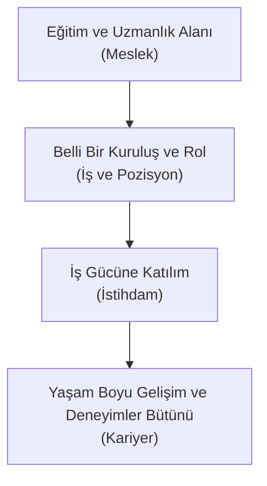
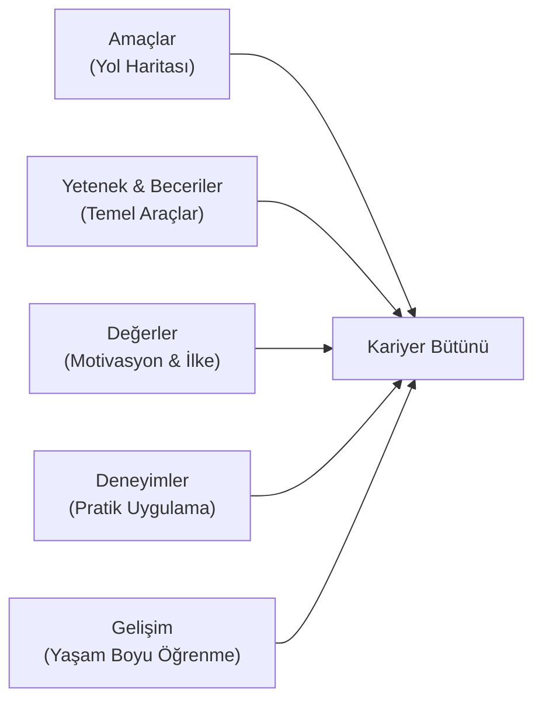
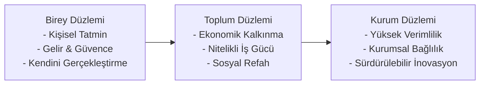

# Kariyer Nedir? Kariyer ve Kariyer ile İlişkili Kavramlar

Kariyer, bireyin yaşamı boyunca sürdürdüğü mesleki ve kişisel gelişim serüvenidir. Günümüz iş dünyasında kariyer, yalnızca tek bir organizasyonda dikey olarak yükselmek veya bir unvan zincirini takip etmekle sınırlı değildir. Bireyin bilgi, beceri, yetenek, değer ve deneyimlerinin harmanlandığı, sürekli öğrenmeyi ve yatay gelişimi de kapsayan çok boyutlu bir süreçtir.

İş dünyasındaki teknolojik dönüşümler, ekonomik dalgalanmalar ve değişen bireysel öncelikler, kariyer algısının geleneksel kalıplardan çıkarak dinamik ve esnek bir yapıya evrilmesine yol açmıştır. Sağlıklı bir kariyer planı oluşturmanın ilk adımı; kariyer olgusunu, meslek, iş, pozisyon ve istihdam gibi birbiriyle sıkça karıştırılan temel kavramlardan ayrıştırmaktır.

*Şekil 1: Meslek, iş, pozisyon ve istihdam kavramlarının kariyer bütünü içerisindeki akışı.*

---

## 1. Temel Kavramsal Ayrım: Meslek, İş, Pozisyon ve İstihdam

Kariyer yolculuğunu analiz ederken günlük konuşma dilinde eş anlamlı gibi kullanılan teknik kavramları netleştirmek gerekir.

| Kavram | Tanım | Odak Sorusu / Karşılığı | Örnek |
| :--- | :--- | :--- | :--- |
| **Meslek** (*Occupation*) | Bireyin sistemli bir eğitim ve uzmanlık sonucu edindiği, bilgi birikimi ve beceri seti gerektiren faaliyet alanıdır. | "Uzmanlık alanın nedir?" | Bilgisayar Mühendisliği |
| **İş** (*Job*) | Belirli bir mesleğin günlük görev ve sorumluluklar çerçevesinde icra edilmesidir. | "Günlük olarak ne yapıyorsun?" | Bir e-ticaret platformunda backend servisleri kodlamak |
| **Pozisyon** (*Position*) | Bir organizasyonun hiyerarşik yapısı içindeki tanımlı görev unvanı ve yetki alanıdır. | "Kurum içindeki rolün nedir?" | Kıdemli Bulut Mimarisi Uzmanı (*Senior Cloud Architect*) |
| **İstihdam** (*Employment*) | Bireyin iş gücüne fiilen katılması, ekonomik getiri sağlayan bir işte çalışmaya başlaması sürecidir. | "İş gücü piyasasında aktif misin?" | Bir teknoloji şirketinde tam zamanlı sözleşmeli olarak göreve başlamak |

Bu ayrımdan görüleceği üzere; bir birey yaşamı boyunca tek bir mesleğe (örneğin mühendisliğe) sahip olabilir, ancak bu meslek çatısı altında farklı şirketlerde onlarca farklı pozisyonda çalışabilir ve birçok iş yürütebilir. Tüm bu işlerin, pozisyonların, yatay ve dikey hareketlerin, kazanılan yetkinliklerin ve hissedilen kişisel tatminin toplamı ise bireyin **kariyerini** oluşturur.

---

## 2. Kariyeri Belirleyen Temel Unsurlar

Kariyer, tesadüflerin yönettiği kontrolsüz bir süreç değildir; belirli yapı taşlarının etkileşimiyle biçimlenir. Bir bireyin kariyer çizgisini belirleyen beş ana unsur bulunmaktadır:

1. **Amaçlar (*Goals*):** Kısa, orta ve uzun vadeli hedefler kariyer yolculuğuna yön verir. Hedefleri belirgin olmayan bir kariyer rotası dışsal etkenlere karşı savunmasız kalır. Amaçlar, hangi eğitimlerin alınacağını, hangi projelere dahil olunacağını belirleyen stratejik kılavuzlardır.
2. **Yetenek ve Beceriler (*Aptitudes & Skills*):** Kariyer inşasının temel araçlarıdır. Bireyin yatkın olduğu alanlar (yetenek) ile bu yatkınlığı pratik ve tekrarla iş üretebilir düzeye getirmesi (beceri), iş gücü piyasasında ayırt edici rekabet avantajı sağlar.
3. **Değerler (*Values*):** Bireyin kararlarını ve önceliklerini yöneten etik, sosyal ve kişisel ilkelerdir. Bağımsızlık, finansal getiri, toplumsal fayda, iş-yaşam dengesi veya yaratıcılık gibi değerler; hangi sektörlerin ve çalışma ortamlarının bireye tatmin sağlayacağını doğrudan belirler.
4. **Deneyimler (*Experiences*):** Yalnızca tam zamanlı kadrolu çalışma geçmişini değil; stajlar, açık kaynak projeler, gönüllülük faaliyetleri, yarışmalar ve kulüp çalışmalarını da kapsar. Deneyim, teorik bilgiyi pratik akla dönüştürür.
5. **Gelişim (*Development & Lifelong Learning*):** Kariyer statik bir nokta değil, yaşam boyu süren bir öğrenme sürecidir. Sürekli yenilenen teknoloji ve pazar koşullarında güncel kalabilmek, bireyin eğitimine ve kişisel gelişimine kesintisiz yatırım yapmasını gerektirir.

*Şekil 2: Kariyeri şekillendiren beş temel unsur.*

---

## 3. Kariyerin Dört Temel Niteliği

Kariyer kavramının doğasını anlamak, bireyin profesyonel adımlarını daha sağlıklı değerlendirmesine yardımcı olur. Bu süreç dört temel özellikle tanımlanır:

- **Süreklilik:** Kariyer belirli bir tarihte başlayıp emeklilikte aniden sonlanan kesintili parçalar değildir; okul öncesi ilgi alanlarından mezuniyet sonrasına, emeklilik dönemindeki danışmanlık veya mentorluk süreçlerine kadar uzanan kesintisiz bir yaşam serüvenidir.
- **Çok Boyutluluk:** Kariyer yalnızca unvan artışından ibaret dikey bir merdiven değildir. Farklı uzmanlık alanlarına geçiş (yatay gelişim), yeni yetkinlikler edinme, yan projeler yürütme ve entelektüel tatmin de kariyerin eşit derecede kritik boyutlarıdır.
- **Kişisellik:** Her bireyin biyografisi, aile yapısı, değerler hiyerarşisi ve risk alma eğilimi farklıdır. Dolayısıyla iki aynı meslektaşın kariyer rotası asla birebir aynı olamaz ve tek bir "mükemmel kariyer" şablonu bulunmaz.
- **Dinamizm:** Kariyer durağan bir planlama tablosu değildir. Küresel ekonomik krizler, yapay zekâ ve otomasyon gibi teknolojik devrimler ya da bireyin değişen yaşam öncelikleri karşısında kariyer rotası sürekli uyumlanmak ve yeniden güncellenmek zorundadır.

---

## 4. Kariyerin Önemi: Birey, Toplum ve Kurumlar Açısından Değeri

Kariyer planlaması yalnızca bireysel kazanç sağlama aracı değildir. Etkileri üç ana düzlemde ortaya çıkar:

*Şekil 3: Kariyerin bireysel, toplumsal ve kurumsal fayda döngüsü.*

### Birey Açısından Önemi
Birey için kariyer; ekonomik güvence ve saygınlık sağlamanın ötesinde, Abraham Maslow'un ihtiyaçlar hiyerarşisinin en tepesinde yer alan kendini gerçekleştirme (*self-actualization*) hedefine ulaşmanın temel aracıdır. Yeteneklerini kullanan, üreten ve takdir gören birey iş hayatında derin bir içsel tatmin yaşar.

### Toplum Açısından Önemi
Toplumun kalkınması, iş gücünün niteliği ve yeteneklerin doğru alanlara kanalize edilmesiyle mümkündür. Bireylerin yetkinliklerine uygun kariyerler inşa etmesi; işsizliği ve verimsiz iş gücü israfını azaltır, ekonomik üretkenliği ve toplumsal refah seviyesini yükseltir.

### Kurumlar Açısından Önemi
Çalışanlarının kariyer gelişimini destekleyen kurumlar; yetenekli iş gücünü bünyesinde tutma (*talent retention*), kurumsal aidiyet duygusunu güçlendirme ve sürekli inovasyon üretme yeteneği kazanır. Kariyer haritaları net olan organizasyonlarda verimlilik ve çalışan motivasyonu belirgin biçimde artar.

---

## 5. Güncel Kariyer Yaklaşımları

Sanayi Devrimi sonrasında şekillenen geleneksel kariyer anlayışı, günümüzün hızla değişen bilgi ekonomisinde yerini daha esnek ve özerk modellere bırakmıştır. Güncel literatürde öne çıkan yaklaşımlar dört grupta incelenmektedir:

### Geleneksel Kariyer Modeli
Bireyin genellikle tek bir organizasyonda veya sektörde uzun yıllar boyunca çalıştığı, dikey hiyerarşik basamakları tırmanarak terfi aldığı modeldir. Sadakat ve istikrar karşılığında iş güvencesi sunar. Ancak günümüzün hızlı değişen pazar koşullarında bu model esneklik açısından yetersiz kalabilmektedir.

### Modern Kariyer Modeli
Bireyin tek bir kuruluşa bağlı kalmak yerine; farklı şirketlerde, ekiplerde ve projelerde görev alarak deneyim havuzunu genişlettiği modeldir. Bu yaklaşımda değer ölçüsü tek bir unvanda kalmak değil, taşınabilir beceriler (*transferable skills*) edinmektir.

### Sınır Tanımayan Kariyer (*Boundaryless Career*)
Fiziksel, örgütsel ve coğrafi sınırların ortadan kalktığı modeldir. Birey tek bir şirketin veya tek bir ülkenin sınırları içinde kalmaz; küresel projelerde, uzaktan çalışma modellerinde, serbest zamanlı (*freelance*) ağlarda ve disiplinler arası geçişlerde aktif rol alır. Kariyer sermayesi bireyin profesyonel ağı ve uzmanlığıdır.

### Kendi Kendini Yöneten Kariyer (*Protean Career*)
Mitolojik şekil değiştirici deniz tanrısı Proteus'tan adını alan bu modelde kariyerin dümeni tamamen bireyin kendi elindedir. Birey rotasını dışsal başarı ölçütlerine (unvan, başkalarının takdiri, statü) göre değil; kendi değerlerine, içsel huzuruna, kişisel hedeflerine ve öğrenme arzusuna göre biçimlendirir. Değişen çevre şartlarına hızla uyum sağlar.

---

## 6. Değerlendirme

Kariyer, tek bir kararla belirlenip ömür boyu değişmeden kalan bir hedef değil; sürekli gözden geçirilen dinamik bir pusuladır. Bireyin meslek, iş ve pozisyon ayrımını net kavraması; amaçlarını kendi değerleriyle hizalaması ve değişen dünya koşullarında kendi kariyerinin yöneticisi olması profesyonel yaşamda kalıcı başarının ve içsel tatminin anahtarıdır.
