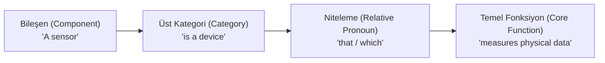

# Sistem Durumları, Teknik Tanımlar ve Temel Fonksiyonlar (System Status, Technical Definitions & Core Functions)

Teknik alanlarda, donanım veri sayfalarında (*datasheet*), sistem loglarında ve yazılım dokümantasyonunda en sık karşılaşılan iki temel dilsel ihtiyaç vardır:
1. Bir sistemin, donanım modülünün veya ağ bağlantısının anlık çalışma durumunu bildirmek (*System & Connection Status*).
2. Bir bileşenin ne olduğunu tanımlamak ve ne işe yaradığını, hangi prensiple çalıştığını açıklamak (*Technical Definitions & Functions*).

Teknik İngilizcede bu işlevler; soyut dil bilgisi kuralları olarak değil, anlık durum belirten yapılar (`is / are`), standart donanım/yazılım tanımlama kalıpları (`A ... is a ... that/which ...`) ve çalışma prensiplerini bildiren geniş zaman fiil mimarisiyle kurulur.

---

## 1. Sistem ve Bağlantı Durumu Bildirimi (System & Connection Status)

Teknik arayüzlerde, gösterge panellerinde ve hata raporlarında bir eylemden ziyade sistemin o anki varlığı, niteliği veya hazır bulunma durumu bildirilir. Bu tür durum bildirimlerinde tekil donanım veya bileşenler için `is`, çoğul bileşenler için `are` yapısı kullanılır.

| Parametre / Bileşen | Durum Cümlesi | Türkçe Karşılığı | Teknik Bağlam |
| :--- | :--- | :--- | :--- |
| **System State** | `The system is ready for operation.` | Sistem çalışmaya hazırdır. | Başlatma kontrolünün tamamlanması |
| **Connection** | `The serial connection is active.` | Seri bağlantı aktiftir. | Donanım portunun açık olması |
| **Hardware Link** | `The sensor is disconnected.` | Sensör bağlı değildir / kopuktur. | Fiziksel kablo veya veri hattı hatası |
| **Memory / Buffer** | `The buffer is full.` | Tampon bellek doludur. | Veri akışının durdurulması gereği |
| **Multiple Units** | `The motors are idle.` | Motorlar boştadır / beklemededir. | Aktif PWM sinyalinin bulunmaması |
| **Network Interface** | `Port 8080 is open.` | 8080 numaralı port açıktır. | Soket dinleme durumunun doğrulanması |

### 1.1. Terminal ve Sistem Logları Analizi

Sistem loglarında durum bildirimleri genellikle seviye etiketleriyle (`INFO`, `WARN`, `ERROR`) birlikte verilir:

```text
[INFO]  Microcontroller clock is stable at 16 MHz.
[INFO]  Wi-Fi connection is established.
[WARN]  Available memory is low (12% remaining).
[ERROR] Temperature sensor is offline.
```

- `is stable`: Kararlıdır (çalışma frekansının dalgalanmadığını bildirir).
- `is established`: Kurulmuştur (ağ el sıkışmasının tamamlandığını gösterir).
- `is low`: Düşüktür (kaynak kısıtına işaret eder).
- `is offline`: Çevrim dışıdır (donanımdan yanıt alınamadığını belirtir).

---

## 2. Standart Teknik Tanımlama Kalıbı (Technical Definition Formula)

Uluslararası standartlarda bir donanım aygıtı, yazılım kütüphanesi veya protokol tanımlanırken nesnenin ait olduğu kategori ve sunduğu temel işlev tek bir cümle çatısında birleştirilir:

$$\text{[Bileşen]} + \text{is a / an} + \text{[Üst Kategori]} + \text{that / which} + \text{[Geniş Zaman Eylemi + Nesne]}$$


*Şekil 1: Standart Teknik Tanımlama Cümlesi Mimarisi*

### 2.1. Formülün Sahadaki Örnekleri

| Tanımlanan Öğe | İngilizce Teknik Tanım Cümlesi | Türkçe Karşılığı |
| :--- | :--- | :--- |
| **Sensor** | `A sensor is a device that detects physical changes.` | Sensör, fiziksel değişimleri algılayan bir cihazdır. |
| **Encoder** | `An encoder is a sensor that converts motion into digital signals.` | Enkoder, hareketi dijital sinyallere dönüştüren bir sensördür. |
| **Compiler** | `A compiler is a program that translates source code into machine code.` | Derleyici, kaynak kodu makine koduna çeviren bir programdır. |
| **Actuator** | `An actuator is a component that produces mechanical movement.` | Aktüatör, mekanik hareket üreten bir bileşendir. |
| **Cache** | `A cache is a memory unit that stores frequently accessed data.` | Önbellek, sık erişilen verileri saklayan bir bellek birimidir. |
| **API** | `An API is an interface that connects different software services.` | API, farklı yazılım servislerini birbirine bağlayan bir arayüzdür. |

---

## 3. Çalışma Prensipleri ve Çekirdek Teknik Eylemler (Operating Principles & Core Verbs)

Teknik cihazların veri sayfalarında (*datasheet*), standart çalışma prensipleri ve sürekli tekrarlanan eylemler geniş zaman yapısıyla ifade edilir.

Teknik İngilizcede özne tekil bir bileşen (`The controller`, `The chip`, `The algorithm`) olduğunda eyleme `-s` takısı gelir; çoğul donanımlarda (`The controllers`, `Sensors`) ise eylem yalın kullanılır.

### 3.1. En Sık Kullanılan 12 Temel Teknik Fiil

| Fiil | Eylem Anlamı | Datasheet / Dokümantasyon Örneği | Türkçe Karşılığı |
| :--- | :--- | :--- | :--- |
| **detect** | algılamak, saptamak | `The infrared sensor detects nearby obstacles.` | Kızılötesi sensör yakındaki engelleri algılar. |
| **convert** | dönüştürmek | `The ADC converts analog voltage into digital values.` | ADC, analog gerilimi dijital değerlere dönüştürür. |
| **process** | işlemek | `The CPU processes incoming data packets in sequence.` | İşlemci, gelen veri paketlerini sırayla işler. |
| **transmit** | iletmek, aktarmak | `The transceiver transmits telemetry data at 2.4 GHz.` | Alıcı-verici, telemetri verisini 2.4 GHz frekansında iletir. |
| **receive** | teslim almak | `The buffer receives data from the UART interface.` | Tampon bellek, UART arayüzünden gelen veriyi teslim alır. |
| **execute** | çalıştırmak, icra etmek | `The microkernel executes low-level system commands.` | Mikroçekirdek, alt seviye sistem komutlarını çalıştırır. |
| **measure** | ölçmek | `The device measures ambient temperature and humidity.` | Cihaz, ortam sıcaklığını ve nemini ölçer. |
| **control** | denetlemek, yönetmek | `The motor driver controls rotation speed via PWM.` | Motor sürücü, dönüş hızını PWM sinyali ile yönetir. |
| **provide** | sağlamak, sunmak | `The voltage regulator provides a steady 3.3V output.` | Gerilim regülatörü, kararlı 3.3V çıkış sağlar. |
| **store** | depolamak, saklamak | `The EEPROM stores configuration parameters permanently.` | EEPROM, yapılandırma parametrelerini kalıcı olarak saklar. |
| **generate** | üretmek | `The oscillator generates periodic clock pulses.` | Osilatör, periyodik saat darbeleri üretir. |
| **trigger** | tetiklemek | `The threshold voltage triggers an external interrupt.` | Eşik gerilim seviyesi harici bir kesmeyi tetikler. |

---

## 4. Gerçek Dünya Analizi: Datasheet ve Kod İçi Yorumlar (Datasheet & Code Comments Analysis)

### Sample 1: Mikrodenetleyici Veri Sayfası Tanıtım Bloğu

Donanım üreticilerinin katalog ve dokümantasyonlarında yer alan tipik teknik açıklama:

```text
The ESP32 is a low-power system on a chip (SoC) microcontroller. 
It integrates Wi-Fi and Bluetooth connectivity. 
The dual-core processor operates at speeds up to 240 MHz. 
The internal power management unit protects the chip against overvoltage.
```

**Satır Satır Teknik İnceleme:**
1. `The ESP32 is a low-power system on a chip...`: Aygıtın kategorisini ve türünü bildirir (*ESP32 düşük güç tüketimli bir mikrodenetleyicidir*).
2. `It integrates Wi-Fi and Bluetooth connectivity`: Donanımın dahili yeteneklerini aktarır (*Wi-Fi ve Bluetooth bağlantısını bünyesinde barındırır*).
3. `The dual-core processor operates at speeds up to 240 MHz`: Çalışma sınırlarını ve performans parametrelerini açıklar (*Çift çekirdekli işlemci 240 MHz'e kadar hızlarda çalışır*).
4. `The internal power management unit protects the chip...`: Koruma fonksiyonunu bildirir (*Dahili güç yönetim birimi çipi aşırı gerilime karşı korur*).

---

### Sample 2: Kaynak Kod İçi Yorum Satırları (*Code Comments*)

Yazılım geliştiriciler ve teknik ekipler, fonksiyonların çalışma prensiplerini kod içine geniş zaman cümleleriyle not ederler:

```python
# The ultrasonic module measures distance in centimeters.
# If distance falls below threshold, the controller triggers emergency braking.
def monitor_proximity(distance_cm: float, threshold_cm: float = 15.0) -> None:
    if distance_cm < threshold_cm:
        trigger_emergency_braking()
```

- `# The ultrasonic module measures distance...`: Modülün temel görevinin ne olduğunu bildirir (*Ultrasonik modül mesafeyi santimetre cinsinden ölçer*).
- `# If distance falls below threshold, the controller triggers...`: Şart gerçekleştiğinde sistemin ne yapacağını tanımlar (*Mesafe eşiğin altına düşerse, denetleyici acil frenlemeyi tetikler*).

---

## 5. Teknik Durum ve Nitelik Göstergeleri Matrisi

Kullanıcı arayüzlerinde (*UI*), CLI çıktılarında ve durum tablolarında sıklıkla tek kelimeyle ifade edilen durum sıfatları:

| Durum Terimi | Anlamı ve İşlevi | Zıt Karşılığı | Tipik Kullanım Alanı |
| :--- | :--- | :--- | :--- |
| **Enabled** | Etkin / Devrede | `Disabled` (Devre dışı) | Özellik ve donanım bayrakları |
| **Active** | Aktif çalışır durumda | `Inactive` (Pasif) | Bağlantı ve servis durumları |
| **Idle** | Boşta / Görev beklemede | `Busy` (Meşgul / İşlemde) | İşlemci ve kuyruk takibi |
| **Connected** | Bağlantı kurulmuş | `Disconnected` (Kopuk) | Ağ ve çevre birimi portları |
| **Valid** | Geçerli / Doğrulanmış | `Invalid` (Geçersiz) | Veri paketleri ve anahtarlar |
| **Suspended** | Geçici olarak askıya alınmış | `Resumed` (Sürdürülen) | Görev ve thread yönetimi |
| **Deprecated** | Kullanımdan kalkmış / Eski | `Supported` (Desteklenen) | API metotları ve kütüphaneler |
