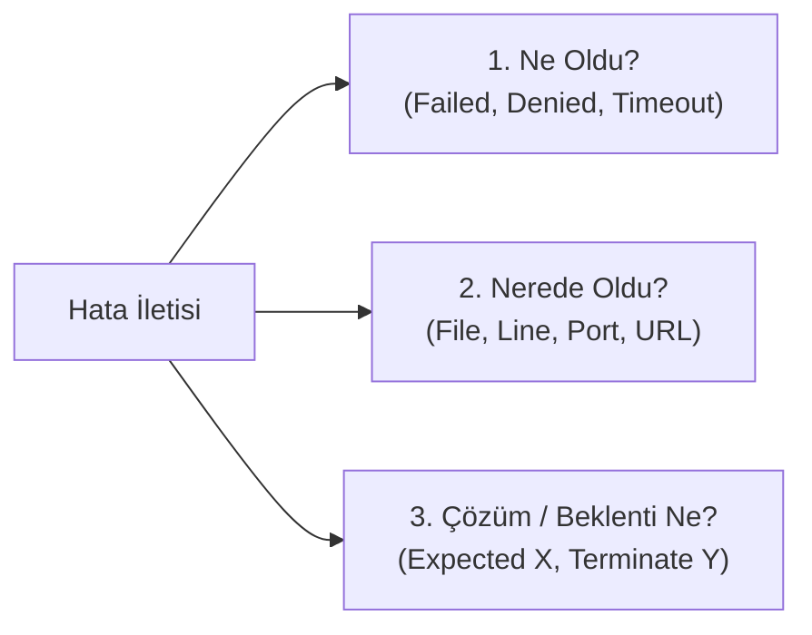

# Teknik Talimatlar ve Hata Yönetimi (Technical Instructions & Error Handling)

Yazılım geliştirme, robotik kontrol ve veri tabanı sistemlerinde karşılaşılan teknik metinler iki temel yapıya dayanır: Sisteme yön veren **teknik talimatlar (instructions)** ve aksaklık anında üretilen **hata kayıtları (error logs)**.

Bu alanda amaç tüm metni kelime kelime Türkçeye çevirmek değil; eylemi, hedef bileşeni ve kısıtları hızlıca ayrıştırmaktır (*skimming* ve *scanning*). Bu belgede; emir kipi ile yazılan teknik talimatlar, hata mesajlarının mimarisi ve gerçek sistem loglarının analizi ele alınmaktadır.

---

## 1. Teknik Talimatlar ve Emir Kipi (Imperatives)

Dokümantasyonlarda, kurulum adımlarında ve donanım kılavuzlarında doğrudan **Emir Kipi (Imperative Mood)** kullanılır. Bu yapıda özne bulunmaz; cümle doğrudan yalın fiille başlar.

```
[Yalın Fiil] + [Hedef Bileşen / Parametre] + [Bağlam / Koşul]
```

### 1.1. Sık Kullanılan Eylem Fiilleri

| Fiil | Türkçe Karşılığı | Örnek Talimat | Türkçe Anlamı |
| :--- | :--- | :--- | :--- |
| **Clone** | Klonlamak / Kopyalamak | `Clone the repository to your local disk.` | Depoyu yerel diskinize klonlayınız. |
| **Install** | Kurmak / Yüklemek | `Install the required dependencies via CLI.` | Gerekli bağımlılıkları komut satırından yükleyiniz. |
| **Configure** | Yapılandırmak | `Configure the database port in config.json.` | `config.json` dosyasındaki portu yapılandırınız. |
| **Run / Execute** | Çalıştırmak / İcra etmek | `Execute the migration script before startup.` | Başlatmadan önce aktarım betiğini çalıştırınız. |
| **Connect** | Bağlamak / Bağlanmak | `Connect the TX pin of the sensor to RX.` | Sensörün TX pinini RX pinine bağlayınız. |
| **Verify** | Doğrulamak / Teyit etmek | `Verify the network connection status.` | Ağ bağlantı durumunu doğrulayınız. |
| **Ensure** | Sağlamak / Emin olmak | `Ensure that the supply voltage is 5V.` | Besleme geriliminin 5V olduğundan emin olunuz. |
| **Restart** | Yeniden başlatmak | `Restart the server after editing the file.` | Dosyayı düzenledikten sonra sunucuyu yeniden başlatınız. |
| **Terminate** | Sonlandırmak / Durdurmak | `Terminate the running background process.` | Çalışan arka plan işlemini sonlandırınız. |

### 1.2. Olumsuz Emir Kipi ve Güvenlik Uyarıları

Sisteme zarar verebilecek adımları önlemek için `Do not + Yalın Fiil` veya `Never + Yalın Fiil` yapısı kullanılır.

* **Talimat:** `Do not disconnect the USB cable during firmware update.`  
  **Çeviri:** Aygıt yazılımı güncellemesi sırasında USB kablosunun bağlantısını kesmeyiniz.

* **Talimat:** `Never expose the microcontroller inputs to voltages higher than 3.3V.`  
  **Çeviri:** Mikrodenetleyici girişlerini asla 3.3V'tan daha yüksek gerilimlere maruz bırakmayınız.

---

## 2. Hata Mesajlarının Anatomisi (Architecture of Error Logs)

Konsol ve terminal çıktıları rastgele metinler değildir. Çıktılar belirli bir yapısal formülü takip eder:

```
[Hata / Problem Türü] + [Etkilenen Bileşen / Konum] + [Sebep veya Beklenen Durum]
```


*Şekil 1: Teknik Hata İletilerini Ayrıştırma ve Teşhis Akışı*

### 2.1. Kritik Hata Terimleri ve Karşılıkları

Hata iletisinin ilk kelimesi sorunun doğasını tanımlar:

| Hata Terimi | Türkçe Karşılığı | Anlamı ve Bağlamı | Tipik Konsol Çıktısı |
| :--- | :--- | :--- | :--- |
| `Failed to...` | ... yapılamadı | İstenen işlem bir engelle karşılaştı | `Failed to load resource` |
| `Unable to...` | ... gerçekleştirilemiyor | Yetki veya kaynak yetersiz | `Unable to resolve host` |
| `Cannot find` / `Not found` | Bulunamıyor / Yok | Hedef dosya, sınıf veya yol mevcut değil | `Cannot find module 'express'` |
| `Timed out` / `Timeout` | Zaman aşımı | Azami bekleme süresi aşıldı | `Connection timed out` |
| `Permission denied` | Erişim engellendi | Okuma, yazma veya çalıştırma yetkisi yok | `Permission denied: /var/log/syslog` |
| `Out of bounds` / `Out of range` | Sınır dışı / Aralık aşımı | Dizi indisi tanımlı aralığın dışında | `Index out of range` |
| `Deprecated` | Kullanımı eski | Metot eski, ileride kaldırılacak | `Warning: This API is deprecated` |
| `Mismatch` | Uyuşmazlık | Veri tipi veya parametre uyuşmuyor | `Type mismatch: expected int, got string` |

---

## 3. Gerçek Dünya Hata Kayıtları ve Vaka Analizleri

Hata mesajlarını çözerken üç temel soru sorulur:
1. **Ne oldu?** *(Durum tespiti)*
2. **Nerede oldu?** *(Dosya, satır veya port bilgisi)*
3. **Sistem ne bekliyor?** *(Çözüm adımı)*

---

### Vaka 1: Ağ ve Port Çakışması Hatası

```text
Error: Port 8080 is already in use. Please terminate the process or change the port.
```

**Türkçe Çeviri:** Hata: Port 8080 zaten kullanımda. Lütfen işlemi sonlandırınız veya portu değiştiriniz.

| Bileşen | İfade | Türkçe Karşılığı | İşlevi |
| :--- | :--- | :--- | :--- |
| **Problem Türü** | `Error` | Hata | İşlemin durduğunu bildirir |
| **Hedef Kaynak** | `Port 8080` | Port 8080 | Çakışmanın yaşandığı ağ kapısı |
| **Mevcut Durum** | `is already in use` | Zaten kullanımda | Başka bir servisin portu dinlediğini gösterir |
| **Önerilen Aksiyon 1** | `terminate the process` | İşlemi sonlandırınız | Portu tutan mevcut uygulamayı kapatma |
| **Önerilen Aksiyon 2** | `or change the port` | Veya portu değiştiriniz | Yapılandırmadan yeni port tanımlama |

**Teknik Değerlendirme:** Sistem 8080 portunu açmak istemiş ancak port doludur. Çalışan önceki servis kapatılmalı ya da servis başka bir porta (örneğin `8081`) yönlendirilmelidir.

---

### Vaka 2: Sürüm Kontrol ve Kimlik Doğrulama Hatası (Git CLI)

```text
Fatal: could not read Username for 'https://github.com': Device not configured.
```

**Türkçe Çeviri:** Kritik Hata: 'https://github.com' için kullanıcı adı okunamadı: Aygıt yapılandırılmamış.

| Bileşen | İfade | Türkçe Karşılığı | İşlevi |
| :--- | :--- | :--- | :--- |
| **Önem Seviyesi** | `Fatal` | Kritik | Sürecin derhal durduğunu gösterir |
| **Problem** | `could not read Username` | Kullanıcı adı okunamadı | Kimlik bilgisi girişinin alınamadığını belirtir |
| **Hedef Adres** | `'https://github.com'` | Hedef depo adresi | Bağlanılmak istenen uzak sunucu |
| **Kök Sebep** | `Device not configured` | Aygıt yapılandırılmamış | Terminalde interaktif giriş akışının olmaması |

**Teknik Değerlendirme:** Terminal interaktif kimlik girdisi alamadığı için işlem düşmüştür. Doğrulama için SSH anahtarı veya kişisel erişim belirteci (*Personal Access Token*) tanımlanmalıdır.

---

### Vaka 3: Dizi ve Bellek Sınır Aşımı (Runtime Exception)

```text
IndexOutOfBoundsException: Index 5 out of bounds for length 5.
```

**Türkçe Çeviri:** Sınır Dışı İndeks İstisnası: 5 elemanlı dizi için 5. indeks sınırların dışındadır.

| Bileşen | İfade | Türkçe Karşılığı | İşlevi |
| :--- | :--- | :--- | :--- |
| **İstisna Sınıfı** | `IndexOutOfBoundsException` | Sınır dışı indeks istisnası | Geçersiz indis erişimini bildirir |
| **İstenen Konum** | `Index 5` | 5. indeks | Kodun erişmeye çalıştığı eleman |
| **Hata Durumu** | `out of bounds` | Sınırların dışında | Tanımlı aralığın aşıldığını gösterir |
| **Dizi Boyutu** | `for length 5` | 5 elemanlık uzunluk için | Dizinin toplam eleman sayısı |

**Teknik Değerlendirme:** İndeksler sıfırdan başladığı için (`0, 1, 2, 3, 4`), 5 elemanlı bir dizinin son geçerli indisi 4'tür. Kod 5. indise erişmeye çalıştığında bellek koruması devreye girmiştir.

---

### Vaka 4: Mobil / Dart Çalışma Zamanı Hatası (Null Pointer)

```text
Unhandled Exception: Null check operator used on a null value.
#0 UserService.getUserData (user_service.dart:45)
```

**Türkçe Çeviri:** Yönetilmemiş İstisna: Null bir değer üzerinde null kontrol operatörü kullanıldı.

| Bileşen | İfade | Türkçe Karşılığı | İşlevi |
| :--- | :--- | :--- | :--- |
| **İstisna Türü** | `Unhandled Exception` | Yönetilmemiş İstisna | Kodda `try/catch` ile yakalanmamış hata |
| **Sebep** | `Null check operator used...` | Null değerde ! kullanıldı | Değişkenin boş (`null`) geldiğini gösterir |
| **Kaynak Dosya** | `user_service.dart:45` | Dosya ve satır 45 | Hatanın fırlatıldığı tam kod satırı |

**Teknik Değerlendirme:** `user_service.dart` dosyasının 45. satırında değişkenin dolu olduğu varsayılarak sonuna `!` konulmuş, ancak çalışma anında veri `null` döndüğü için uygulama kırılmıştır.

---

### Vaka 5: Gömülü Sistem ve Derleyici Bağlantı Hatası (Linker Error)

```text
undefined reference to 'setup'
collect2: error: ld returned 1 exit status
```

**Türkçe Çeviri:** 'setup' fonksiyonuna tanımsız referans. Bağlayıcı (ld) 1 çıkış koduyla sonlandı.

| Bileşen | İfade | Türkçe Karşılığı | İşlevi |
| :--- | :--- | :--- | :--- |
| **Bağlantı Hatası** | `undefined reference to 'setup'` | Tanımsız referans | Fonksiyon bildirilmiş fakat gövdesi bulunamamış |
| **Bileşen** | `ld (Linker)` | Bağlayıcı | Nesne dosyalarını birleştiren derleme aracı |
| **Çıkış Durumu** | `returned 1 exit status` | 1 koduyla döndü | Derleme sürecinin başarısız olduğunu belirtir |

**Teknik Değerlendirme:** Framework tarafından beklenen `setup()` fonksiyonu tanımlanmamış veya kaynak dosya derleme zincirine dahil edilmemiştir.

---

## 4. Teknik Kurulum Kılavuzu Analizi (Step-by-Step Implementation Guide)

Açık kaynak bir projenin kurulum adımları:

> **Step 1:** Clone the repository to your local machine.  
> **Step 2:** Ensure that the database service is running on the default port.  
> **Step 3:** Run `npm install` to download and install all external dependencies.  
> **Step 4:** If you encounter an `EACCES` error, check your folder permissions.  
> **Step 5:** Execute `npm start` to launch the application in development mode.

### Adım Adım İnceleme ve Çeviri Tablosu

| Adım | İngilizce Cümle | Anahtar Eylem / Yapı | Türkçe Açıklama ve Çeviri |
| :---: | :--- | :--- | :--- |
| **1** | `Clone the repository to your local machine.` | **Clone** *(Emir Kipi)* | Proje deposunu yerel bilgisayarınıza klonlayınız. |
| **2** | `Ensure that the database service is running...` | **Ensure that** *(Kontrol)* | Veri tabanı servisinin varsayılan portta çalıştığından emin olunuz. |
| **3** | `Run npm install to download and install...` | **Run ... to [Fiil]** *(Amaç Bildirimi)* | Tüm harici bağımlılıkları indirmek ve kurmak için `npm install` komutunu çalıştırınız. |
| **4** | `If you encounter an EACCES error, check...` | **If + check** *(Koşullu Emir)* | Eğer bir `EACCES` (erişim) hatasıyla karşılaşırsanız, klasör izinlerinizi kontrol ediniz. |
| **5** | `Execute npm start to launch the application...` | **Execute ... to launch** *(Amaç Bildirimi)* | Uygulamayı geliştirme modunda başlatmak için `npm start` komutunu icra ediniz. |

---

## 5. Teknik Metin Okuma Stratejisi: Tarama Yöntemi (Skimming & Scanning)

Teknik metinleri okurken sözlük kullanarak her kelimeyi Türkçeleştirmeye çalışmak süreci yavaşlatır. Mühendislik pratiğinde iki aşamalı okuma yöntemi uygulanır:

1. **Skimming (Göz Gezdirme - Ana Fikri Çıkarma):**
   * Metnin tamamı okunmaz.
   * Yalnızca **başlıklar**, **kod blokları**, **hata kodları** ve **vurgulu terimler** taranarak bağlam saniyeler içinde anlaşılır.
2. **Scanning (Ayrıntı Avlama - Nokta Atışı Bilgi Bulma):**
   * Belirli bir parametre aranır (örneğin port numarası, satır bilgisi, gerilim kısıtı).
   * Göz yalnızca aranan anahtar kelimeye (`port`, `line`, `syntax`, `voltage`) odaklanır; çevreleyen cümleler atlanır.
