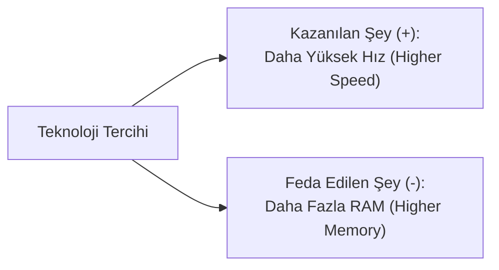

# Teknik Karşılaştırmalar ve Teknoloji Seçimi (Technical Comparatives & Trade-offs)

Teknik alanlarda ve yazılım mimarisinde kararlar mutlak doğrular üzerine değil, sistem kısıtlarına göre yapılan **tercih ve denge hesapları (trade-offs)** üzerine kuruludur. Bir sistemde işlem hızı artırıldığında bellek tüketimi yükselebilir; güvenlik katmanları çoğaltıldığında sistemin kullanım kolaylığı azalabilir.

Teknik İngilizcede teknolojileri, algoritmaları ve donanımları kıyaslamak için kullanılan dil; doğrudan sıfatların kıyaslama biçimlerine (*comparatives* ve *superlatives*), zıtlık bağlaçlarına ve performans ölçütlerine dayanır. Bu belgede; teknik kıyaslama kalıpları, donanım/yazılım seçiminde kullanılan kritik sıfat çiftleri ve gerçek dünya kıyaslama raporlarının analizi incelenmektedir.

---

## 1. Teknik Alanlarda "Trade-off" (Tercih ve Denge) Mantığı

Teknik İngilizcede en sık duyulan terimlerden biri **trade-off** kavramıdır. Bu kavram günlük dildeki **"bir avantajı kazanmak için başka bir şeyden mecburen vazgeçmek"** veya **"artı - eksi dengesi"** anlamına gelir.

Teknik dünyada "hem en hızlı, hem en ucuz, hem de sıfır kaynak tüketen" mükemmel bir sistem yoktur. Bir özelliği artırdığınızda başka bir özellikten taviz vermek zorunda kalırsınız:

| Karşılaşılan Durum | Kazanılan Avantaj (+) | Verilen Taviz / Bedel (-) | İngilizce Karşılığı |
| :--- | :--- | :--- | :--- |
| **Görüntü Kalitesi** | 4K kristal netliğinde video | 10 GB devasa dosya boyutu | `Quality vs file size trade-off` |
| **İşlem Hızı** | Milisaniyeler içinde hızlı yanıt | Aşırı RAM (bellek) tüketimi | `Speed vs memory trade-off` |
| **Sistem Güvenliği** | Kırılamaz 3 aşamalı doğrulama | Kullanıcının giriş yaparken zorlanması | `Security vs convenience trade-off` |
| **Pilli Sensörler** | Yıllarca bitmeyen pil ömrü | Düşük veri hızı ve kısa çekim mesafesi | `Power vs performance trade-off` |


*Şekil 1: Bir Özelliği İyileştirirken Diğerinden Vazgeçme (Trade-off) Mantığı*

### 1.1. Metinlerde Sık Geçen Kalıp Cümleler

* **Kalıp 1:** `There is a trade-off between X and Y.`  
  *(X ile Y arasında mecburi bir denge / taviz ilişkisi vardır.)*  
  *Örnek:* `There is a trade-off between security and speed.` *(Güvenlik ile hız arasında bir denge zorunluluğu vardır; güvenlik arttıkça sistem yavaşlayabilir).*

* **Kalıp 2:** `We sacrifice X to gain Y.`  
  *(Y'yi kazanmak için X'ten vazgeçeriz / feragat ederiz.)*  
  *Örnek:* `We sacrifice binary size to achieve faster execution.` *(Daha hızlı çalışma elde etmek için dosya boyutunun büyümesine razı oluruz).*

---

## 2. Kıyaslama ve Üstünlük Dereceleri (Comparatives & Superlatives)

Teknik şartnamelerde ve benchmark analizlerinde sıfatlar hece sayısına ve kural yapısına göre üç grupta çekimlenir:

### 2.1. Kısa (Tek Heceli) Sıfatlar (`-er than` / `the -est`)

Tek heceli teknik sıfatların sonuna kıyaslamada `-er`, en üstünlük bildiriminde `-est` eklenir:

| Sıfat (Base) | Kıyaslama (Comparative) | Üstünlük (Superlative) | Teknik Kullanım Örneği | Türkçe Anlamı |
| :--- | :--- | :--- | :--- | :--- |
| **Fast** (Hızlı) | `faster than` | `the fastest` | `C++ is faster than Python.` | C++, Python'dan daha hızlıdır. |
| **Slow** (Yavaş) | `slower than` | `the slowest` | `Disk I/O is slower than RAM access.` | Disk G/Ç işlemi RAM erişiminden daha yavaştır. |
| **Low** (Düşük) | `lower than` | `the lowest` | `BLE offers lower power consumption.` | BLE daha düşük güç tüketimi sunar. |
| **High** (Yüksek) | `higher than` | `the highest` | `Optical fibers provide higher bandwidth.` | Fiber kablolar daha yüksek bant genişliği sağlar. |

### 2.2. Çok Heceli Sıfatlar (`more / less ... than` / `the most / least`)

İki veya daha fazla heceli teknik sıfatlarda kelime yapısı bozulmaz; önüne `more` (daha fazla) veya `less` (daha az) getirilir:

| Sıfat (Base) | Kıyaslama | Üstünlük | Teknik Kullanım Örneği | Türkçe Anlamı |
| :--- | :--- | :--- | :--- | :--- |
| **Reliable** (Güvenilir) | `more reliable than` | `the most reliable` | `TCP is more reliable than UDP.` | TCP, UDP'den daha güvenilirdir. |
| **Efficient** (Verimli) | `more efficient than` | `the most efficient` | `Vectorized operations are more efficient.` | Vektörel işlemler daha verimlidir. |
| **Complex** (Karmaşık) | `less complex than` | `the least complex` | `SPI is less complex than I2C.` | SPI protokolü I2C'den daha az karmaşıktır. |
| **Scalable** (Ölçeklenebilir) | `more scalable than` | `the most scalable` | `NoSQL is more scalable horizontally.` | NoSQL yatayda daha ölçeklenebilirdir. |

### 2.3. Düzensiz Sıfatlar (Irregular Forms)

Kural dışı değişen temel değerlendirme sıfatları:

| Sıfat | Comparative | Superlative | Örnek Cümle | Türkçe Anlamı |
| :--- | :--- | :--- | :--- | :--- |
| **Good** (İyi) | `better than` | `the best` | `PostgreSQL provides better query optimization.` | PostgreSQL daha iyi sorgu optimizasyonu sağlar. |
| **Bad** (Kötü) | `worse than` | `the worst` | `Linear search has worse time complexity.` | Doğrusal arama daha kötü zaman karmaşıklığına sahiptir. |

### 2.4. Eşitlik ve Oran Kalıpları (`as ... as` / `Kat İfadeleri`)

* **As ... as (Kadar):** `SQLite is as fast as file storage for small datasets.`  
  *(Küçük veri setlerinde SQLite, dosya depolama kadar hızlıdır.)*
* **Twice as ... as (İki kat daha):** `Flash memory is twice as fast as magnetic storage.`  
  *(Flash bellek, manyetik depolamadan iki kat daha hızlıdır.)*

---

## 3. Sık Kullanılan Teknik Sıfat Çiftleri

Teknik değerlendirme raporlarında zıtlıkları vurgulamak için kullanılan anahtar terimler:

| Parametre Çifti | Orijinal Terimler | Türkçe Karşılıkları | Bağlam ve Kullanım Alanı |
| :--- | :--- | :--- | :--- |
| **Performans** | `High throughput` $\leftrightarrow$ `Low latency` | Yüksek veri akışı $\leftrightarrow$ Düşük gecikme | Ağ protokolleri ve veri tabanları |
| **Kaynak** | `Lightweight` $\leftrightarrow$ `Resource-intensive` | Hafif / Düşük kaynaklı $\leftrightarrow$ Ağır / Kaynak tüketen | Kütüphane, mikrodenetleyici ve işletim sistemi |
| **Maliyet** | `Cost-effective` $\leftrightarrow$ `Expensive` | Fiyat-performans odaklı $\leftrightarrow$ Maliyetli | Bulut altyapısı ve donanım bileşeni seçimi |
| **Esneklik** | `Flexible` $\leftrightarrow$ `Rigid / Strict` | Esnek / Dinamik $\leftrightarrow$ Katı / Sabit şemalı | NoSQL (şemasız) $\leftrightarrow$ SQL (katı ilişkisel) |
| **Sağlamlık** | `Robust` $\leftrightarrow$ `Fragile` | Hata toleranslı / Dayanıklı $\leftrightarrow$ Kırılgan / Hassas | Endüstriyel sensörler ve hata yakalama |

---

## 4. Kıyaslama ve Zıtlık Bildiren Teknik Bağlaçlar

Farklı sistemleri tek bir raporda karşılaştırırken kullanılan temel bağlaçlar:

| Bağlaç | Türkçe Anlamı | Teknik Cümle Örneği | Türkçe Karşılığı |
| :--- | :--- | :--- | :--- |
| **Compared to** | ... ile kıyaslandığında | `Compared to HDD, SSD consumes less energy.` | HDD ile kıyaslandığında SSD daha az enerji tüketir. |
| **Whereas / While** | ... iken / -e karşılık | `SQL enforces schema, whereas NoSQL is dynamic.` | SQL şemayı zorunlu kılarken, NoSQL dinamiktir. |
| **In contrast to** | ...-in aksine | `In contrast to Wi-Fi, BLE has a lower range.` | Wi-Fi'ın aksine BLE daha düşük bir menzile sahiptir. |
| **On the other hand** | Diğer yandan / Öte yandan | `Flutter simplifies UI; on the other hand, build size is larger.` | Flutter arayüzü kolaylaştırır; öte yandan çıktı boyutu daha büyüktür. |

---

## 5. Gerçek Dünya Vaka Analizleri ve Karşılaştırma Raporları

### Vaka 1: Veri Tabanı Mimarisi (PostgreSQL vs MongoDB)

```text
PostgreSQL is more reliable than MongoDB for complex relational transactions. 
However, MongoDB offers higher write throughput and better horizontal scalability for unstructured logs.
```

**Türkçe Çeviri:** Karmaşık ilişkisel işlemlerde PostgreSQL, MongoDB'den daha güvenilirdir. Bununla birlikte MongoDB, yapısal olmayan log kayıtlarında daha yüksek yazma hızı ve daha iyi yatay ölçeklenebilirlik sunar.

| Karşılaştırma Ölçütü | PostgreSQL | MongoDB | Teknik Değerlendirme |
| :--- | :--- | :--- | :--- |
| **Transaction Reliability** | `More reliable (ACID)` | `Eventual consistency` | Finansal veri için PostgreSQL seçilmelidir |
| **Write Throughput** | `Moderate` | `Higher write throughput` | Yüksek hacimli veri akışında MongoDB öne çıkar |
| **Schema Flexibility** | `Strict relational schema` | `More flexible (JSON/BSON)` | Değişken veri yapıları için NoSQL daha esnektir |

---

### Vaka 2: Mobil Geliştirme Yaklaşımları (Flutter vs Native Android)

```text
Cross-platform development with Flutter is more cost-effective and faster than developing separate native apps. 
Nevertheless, native Android code provides direct hardware access and results in smaller binary sizes.
```

**Türkçe Çeviri:** Flutter ile platformlar arası geliştirme yapmak, ayrı yerel uygulamalar geliştirmekten daha uygun maliyetli ve daha hızlıdır. Yine de yerel Android kodu doğrudan donanım erişimi sağlar ve daha küçük derleme boyutları üretir.

| Karşılaştırma Ölçütü | Flutter (Cross-Platform) | Native (Kotlin / Swift) | Teknik Değerlendirme |
| :--- | :--- | :--- | :--- |
| **Development Speed** | `Faster (Single codebase)` | `Slower (Two codebases)` | Pazara hızlı çıkış için Flutter avantajlıdır |
| **Binary Size** | `Larger (Engine bundle)` | `Smaller binary size` | Kısıtlı depolama alanına sahip cihazlarda yerel kod tercih edilir |
| **Hardware Access** | `Requires platform channels` | `Direct hardware access` | Derin Bluetooth/NFC sürücülerinde yerel kod daha kararlıdır |

---

### Vaka 3: Kablosuz Haberleşme Seçimi (Wi-Fi vs Bluetooth Low Energy - BLE)

```text
Wi-Fi delivers significantly higher bandwidth than BLE, making it suitable for video streaming. 
On the other hand, BLE consumes substantially less power, allowing battery-powered sensors to operate for years.
```

**Türkçe Çeviri:** Wi-Fi, BLE'den belirgin şekilde daha yüksek bant genişliği sunarak video aktarımı için uygun hale gelir. Diğer yandan BLE, büyük ölçüde daha az güç tüketerek pilli sensörlerin yıllarca çalışmasına olanak tanır.

| Parametre | Wi-Fi (802.11) | Bluetooth Low Energy (BLE) | Teknik Karar |
| :--- | :--- | :--- | :--- |
| **Data Rate (Throughput)** | `Higher bandwidth (Mbps)` | `Lower bandwidth (kbps)` | Yüksek veri akışında Wi-Fi zorunludur |
| **Power Consumption** | `High power consumption` | `Substantially less power` | Düğme pille çalışan IoT sensörlerinde BLE kullanılır |
| **Communication Range** | `Longer range (~50m)` | `Shorter range (~10m)` | Uzak saha izleme için Wi-Fi veya hücresel ağ gerekir |

---

## 6. Teknik Karar Matrisi: Teknoloji Seçim Kriterleri

Teknik değerlendirme raporu yazılırken veya iki teknoloji arasında seçim yapılırken şu şablon kullanılır:

| Kriter | Kıyaslama Sorusu | Kullanılacak İngilizce Kalıp | Karar Çıkarımı |
| :---: | :--- | :--- | :--- |
| **1** | Hangi teknoloji daha az kaynak tüketiyor? | `X is more lightweight than Y.` | Gömülü ve mobil hedeflerde X seçilir |
| **2** | Hangisinin tepki süresi daha kısa? | `X provides lower latency than Y.` | Gerçek zamanlı robotik kontrolde X zorunludur |
| **3** | Hangisi daha düşük maliyetli? | `X is more cost-effective than Y.` | Girişim ve MVP projelerinde X tercih edilir |
| **4** | Hangisi yüksek yük altında daha dayanıklı? | `X is more robust under heavy traffic.` | Kurumsal ve kritik altyapılarda X seçilir |
