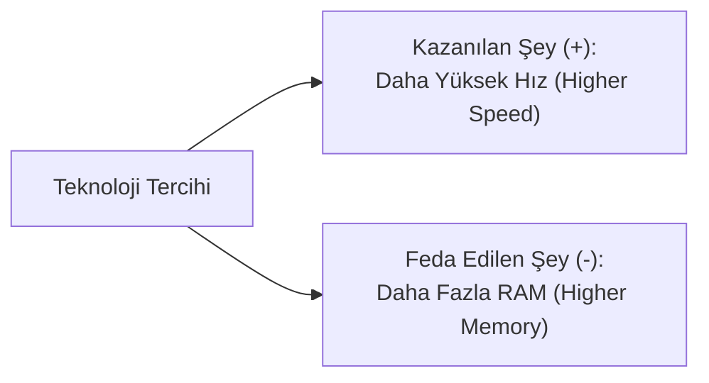

# Teknik Karşılaştırmalar ve Teknoloji Seçimi (Technical Comparatives & Trade-offs)

Teknik alanlarda ve yazılım mimarisinde kararlar mutlak doğrular üzerine değil, sistem kısıtlarına göre yapılan **tercih ve denge hesapları (trade-offs)** üzerine kuruludur. Bir sistemde işlem hızı artırıldığında bellek tüketimi yükselebilir; güvenlik katmanları çoğaltıldığında sistemin kullanım kolaylığı azalabilir.

Teknik İngilizcede teknolojileri, algoritmaları ve donanımları kıyaslamak için kullanılan dil; doğrudan sıfatların kıyaslama biçimlerine (*comparatives* ve *superlatives*), zıtlık bağlaçlarına ve performans ölçütlerine dayanır. Bu belgede; teknik kıyaslama kalıpları, donanım/yazılım seçiminde kullanılan kritik sıfat çiftleri ve gerçek dünya kıyaslama raporlarının analizi incelenmektedir.

---

## 1. Teknik Alanlarda "Trade-off" (Tercih ve Denge) Mantığı

Teknik İngilizcede en sık duyulan terimlerden biri **trade-off** kavramıdır. Bu kavram günlük dildeki **"bir avantajı kazanmak için başka bir şeyden mecburen vazgeçmek"** veya **"artı - eksi dengesi"** anlamına gelir.

Teknik dünyada "hem en hızlı, hem en ucuz, hem de sıfır kaynak tüketen" mükemmel bir sistem yoktur. Bir özelliği artırdığınızda başka bir özellikten taviz vermek zorunda kalırsınız:

| Karşılaşılan Durum | Kazanılan Avantaj (+) | Verilen Taviz / Bedel (-) | İngilizce Karşılığı |
| :--- | :--- | :--- | :--- |
| **Görüntü Kalitesi** | 4K kristal netliğinde video | 10 GB devasa dosya boyutu | `Quality vs file size trade-off` |
| **İşlem Hızı** | Milisaniyeler içinde hızlı yanıt | Aşırı RAM (bellek) tüketimi | `Speed vs memory trade-off` |
| **Sistem Güvenliği** | Kırılamaz 3 aşamalı doğrulama | Kullanıcının giriş yaparken zorlanması | `Security vs convenience trade-off` |
| **Pilli Sensörler** | Yıllarca bitmeyen pil ömrü | Düşük veri hızı ve kısa çekim mesafesi | `Power vs performance trade-off` |

*Şekil 1: Bir Özelliği İyileştirirken Diğerinden Vazgeçme (Trade-off) Mantığı*

### 1.1. Metinlerde Sık Geçen Kalıp Cümleler

* **Kalıp 1:** `There is a trade-off between X and Y.`  
  *(X ile Y arasında mecburi bir denge / taviz ilişkisi vardır.)*  
  *Örnek:* `There is a trade-off between security and speed.` *(Güvenlik ile hız arasında bir denge zorunluluğu vardır; güvenlik arttıkça sistem yavaşlayabilir).*

* **Kalıp 2:** `We sacrifice X to gain Y.`  
  *(Y'yi kazanmak için X'ten vazgeçeriz / feragat ederiz.)*  
  *Örnek:* `We sacrifice binary size to achieve faster execution.` *(Daha hızlı çalışma elde etmek için dosya boyutunun büyümesine razı oluruz).*

---

## 2. Kıyaslama ve Üstünlük Dereceleri (Comparatives & Superlatives)

Teknik şartnamelerde ve benchmark analizlerinde sıfatlar hece sayısına ve kural yapısına göre üç grupta çekimlenir:

### 2.1. Kısa (Tek Heceli) Sıfatlar (`-er than` / `the -est`)

Tek heceli teknik sıfatların sonuna kıyaslamada `-er`, en üstünlük bildiriminde `-est` eklenir:

| Sıfat (Base) | Kıyaslama (Comparative) | Üstünlük (Superlative) | Teknik Kullanım Örneği | Türkçe Anlamı |
| :--- | :--- | :--- | :--- | :--- |
| **Fast** (Hızlı) | `faster than` | `the fastest` | `C++ is faster than Python.` | C++, Python'dan daha hızlıdır. |
| **Slow** (Yavaş) | `slower than` | `the slowest` | `Disk I/O is slower than RAM access.` | Disk G/Ç işlemi RAM erişiminden daha yavaştır. |
| **Low** (Düşük) | `lower than` | `the lowest` | `BLE offers lower power consumption.` | BLE daha düşük güç tüketimi sunar. |
| **High** (Yüksek) | `higher than` | `the highest` | `Optical fibers provide higher bandwidth.` | Fiber kablolar daha yüksek bant genişliği sağlar. |

### 2.2. Çok Heceli Sıfatlar (`more / less ... than` / `the most / least`)

İki veya daha fazla heceli teknik sıfatlarda kelime yapısı bozulmaz; önüne `more` (daha fazla) veya `less` (daha az) getirilir:

| Sıfat (Base) | Kıyaslama | Üstünlük | Teknik Kullanım Örneği | Türkçe Anlamı |
| :--- | :--- | :--- | :--- | :--- |
| **Reliable** (Güvenilir) | `more reliable than` | `the most reliable` | `TCP is more reliable than UDP.` | TCP, UDP'den daha güvenilirdir. |
| **Efficient** (Verimli) | `more efficient than` | `the most efficient` | `Vectorized operations are more efficient.` | Vektörel işlemler daha verimlidir. |
| **Complex** (Karmaşık) | `less complex than` | `the least complex` | `SPI is less complex than I2C.` | SPI protokolü I2C'den daha az karmaşıktır. |
| **Scalable** (Ölçeklenebilir) | `more scalable than` | `the most scalable` | `NoSQL is more scalable horizontally.` | NoSQL yatayda daha ölçeklenebilirdir. |

### 2.3. Düzensiz Sıfatlar (Irregular Forms)

Kural dışı değişen temel değerlendirme sıfatları:

| Sıfat | Comparative | Superlative | Örnek Cümle | Türkçe Anlamı |
| :--- | :--- | :--- | :--- | :--- |
| **Good** (İyi) | `better than` | `the best` | `PostgreSQL provides better query optimization.` | PostgreSQL daha iyi sorgu optimizasyonu sağlar. |
| **Bad** (Kötü) | `worse than` | `the worst` | `Linear search has worse time complexity.` | Doğrusal arama daha kötü zaman karmaşıklığına sahiptir. |

### 2.4. Eşitlik ve Oran Kalıpları (`as ... as` / `Kat İfadeleri`)

* **As ... as (Kadar):** `SQLite is as fast as file storage for small datasets.`  
  *(Küçük veri setlerinde SQLite, dosya depolama kadar hızlıdır.)*
* **Twice as ... as (İki kat daha):** `Flash memory is twice as fast as magnetic storage.`  
  *(Flash bellek, manyetik depolamadan iki kat daha hızlıdır.)*

---

## 3. Gerçek Dünya Karşılaştırma Cümleleri (Sample Comparative Sentences)

Teknik alanlarda sıkça karşılaşılan kıyaslama senaryoları ve Türkçe karşılıkları:

### 3.1. Veri Tabanı ve Veri Yönetimi

* `PostgreSQL is more reliable than MongoDB for complex relational transactions.`  
  *(Karmaşık ilişkisel işlemlerde PostgreSQL, MongoDB'den daha güvenilirdir.)*

* `MongoDB offers higher write throughput and better horizontal scalability for unstructured logs.`  
  *(MongoDB, yapısal olmayan log kayıtlarında daha yüksek yazma hızı ve daha iyi yatay ölçeklenebilirlik sunar.)*

* `Redis is significantly faster than relational databases because it operates in-memory.`  
  *(Redis, bellek içinde çalıştığı için ilişkisel veri tabanlarından belirgin şekilde daha hızlıdır.)*

### 3.2. Yazılım ve Mobil Geliştirme

* `Cross-platform development with Flutter is more cost-effective and faster than developing separate native apps.`  
  *(Flutter ile platformlar arası geliştirme yapmak, ayrı yerel uygulamalar geliştirmekten daha uygun maliyetli ve daha hızlıdır.)*

* `Native Android code provides direct hardware access and results in smaller binary sizes.`  
  *(Yerel Android kodu doğrudan donanım erişimi sağlar ve daha küçük derleme boyutları üretir.)*

* `Compiled languages like Go and Rust are more efficient than interpreted languages like Python.`  
  *(Go ve Rust gibi derlenen diller, Python gibi yorumlanan dillerden daha verimlidir.)*

### 3.3. Donanım ve Ağ Protokolleri

* `Wi-Fi delivers higher bandwidth than BLE, making it suitable for continuous data streaming.`  
  *(Wi-Fi, BLE'den daha yüksek bant genişliği sunarak sürekli veri akışı için uygun hale gelir.)*

* `BLE consumes substantially less power than Wi-Fi, allowing battery-powered sensors to operate for years.`  
  *(BLE, Wi-Fi'dan büyük ölçüde daha az güç tüketerek pilli sensörlerin yıllarca çalışmasına olanak tanır.)*

* `SPI is faster than I2C because it uses dedicated clock and data lines for full-duplex communication.`  
  *(SPI, çift yönlü eşzamanlı iletişim için ayrı saat ve veri hatları kullandığından I2C'den daha hızlıdır.)*
