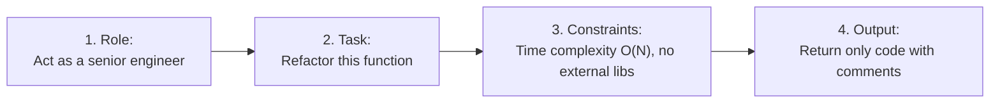

# Geliştiriciler İçin Teknik Prompt Tasarımı (Technical Prompt Engineering for Developers)

Yapay zekâ kodlama asistanları (Gemini, GitHub Copilot, ChatGPT), modern yazılım geliştirme ve teknik iş akışlarının vazgeçilmez bir parçası haline gelmiştir. Bu modellerin temel eğitim verisi ve teknik literatür ağırlıklı olarak İngilizce olduğu için; bir mimari problemi, optimizasyon gereksinimini veya hata ayıklama sürecini İngilizce ifade etmek çok daha doğru, temiz ve optimize sonuçlar üretir.

Teknik İngilizcede amaç yapay zekâ ile genel sohbet etmek değil; modele kesin roller vermek, kısıtları netleştirmek ve beklenen çıktı biçimini hatasız tanımlamaktır. Bu belgede; teknik prompt mimarisi, yönerge fiilleri, gerçek dünya geliştirici prompt senaryoları ve prompt teknikleri incelenmektedir.

---

## 1. Etkili Bir Teknik Prompt'un Anatomisi

Geliştirici dünyasında rastgele ve belirsiz istekler yerine 4 bileşenden oluşan yapısal prompt formülü kullanılır:

```
[Rol Tanımı (Role)] + [Görev ve Bağlam (Task & Context)] + [Kısıtlar (Constraints)] + [Çıktı Formatı (Output Format)]
```


*Şekil 1: Yapısal Teknik Prompt Oluşturma Mimarisi*

* **Role (Rol):** Modelin hangi uzman kimliğinde yanıt üreteceğini belirler (*Act as a PostgreSQL DBA*).
* **Task (Görev):** Gerçekleştirilmesi istenen somut teknik iş (*Refactor this function*).
* **Constraints (Kısıtlar):** Uyulması zorunlu olan sınırlar ve yasaklar (*Time complexity must be O(N)*).
* **Output Format (Çıktı Biçimi):** Yanıtın şekli (*Return only the JSON schema, do not include explanations*).

---

## 2. Kritik Yönerge Fiilleri ve Şablon İfadeler

Yapay zekâya talimat verirken netlik sağlayan temel eylemler ve kısıt kalıpları:

| Fiil / Kalıp | Türkçe Karşılığı | Teknik Prompt Kullanımı | Türkçe Anlamı |
| :--- | :--- | :--- | :--- |
| **Act as a...** | ... olarak davran | `Act as a senior cybersecurity analyst.` | Kıdemli bir siber güvenlik analisti olarak davran. |
| **Refactor** | Kodu yeniden düzenle | `Refactor this legacy code to use async/await.` | Bu eski kodu async/await kullanacak şekilde düzenle. |
| **Optimize** | İyileştir / Optimize et | `Optimize this query to eliminate full table scans.` | Tam tablo taramasını engellemek için sorguyu optimize et. |
| **Debug / Locate** | Hatayı bul ve ayıkla | `Locate the root cause of this memory leak.` | Bu bellek sızıntısının kök nedenini tespit et. |
| **Implement** | Uygula / Koda dök | `Implement robust error handling using try-catch.` | Try-catch kullanarak güçlü hata yönetimi uygula. |
| **Ensure that...** | ... olduğundan emin ol | `Ensure that the function handles null values safely.` | Fonksiyonun null değerleri güvenle yönettiğinden emin ol. |
| **Avoid...** | ... yapmaktan kaçın | `Avoid using external third-party libraries.` | Harici üçüncü parti kütüphaneler kullanmaktan kaçın. |
| **Step by step** | Adım adım | `Explain your architectural decision step by step.` | Mimari kararını adım adım açıkla. |

---

## 3. Real-World Prompt Scenarios (Gerçek Dünya Prompt Senaryoları)

### Scenario 1: Code Optimization & Complexity (Kod Optimizasyonu ve Karmaşıklık)

* **Yetersiz Prompt:** *"Bu kodu hızlandır."*
* **Profesyonel Teknik Prompt:**
  ```text
  Act as an algorithm specialist. 
  Refactor the following Python function to reduce its time complexity from O(N^2) to O(N). 
  Avoid using external libraries and preserve the original input structure. 
  Provide concise inline comments explaining the logic.
  ```

**Türkçe Çeviri:** Bir algoritma uzmanı olarak davran. Aşağıdaki Python fonksiyonunu, zaman karmaşıklığını O(N^2) seviyesinden O(N) seviyesine düşürecek şekilde yeniden düzenle. Harici kütüphane kullanmaktan kaçın ve orijinal girdi yapısını koru. Mantığı açıklayan kısa satır içi yorumlar ekle.

| Prompt Bileşeni | Kullanılan İngilizce İfade | Teknik İşlevi |
| :--- | :--- | :--- |
| **Rol** | `Act as an algorithm specialist` | Yanıtın akademik ve algoritmik doğruluğunu artırır |
| **Görev** | `Refactor ... to reduce time complexity` | Hedeflenen optimizasyon parametresini tanımlar |
| **Kısıt** | `from O(N^2) to O(N)`, `Avoid external libraries` | Bellek ve çalışma sınırlarını kesinleştirir |
| **Çıktı Şartı** | `Provide concise inline comments` | Kodun okunabilirliğini ve belgelenmesini sağlar |

---

### Scenario 2: Mobile Debugging (Mobil Hata Ayıklama & Crash Analizi)

* **Yetersiz Prompt:** *"Burada hata veriyor düzelt."*
* **Profesyonel Teknik Prompt:**
  ```text
  Analyze the following Flutter stack trace. 
  Identify the root cause of the NullPointerException and provide a fix. 
  Ensure that null-safety principles are strictly maintained and add a fallback UI state if data is missing.
  ```

**Türkçe Çeviri:** Aşağıdaki Flutter hata yığınını (stack trace) analiz et. NullPointerException hatasının kök nedenini belirle ve bir çözüm sun. Null-safety kurallarının katı bir şekilde korunduğundan emin ol ve verinin eksik olması durumunda yedek bir arayüz durumu ekle.

| Prompt Bileşeni | Kullanılan İngilizce İfade | Teknik İşlevi |
| :--- | :--- | :--- |
| **Görev** | `Analyze stack trace`, `Identify root cause` | Modelin yalnızca yüzeysel değil, kök nedene odaklanmasını sağlar |
| **Kısıt 1** | `Strictly maintain null-safety` | Eski usul güvensiz kod yazılmasını engeller |
| **Kısıt 2** | `Add a fallback UI state` | Uygulamanın beyaz ekranda kalmasını önler |

---

### Scenario 3: Database & SQL Optimization (Veri Tabanı ve Sorgu İyileştirme)

* **Yetersiz Prompt:** *"Bu sorgu çok yavaş çalışıyor."*
* **Profesyonel Teknik Prompt:**
  ```text
  Act as a PostgreSQL DBA. 
  Optimize the attached SQL query to improve execution time on a table with 10 million rows. 
  Suggest the exact composite indexes required. 
  Return only the optimized SQL and the CREATE INDEX statements.
  ```

**Türkçe Çeviri:** Bir PostgreSQL Veri Tabanı Yöneticisi (DBA) olarak davran. Ekli SQL sorgusunu 10 milyon satırlı bir tabloda çalışma süresini iyileştirecek şekilde optimize et. Gerekli olan kesin birleşik indeksleri (composite indexes) öner. Yalnızca optimize edilmiş SQL'i ve CREATE INDEX komutlarını döndür.

| Prompt Bileşeni | Kullanılan İngilizce İfade | Teknik İşlevi |
| :--- | :--- | :--- |
| **Rol** | `Act as a PostgreSQL DBA` | Modeli veri tabanı optimizasyon motoru moduna geçirir |
| **Bağlam** | `table with 10 million rows` | Modelin büyük veri ölçeğine uygun indeks seçmesini sağlar |
| **İstenen Çözüm** | `Suggest composite indexes` | Yalnızca sorguyu değil, donanım indeksini de çözer |
| **Çıktı Kısıtı** | `Return only the optimized SQL...` | Gereksiz uzun metinleri engelleyip doğrudan koda odaklanır |

---

## 4. Temel Prompt Teknikleri: Zero-Shot, Few-Shot ve CoT

İleri düzey teknik sorunlarda modele yaklaşım yöntemleri:

### 4.1. Zero-Shot Prompting (Örneksiz Doğrudan Yönerge)
Modele önceden hiçbir girdi-çıktı örneği vermeden doğrudan görev tanımı yapılır:
* *Örnek:* `Convert the following JSON object into a Dart model class with fromJson and toJson methods.`

### 4.2. Few-Shot Prompting (Örneklerle Kalıp Öğretme)
Modele beklenen kalıbı göstermek için 1 veya 2 adet girdi/çıktı çifti verilir:
* *Girdi:* `Input: status=404 -> Output: NotFoundException`
* *Girdi:* `Input: status=500 -> Output: InternalServerException`
* *Görev:* `Input: status=401 -> Output: ?`

### 4.3. Chain-of-Thought (Düşünce Zinciri - Adım Adım Akıl Yürütme)
Karmaşık mimari veya matematiksel mantık içeren görevlerde modelin doğrudan kod üretmesi yerine önce mantığı kurgulaması istenir:
* *Kritik Kalıp:* `Think step by step before generating the code.`  
*(Kodu üretmeden önce adım adım mantığı kurgulayınız.)*

---

## 5. Teknik Karar Matrisi: Prompt Kalite Kontrolü

Yapay zekâya teknik bir istek göndermeden önce uygulanacak 4 adımlı kontrol listesi:

| Adım | Kontrol Sorusu | Eksikse Doğacak Sonuç |
| :---: | :--- | :--- |
| **1. Rol** | Modele spesifik bir uzmanlık alanı tanımlandı mı? | Genel geçer, yüzeysel ve standart cevaplar üretilir |
| **2. Bağlam** | Dil, kütüphane sürümü ve veri büyüklüğü belirtildi mi? | Kullanılamaz veya eski sürümlere ait fonksiyonlar önerilir |
| **3. Kısıt** | Algoritmik sınırlar ve yasaklar ifade edildi mi? | İstenmeyen kütüphaneler eklenir ve bellek tüketimi artar |
| **4. Format** | Çıktının sadece kod mu yoksa şema mı olacağı yazıldı mı? | Sayfalar dolusu gereksiz sohbet metni ayıklanmak zorunda kalınır |
