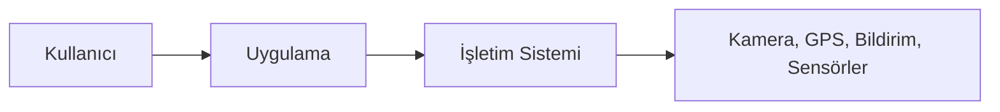
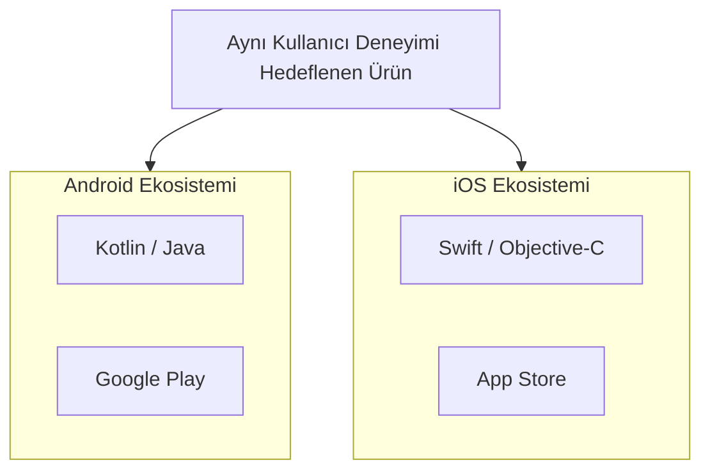
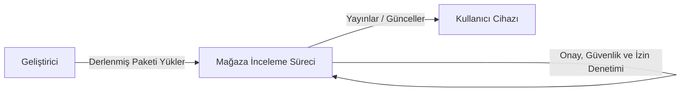
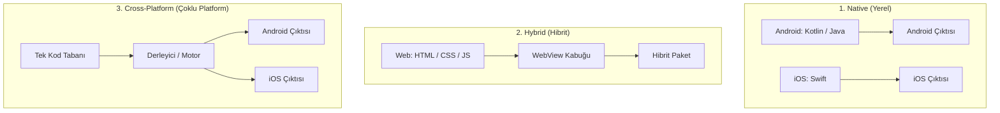
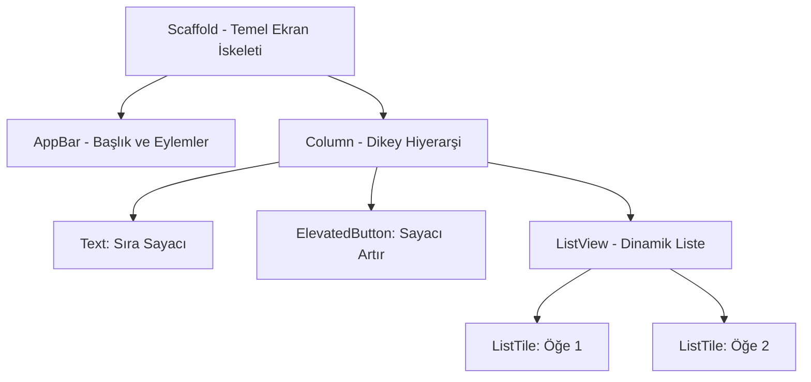
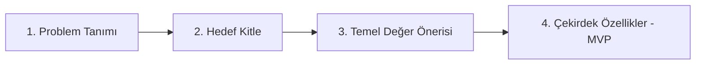
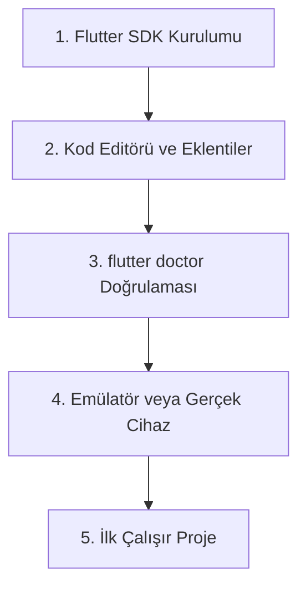

# Mobil Uygulama Geliştirmeye Giriş

Bir banka uygulamasında bakiyemizi kontrol eder, yemek siparişi verir veya mesajlaşma uygulamalarıyla iletişim kurarız. Hepsi cebimizdeki tek bir cihazda yan yana çalışır. Ancak işin mutfağına geçtiğimizde mimari bir gerçekle karşılaşırız: Android ile iOS, birbirinden tamamen farklı işletim sistemleridir ve aynı kurulum paketini çalıştırmazlar. Dolayısıyla bir mobil ürün geliştirirken yanıtlanması gereken ilk stratejik soru şudur: Her platform için ayrı ayrı kod mu yazılacak, yoksa tek bir kod tabanı üzerinden mi ilerlenecek?

Bu yazı; mobil ekosistemin bileşenlerini, temel geliştirme yaklaşımlarını ve bu yazı dizisinde Flutter ile ilerleme gerekçelerini dengeli bir mühendislik bakış açısıyla ele alıyor. Serinin devamında adım adım inşa edeceğimiz not/liste uygulamasının kavramsal çerçevesi de bu temeller üzerine kurulacak.

---

## 1. Mobil Uygulama Nedir ve Cihazla Nasıl İletişim Kurar?

**Mobil uygulama**; akıllı telefon, tablet ve giyilebilir teknolojiler gibi taşınabilir cihazlara özgü olarak geliştirilen yazılımlardır. **Arayüz (UI)**, kullanıcının doğrudan gördüğü ekranları, tipografiyi ve dokunmatik etkileşimleri barındırır. Mobil dünyada bu etkileşim, sınırlı ekran alanı ve parmakla kullanım ergonomisi gözetilerek tasarlanır.

Bir uygulama, donanım kaynaklarına doğrudan ve denetimsiz biçimde erişemez. Araya giren **işletim sistemi** (Android veya iOS), güvenlik ve kaynak yönetiminden sorumlu ana katmandır. Kamera, GPS, biyometrik sensörler veya anlık bildirimler, uygulamalara işletim sisteminin izin mekanizmaları üzerinden sunulur.



*Şekil 1: Kullanıcı uygulama arayüzüyle etkileşime girer; uygulama ise donanımsal yeteneklere işletim sistemi katmanından erişir.*

Bir mobil uygulamayı standart bir web sitesinden ayıran en temel unsur, cihazın fiziksel donanım kabiliyetleriyle kurduğu bu doğrudan ve entegre ilişkidir. Geliştirilen ürünün faaliyet alanına göre işletim sisteminden talep edilen donanım özellikleri de farklılaşır:

| Kategori | Temel Kullanım Amacı | Yoğun Kullanılan Cihaz Özellikleri |
| --- | --- | --- |
| **Finans & Bankacılık** | Bakiye takibi, transferler | Biyometrik kimlik doğrulama (Face ID/Parmak izi), güvenli depolama, anlık bildirim |
| **E-Ticaret & Lojistik** | Ürün listeleme, sipariş ve adresleme | Konum servisleri (GPS), kamera (barkod ve kart tarama) |
| **Eğitim & Üretkenlik** | İçerik tüketimi, görev takibi | Çevrimdışı (offline) yerel depolama, zamanlanmış yerel bildirimler |
| **Not / Görev Yönetimi** | Hızlı kayıt, arama ve düzenleme | Dahili veri tabanı (SQLite vb.), arka plan senkronizasyonu |
| **Oyun & Medya** | Yüksek etkileşimli grafik deneyimi | İvmeölçer, jiroskop, grafik işlemci (GPU) optimizasyonları |

Pazar, Google öncülüğündeki **Android** ve Apple'ın kapalı ekosistemi olan **iOS** olmak üzere iki ana güç üzerinde ilerler:



*Şekil 2: İki ayrı ekosistem; farklı programlama dilleri, derleme araçları ve dağıtım kuralları anlamına gelir.*

---

## 2. Mağazalar, Dağıtım Süreçleri ve Kısa Tarihçe

Kullanıcılar uygulamaları cihazlarına kurmak, güncellemek veya sistemden kaldırmak için uygulama mağazalarını kullanır. Android tarafında **Google Play**, iOS tarafında ise **Apple App Store** ana dağıtım kanallarıdır. Mağazalar yalnızca birer indirme dizini değildir; uygulamanın güvenlik denetimlerinin yapıldığı, gizlilik politikalarının incelendiği ve talep edilen sistem izinlerinin onaylandığı merkezi kontrol mekanizmalarıdır.



*Şekil 3: Dağıtım hattı; geliştiricinin derlediği paketin mağaza onay mekanizmasından geçerek son kullanıcıya ulaşmasını sağlar.*

Mobil yazılımın bugünkü olgunluğuna ulaşması kademeli bir evrimle gerçekleşti:

* **İlk Dönem:** Dokunmatik ekranların sınırlı olduğu, donanım kaynaklarının kısıtlandığı ve uygulama dağıtımının operatörler üzerinden yapıldığı **Symbian** ve **Java ME** dönemiydi.
* **Modern Dönem (2007 ve Sonrası):** İlk iPhone'un duyurulması ve hemen ardından Android'in açık kaynaklı bir modelle pazara girmesi, bugünkü akıllı telefon paradigmasını başlattı.
* **Mağaza Modeli ve Sensörler:** Geliştiricilerin tek bir merkezden dünyaya yazılım dağıtabildiği mağaza yapısı kuruldu; GPS, kamera, hareket algılayıcılar gibi sensörler mobil cihazları birer genel amaçlı bilgisayara dönüştürdü.

Bu yaygınlaşma, aynı zamanda yazılım dünyasında kritik bir ihtiyacı ortaya çıkardı: Her iki platformda da yer almak isteyen projeler için zaman, geliştirme eforu ve sürdürülebilirlik dengesini kurmak.

---

## 3. Mobil Geliştirme Yaklaşımları: İhtiyaç ve Kaynak Dengesi

Farklı platformlar için yazılım geliştirirken tercih edilen yöntemler bir üstünlük yarışından ziyade; **projenin gereksinimleri, ekibin uzmanlığı, bütçe ve hedeflenen donanım derinliği** doğrultusunda seçilir.



*Şekil 4: Üç ana geliştirme yaklaşımının mimari yapısı.*

### A. Native (Yerel) Geliştirme: Endüstrinin Altın Standardı

İşletim sisteminin doğrudan kendi resmi dilleri ve araçlarıyla (Android için **Kotlin/Java**, iOS için **Swift**) yapılan geliştirmedir.

* **Güçlü Yönleri:** Donanıma ve işletim sistemi çekirdeğine en doğrudan, aracısız erişimi sunar. Apple veya Google her yıl yeni bir donanım veya sistem yeteneği (ör. yeni kamera sensör API'leri, sistem düzeyinde yapay zeka modelleri) tanıttığında, native geliştiriciler bu özellikleri **ilk gün (Day-0)** kullanabilir. Platformun kendi arayüz tasarım diliyle (Material 3 ve Human Interface Guidelines) ve mikro etkileşimleriyle kusursuz uyum sağlar.
* **Maliyeti:** Aynı iş mantığını iki ayrı projede, iki ayrı dille yazmak; ayrı uzmanlıklara sahip ekipler kurmayı ve geliştirme maliyetlerini iki katına çıkarmayı gerektirir.

### B. Hybrid (Hibrit) Geliştirme

Arayüzün ve iş mantığının web teknolojileriyle (**HTML, CSS, JavaScript**) kurgulandığı, ardından **Capacitor** veya **Cordova** gibi bir ara katman (WebView) içerisine sarılarak mağazalara yüklendiği modeldir.

* **Güçlü Yönleri:** Web geliştirme yetkinliğine sahip ekiplerin hızla mobil çıktı alabilmesini sağlar; basit bilgi ve içerik odaklı uygulamalar için prototipleme süresi oldukça kısadır.
* **Sınırları:** Arayüz aslında bir tarayıcı motoru içinde çalıştığı için yoğun animasyonlarda, yüksek yenileme hızına sahip ekranlarda ve derin donanım gereksinimlerinde native akıcılığı yakalamakta zorlanır.

### C. Cross-Platform (Platformlar Arası) Geliştirme

Tek bir kod tabanının yazıldığı, altyapıdaki çerçevenin (framework) bu kodu hedef platformların anlayacağı biçimde yorumladığı veya doğrudan makine koduna derlediği yaklaşımdır. **Flutter** ve **React Native** günümüzdeki en yaygın temsilcileridir.

* **Güçlü Yönleri:** Tek kod tabanı üzerinden iki mağazaya birden aynı anda ürün çıkarabilme hızı, bakım kolaylığı ve ortak iş mantığı sayesinde yüksek mühendislik verimliliği sağlar.
* **Sınırları:** Platforma özgü çok nadir bir donanım veya henüz resmi olarak paketlenmemiş çok yeni bir sistem API'si gerektiğinde, araya native köprü (platform channels) yazma ihtiyacı doğabilir.

| Kriter | Native (Yerel) | Hybrid (Hibrit) | Cross-Platform (Platformlar Arası) |
| --- | --- | --- | --- |
| **Kod Tabanı** | Platform başına bağımsız proje | Web kodu ara bir kabukta | Tek kod tabanı |
| **Programlama Dili** | Kotlin, Java / Swift | HTML, CSS, JavaScript | Dart veya JavaScript / TypeScript |
| **Donanıma Erişim** | Doğrudan, sıfır gecikme (Day-0) | Kısıtlı, eklenti bağımlı | Yüksek, hazır paket ekosistemiyle geniş |
| **Arayüz Performansı** | En üst düzey akıcılık | Tarayıcı (WebView) sınırlarında | Yüksek (Donanım hızlandırmalı grafik motoru) |
| **Bakım & Ekip Maliyeti** | İki ayrı uzmanlık ve iki ayrı hat | Düşük maliyet | Tek ekip ile dengeli kaynak kullanımı |

---

## 4. Bu Seride Neden Flutter?

Büyük ölçekli bankacılık altyapıları, işletim sisteminin en güncel donanım özelliklerini çıktığı gün kullanması gereken projeler veya yoğun grafik hesaplamalı oyunlar için **Native (Kotlin/Swift) bugün hâlâ endüstrinin tartışmasız altın standardıdır.**

Bu seride Flutter'ı merkeze almamızın gerekçesi Native ekosistemin yerini alması değil; **modern bir mobil uygulamanın tüm katmanlarını en pratik ve verimli yoldan inşa etme fırsatı sunmasıdır:**

1. **Uçtan Uca Mimariyi Tek Çatıda Deneyimleme:** Farklı platform dillerine ve araçlarına bölünmeden; mimari desenler (MVVM), durum yönetimi (State Management), asenkron veri akışları ve REST API entegrasyonu gibi kritik kavramları tek bir dille ve tek bir çatı altında kurgulamayı mümkün kılar.
2. **Platform Bağımsız Geliştirme Özgürlüğü:** Geliştiricinin macOS, Windows veya Linux kullanmasından bağımsız olarak, tek bir ortam üzerinden derleme alma ve test etme imkânı tanır.
3. **Piksel Düzeyinde Kontrol (Grafik Motoru Mimarisi):** Flutter, işletim sisteminin hazır arayüz bileşenlerini çağırmak yerine, kendi grafik motorunu kullanarak her bir pikseli ekrana doğrudan kendisi çizer. Bu durum, uygulamanın farklı ekran boyutlarında ve her iki işletim sisteminde de tutarlı görünmesini sağlar.
4. **Dart Dilinin Güvenlik Modeli:** Dart; güçlü tip güvenliği (**Type Safety**) ve derleme anında boş değerleri denetleyen **Null Safety** altyapısıyla çalışır. Henüz atanmamış verilerden kaynaklanabilecek olası uygulama çökmeleri daha derleme aşamasında engellenir.
5. **Geliştirme Hızı (Hot Reload):** Kod üzerinde yapılan görsel ve mantıksal değişiklikler, uygulamayı baştan derlemeye gerek kalmadan saniyeler içinde ekrana yansır. Bu da geliştirme sürecindeki geri bildirim döngüsünü inanılmaz derecede hızlandırır.



*Şekil 5: Flutter'da "Her Şey Bir Widget'tır". Ekran, iç içe geçmiş hiyerarşik bir ağaç yapısı (Widget Tree) olarak inşa edilir.*

---

## 5. Proje Fikrinin Netleştirilmesi: MVP Yaklaşımı

Bir mobil uygulamayı geliştirmeye doğrudan kod yazarak başlanmaz. Öncelikle fikrin uygulanabilir, test edilebilir ve net sınırlara sahip bir kapsama indirgenmesi gerekir. Bu yazı dizisi boyunca adım adım büyüteceğimiz proje, kullanıcıların hızla not ve yapılacaklar listesi tutabileceği bir **Veri Odaklı Not Uygulaması** olacak.

Bu doğrultuda ürün fikrini dört temel basamakta tanımlıyoruz:



*Şekil 6: Proje fikri önce temel problem ve hedef kitleyle netleştirilir; ilk sürüme sadece çekirdek fonksiyonlar alınır.*

* **Problem:** Günlük kısa notların, bağlantıların ve görevlerin farklı platformlarda dağınık kalması; ihtiyaç anında arama ve kategorizasyonun zorlaşması.
* **Hedef Kitle:** Gün içerisinde hızlıca fikir, liste ve görev kaydetmek isteyen mobil kullanıcılar.
* **Temel Değer Önerisi:** Minimal arayüze sahip, hızlı açılan, arama kabiliyeti yüksek ve çevrimdışı çalışabilen güvenilir bir not alanı.
* **Çekirdek Fonksiyonlar (MVP - Minimum Viable Product):** Not ekleme, silme, metin bazlı filtreleme/arama, durumu güncelleme ve yerel hafızaya kaydetme.

Benzer bir mimari iskeleti taşımak kaydıyla farklı fikirler için de MVP kapsamı şu şekilde kurgulanabilir:

| Proje Fikri | Çözdüğü Problem | İlk Sürümde (MVP) Sunulacak İşlev |
| --- | --- | --- |
| **Kantin / Yemek Sırası** | Sıranın ve menünün önceden bilinmemesi | Anlık sıra sayacı, günün menüsü, bildirim |
| **Gider Paylaşımı** | Ortak harcamaların karışması | Harcama kaydı girme, kişi başı borç hesaplama |
| **Alışkanlık Takibi** | Günlük hedeflerin unutulması | Günlük onay kutuları, haftalık tamamlama çubuğu |
| **İzleme Listesi** | İzlenecek filmlerin unutulması | Film arama, izlendi/izlenecek listesi oluşturma |

---

## 6. Geliştirme Ortamının Hazırlanması

Uygulama geliştirmeye başlamadan önce sistemde bulunması gereken üç temel yapı taşı vardır:



*Şekil 7: Geliştirme ortamının hazırlanma sırası.*

1. **Flutter SDK:** Dart derleyicisini, temel widget kütüphanelerini ve komut satırı araçlarını içeren çekirdek pakettir. İşletim sistemine uygun kurulum [Flutter Resmî Dokümantasyonu](https://docs.flutter.dev/get-started/install) üzerinden gerçekleştirilir. Ayrıntılı adım adım kurulum, ortam değişkenleri (PATH) ve olası hataların çözümü için [Geliştirme Ortamı Kurulum Rehberi](<Geliştirme Ortamı Kurulum Rehberi.md>) dokümanını inceleyebilirsiniz.
2. **Sistem Doğrulaması (`flutter doctor`):** Kurulum sonrasında terminale yazılacak şu komut, sistemin geliştirme hazırlığını denetler:
```bash
flutter doctor

```


Bu araç; Android SDK, lisans onayları ve eksik paketleri tespit ederek yapılması gereken adımları raporlar.
3. **Kod Editörü:** Tercihen **VS Code** veya **Android Studio** kullanılır. Her iki editöre de resmi **Flutter** ve **Dart** eklentilerini kurmak yeterlidir.
4. **Çalıştırma Ortamı (Test Platformu):** Kodlar; fiziksel bir Android/iOS cihazın USB ile bilgisayara bağlanmasıyla doğrudan telefonda test edilebileceği gibi, Android Studio üzerinden kurulacak bir sanal cihazda (**Android Emulator**) veya macOS ortamında **iOS Simulator** üzerinde koşturulabilir.

Geliştirme ortamı hazırlandıktan sonra, serinin bir sonraki bölümünde Flutter'ın arkasındaki güç olan **Dart programlama dilinin sözdizimi, nesne yönelimli özellikleri ve koleksiyon yapıları** detaylıca incelenecek.