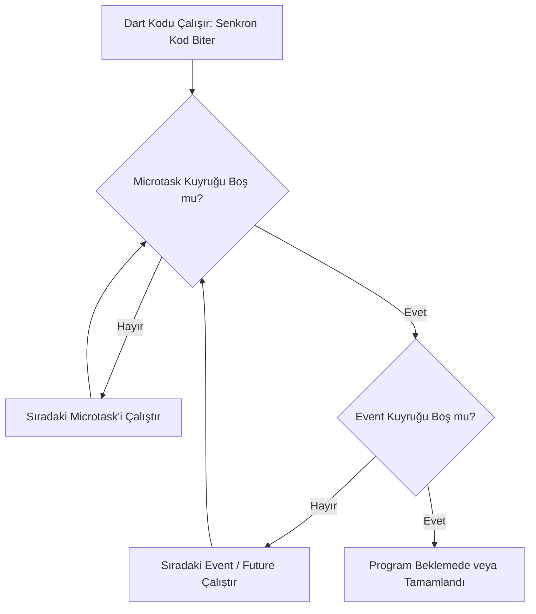

# Dart Programlama Dili Temelleri 4: İleri Seviye Dart — Higher-Order Fonksiyonlar, Closure, Asenkron Mimari ve İleri Pratikler

**Arayüz çizmek kolaydır; asıl ustalık, arka plandaki veri akışını, bellek davranışını ve asenkron operasyonları kusursuz yönetebilmektir.**

Önceki üç yazıda değişkenleri, koleksiyonları, isimli parametreleri, OOP yapılarını ve JSON dönüşümlerini inşa ettik. Ancak gerçek dünya mobil uygulamalarında işler "butona basınca ekrana metin basmak" kadar basit kalmaz:

* Bir arama çubuğuna her harf girildiğinde sunucuya istek atmayı geciktirmek (**debouncing**),
* Fonksiyon üreten fonksiyonlar tasarlamak (**higher-order functions & closures**),
* Fonksiyon referanslarını belleği yormadan aktarmak (**tear-offs**),
* Arka arkaya akan gerçek zamanlı verileri tüketmek (**Streams & Generators**),
* Asenkron veri akışlarında `Future` havuzlarını paralel yönetmek ve hata izolasyonu kurmak gerekir.

Bu yazıda, Dart'ın ileri seviye yeteneklerini; kaputun altındaki çalışma mantıklarını, bellek davranışlarını ve zihin açıcı uç senaryoları VS Code üzerinde adım adım inceliyoruz.

---

### Bu Yazıda Neler Var?

* **Higher-Order Functions:** Fonksiyon alan ve fonksiyon üreten fonksiyonlar
* **Lexical Closures (Sözcüksel Kapanışlar):** Fonksiyonların ortam durumunu bellekte hapsetmesi
* **Tear-offs:** Anonim fonksiyon yükünden kurtulup doğrudan metot referansı aktarma
* **Asenkron Programlama Derinleşmesi:** `Event Loop`, `Microtask Queue` vs `Event Queue` farkı
* **`Future.wait`, Timeout ve Hata İzolasyonu:** Paralel asenkron operasyonları yönetme
* **Generators ve Streams:** `sync*` (`Iterable`), `async*` (`Stream`) ve reaktif veri akışları
* **Beyin Yakan Alıştırma:** Kendi fonksiyonel debounce/caching mekanizmamızı yazma

---

## 1. Higher-Order Functions (Fonksiyon Üreten Fonksiyonlar)

Bir fonksiyonun başka bir fonksiyonu parametre olarak alabilmesi veya geriye başka bir fonksiyon döndürebilmesine **Higher-Order Function (Yüksek Mertebeden Fonksiyon)** denir.

Parametre alanları (`map`, `where`) ikinci yazıda görmüştük. Şimdi bir adım öteye geçip **fonksiyon üreten fonksiyon** kuralım.

### Senaryo: Dinamik Doğrulama (Validation) Motoru Fabrikası

Flutter formlarında her girdi için ayrı ayrı doğrulama fonksiyonları yazmak yerine, girdi kurallarını dinamik üreten bir fonksiyon fabrikası kuralım:

```dart
// Geriye "String? Function(String?)" tipinde başka bir fonksiyon döndürür:
String? Function(String?) createValidator({
  required int minLength,
  required String fieldName,
}) {
  // Geri dönen anonim fonksiyon:
  return (String? value) {
    if (value == null || value.trim().isEmpty) {
      return '$fieldName alanı boş bırakılamaz.';
    }
    if (value.trim().length < minLength) {
      return '$fieldName en az $minLength karakter olmalıdır.';
    }
    return null; // Geçerli
  };
}

void main() {
  // Fabrikadan amaca özel doğrulayıcılar üretiyoruz:
  final validateTitle = createValidator(minLength: 5, fieldName: 'Başlık');
  final validateDescription = createValidator(minLength: 20, fieldName: 'Açıklama');

  print(validateTitle('Not')); // Hata: Başlık en az 5 karakter olmalıdır.
  print(validateTitle('Flutter')); // null (Geçerli)
  print(validateDescription('Kısa metin')); // Hata: Açıklama en az 20 karakter olmalıdır.
}

```

---

## 2. Lexical Closures (Sözcüksel Kapanışlar): Bellekte Yaşayan Durumlar

Bir fonksiyon kendi kapsamı (scope) dışındaki değişkenlere erişip onları bellekte "kilitlerse", dış fonksiyonun çalışması bitse bile o değişkenler yaşamaya devam eder. Buna **Closure** denir.

Normalde bir fonksiyon çalıştığında yerel değişkenleri bellekten (stack) silinir. Ancak bir closure o değişkene referans veriyorsa, o değişken "çöp toplayıcı" (Garbage Collector) tarafından silinmez; fonksiyonla birlikte heap üzerinde yaşar.

### Zihin Açıcı Örnek: Kendi İçinde Durum Tutan Sayaç

```dart
Function makeCounter([int initialValue = 0]) {
  int count = initialValue; // Bu değişken normalde fonksiyon bitince yok olmalıydı!

  return () {
    count++;
    return count;
  };
}

void main() {
  final counterA = makeCounter(10);
  final counterB = makeCounter(100);

  print(counterA()); // 11
  print(counterA()); // 12
  print(counterA()); // 13

  // counterB, counterA'nın hafızasından tamamen bağımsız kendi durumunu korur:
  print(counterB()); // 101
  print(counterA()); // 14
}

```

---

## 3. Tear-offs (Gereksiz Anonim Fonksiyon Yükünden Kurtulma)

Flutter geliştiricilerinin en sık yaptığı stil hatası, zaten aynı imzaya sahip bir metodu ekstra bir anonim fonksiyon parantezine sarmaktır.

Dart derleyicisi bir metodun adını doğrudan fonksiyon referansı olarak iletmenize izin verir. Buna **Tear-off** denir.

```dart
void main() {
  final List<String> names = ['ayşe', 'ahmet', 'mehmet'];

  // KÖTÜ VE GEREKSİZ (Anonim sarmalayıcı):
  names.forEach((name) {
    print(name);
  });

  // MÜKEMMEL (Tear-off): print fonksiyonunun referansı doğrudan iletilir
  names.forEach(print);

  // Başka bir örnek:
  final List<String> numbersAsStrings = ['10', '20', '30'];

  // Uzun yol: numbersAsStrings.map((str) => int.parse(str)).toList();
  // Tear-off ile tek satır:
  final List<int> numbers = numbersAsStrings.map(int.parse).toList();
  print(numbers); // [10, 20, 30]
}

```

---

## 4. Asenkron Dart’ın İç Yüzü: Event Loop, Microtask ve Event Queue

Dart **tek iş parçacıklı (single-threaded)** bir dildir. Peki nasıl olur da arkada veri indirirken ekran donmaz?

Cevap: **Event Loop (Olay Döngüsü)**.

Dart'ın arkasında iki farklı öncelik kuyruğu (queue) çalışır:

1. **Microtask Queue (Çok Yüksek Öncelik):** Çok acil, anlık dahili işlemler. Microtask kuyruğu tamamen boşalmadan Event kuyruğuna asla sıra gelmez.
2. **Event Queue (Standart Öncelik):** I/O işlemleri, fare/dokunma tıklamaları, zamanlayıcılar (`Timer`) ve `Future` operasyonları.



### Kodla Kanıtlayalım: Sıralama Neden Böyle Çıkar?

```dart
import 'dart:async';

void main() {
  print('1. Senkron: Başladı');

  // Event kuyruğuna girer
  Future(() => print('2. Event Queue: Future tetiklendi'));

  // Microtask kuyruğuna girer (Öncelikli!)
  scheduleMicrotask(() => print('3. Microtask Queue: Acil microtask çalıştı'));

  print('4. Senkron: Bitti');
}

```

### Çıktı:

```text
1. Senkron: Başladı
4. Senkron: Bitti
3. Microtask Queue: Acil microtask çalıştı
2. Event Queue: Future tetiklendi

```

> **Önemli Çıkarım:** Senkron kodlar her zaman ilk önce biter. Ardından microtask kuyruğu tüketilir. En son standart `Future` olayları çalıştırılır.

---

## 5. Paralel Asenkron Yönetimi: `Future.wait` ve Hata İzolasyonu

Mobil uygulamada ana ekran açılırken:

* Kullanıcı profilini çekmek,
* Bildirim sayısını almak,
* Not listesini getirmek zorundayız.

Bunları arka arkaya `await` ile çağırırsanız (3 sn + 2 sn + 1 sn = 6 sn) sürer. Oysa hepsi aynı anda paralel tetiklenebilir:

```dart
Future<String> fetchUser() async {
  await Future.delayed(Duration(seconds: 2));
  return 'Hamit Seyrek';
}

Future<int> fetchUnreadCount() async {
  await Future.delayed(Duration(seconds: 1));
  return 5;
}

Future<List<String>> fetchRecentNotes() async {
  await Future.delayed(Duration(seconds: 2));
  return ['Toplantı', 'Alışveriş'];
}

void main() async {
  final stopwatch = Stopwatch()..start();
  print('İstekler paralel olarak başlatılıyor...');

  // 3 istek aynı anda ateşlenir; en uzun süren bittiğinde sonuçlar döner:
  final results = await Future.wait([
    fetchUser(),
    fetchUnreadCount(),
    fetchRecentNotes(),
  ]);

  stopwatch.stop();

  final user = results[0] as String;
  final unread = results[1] as int;
  final notes = results[2] as List<String>;

  print('Kullanıcı: $user');
  print('Okunmamış: $unread');
  print('Notlar: $notes');
  print('Toplam Geçen Süre: ${stopwatch.elapsed.inSeconds} saniye'); // Yaklaşık 2 saniye!
}

```

---

## 6. Generators ve Streams: Zaman İçinde Akan Veriler

Listeler tüm veriyi aynı anda belleğe yükler (`[1, 2, 3]`). Oysa büyük veri setlerinde veya canlı akan sensör/socket verilerinde veriyi parça parça üretip tüketmek gerekir.

### A. Senkron Generator (`sync*` ve `yield`)

Tüm listeyi bellekte tutmaz; talep edildikçe sıradaki elemanı üretir (`Iterable` döner):

```dart
Iterable<int> countUpTo(int max) sync* {
  print('Generator çalışmaya başladı...');
  for (int i = 1; i <= max; i++) {
    yield i; // Değeri üretir, duraklar ve talep gelene kadar bekler
  }
}

void main() {
  final numbers = countUpTo(3); // Henüz hiçbir şey çalışmadı!
  print('Döngüye giriyoruz:');

  for (final n in numbers) {
    print('Gelen sayı: $n');
  }
}

```

---

### B. Asenkron Generator (`async*` ve `Stream`)

Flutter'ın reaktif mimarisinin, Firebase dinleyicilerinin ve WebSocket akışlarının kalbidir. Zaman içinde gelen asenkron veri dizisidir.

```dart
Stream<String> downloadSimulation() async* {
  for (int percent = 25; percent <= 100; percent += 25) {
    await Future.delayed(Duration(milliseconds: 500));
    yield '%$percent indirildi...';
  }
}

void main() async {
  print('İndirme akışı dinleniyor:');

  // await for ile Stream dinleme
  await for (final status in downloadSimulation()) {
    print('-> $status');
  }

  print('İndirme başarıyla bitti.');
}

```

---

## 7. Beyin Yakan Alıştırma: Fonksiyonel Debounce ve Bellek İçi Cache Motoru

Şimdi tüm bu kavramları (Higher-Order Functions, Closures, Asenkronite ve Fonksiyon Referansları) bir araya getirip gerçek dünyada hayat kurtaran bir yapı kuralım: **Fonksiyonel Önbellekleme (Memoization / Caching) Mekanizması.**

### Problem:

Bir sunucu sorgulama fonksiyonumuz var. Aynı sorgu (örneğin `"flutter"`) arka arkaya çağrıldığında sunucuya tekrar gitmesin; sonucu hafızadaki closure tablosundan anında dönsün. Farklı bir sorgu gelirse sunucuya gidip sonucu hafızaya alsın.

```dart
import 'dart:async';

// Higher-order fonksiyon: Verilen asenkron fonksiyonu önbellekleyen yeni bir fonksiyon üretir
Future<T> Function(String) memoizeAsync<T>(
  Future<T> Function(String) originalFunction,
) {
  // Closure içinde hapsedilen bellek tablosu:
  final Map<String, T> cache = {};

  return (String query) async {
    // 1. Veri önbellekte var mı?
    if (cache.containsKey(query)) {
      print('⚡ [CACHE]: "$query" bellekten getirildi (0 ms)');
      return cache[query]!;
    }

    // 2. Yoksa asıl maliyetli fonksiyonu çalıştır
    print('🌐 [NETWORK]: "$query" için sunucuya gidiliyor...');
    final result = await originalFunction(query);

    // 3. Hafızaya al ve dön
    cache[query] = result;
    return result;
  };
}

// Simüle edilmiş maliyetli sunucu araması:
Future<String> searchNotesOnServer(String keyword) async {
  await Future.delayed(Duration(seconds: 1)); // 1 saniyelik ağ gecikmesi
  return '$keyword ile ilgili 12 adet not bulundu.';
}

void main() async {
  // Arama fonksiyonumuzu akıllı hâle getiriyoruz:
  final cachedSearch = memoizeAsync(searchNotesOnServer);

  print('--- 1. İlk Arama ("flutter") ---');
  final res1 = await cachedSearch('flutter');
  print('Sonuç: $res1\n');

  print('--- 2. Tekrar Arama ("flutter") ---');
  final res2 = await cachedSearch('flutter'); // Sunucuya gitmemeli!
  print('Sonuç: $res2\n');

  print('--- 3. Farklı Arama ("dart") ---');
  final res3 = await cachedSearch('dart'); // Sunucuya gitmeli!
  print('Sonuç: $res3\n');

  print('--- 4. Tekrar Arama ("dart") ---');
  final res4 = await cachedSearch('dart'); // Sunucuya gitmemeli!
  print('Sonuç: $res4\n');
}

```

### Terminal Çıktısı

```text
--- 1. İlk Arama ("flutter") ---
🌐 [NETWORK]: "flutter" için sunucuya gidiliyor...
Sonuç: flutter ile ilgili 12 adet not bulundu.

--- 2. Tekrar Arama ("flutter") ---
⚡ [CACHE]: "flutter" bellekten getirildi (0 ms)
Sonuç: flutter ile ilgili 12 adet not bulundu.

--- 3. Farklı Arama ("dart") ---
🌐 [NETWORK]: "dart" için sunucuya gidiliyor...
Sonuç: dart ile ilgili 12 adet not bulundu.

--- 4. Tekrar Arama ("dart") ---
⚡ [CACHE]: "dart" bellekten getirildi (0 ms)
Sonuç: dart ile ilgili 12 adet not bulundu.

```

---

## Özet

Bu ileri seviye rehberde:

1. **Higher-Order Functions** ile dinamik fonksiyon fabrikaları üretmeyi,
2. **Lexical Closure** mekanizmasının değişkenleri bellekte nasıl canlı tuttuğunu,
3. **Tear-offs** ile kod kalabalığını ortadan kaldırmayı,
4. **Event Loop & Microtask** hiyerarşisini ve Dart'ın tek iş parçacıklı asenkron mimarisini,
5. `Future.wait` ile paralel operasyonları ve `async*` / `Stream` ile reaktif veri akışlarını,
6. Kendi fonksiyonel önbellekleme (**memoization**) motorumuzu closure mimarisiyle inşa etmeyi öğrendik.

Artık Dart tarafında sizi şaşırtabilecek hiçbir sözdizimi veya mimari mekanizma kalmadı. Sıradaki adım: **Terminalden ilk Flutter projesini ayağa kaldırmak (`flutter create`) ve bu sağlam temeller üzerine modern arayüzler inşa etmek.**