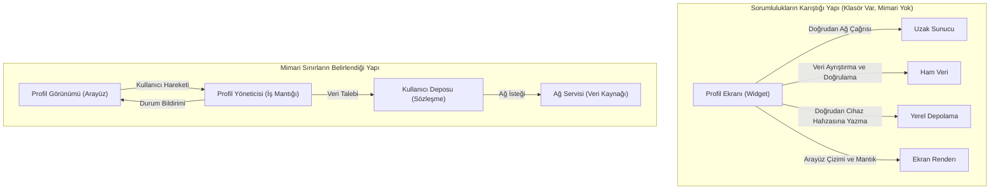

# Yazılım Mimarisi ve Temel Tasarım İlkeleri: Klasör Yapısından Mimari Sınırlara

Bir mobil uygulama projesine başlarken mimari kararlar genellikle göz ardı edilir. Birkaç ekran ve temel işlevlerle yola çıkıldığında her şeyin tek bir yerde toplanması hızlı sonuç veriyor gibi görünür. Ancak projeye yeni özellikler eklendikçe ağ istekleri, yerel veri saklama, veri doğrulama ve kullanıcı arayüzü mantığı birbirine dolanır. Sonuçta en küçük bir görsel düzenleme veri akışını bozabilir veya bir sunucu değişikliği ekranların baştan yazılmasını gerektirebilir.

Mimari, projede `models`, `services` ve `screens` adında klasörler açmaktan ibaret değildir. Mimari; sistemin sınırlarını belirleme, sorumlulukları doğru bileşenlere dağıtma ve değişiklik geldiğinde hangi parçanın neden değişeceğini öngörebilme disiplinidir.

## Mimarinin Cevap Verdiği Temel Sorular

Yazılım mimarisi, uygulamanın zaman içerisindeki değişim maliyetini doğrudan belirler. Sağlam bir mimari yapı şu sorulara net cevaplar sunar:

- **Kullanıcı arayüzünün sınırı nedir?** Arayüz bileşeni yalnızca veriyi ekranda gösterip dokunma hareketlerini mi iletir, yoksa iş kurallarını işletip sisteme dair kararlar mı verir?
- **İş kuralları nerede konumlanır?** İndirim hesaplama, yetkilendirme kontrolleri veya form doğrulama mantığı ekrandan bağımsız mıdır?
- **Veri kaynaklarının ayrıntılarını kim bilir?** Verinin uzaktaki bir sunucudan mı, yerel veri tabanından mı yoksa cihaz hafızasından mı geldiğini arayüz bilmek zorunda mıdır?
- **Teknik bir altyapı değiştiğinde ne olur?** Ağ kütüphanesi veya veri tabanı motoru değiştirildiğinde yalnızca ilgili veri bileşeni mi güncellenir, yoksa onlarca ekran dosyası tek tek taranmak zorunda mı kalınır?
- **Davranışlar ekrana ihtiyaç duymadan test edilebilir mi?** Bir kuralı doğrulamak için her defasında uygulamayı cihazda derleyip ilgili düğmeye tıklamak şart mıdır, yoksa mantık saniyeler içinde otomatik testlerle doğrulanabilir mi?

Mimari, sisteme peşinen karmaşık yapılar yığmak değildir. Değişmesi muhtemel teknik kararlar ile sistemin ana omurgasını birbirinden izole etmektir.

## Klasör Yapısı Neden Mimari Değildir?

Mobil projelerde sıkça rastlanan düzenlemelerden biri şu şekildedir:

```text
lib/
  models/
  services/
  screens/
```

Bu dizilim bir mimariyi temsil etmez; yalnızca dosyaların disk üzerindeki yerleşim biçimidir. Eğer `screens` altındaki bir ekran bileşeni doğrudan sunucuya ağ isteği atıyor, gelen yanıtı çözüyor, hata metinlerini biçimlendiriyor ve yerel hafızaya yazıyorsa, ortada mimari bir sınır yoktur.

Klasörler dosyaları bulmayı kolaylaştırır; mimari ise sorumlulukların nerede başlayıp nerede bittiğini ve bileşenler arasındaki bağımlılık yönünü belirler. İyi tasarlanmış bir yapıda klasör adları değişse dahi bileşenlerin sınırları ve haberleşme kuralları korunur.


*Şekil 1: Sorumlulukların tek bir ekrana yığıldığı durum ile sınırları belirlenmiş mimari akış arasındaki fark.*

## Dört Temel Tasarım İlkesi

Mimariyi ayakta tutan ve projenin ömrünü uzatan dört temel mühendislik ilkesi bulunur.

### 1. Sorumlulukların Ayrılması (Separation of Concerns)

Her yazılım bileşeni yalnızca tek bir temel işi üstlenmelidir. Bir mobil ekranda üç farklı sorumluluk alanı vardır:

- **Sunum:** Bilgiyi ekranda göstermek ve dokunma, kaydırma gibi kullanıcı hareketlerini yakalamak.
- **İş Mantığı:** Veriyi işlemek, kuralları denetlemek (örneğin kullanıcının engelli olup olmadığını kontrol etmek) ve işlem akışını yönetmek.
- **Veri Erişimi:** Sunucuyla veya yerel depolamayla haberleşip ham veriyi sistemin anlayacağı kalıba sokmak.

Bu üç kaygı tek bir dosyada toplandığında arayüzdeki küçük bir metin düzenlemesi veri akışını bozabilir. Sorumluluklar ayrıldığında ise her değişiklik yalnızca kendi alanında kalır.

### 2. Yüksek Uyum (High Cohesion)

Yüksek uyum, bir modülün veya sınıfın barındırdığı tüm işlevlerin tek ve odaklanmış bir amaca hizmet etmesidir.

- **Düşük Uyum:** Bir bileşenin hem kullanıcı profilini sunucudan çekmesi hem profil fotoğrafını kırpması hem de cihazın pil seviyesini okuması. Birbiriyle ilgisiz işlerin toplandığı bu tür yapılar hızla kontrol edilemez hale gelir.
- **Yüksek Uyum:** Yalnızca oturum anahtarlarını saklama, okuma ve silme işlerini yürüten bir oturum yönetim bileşeni. Bu bileşenin içindeki her parça aynı hedefe hizmet eder.

Yüksek uyumlu bileşenlerin sınırları nettir, bakımı kolaydır ve projede farklı yerlerde güvenle tekrar kullanılabilirler.

### 3. Düşük Bağımlılık (Low Coupling)

Düşük bağımlılık, sistem parçalarının birbirinin iç çalışma mekanizmalarına asgari düzeyde bağlı olmasıdır.

Bir ekran bileşeni sunucudan dönen HTTP durum kodunu doğrudan kontrol edip ona göre karar veriyorsa, ağ protokolünün teknik ayrıntısı arayüze sızmış demektir. Sunucunun iletişim protokolü değiştiğinde veya farklı bir veri kaynağına geçildiğinde arayüz de doğrudan bozulur.

Düşük bağımlılık kurulduğunda arayüz yalnızca genel durumları bilir: "Veri hazır", "Yükleniyor" veya "Erişim engellendi". Ağın veya veri tabanının teknik detayları arayüzden gizlenir.

### 4. Açık Sözleşmeler (Explicit Contracts)

Bileşenler birbirleriyle somut iç detaylar üzerinden değil, soyut sözleşmeler (arayüzler) üzerinden haberleşmelidir. 

Bu yaklaşımda çağıran taraf, çağırdığı parçanın arkada ne yaptığını bilmez; yalnızca sunduğu sözleşmeye güvenir. Açık sözleşmeler sayesinde henüz sunucu hazır değilken geçici verilerle uygulama geliştirilebilir veya gerçek sunucuya bağlanmadan sistem mantığı test edilebilir.

## Bir Senaryo Üzerinden Mimari Ayrım: Kullanıcı Profili Yükleme

İlkelerin pratikte ne anlama geldiği, bir mobil uygulamadaki kullanıcı profili ekranı üzerinden iki farklı yaklaşımla değerlendirilebilir.

### Hatalı Senaryo: Her Şeyin Ekrana Yığılması

Geliştirici profili göstermek için bir ekran oluşturur. Bu ekran dosyasının içine doğrudan sunucu adresi yazılır, HTTP isteği bu dosya içinden başlatılır. Sunucudan dönen ham JSON yanıtı ekranın durum fonksiyonları içinde satır satır çözülür. 

Bu kurguda şu problemler ortaya çıkar:

1. **Ayrıntıların Sızması:** Kullanıcının sistemde engelli olup olmadığı kuralı ekran kodunun ortasında kontrol edilir. Eğer kullanıcı engelliyse ekranda kırmızı bir uyarı gösterilmesine karar verilir. Yarın bu kural "engelli kullanıcının oturumu kapatılsın" şeklinde değiştiğinde ekran dosyasını açıp navigasyon mantığıyla boğuşmak gerekir.
2. **Kırılganlık:** Sunucu tarafında veri tabanı alanı adında bir harf değiştiğinde ekran anında çöker. Hatanın görsel bir problemden mi yoksa veri ayrıştırma hatasından mı kaynaklandığını anlamak zorlaşır.
3. **Test Zorluğu:** Kullanıcı doğrulama kuralının doğru çalışıp çalışmadığını test etmek için her defasında uygulamayı cihazda çalıştırmak, ağ bağlantısını beklemek ve giriş yapmak gerekir. Kod ekrandan bağımsız çalıştırılamaz.

### Doğru Senaryo: Sınırların ve Rollerin Belirlenmesi

Aynı senaryo mimari ilkeler gözetilerek rollerine ayrılır:

1. **Veri Modeli ve Sözleşme:** Sistemin ihtiyaç duyduğu profil bilgilerini tanımlayan yalın bir veri kalıbı ve profil verisinin nasıl talep edileceğini bildiren bir sözleşme oluşturulur. Bu sözleşme yalnızca "bana kullanıcı kimliğini ver, sana kullanıcı profili nesnesini teslim edeyim" der. Verinin nereden geldiği sözleşmenin konusu değildir.
2. **Veri Sağlayıcı (Data Layer):** Sözleşmeyi uygulayan bileşendir. Sunucu bağlantısını kurar, HTTP isteklerini yönetir ve gelen ham veriyi temiz profil nesnesine dönüştürür. Ağ kütüphanesi değişirse veya yerel önbellek desteği eklenirse yalnızca bu parça güncellenir.
3. **İş Mantığı ve Durum Yöneticisi (Logic Layer):** Veri sağlayıcıdan gelen profili değerlendirir. "Kullanıcı engelli mi?", "Yetkisi geçerli mi?" gibi iş kurallarını işletir. Sonuca göre durumu "Yükleniyor", "Profil Bilgisi Hazır" veya "Erişim Engellendi" şeklinde günceller. Bu bileşenin ekranla veya piksellerle hiçbir teması yoktur; dolayısıyla saniyeler içinde otomatik birim testlerle sınanabilir.
4. **Sunum Bileşeni (View / UI):** Arayüz yalnızca kendisine iletilen durumu çizer. Durum "Yükleniyor" ise dönen bir simge gösterir; "Erişim Engellendi" ise uyarı mesajını ekrana basar. Sunucunun adresini, HTTP protokolünü ya da JSON yapısını bilmez.

Bu senaryoda kullanıcı arayüzü tamamen yeniden tasarlansa dahi veri akışı ve iş kuralları tek satır değişmeden yerinde kalır. Aynı şekilde sunucu yapısı baştan aşağı yenilense bile arayüz dosyalarına dokunulmaz.

## Değişim Maliyeti ve Aşırı Mühendislik Dengesi

Mimari kararlar alınırken iki aşırı uçtan kaçınılmalıdır:

- **Yetersiz Mimari:** "Zaten küçük bir uygulama" diyerek her işi ekran bileşenlerine yüklemek. Proje genişledikçe küçük bir özellik eklemek bile haftalar sürmeye başlar; hata ayıklama maliyeti katlanır.
- **Aşırı Mühendislik (Over-Engineering):** Yalnızca birkaç sabit bilgi gösterecek basit bir ekran için onlarca katman ve gereksiz soyutlama üretmek. Bu durum sistemi çözdüğü problemden daha karmaşık hale getirir.

Dengeyi kurmak için beklenen değişimler göz önünde bulundurulmalıdır: Bu veri kaynağı ileride değişecek mi? Bu kural işletme için kritik mi ve test edilmesi gerekiyor mu? Ekip bu yapıyı kolayca sürdürebilir mi?

## Mimariyi Değerlendirirken Sorulacak Pratik Soru

Yazılan bir tasarımın doğruluğunu test etmek için her yeni özellikte şu soru sorulmalıdır:

> **"Bu değişiklik geldiğinde hangi bileşen değişmeli?"**

- Başlık rengi veya buton konumu değiştiğinde yalnızca sunum bileşeni değişmelidir.
- Kullanıcının erişim engeli kuralı değiştiğinde yalnızca iş mantığı bileşeni değişmelidir.
- Sunucu adresi veya yerel veri tabanı motoru değiştiğinde yalnızca veri bileşeni değişmelidir.

Eğer basit bir görsel düzenleme veri tabanı kodlarını etkiliyorsa veya sunucudaki bir alan güncellemesi arayüz dosyalarında düzenleme gerektiriyorsa mimari sınırlar doğru kurulmamıştır. Mimari, belirli bir kalıbı kopyalamak değil; sistemdeki değişim dalgalarını doğru sınırlarda durdurabilmektir.
