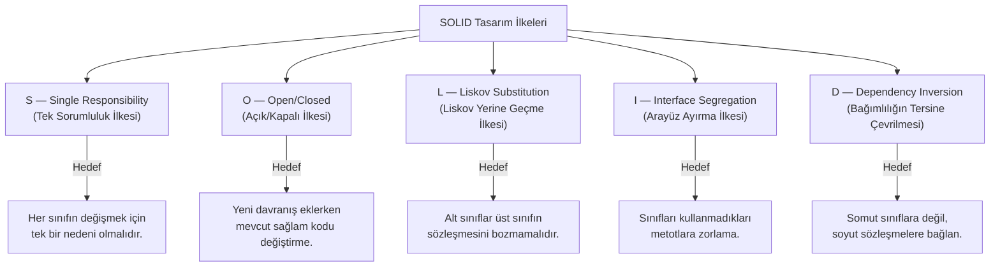

# SOLID Prensipleri ve Tasarım Kararları: Değişime Dirençli Nesne Yönelimli Tasarım

Bir yazılım projesinde ilk sürümü çalışır hale getirmek genellikle kolaydır. Ancak projeye yeni özellikler eklendikçe sınıflar büyür, bir dosyada yapılan küçük bir değişiklik hiç beklenmeyen başka bir ekranı bozar ve mevcut kodu test etmek imkânsız hale gelir. Yazılımın zaman içinde bu şekilde katılaşıp kırılganlaşması, kodun satır sayısından değil; sınıflar arasındaki sorumlulukların ve bağımlılıkların yanlış kurgulanmasından kaynaklanır.

**SOLID**, nesne yönelimli programlamada (OOP) yazılımın esnek, anlaşılır, test edilebilir ve değişime dayanıklı olmasını sağlayan beş temel tasarım ilkesinin baş harflerinden oluşur. Robert C. Martin tarafından bir araya getirilen bu ilkeler, ezberlenecek katı kurallar listesi değil; *"Değişiklik geldiğinde kod neden kırılıyor?"* sorusuna yanıt veren mühendislik araçlarıdır.


*Şekil 1: SOLID prensiplerinin beş temel sütunu ve her birinin çözdüğü mimari problem.*

---

## 1. S — Single Responsibility Principle (Tek Sorumluluk İlkesi)

> **"Bir sınıfın veya modülün değişmek için yalnızca tek bir nedeni olmalıdır."**

Tek sorumluluk ilkesi, "her sınıf yalnızca tek bir metot içermelidir" anlamına gelmez. Bir sınıfın içinde birden fazla metot bulunabilir; ancak bu metotların tamamı **tek bir amaca ve tek bir sorumluluk alanına** hizmet etmelidir.

Bir sınıf hem iş kurallarını hesaplıyor, hem veriyi JSON formatına dönüştürüyor, hem veritabanına kayıt yazıyor hem de kullanıcıya e-posta gönderiyorsa; veritabanı yapısı değiştiğinde de, vergi oranı değiştiğinde de, e-posta şablonu değiştiğinde de aynı sınıf açılıp düzenlenmek zorunda kalır.

### İhlal Örneği: Her İşi Üstlenen Sınıf

Aşağıdaki `InvoiceProcessor` sınıfı fatura hesaplama, dosya kaydetme ve bildirim gönderme sorumluluklarını tek bir gövdede birleştirmektedir:

```dart
class Invoice {
  final String id;
  final String customerEmail;
  final List<double> itemPrices;

  Invoice({
    required this.id,
    required this.customerEmail,
    required this.itemPrices,
  });
}

// KÖTÜ TASARIM: Üç farklı sorumluluk tek sınıfta toplanmış
class InvoiceProcessor {
  double calculateTotalWithTax(Invoice invoice) {
    final subtotal = invoice.itemPrices.fold(0.0, (sum, item) => sum + item);
    return subtotal * 1.20; // %20 KDV hesaplama (İş Kuralı)
  }

  void saveToLocalFile(Invoice invoice, double total) {
    // Dosya formatı veya depolama yöntemi değişirse bu sınıf değişir
    final content = 'Fatura No: ${invoice.id}, Tutar: $total TL';
    print('Disk üzerine kaydedildi: $content');
  }

  void sendEmailNotification(Invoice invoice, double total) {
    // E-posta sunucusu veya mesaj metni değişirse yine bu sınıf değişir
    print('${invoice.customerEmail} adresine $total TL tutarlı fatura gönderildi.');
  }
}
```

Bu tasarımda vergi hesaplama mantığını test etmek isteyen bir geliştirici bile dosya sistemi ve e-posta bağımlılıklarıyla uğraşmak zorunda kalır.

### Doğru Tasarım: Sorumlulukların Ayrıştırılması

Her değişim nedeni kendi odaklanmış sınıfına taşınır ve bu sınıflar yüksek uyumlu (**high cohesion**) birimler haline getirilir:

```dart
// 1. Sorumluluk: Yalnızca fatura tutarı ve vergi kurallarını hesaplar
class InvoiceCalculator {
  static const double _taxRate = 0.20;

  double calculateTotal(Invoice invoice) {
    final subtotal = invoice.itemPrices.fold(0.0, (sum, item) => sum + item);
    return subtotal * (1 + _taxRate);
  }
}

// 2. Sorumluluk: Yalnızca faturanın kalıcı olarak saklanmasıyla ilgilenir
class InvoiceRepository {
  void save(Invoice invoice, double totalAmount) {
    final record = 'Fatura No: ${invoice.id}, Tutar: $totalAmount TL';
    print('Veri kaynağına kaydedildi: $record');
  }
}

// 3. Sorumluluk: Yalnızca müşteri bildirimlerini yönetir
class InvoiceNotificationService {
  void sendInvoiceEmail(Invoice invoice, double totalAmount) {
    print('${invoice.customerEmail} adresine $totalAmount TL fatura özeti iletildi.');
  }
}
```

Artık vergi oranı değiştiğinde yalnızca `InvoiceCalculator`, bildirim metni değiştiğinde ise yalnızca `InvoiceNotificationService` güncellenir. Sınıflar birbirinden bağımsız olarak kolayca test edilebilir.

---

## 2. O — Open/Closed Principle (Açık/Kapalı İlkesi)

> **"Yazılım bileşenleri gelişime (yeni davranışlar eklemeye) açık, ancak mevcut kaynak kodunun değiştirilmesine kapalı olmalıdır."**

Projeye her yeni özellik veya yeni bir tür eklendiğinde, halihazırda çalışan ve test edilmiş sınıfların içini açıp `if/else` veya `switch` bloklarına yeni dallar eklemek zorunda kalınıyorsa Açık/Kapalı ilkesi ihlal ediliyor demektir. Çalışan bir koda her müdahale edildiğinde mevcut işlevleri bozma riski doğar.

### İhlal Örneği: Her Yeni Türde Değişen Koşul Zinciri

Bir e-ticaret uygulamasında farklı ödeme yöntemlerini işleyen aşağıdaki sınıfı inceleyelim:

```dart
enum PaymentType { creditCard, bankTransfer, digitalWallet }

// KÖTÜ TASARIM: Yeni bir ödeme yöntemi (ör. Hediye Çeki) eklendiğinde
// bu sınıfın kaynak kodu açılıp değiştirilmek zorundadır.
class PaymentCheckoutService {
  void processPayment(double amount, PaymentType type) {
    if (type == PaymentType.creditCard) {
      print('Kredi kartından $amount TL çekildi. Komisyon: ${amount * 0.02} TL');
    } else if (type == PaymentType.bankTransfer) {
      print('Banka havalesi ile $amount TL onaylandı. Komisyon: 0 TL');
    } else if (type == PaymentType.digitalWallet) {
      print('Dijital cüzdandan $amount TL ödendi. Komisyon: ${amount * 0.01} TL');
    } else {
      throw UnsupportedError('Desteklenmeyen ödeme yöntemi.');
    }
  }
}
```

Sisteme "Kapıda Ödeme" veya "Kripto Ödeme" eklendiğinde `PaymentCheckoutService` sınıfı yeniden düzenlenmeli ve kredi kartı dahil tüm ödeme testleri baştan koşturulmalıdır.

### Doğru Tasarım: Soyut Sözleşme ile Genişletilebilirlik

Değişen davranış bir arayüz (`abstract interface class`) arkasına alınır. Her yeni ödeme yöntemi mevcut kodu değiştirmeden yeni bir sınıf olarak sisteme eklenir:

```dart
// Ortak sözleşme
abstract interface class PaymentMethod {
  void pay(double amount);
}

class CreditCardPayment implements PaymentMethod {
  @override
  void pay(double amount) {
    final fee = amount * 0.02;
    print('Kredi kartından $amount TL çekildi (Komisyon: $fee TL).');
  }
}

class BankTransferPayment implements PaymentMethod {
  @override
  void pay(double amount) {
    print('Banka havalesi ile $amount TL komisyonsuz onaylandı.');
  }
}

// Yeni eklenen yöntem: Mevcut hiçbir sınıfa dokunulmadan sisteme dahil edildi
class GiftCardPayment implements PaymentMethod {
  @override
  void pay(double amount) {
    print('Hediye çeki bakiyesinden $amount TL düşüldü.');
  }
}

// Değişime kapalı, gelişime açık ana servis
class CheckoutProcessor {
  void checkout(double amount, PaymentMethod paymentMethod) {
    paymentMethod.pay(amount);
  }
}
```

`CheckoutProcessor` sınıfı artık ne kadar yeni ödeme yöntemi eklenirse eklensin tek satır bile değişmez.

---

## 3. L — Liskov Substitution Principle (Liskov Yerine Geçme İlkesi)

> **"Bir alt sınıf, türetildiği üst sınıfın (veya uyguladığı sözleşmenin) yerine geçtiğinde, programı kullanan kodun beklediği davranışı bozmamalıdır."**

Barbara Liskov tarafından tanımlanan bu ilke, kalıtımın (`extends`) ve sözleşme uygulamasının (`implements`) yalnızca sözdizimsel değil, **davranışsal olarak da doğru** kurulmasını şart koşar. Eğer bir alt sınıf, üst sınıfın sunduğu bir metodu çağrıldığında `UnimplementedError` fırlatıyorsa veya beklenen ön/son koşulları ihlal ediyorsa Liskov ilkesi bozulmuştur.

### İhlal Örneği: Sözleşmeyi Bozan Alt Sınıf

Sistemdeki belgeleri yöneten bir yapıda tüm belgelerin hem okunabildiğini hem de düzenlenip kaydedilebildiğini varsayan hatalı bir hiyerarşi kuralım:

```dart
abstract class Document {
  String readContent();
  void saveContent(String newContent);
}

class EditableTextDocument extends Document {
  String _content;
  EditableTextDocument(this._content);

  @override
  String readContent() => _content;

  @override
  void saveContent(String newContent) {
    _content = newContent;
    print('Belge güncellendi: $_content');
  }
}

// KÖTÜ TASARIM: Salt okunur PDF belgesi Document sınıfından türetilmiş
// ancak kaydetme davranışını desteklemediği için hata fırlatıyor.
class ReadOnlyPdfDocument extends Document {
  final String _content;
  ReadOnlyPdfDocument(this._content);

  @override
  String readContent() => _content;

  @override
  void saveContent(String newContent) {
    throw UnsupportedError('Salt okunur PDF belgeleri değiştirilemez!');
  }
}

void autoSaveAllDocuments(List<Document> documents) {
  for (final doc in documents) {
    // Liste içinde ReadOnlyPdfDocument varsa uygulama çalışma zamanında çöker!
    doc.saveContent('Otomatik yedek içeriği');
  }
}
```

`autoSaveAllDocuments` fonksiyonu `Document` sözleşmesine güvenerek `saveContent` metodunu çağırmaktadır; ancak `ReadOnlyPdfDocument` alt sınıfı üst sınıfın verdiği sözü tutmayarak sistemi çökertmektedir.

### Doğru Tasarım: Davranış Yeteneklerine Göre Doğru Hiyerarşi

Okuma ve yazma yetenekleri birbirinden ayrılarak her alt sınıfın yalnızca gerçekten yerine getirebildiği sözleşmeyi üstlenmesi sağlanır:

```dart
abstract interface class ReadableDocument {
  String readContent();
}

abstract interface class WritableDocument implements ReadableDocument {
  void saveContent(String newContent);
}

class TextDocument implements WritableDocument {
  String _content;
  TextDocument(this._content);

  @override
  String readContent() => _content;

  @override
  void saveContent(String newContent) {
    _content = newContent;
    print('Metin belgesi kaydedildi: $_content');
  }
}

class PdfReportDocument implements ReadableDocument {
  final String _content;
  PdfReportDocument(this._content);

  @override
  String readContent() => _content;
}

// Fonksiyon artık yalnızca yazılabilir belgeleri kabul ediyor; çökme riski sıfırlandı
void autoSaveDocuments(List<WritableDocument> writableDocs) {
  for (final doc in writableDocs) {
    doc.saveContent('Otomatik yedek içeriği');
  }
}
```

---

## 4. I — Interface Segregation Principle (Arayüz Ayırma İlkesi)

> **"Hiçbir sınıf, kullanmadığı metotları içeren şişkin bir arayüze (sözleşmeye) bağımlı olmaya zorlanmamalıdır."**

Tek bir büyük arayüz (`Fat Interface`) tanımlayıp sistemdeki tüm metotları içine doldurmak başlangıçta pratik görünür. Ancak bu arayüzü uygulayan sınıflar, kendi görevleriyle ilgisi olmayan metotları da boş gövdelerle veya hata fırlatarak yazmak zorunda kalır. Ayrıca arayüzdeki tek bir metodun imzası değiştiğinde, o metodu hiç kullanmayan bileşenler de yeniden derlenmek ve güncellenmek zorunda kalır.

### İhlal Örneği: Şişkin Arayüz (Fat Interface)

Bir akıllı ofis uygulamasında cihazları kontrol etmek için tek bir `SmartDevice` arayüzü tanımlandığını düşünelim:

```dart
// KÖTÜ TASARIM: Tüm cihaz yetenekleri tek bir arayüze sıkıştırılmış
abstract interface class SmartDevice {
  void turnOn();
  void turnOff();
  void printDocument(String text);
  void scanDocument();
  void adjustTemperature(double celsius);
}

// Akıllı lamba yalnızca açılıp kapanabilir, ancak yazdırma ve sıcaklık
// metotlarını da uygulamak zorunda bırakılmıştır.
class SmartLightBulb implements SmartDevice {
  @override
  void turnOn() => print('Lamba açıldı.');

  @override
  void turnOff() => print('Lamba kapatıldı.');

  @override
  void printDocument(String text) {
    // Anlamsız boş uygulama
  }

  @override
  void scanDocument() {
    // Anlamsız boş uygulama
  }

  @override
  void adjustTemperature(double celsius) {
    // Anlamsız boş uygulama
  }
}
```

### Doğru Tasarım: Odaklanmış ve Rol Tabanlı Arayüzler

Büyük sözleşme, yetenek bazlı küçük sözleşmelere bölünür. Sınıflar yalnızca sahip oldukları yeteneklerin sözleşmelerini uygular:

```dart
abstract interface class Switchable {
  void turnOn();
  void turnOff();
}

abstract interface class Printable {
  void printDocument(String text);
}

abstract interface class Scannable {
  void scanDocument();
}

abstract interface class ThermostatControllable {
  void adjustTemperature(double celsius);
}

// Akıllı lamba yalnızca açma/kapama sözleşmesini uygular
class SmartBulb implements Switchable {
  @override
  void turnOn() => print('Lamba açıldı.');

  @override
  void turnOff() => print('Lamba kapatıldı.');
}

// Çok fonksiyonlu ofis yazıcısı birden fazla odaklanmış sözleşmeyi birleştirebilir
class OfficeMultiFunctionPrinter implements Switchable, Printable, Scannable {
  @override
  void turnOn() => print('Yazıcı hazır.');

  @override
  void turnOff() => print('Yazıcı kapatıldı.');

  @override
  void printDocument(String text) => print('Yazdırılıyor: $text');

  @override
  void scanDocument() => print('Belge taranıyor...');
}
```

---

## 5. D — Dependency Inversion Principle (Bağımlılığın Tersine Çevrilmesi İlkesi)

> **"Üst seviye modüller (iş kuralları), alt seviye modüllere (teknik detaylara) doğrudan bağımlı olmamalıdır. Her ikisi de soyutlamalara (arayüzlere) bağımlı olmalıdır."**

Geleneksel katmanlı yapılarda iş mantığı sınıfı, veriyi kaydetmek için doğrudan `SqliteDatabase` veya `FirebaseAuthService` gibi somut bir alt katman sınıfını kendi içinde oluşturup (`new` ile) çağırır. Bu durumda üst seviye iş kuralı, alt seviye kütüphanenin esiri olur:

1. Veritabanı veya ağ kütüphanesi değiştiğinde iş mantığı sınıfı da baştan yazılır.
2. İş mantığını test etmek için gerçek veritabanı veya gerçek internet bağlantısı gerekir.

Bağımlılığın tersine çevrilmesi ilkesinde iş katmanı kendi ihtiyaç duyduğu sözleşmeyi (`Repository` arayüzünü) tanımlar; alt katman ise bu sözleşmeye uymak zorundadır.

### İhlal Örneği: Üst Katmanın Alt Katmana Doğrudan Bağlanması

```dart
// Alt seviye teknik detay sınıfı
class SqliteHabitStorage {
  void insertHabit(String title) {
    print('SQLite veritabanına yazıldı: $title');
  }
}

// KÖTÜ TASARIM: Üst seviye iş mantığı doğrudan somut SQLite sınıfına göbekten bağlı
class HabitManager {
  final SqliteHabitStorage _storage = SqliteHabitStorage();

  void createHabit(String title) {
    if (title.trim().isEmpty) {
      throw ArgumentError('Alışkanlık başlığı boş olamaz.');
    }
    _storage.insertHabit(title);
  }
}
```

`HabitManager` sınıfını SQLite olmadan birim testine sokmak veya yarın bulut tabanlı bir API'ye geçirmek imkânsızdır.

### Doğru Tasarım: Sözleşme ve Bağımlılık Enjeksiyonu (Dependency Injection)

Üst katman bir sözleşme (`HabitRepository`) tanımlar ve bu sözleşmeyi yapıcı metot (**constructor**) üzerinden dışarıdan alır:

```dart
// 1. Soyut sözleşme (Üst katmanın belirlediği kural)
abstract interface class HabitRepository {
  Future<void> saveHabit(String title);
}

// 2. Üst seviye iş mantığı: Verinin nereye kaydedildiğini bilmez, sözleşmeye güvenir
class HabitService {
  final HabitRepository _repository;

  // Bağımlılık dışarıdan enjekte edilir (Constructor Injection)
  HabitService(this._repository);

  Future<void> createHabit(String title) async {
    final normalizedTitle = title.trim();
    if (normalizedTitle.isEmpty) {
      throw ArgumentError('Alışkanlık başlığı boş olamaz.');
    }
    await _repository.saveHabit(normalizedTitle);
  }
}

// 3. Alt seviye uygulama A: Yerel veritabanı
class LocalSqliteHabitRepository implements HabitRepository {
  @override
  Future<void> saveHabit(String title) async {
    print('SQLite tablosuna kaydedildi: $title');
  }
}

// 4. Alt seviye uygulama B: Uzak sunucu API'si
class RemoteApiHabitRepository implements HabitRepository {
  @override
  Future<void> saveHabit(String title) async {
    print('REST API üzerinden sunucuya gönderildi: $title');
  }
}

// 5. Alt seviye uygulama C: Birim testler için bellek içi sahte depo
class FakeMemoryHabitRepository implements HabitRepository {
  final List<String> savedHabits = [];

  @override
  Future<void> saveHabit(String title) async {
    savedHabits.add(title);
  }
}
```

Bu mimaride `HabitService` sınıfı tek bir satırı bile değiştirilmeden ister yerel SQLite ile, ister uzak sunucuyla, isterse milisaniyeler içinde çalışan birim testiyle (`FakeMemoryHabitRepository`) çalıştırılabilir.

---

## Mühendislik Karar Matrisi: SOLID İlkeleri Özeti

| İlke | Temel Soru | İhlal Belirtisi (Code Smell) | Çözüm Yaklaşımı |
| :--- | :--- | :--- | :--- |
| **SRP** | Bu sınıfı değiştirmek için kaç farklı aktör/neden var? | yüzlerce satırlık `Manager` / `Helper` sınıfları; hem UI hem ağ hem hesaplama yapan dosyalar. | Farklı nedenlerle değişen sorumlulukları odaklanmış ayrı sınıflara bölmek. |
| **OCP** | Yeni bir davranış türü eklerken mevcut çalışan kodu bozuyor muyum? | Tür kontrolü yapan uzun `if/else` veya `switch` blokları. | Ortak bir arayüz tanımlayıp her yeni davranışı ayrı bir sınıf olarak eklemek. |
| **LSP** | Alt sınıf, üst sınıfın kullanıldığı her yerde sorunsuz çalışıyor mu? | Alt sınıflarda içi boş bırakılan veya `UnsupportedError` fırlatan metotlar. | Kalıtım hiyerarşisini ortak yeteneklere ve doğru sözleşmelere göre yeniden ayırmak. |
| **ISP** | Bu sınıf gerçekten kullanmadığı metotları uygulamak zorunda mı? | Onlarca metot barındıran tekil dev arayüzler (`AppService`). | Şişkin arayüzleri rol ve yetenek bazlı küçük sözleşmelere ayırmak. |
| **DIP** | İş mantığım veritabanı veya paket detaylarına doğrudan bağımlı mı? | İş mantığı sınıflarının içinde doğrudan `new HttpClient()` veya `SharedPreferences` çağrılması. | Arayüz üzerinden haberleşmek ve bağımlılıkları `constructor` ile dışarıdan vermek. |

## Aşırı Mühendislik (Over-Engineering) Dengesi

SOLID ilkeleri, kodun bakım maliyetini düşürmek için vardır; proje içindeki dosya sayısını artırmak için değil. Hiçbir zaman ikinci bir uygulaması olmayacak, dış dünyayla iletişim kurmayan basit bir yardımcı sınıfa sırf kurallara uymak adına soyut arayüzler (`interface`) yazmak kodu gereksiz yere karmaşıklaştırır.

Doğru yaklaşım; dış bağımlılık sınırlarında (ağ, veritabanı, cihaz servisleri), birden fazla davranış çeşidinin bulunduğu iş kurallarında ve birim testi yazılması gereken çekirdek mantıkta SOLID sınırlarını kararlılıkla uygulamak, basit iç veri yapılarında ise sadeliği korumaktır.
