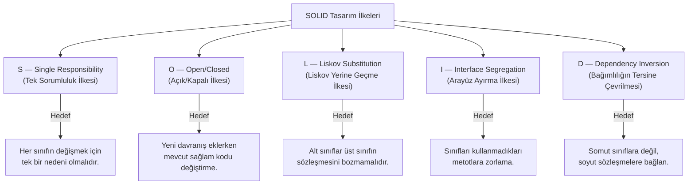

# SOLID Prensipleri ve Tasarım Kararları: Değişime Dirençli Nesne Yönelimli Tasarım

Bir yazılım projesinde ilk sürümü çalışır hale getirmek genellikle kolaydır. Ancak projeye yeni özellikler eklendikçe sınıflar büyür, bir dosyada yapılan küçük bir değişiklik hiç beklenmeyen başka bir ekranı bozar ve mevcut kodu test etmek imkânsız hale gelir. Yazılımın zaman içinde bu şekilde katılaşıp kırılganlaşması, kodun satır sayısından değil; sınıflar arasındaki sorumlulukların ve bağımlılıkların yanlış kurgulanmasından kaynaklanır.

**SOLID**, nesne yönelimli programlamada (OOP) yazılımın esnek, anlaşılır, test edilebilir ve değişime dayanıklı olmasını sağlayan beş temel tasarım ilkesinin baş harflerinden oluşur. Robert C. Martin tarafından bir araya getirilen bu ilkeler, ezberlenecek katı kurallar listesi değil; *"Değişiklik geldiğinde kod neden kırılıyor?"* sorusuna yanıt veren mühendislik araçlarıdır.


*Şekil 1: SOLID prensiplerinin beş temel sütunu ve her birinin çözdüğü mimari problem.*

---

## 1. S — Single Responsibility Principle (Tek Sorumluluk İlkesi)

> **"Bir sınıfın veya modülün değişmek için yalnızca tek bir nedeni olmalıdır."**

Tek sorumluluk ilkesi, "her sınıf yalnızca tek bir metot içermelidir" anlamına gelmez. Bir sınıfın içinde birden fazla metot bulunabilir; ancak bu metotların tamamı **tek bir amaca ve tek bir sorumluluk alanına** hizmet etmelidir.

Bir sınıf hem iş kurallarını hesaplıyor, hem veriyi JSON formatına dönüştürüyor, hem veritabanına kayıt yazıyor hem de kullanıcıya e-posta gönderiyorsa; veritabanı yapısı değiştiğinde de, vergi oranı değiştiğinde de, e-posta şablonu değiştiğinde de aynı sınıf açılıp düzenlenmek zorunda kalır.

### İhlal Örneği: Her İşi Üstlenen Sınıf (God Object)

Aşağıdaki `InvoiceManager` sınıfı fatura tutarı hesaplama, veritabanına kaydetme ve müşteri e-postası gönderme sorumluluklarını tek bir gövdede birleştirmektedir:

```dart
// ============================================================================
// KÖTÜ TASARIM (SRP İhlali): Tek bir sınıf 3 farklı departmanın işini yapıyor!
// ============================================================================

class InvoiceManager {
  // 1. Sorumluluk: Muhasebe / Hesaplama kuralı (İş Mantığı)
  // Finans departmanı KDV oranını veya indirim kuralını değiştirirse bu metot değişir.
  double calculateTotalWithTax(double subtotal) {
    final vat = subtotal * 0.20; // %20 KDV hesaplanıyor
    return subtotal + vat;
  }

  // 2. Sorumluluk: Veritabanı ve Depolama Yönetimi (Veri Katmanı)
  // Veritabanı SQLite'tan Firebase'e geçerse veya tablo yapısı değişirse bu metot değişir.
  void saveToDatabase(int invoiceId, double total) {
    print('Fatura #$invoiceId veritabanına kaydedildi. Tutar: $total TL');
  }

  // 3. Sorumluluk: Dış Bildirim ve İletişim (İletişim Katmanı)
  // Pazarlama departmanı e-posta şablonunu veya sunucuyu değiştirirse bu metot değişir.
  void sendCustomerEmail(String email, double total) {
    print('$email adresine $total TL tutarlı fatura e-postası gönderildi.');
  }
}
```

**Neden Kötü Tasarım?**
* **Üç Farklı Değişim Nedeni:** Muhasebe (vergi oranı), Veritabanı Yöneticisi (SQL şeması) ve Pazarlama (e-posta metni) aynı sınıfı değiştirmek zorundadır. Sınıf tek bir aktörün değil, şirketteki her departmanın ortak çatışma alanına dönüşür.
* **Git Çakışmaları (Merge Conflict):** Farklı özellikler geliştiren ekip üyeleri sürekli aynı dosya üzerinde çalışmak zorunda kaldığı için kod çakışmaları kaçınılmaz hale gelir.
* **Test İmkânsızlığı:** Yalnızca KDV hesaplama kuralını birim testine sokmak isteyen bir mühendis bile dosya sistemi ve e-posta modüllerini taklit (mock) etmek zorunda kalır.

### Doğru Tasarım: Sorumlulukların Ayrıştırılması (High Cohesion)

Her değişim nedeni kendi odaklanmış sınıfına taşınır ve bu sınıflar yüksek uyumlu (**high cohesion**) birimler haline getirilir:

```dart
// ============================================================================
// DOĞRU TASARIM (SRP Uygun): Her sınıf yalnızca TEK bir nedenden ötürü değişir.
// ============================================================================

// 1. Sorumluluk: Yalnızca muhasebe ve hesaplama mantığı (Domain Kuralı)
// Yalnızca finansal formüller değişirse bu sınıf güncellenir.
class InvoiceCalculator {
  double calculateTotalWithTax(double subtotal) {
    final vat = subtotal * 0.20; // %20 KDV ekleniyor
    return subtotal + vat;
  }
}

// 2. Sorumluluk: Yalnızca veritabanı ve kalıcılık işlemleri (Veri Katmanı)
// Yalnızca kayıt ortamı (SQLite, Firebase, REST API) değişirse bu sınıf güncellenir.
class InvoiceRepository {
  void save(int invoiceId, double total) {
    print('Fatura #$invoiceId veritabanına kaydedildi. Tutar: $total TL');
  }
}

// 3. Sorumluluk: Yalnızca dış dünya iletişimi ve bildirimler (İletişim Katmanı)
// Yalnızca e-posta formatı veya SMS sağlayıcısı değişirse bu sınıf güncellenir.
class InvoiceNotificationService {
  void sendCustomerEmail(String email, double total) {
    print('$email adresine $total TL tutarlı fatura e-postası gönderildi.');
  }
}
```

**Neden Doğru Tasarım?**
* **İzole Değişim:** KDV oranı değiştiğinde yalnızca `InvoiceCalculator` güncellenir; veritabanı veya e-posta kodlarına dokunulmaz.
* **Kolay Test:** Hesaplama mantığı sahte nesnelere (mock) ihtiyaç duyulmadan saf birim testleriyle (Unit Test) anında test edilebilir.
* **Yeniden Kullanılabilirlik:** Bildirim servisi yarın sipariş veya kargo bildirimleri için de aynen kullanılabilir.

---

## 2. O — Open/Closed Principle (Açık/Kapalı İlkesi)

> **"Yazılım bileşenleri gelişime (yeni davranışlar eklemeye) açık, ancak mevcut kaynak kodunun değiştirilmesine kapalı olmalıdır."**

Projeye her yeni özellik veya yeni bir tür eklendiğinde, halihazırda çalışan ve test edilmiş sınıfların içini açıp `if/else` veya `switch` bloklarına yeni dallar eklemek zorunda kalınıyorsa Açık/Kapalı ilkesi ihlal ediliyor demektir. Çalışan bir koda her müdahale edildiğinde mevcut işlevleri bozma riski doğar.

### İhlal Örneği: Her Yeni Türde Değişen Koşul Zinciri

Bir e-ticaret uygulamasında farklı ödeme yöntemlerini işleyen aşağıdaki sınıfı inceleyelim:

```dart
// ============================================================================
// KÖTÜ TASARIM (OCP İhlali): Yeni tür eklendikçe çalışan kod açılıp değiştiriliyor!
// ============================================================================

enum PaymentType { creditCard, bankTransfer }

class PaymentService {
  void processPayment(double amount, PaymentType type) {
    // 1. Yöntem: Kredi kartı tahsilatı
    if (type == PaymentType.creditCard) {
      print('Kredi kartından $amount TL çekildi.');
    } 
    // 2. Yöntem: Havale tahsilatı
    else if (type == PaymentType.bankTransfer) {
      print('Banka havalesi ile $amount TL onaylandı.');
    }

    // TEHLİKE: Yarın sisteme "Hediye Kartı", "Kripto" veya "Kapıda Ödeme" geldiğinde;
    // aylardır sorunsuz çalışan bu sınıf mecburen açılacak, araya yeni "else if"
    // eklenecek ve daha önce test edilip onaylanmış kodların bozulma riski doğacak!
  }
}
```

**Neden Kötü Tasarım?**
* **Değişime Açık (Tehlikeli):** Sisteme yeni bir ödeme seçeneği geldiğinde mevcut çalışan kaynak kodu açıp değiştirmek zorunlu hale gelir.
* **Regresyon Riski:** Halihazırda sorunsuz çalışan kredi kartı mantığının ortasına yeni kod eklenirken yanlışlıkla eski akış bozulabilir.
* **Tekrar Eden Test Yükü:** Yalnızca tek bir yeni yöntem eklendiği halde tüm eski ödeme türlerinin baştan test edilmesi gerekir.

### Doğru Tasarım: Soyut Sözleşme ile Genişletilebilirlik (Polimorfizm)

Değişen davranış bir arayüz (`abstract interface class`) arkasına alınır. Her yeni ödeme yöntemi mevcut koda tek bir satır dahi dokunmadan yeni bir sınıf dosyası olarak sisteme dahil edilir:

```dart
// ============================================================================
// DOĞRU TASARIM (OCP Uygun): Gelişime AÇIK, kaynak kod değişimine KAPALI mimari.
// ============================================================================

// 1. Adım: Tüm ödeme yöntemlerinin uyması gereken ortak sözleşme (Arayüz)
abstract interface class PaymentMethod {
  void pay(double amount); // Her yöntem kendi tahsilatını kendisi yönetir
}

// 2. Adım: Kredi kartı sınıfı sözleşmeyi uygular
class CreditCardPayment implements PaymentMethod {
  @override
  void pay(double amount) {
    print('Kredi kartından $amount TL çekildi.');
  }
}

// 3. Adım: Banka havalesi sınıfı sözleşmeyi uygular
class BankTransferPayment implements PaymentMethod {
  @override
  void pay(double amount) {
    print('Banka havalesi ile $amount TL onaylandı.');
  }
}

// 4. Adım: YENİ BİR ÖDEME TÜRÜ GELDİ! (Örn: Hediye Çeki)
// Eski hiçbir koda DOKUNMADAN, yalnızca yeni bir sınıf ekleyerek sistemi büyütüyoruz:
class GiftCardPayment implements PaymentMethod {
  @override
  void pay(double amount) {
    print('Hediye çeki bakiyesinden $amount TL tahsil edildi.');
  }
}

// 5. Adım: Ödemeyi başlatan ana servis (DEĞİŞİME TAMAMEN KAPALI)
// Sisteme 100 farklı ödeme yöntemi eklense bile BU SINIF ASLA DEĞİŞMEZ!
class CheckoutService {
  void checkout(PaymentMethod paymentMethod, double amount) {
    paymentMethod.pay(amount); // Polimorfizm: Tek satırlık çağrı her yönteme uyar
  }
}
```

**Neden Doğru Tasarım?**
* **Gelişime Açık:** Yeni bir ödeme türü eklemek için projeye sadece yeni bir sınıf dosyası eklemek yeterlidir.
* **Değişime Kapalı:** `CheckoutService` sınıfının ve mevcut ödeme sınıflarının tek bir satırı dahi düzenlenmez.
* **Sıfır Hata Riski:** Yeni özellik eklenirken eski çalışan kodlara dokunulmadığı için beklenmedik arıza (regresyon) riski tamamen ortadan kalkar.

---

## 3. L — Liskov Substitution Principle (Liskov Yerine Geçme İlkesi)

> **"Bir alt sınıf, türetildiği üst sınıfın (veya uyguladığı sözleşmenin) yerine geçtiğinde, programı kullanan kodun beklediği davranışı bozmamalıdır."**

Barbara Liskov tarafından tanımlanan bu ilke, kalıtımın (`extends`) ve sözleşme uygulamasının (`implements`) yalnızca sözdizimsel değil, **davranışsal olarak da doğru** kurulmasını şart koşar. Eğer bir alt sınıf, üst sınıfın sunduğu bir metodu çağrıldığında `UnimplementedError` fırlatıyorsa veya beklenen ön/son koşulları ihlal ediyorsa Liskov ilkesi bozulmuştur.

### İhlal Örneği: Sözleşmeyi Bozan Alt Sınıf

Sistemdeki belgeleri yöneten bir yapıda tüm belgelerin hem okunabildiğini hem de kaydedilebildiğini varsayan hatalı bir hiyerarşi kuralım:

```dart
// ============================================================================
// KÖTÜ TASARIM (LSP İhlali): Alt sınıf, üst sınıfın verdiği sözü çiğniyor!
// ============================================================================

// Üst sınıf: Sistemdeki her belgenin okunabileceğini ve kaydedilebileceğini taahhüt eder.
abstract class Document {
  void read();
  void save(); // "Tüm belgeler kaydedilebilir" sözü veriliyor
}

// Word belgesi: Hem okunabilir hem kaydedilebilir (Sorunsuz türeyen sınıf)
class WordDocument extends Document {
  @override
  void read() => print('Word belgesi okundu.');

  @override
  void save() => print('Word belgesi disk üzerine kaydedildi.');
}

// KÖTÜ ALT SINIF: Salt okunur PDF belgesi üst sınıftan türüyor
// fakat doğası gereği kaydedilemediği için metotta hata fırlatıyor!
class ReadOnlyPdfDocument extends Document {
  @override
  void read() => print('PDF belgesi okundu.');

  @override
  void save() {
    // İHLAL: Üst sınıfın vaadi yerine getirilmiyor!
    // Çağrıldığı anda çalışma zamanında (runtime) uygulama beklenmedik şekilde çöker!
    throw UnsupportedError('HATA: Salt okunur PDF belgeleri kaydedilemez!');
  }
}

// Belgeleri topluca kaydeden fonksiyon:
void saveAllDocuments(List<Document> documents) {
  for (final doc in documents) {
    doc.save(); // Listede ReadOnlyPdfDocument varsa PROGRAM ÇALIŞMA ZAMANINDA ÇÖKER!
  }
}
```

**Neden Kötü Tasarım?**
* **Yalancı Kalıtım:** Alt sınıf, üst sınıfın sunduğu temel davranışı yerine getiremeyip çalışma zamanında istisna (`UnsupportedError`) fırlatmaktadır.
* **Çalışma Zamanı Çökmesi:** Derleyici hiçbir sözdizimi hatası vermez; facia canlıda bir müşteri PDF belgesini kaydetmeye çalıştığında patlak verir.
* **Kırılgan Güven:** `saveAllDocuments` fonksiyonunu yazan mühendis, parametre olarak gelen nesnelere güvenemez ve her nesne için tip kontrolü (`if (doc is! ReadOnlyPdfDocument)`) yapmak zorunda kalır.

### Doğru Tasarım: Davranış Yeteneklerine Göre Doğru Hiyerarşi

Okuma ve yazma yetenekleri birbirinden ayrılarak her alt sınıfın yalnızca gerçekten yerine getirebildiği sözleşmeyi üstlenmesi sağlanır:

```dart
// ============================================================================
// DOĞRU TASARIM (LSP Uygun): Yeteneklere göre ayrılmış güvenilir sözleşmeler.
// ============================================================================

// 1. Sözleşme: Yalnızca okuma yeteneği olan belgeler
abstract interface class ReadableDocument {
  void read(); // Sadece okuma garantisi verilir
}

// 2. Sözleşme: Hem okuma hem de kaydetme yeteneği olan belgeler
abstract interface class WritableDocument implements ReadableDocument {
  void save(); // Kaydetme garantisi yalnızca burada verilir
}

// Word belgesi hem okunabilir hem kaydedilebilir:
class WordDocument implements WritableDocument {
  @override
  void read() => print('Word belgesi okundu.');

  @override
  void save() => print('Word belgesi disk üzerine kaydedildi.');
}

// Salt okunur PDF belgesi YALNIZCA okuma sözleşmesini üstlenir:
class ReadOnlyPdfDocument implements ReadableDocument {
  @override
  void read() => print('Salt okunur PDF belgesi okundu.');
  // İçinde sahte veya çöken save() metodu bulundurmaz!
}

// Kaydetme fonksiyonu artık SADECE gerçekten yazılabilen belgeleri kabul eder:
void saveAllDocuments(List<WritableDocument> writableDocs) {
  for (final doc in writableDocs) {
    doc.save(); // Artık çökme riski SIFIR! Güvenle çalışır.
  }
}
```

**Neden Doğru Tasarım?**
* **Derleme Zamanı Güvenliği:** `ReadOnlyPdfDocument` nesnesi `saveAllDocuments` fonksiyonuna parametre olarak verilmek istendiğinde, Dart derleyicisi daha kod çalışmadan hatayı yakalar.
* **Eksiksiz Yerine Geçebilirlik:** `WritableDocument` beklenen her fonksiyona herhangi bir yazılabilir belge (Word, Excel, Markdown) güvenle verilebilir.
* **Temiz Mimari:** Metotların içine gizlenmiş sahte hata fırlatmaları tamamen ortadan kalkar.

---

## 4. I — Interface Segregation Principle (Arayüz Ayırma İlkesi)

> **"Hiçbir sınıf, kullanmadığı metotları içeren şişkin bir arayüze (sözleşmeye) bağımlı olmaya zorlanmamalıdır."**

Tek bir büyük arayüz (`Fat Interface`) tanımlayıp sistemdeki tüm metotları içine doldurmak başlangıçta pratik görünür. Ancak bu arayüzü uygulayan sınıflar, kendi görevleriyle ilgisi olmayan metotları da boş gövdelerle veya hata fırlatarak yazmak zorunda kalır. Ayrıca arayüzdeki tek bir metodun imzası değiştiğinde, o metodu hiç kullanmayan bileşenler de yeniden derlenmek ve güncellenmek zorunda kalır.

### İhlal Örneği: Şişkin Arayüz (Fat Interface)

Bir akıllı ofis uygulamasında cihazları kontrol etmek için tek bir `SmartDevice` arayüzü tanımlandığını düşünelim:

```dart
// ============================================================================
// KÖTÜ TASARIM (ISP İhlali): Tek bir dev arayüz (Fat Interface) sınıfları boğuyor!
// ============================================================================

// Şişkin arayüz: Birbiriyle ilgisiz tüm cihaz yetenekleri tek bir yere yığılmış
abstract interface class SmartDevice {
  void turnOn();                    // Cihazı açma yeteneği
  void turnOff();                   // Cihazı kapatma yeteneği
  void printDocument(String text);  // Yazıcı çıktısı alma yeteneği
  void scanDocument();              // Tarayıcıdan belge okuma yeteneği
}

// Akıllı ampul yalnızca ışığı açıp kapatmak ister,
// fakat şişkin arayüz yüzünden yazıcı ve tarayıcı metotlarını da ezmek zorunda kalır!
class SmartBulb implements SmartDevice {
  @override
  void turnOn() => print('Lamba açıldı.');

  @override
  void turnOff() => print('Lamba kapatıldı.');

  // İLGİSİZ METOT 1: Lamba çıktı veremez! Mecburen boş bırakılıyor.
  @override
  void printDocument(String text) {
    // Boş gövde: Gereksiz kod kalabalığı ve potansiyel hata kaynağı!
  }

  // İLGİSİZ METOT 2: Lamba tarama yapamaz!
  @override
  void scanDocument() {
    // Boş gövde: ISP ihlalinin bariz göstergesi (Code Smell)
  }
}
```

**Neden Kötü Tasarım?**
* **Zoraki Bağımlılık (Unwanted Coupling):** Yarın yazıcı ekibi `printDocument` metoduna yeni bir parametre (ör. kopya sayısı) eklediğinde, lambalarla ilgili tüm sınıflar da etkilenir ve baştan derlenmek zorunda kalır.
* **Yanıltıcı API:** Ampul nesnesini kullanan bir geliştirici kod tamamlama menüsünde `printDocument()` görünce "Bu lamba çıktı mı alabiliyor?" yanılgısına düşer.
* **Kod Kirliliği:** Projede içi boş bırakılmış yüzlerce anlamsız metot gövdesi birikir.

### Doğru Tasarım: Odaklanmış ve Rol Tabanlı Arayüzler

Büyük sözleşme, yetenek bazlı küçük sözleşmelere bölünür. Sınıflar yalnızca kendi doğalarına uygun sözleşmeleri uygular:

```dart
// ============================================================================
// DOĞRU TASARIM (ISP Uygun): İnce, odaklanmış ve amaca özel arayüzler.
// ============================================================================

// 1. Yetenek: Yalnızca açılıp kapanabilen cihazlar için
abstract interface class Switchable {
  void turnOn();
  void turnOff();
}

// 2. Yetenek: Yalnızca yazdırma yeteneği olan cihazlar için
abstract interface class Printable {
  void printDocument(String text);
}

// 3. Yetenek: Yalnızca tarama yeteneği olan cihazlar için
abstract interface class Scannable {
  void scanDocument();
}

// Akıllı ampul SADECE ihtiyacı olan sözleşmeyi seçer:
class SmartBulb implements Switchable {
  @override
  void turnOn() => print('Lamba açıldı.');

  @override
  void turnOff() => print('Lamba kapatıldı.');
}

// Gelişmiş ofis yazıcısı ise ihtiyacı olan tüm yetenekleri birleştirir:
class OfficePrinter implements Switchable, Printable, Scannable {
  @override
  void turnOn() => print('Yazıcı açıldı ve hazır.');

  @override
  void turnOff() => print('Yazıcı kapatıldı.');

  @override
  void printDocument(String text) => print('Yazdırılıyor: $text');

  @override
  void scanDocument() => print('Belge tarandı ve PDF yapıldı.');
}
```

**Neden Doğru Tasarım?**
* **Modüler Yapı:** Sınıflar ihtiyaç duydukları yetenekleri lego parçaları gibi birleştirebilir (`implements Switchable, Printable`).
* **Bağımsız Bakım:** Yazıcı arayüzünde yapılacak değişiklikler lambaları asla etkilemez; gereksiz yeniden derleme yaşanmaz.
* **Tertemiz Kod Tabanı:** İçi boş bırakılmış sahte metotlar tarihe karışır; her metot gerçek bir işleve sahiptir.

---

## 5. D — Dependency Inversion Principle (Bağımlılığın Tersine Çevrilmesi İlkesi)

> **"Üst seviye modüller (iş kuralları), alt seviye modüllere (teknik detaylara) doğrudan bağımlı olmamalıdır. Her ikisi de soyutlamalara (arayüzlere) bağımlı olmalıdır."**

Geleneksel katmanlı yapılarda iş mantığı sınıfı, veriyi kaydetmek için doğrudan `SqliteDatabase` veya `FirebaseAuthService` gibi somut bir alt katman sınıfını kendi içinde oluşturup (`new` ile) çağırır. Bu durumda üst seviye iş kuralı, alt seviye kütüphanenin esiri olur:

1. Veritabanı veya ağ kütüphanesi değiştiğinde iş mantığı sınıfı da baştan yazılır.
2. İş mantığını test etmek için gerçek veritabanı veya gerçek internet bağlantısı gerekir.

Bağımlılığın tersine çevrilmesi ilkesinde iş katmanı kendi ihtiyaç duyduğu sözleşmeyi (`Repository` arayüzünü) tanımlar; alt katman ise bu sözleşmeye uymak zorundadır.

### İhlal Örneği: Üst Katmanın Alt Katmana Doğrudan Bağlanması

```dart
// ============================================================================
// KÖTÜ TASARIM (DIP İhlali): Üst seviye iş mantığı alt seviye araca göbekten bağlı!
// ============================================================================

// Alt seviye teknik detay sınıfı: SQLite veritabanı aracı
class SqliteDatabase {
  void insertUser(String name) {
    print('Kullanıcı SQLite veritabanına kaydedildi: $name');
  }
}

// Üst seviye iş mantığı (Business Logic): Sistemin en değerli kurallarını taşır.
class UserService {
  // BÜYÜK HATA: Üst katman kendi içinde doğrudan "new" ile somut alt katmanı yaratıyor!
  final SqliteDatabase _database = SqliteDatabase();

  void registerUser(String name) {
    // 1. İş kuralı kontrolü
    if (name.trim().isEmpty) {
      throw ArgumentError('Kullanıcı adı boş bırakılamaz!');
    }

    // 2. Alt seviye araca doğrudan bağımlı kayıt çağrısı
    _database.insertUser(name);
  }
}
```

**Neden Kötü Tasarım?**
* **Altyapıya Mahkumiyet:** Yarın SQLite yerine Firebase veya REST API kullanılmak istendiğinde, çekirdek iş mantığını barındıran `UserService` sınıfı baştan yazılmak zorunda kalır.
* **Birim Test Çıkmazı:** `UserService` sınıfını test etmek için bilgisayarda mutlaka gerçek bir SQLite dosyasının bulunması gerekir; testler yavaşlar ve dış ortama bağımlı hale gelir.
* **Ters Yönlü Bağımlılık:** Sistemin kalbi olan iş mantığı, önemsiz bir teknik detay olan veritabanı kütüphanesine esir düşmüştür.

### Doğru Tasarım: Sözleşme ve Bağımlılık Enjeksiyonu (Dependency Injection)

Üst katman bir sözleşme (`UserRepository`) tanımlar ve bu sözleşmeyi yapıcı metot (**constructor**) üzerinden dışarıdan alır:

```dart
// ============================================================================
// DOĞRU TASARIM (DIP Uygun): Soyut Sözleşme & Bağımlılık Enjeksiyonu (DI)
// ============================================================================

// 1. Adım: Soyutlama (Sözleşme). Kuralı üst seviye iş mantığı belirler.
abstract interface class UserRepository {
  void saveUser(String name); // Verinin nereye kaydedileceğini alt katman bilir
}

// 2. Adım: Üst seviye iş mantığı. Verinin NASIL saklandığını BİLMEZ ve UMURSAMAZ!
class UserService {
  final UserRepository _repository;

  // Bağımlılık sınıfa dışarıdan verilir (Constructor Injection)
  UserService(this._repository);

  void registerUser(String name) {
    // İş kuralı kontrolü
    if (name.trim().isEmpty) {
      throw ArgumentError('Kullanıcı adı boş bırakılamaz!');
    }

    // Yalnızca soyut sözleşmeye güvenir ve çağırır
    _repository.saveUser(name);
  }
}

// 3. Adım: Alt seviye somut seçenekler (Teknik detaylar sözleşmeye uyar):

// Seçenek A: Yerel SQLite veritabanı deposu
class SqliteUserRepository implements UserRepository {
  @override
  void saveUser(String name) {
    print('SQLite veritabanı tablosuna kaydedildi: $name');
  }
}

// Seçenek B: Uzak REST API bulut deposu
class ApiUserRepository implements UserRepository {
  @override
  void saveUser(String name) {
    print('REST API ile bulut sunucusuna gönderildi: $name');
  }
}

// Seçenek C: Birim testler için sahte bellek deposu (Mock/Fake)
class FakeUserRepository implements UserRepository {
  final List<String> users = [];

  @override
  void saveUser(String name) {
    users.add(name); // Disk veya internet gerekmez; test milisaniyeler içinde biter!
  }
}
```

**Neden Doğru Tasarım?**
* **Tam Bağımsızlık:** `UserService` sınıfı tek bir satırı bile değiştirilmeden SQLite ile de, REST API ile de, Firebase ile de çalışabilir.
* **Işık Hızında Birim Testleri:** `FakeUserRepository` sayesinde gerçek veritabanı veya ağ bağlantısına ihtiyaç duymadan milisaniyeler içinde testler koşturulur.
* **Tersine Çevrilen Kontrol:** Eskiden iş mantığı veritabanı kütüphanesine bağımlıyken, artık veritabanı araçları iş mantığının belirlediği sözleşmeye uymak zorundadır.

---

## Mühendislik Karar Matrisi: SOLID İlkeleri Özeti

| İlke | Temel Soru | İhlal Belirtisi (Code Smell) | Çözüm Yaklaşımı |
| :--- | :--- | :--- | :--- |
| **SRP** | Bu sınıfı değiştirmek için kaç farklı aktör/neden var? | Yüzlerce satırlık `Manager` / `Helper` sınıfları; hem UI hem ağ hem hesaplama yapan dosyalar. | Farklı nedenlerle değişen sorumlulukları odaklanmış ayrı sınıflara bölmek. |
| **OCP** | Yeni bir davranış türü eklerken mevcut çalışan kodu bozuyor muyum? | Tür kontrolü yapan uzun `if/else` veya `switch` blokları. | Ortak bir arayüz tanımlayıp her yeni davranışı ayrı bir sınıf olarak eklemek. |
| **LSP** | Alt sınıf, üst sınıfın yerine geçtiğinde beklenen davranışı koruyor mu? | Alt sınıflarda içi boş bırakılan veya `UnsupportedError` fırlatan metotlar. | Kalıtım hiyerarşisini ortak yeteneklere ve doğru sözleşmelere göre yeniden ayırmak. |
| **ISP** | Bu sınıf gerçekten kullanmadığı metotları uygulamak zorunda mı? | Onlarca metot barındıran şişkin tekil dev arayüzler (`Fat Interfaces`). | Şişkin arayüzleri rol ve yetenek bazlı küçük sözleşmelere ayırmak. |
| **DIP** | İş mantığım veritabanı veya paket detaylarına doğrudan bağımlı mı? | İş mantığı sınıflarının içinde doğrudan `new Database()` veya `HttpClient` çağrılması. | Arayüz üzerinden haberleşmek ve bağımlılıkları `constructor` ile dışarıdan vermek. |

## Aşırı Mühendislik (Over-Engineering) Dengesi

SOLID ilkeleri, kodun bakım maliyetini düşürmek için vardır; proje içindeki dosya sayısını artırmak için değil. Hiçbir zaman ikinci bir uygulaması olmayacak, dış dünyayla iletişim kurmayan basit bir yardımcı sınıfa sırf kurallara uymak adına soyut arayüzler (`interface`) yazmak kodu gereksiz yere karmaşıklaştırır.

Doğru yaklaşım; dış bağımlılık sınırlarında (ağ, veritabanı, cihaz servisleri), birden fazla davranış çeşidinin bulunduğu iş kurallarında ve birim testi yazılması gereken çekirdek mantıkta SOLID sınırlarını kararlılıkla uygulamak, basit iç veri yapılarında ise sadeliği korumaktır.
