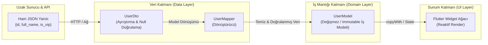
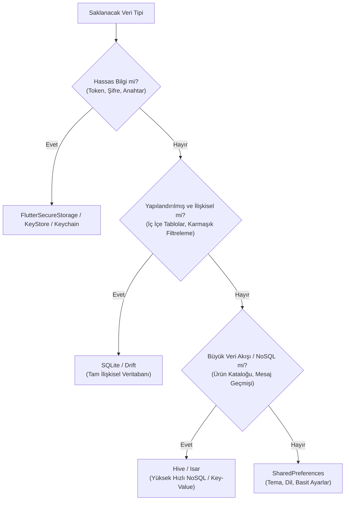

# Veri Modelleme, Değişmezlik ve API Sözleşmeleri: Mobil İstemcide Veri Bütünlüğü ve Tip Güvenliği

Mobil uygulama geliştirme süreçlerinde karşılaşılan çökmelerin, beklenmeyen ekran güncellemelerinin ve tutarsız durum hatalarının çok büyük bir kısmı arayüz (UI) bileşenlerinden değil; uygulamanın veriyi nasıl modellediğinden, taşıdığından ve yorumladığından kaynaklanır. Sunucudan dönen bir JSON yanıtındaki beklenmedik bir `null` alan, arayüzde doğrudan kullanılan bir veri nesnesinin beklenmedik bir anda yan etkiyle (side-effect) değiştirilmesi veya ağ kesintisi sırasında tekrarlanan bir sipariş isteği, tüm kullanıcı deneyimini saniyeler içinde çökertebilir.

Profesyonel bir mobil mimaride veri modelleme; yalnızca API'den gelen alanları bir sınıfa atamaktan ibaret değildir. Verinin dış dünya ile olan sözleşmesini (API Contract), iş mantığındaki saflığını (Domain Model), yerel bellekteki karşılığını (Local Entity) ve bellekteki değişmezlik (Immutability) disiplinini kapsayan uçtan uca bir sistem mühendisliğidir.


*Şekil 1: Ham JSON verisinden değişmez iş modeline ve kullanıcı arayüzüne uzanan veri dönüşüm hattı.*

---

## 1. Mobil Odaklı Veri Modelleme ve Katman Ayrımı

Mobil uygulamalarda sıklıkla düşülen en büyük mimari tuzak, tek bir model sınıfını uygulamanın her yerinde kullanmaya çalışmaktır. Aynı sınıf hem sunucudan gelen JSON nesnesini ayrıştırmakta (deserialization), hem yerel SQLite veya Hive veritabanına kaydedilmekte, hem iş kurallarını barındırmakta hem de doğrudan widget içinde ekrana çizilmektedir. 

Bu yaklaşım küçük prototiplerde hızlı görünse de ölçeklenen projelerde şu kritik sorunları doğurur:
* **Sunucu Bağımlılığı:** Sunucu ekibi bir JSON anahtarının adını değiştirdiğinde (`full_name` yerine `fullName`), arayüz ekranlarından veritabanı tablolarına kadar onlarca dosya kırılır.
* **Tip Kirliliği:** Sunucunun kullandığı veri tipleri (örneğin milisaniye cinsinden `int` tarih veya string durum kodları), doğrudan arayüze taşınır ve her ekranda tekrar tekrar formatlanmak zorunda kalınır.
* **Güvenlik ve Bütünlük Açığı:** Sunucudan eksik veya bozuk gelen bir alan, uygulamanın iş kurallarını işleten en derin katmanlarına kadar sızar.

Sağlam bir mobil mimaride veri üç temel forma ayrılır:

| Model Tipi | Sorumluluk Alanı | Katman | Temel Özellikleri |
| :--- | :--- | :--- | :--- |
| **DTO (Data Transfer Object)** | Sunucu veya ağ katmanı ile haberleşme | Data Katmanı | Sunucudaki JSON şemasını birebir yansıtır. Nullable alanları yönetir, ham string/sayı formatlarını tutar. |
| **Domain Model** | Uygulamanın saf iş kuralları | Domain Katmanı | İş kurallarına göre doğrulanmış, tipleri kesinleşmiş (`DateTime`, `enum`), değişmez (immutable) iş nesnesidir. |
| **Local Entity** | Cihaz hafızası ve yerel veritabanı | Data / Local Katmanı | SQLite (Drift) tablolarına veya NoSQL (Isar/Hive) anahtarlarına göre optimize edilmiş veri yapısıdır. |

### DTO'dan Domain Model'e Dönüşüm (Mapper Kalıbı)

Sunucu modellerini iş modellerinden izole etmek için açık bir dönüştürücü (Mapper) kullanılır. Bu sayede sunucu tarafında yapılan değişiklikler yalnızca DTO ve Mapper seviyesinde çözülür; uygulamanın geri kalanı bu değişiklikten hiç etkilenmez.

```dart
// 1. DTO: Sunucudan gelen ham JSON yapısı
class UserDto {
  final String? id;
  final String? fullName;
  final String? registeredAt;
  final int? loyaltyScore;

  const UserDto({
    this.id,
    this.fullName,
    this.registeredAt,
    this.loyaltyScore,
  });

  factory UserDto.fromJson(Map<String, dynamic> json) {
    return UserDto(
      id: json['id'] as String?,
      fullName: json['full_name'] as String?,
      registeredAt: json['registered_at'] as String?,
      loyaltyScore: json['loyalty_score'] as int?,
    );
  }
}

// 2. Domain Model: Saf, tipleri kesinleştirilmiş iş modeli
class UserModel {
  final String id;
  final String name;
  final DateTime registrationDate;
  final bool isVip;

  const UserModel({
    required this.id,
    required this.name,
    required this.registrationDate,
    required this.isVip,
  });
}

// 3. Mapper: Veri katmanından iş katmanına güvenli köprü
extension UserDtoMapper on UserDto {
  UserModel toDomain() {
    return UserModel(
      id: id ?? '',
      name: (fullName != null && fullName!.trim().isNotEmpty)
          ? fullName!.trim()
          : 'Bilinmeyen Kullanıcı',
      registrationDate: registeredAt != null
          ? DateTime.tryParse(registeredAt!) ?? DateTime.now()
          : DateTime.now(),
      isVip: (loyaltyScore ?? 0) >= 1000,
    );
  }
}
```

Bu ayrım sayesinde sunucu `loyalty_score` alanını kaldırıp yerine `tier_level: "GOLD"` gönderdiğinde, sadece `UserDto` ve `toDomain()` fonksiyonu güncellenir. Widget'ların veya iş akışlarının `isVip` kontrolü hiçbir şekilde bozulmaz.

---

## 2. Değişmezlik (Immutability) ve Tip Güvenliği

Nesne yönelimli programlamada nesneler varsayılan olarak değiştirilebilirdir (mutable). Bir nesnenin alanları çalışma zamanında doğrudan güncellenebilir. Ancak modern reaktif arayüz çerçevelerinde (Flutter gibi) değiştirilebilir nesneler, hata ayıklaması en zor mantık hatalarına yol açar.

### Neden Değişmezlik (Immutability)?

1. **Öngörülebilir Durum (Predictable State):** Bir model oluşturulduktan sonra alanları değiştirilemez. Modelin bir kopyası bir widget'a veya bir servise aktarıldığında, başka bir asenkron iş parçacığının bu nesnenin durumunu habersizce bozması engellenir.
2. **Yan Etkisiz Fonksiyonlar (Pure Functions):** Bir fonksiyona veya BLoC/Notifier olayına parametre olarak verilen nesne içeride manipüle edilemez; yeni bir durum üretmek için mutlaka yeni bir nesne oluşturulması gerekir.
3. **Reaktif Render Optimizasyonu:** Flutter'da bir arayüzün yeniden çizilip çizilmeyeceğini belirleyen temel unsur, önceki durum ile yeni durum arasındaki farktır. Değişmez nesnelerle çalışıldığında durumun değişip değişmediği anında anlaşılır.

### Değer Eşitliği (Value Equality) ve Bellek Referansı Problemi

Dart dilinde sınıflar varsayılan olarak referans eşitliğine (`identical`) göre karşılaştırılır. Yani bellekteki adresleri farklı olan iki nesne, içerdikleri tüm değerler birebir aynı olsa dahi eşit kabul edilmez (`==` sonucu `false` döner).

```dart
// 1. Durum: Standart Dart sınıfı (Referans Eşitliği)
class Product {
  final String id;
  final String title;

  const Product(this.id, this.title);
}

void main() {
  // Aynı alanlara ve değerlere sahip iki farklı nesne örneği
  final p1 = Product('1', 'Klavye');
  final p2 = Product('1', 'Klavye');

  // Varsayılan Dart davranışı: Bellekteki RAM adresleri farklı olduğu için FALSE döner!
  print(p1 == p2); // false
}
```

Bu durum BLoC, Riverpod veya Provider gibi durum yönetimlerinde büyük bir probleme yol açar: Durum nesnesi aynı veriyi taşımasına rağmen yeni bir referansla yayımlandığında gereksiz ekran çizimleri tetiklenir; ya da nesnenin içi değiştirildiğinde referans aynı kaldığı için ekran hiç güncellenmez.

Bu problemi çözmek için sınıflarda `operator ==` ve `hashCode` ezilir veya `Equatable` / `freezed` gibi standart kütüphaneler kullanılır:

```dart
import 'package:equatable/equatable.dart';

// 2. Durum: Equatable ile Değer Eşitliği (Value Equality)
class ProductModel extends Equatable {
  final String id;
  final String title;
  final double price;

  const ProductModel({
    required this.id,
    required this.title,
    required this.price,
  });

  // Değişmez nesnelerde alan güncellemesi için standart kopya metodu
  ProductModel copyWith({
    String? id,
    String? title,
    double? price,
  }) {
    return ProductModel(
      // Parametre verilmediyse mevcut değeri aynen koru
      id: id ?? this.id,
      title: title ?? this.title,
      price: price ?? this.price,
    );
  }

  // Eşitlik kıyaslamasına dahil edilecek alanların listesi
  @override
  List<Object?> get props => [id, title, price];
}
```

`copyWith` deseni, nesnenin değişmezliğini korurken yalnızca tek bir alanın güncellenmiş yeni bir kopyasını üretmeyi mümkün kılar:

```dart
// 1. Orijinal nesne oluşturuluyor
final original = ProductModel(id: '101', title: 'Fare', price: 450.0);

// 2. Fiyat güncellenmiş yeni durum türetiliyor
final discounted = original.copyWith(price: 400.0);

// Orijinal nesne bellekte asla değişmez
print(original.price);   // 450.0 (Orijinal nesne güvende)

// Yeni durum reaktif akışa iletilir
print(discounted.price); // 400.0 (Yeni durum oluştu)
```

---

## 3. API Sözleşmeleri (Contracts) ve İstemci Güvenliği

Mobil istemci, sunucunun merhametine bırakılamaz. Sunucu çöktüğünde, geriye HTML hata sayfası döndüğünde, veritabanı bağlantısı koptuğunda veya beklenen alan yerine `null` gönderdiğinde mobil uygulamanın beyaz ekrana düşmesi kabul edilemez bir mühendislik zafiyetidir.

### Contract-First (Sözleşme Odaklı) Yaklaşım

Mobil ve arka uç ekipleri kod yazmaya başlamadan önce API şemasını (OpenAPI / Swagger veya JSON Schema) kesinleştirmelidir. Bu sözleşmede şu kurallar açıkça belirlenir:
* Hangi alanlar zorunlu (`required`), hangi alanlar opsiyonel (`nullable`)?
* Sayısal alanlar tam sayı mı (`int`) yoksa ondalıklı mı (`double`)?
* Tarih formatı ISO-8601 standardında mı (`2026-03-30T10:00:00Z`)?
* Hata durumunda dönecek standart JSON gövdesi nedir?

### Standart Hata Zarfı (Error Envelope) Mimarisi

Sunucu bir hata ürettiğinde rastgele metinler veya farklı JSON yapıları döndürmemelidir. Başarılı ve başarısız tüm yanıtlar standart bir zarf (envelope) içine alınmalıdır:

```json
{
  "success": false,
  "data": null,
  "error": {
    "code": "AUTH_SESSION_EXPIRED",
    "message": "Oturum süreniz doldu, lütfen tekrar giriş yapın.",
    "details": {
      "expired_at": "2026-03-30T14:22:00Z"
    }
  }
}
```

İstemci tarafında bu zarf jenerik bir `ApiResponse<T>` sınıfıyla karşılanır:

```dart
class ApiResponse<T> {
  final bool success;
  final T? data;
  final ApiError? error;

  const ApiResponse({
    required this.success,
    this.data,
    this.error,
  });

  factory ApiResponse.fromJson(
    Map<String, dynamic> json,
    T Function(dynamic json) fromJsonT,
  ) {
    return ApiResponse(
      success: json['success'] as bool? ?? false,
      data: json['data'] != null ? fromJsonT(json['data']) : null,
      error: json['error'] != null
          ? ApiError.fromJson(json['error'] as Map<String, dynamic>)
          : null,
    );
  }
}

class ApiError {
  final String code;
  final String message;

  const ApiError({required this.code, required this.message});

  factory ApiError.fromJson(Map<String, dynamic> json) {
    return ApiError(
      code: json['code'] as String? ?? 'UNKNOWN_ERROR',
      message: json['message'] as String? ?? 'Beklenmeyen bir hata oluştu.',
    );
  }
}
```

Bu yapı sayesinde ağ katmanı hataları tür güvenli (type-safe) biçimde yakalar; arayüz katmanı ise kullanıcıya doğrudan teknik hata yığını (stack trace) yerine insan dilinde anlamlı mesajlar gösterir.

---

## 4. Sayfalama (Pagination) ve Ağ Kesintisi Yönetimi

Mobil cihazlar sınırlı bellek ve dengesiz ağ bant genişliği koşullarında çalışır. Binlerce satırlık listeleri tek bir istekte cihaza çekmek hem belleği tüketir hem de ağ gecikmesini katlar.

### Sayfalama Stratejileri: Offset vs. Cursor

| Kriter | Sayfa Bazlı Sayfalama (Offset / Limit) | İmleç Bazlı Sayfalama (Cursor / Keşif) |
| :--- | :--- | :--- |
| **Çalışma Prensibi** | `page=2&limit=20` mantığıyla veri atlama | `cursor=eyJpZCI6MTAxfQ==&limit=20` son kaydın kimliğiyle ilerleme |
| **Yeni Kayıt Eklenme Riski** | Kullanıcı 1. sayfadayken yeni kayıt gelirse 2. sayfaya geçtiğinde **mükerrer kayıt görür**. | Kayıt eklense de imleç son görülen ID'den devam ettiği için **asla mükerrer veri oluşmaz**. |
| **Veritabanı Performansı** | Yüksek sayfa numaralarında sunucu tarafında yavaşlar (`OFFSET 100000`). | İndeks üzerinden sorgulama yaptığı için her zaman yüksek performanslıdır. |
| **Mobildeki Tercih** | Sabit tablolar ve yönetim panelleri için uygundur. | **Sonsuz kaydırma (Infinite Scroll) ve sosyal akışlar için endüstri standardıdır.** |

### Ağ Kopmalarına Karşı İdempotans (Idempotency-Key)

Mobil ağlar doğası gereği kararsızdır. Kullanıcı bir ödeme veya sipariş butonuna bastığında istek sunucuya ulaşabilir, sunucu işlemi gerçekleştirebilir; ancak yanıt cihaza dönerken tünel veya baz istasyonu geçişi sebebiyle bağlantı kopabilir.

Kullanıcı arayüzde hata gördüğü için butona tekrar basarsa, aynı siparişin mükerrer oluşması (çift tahsilat) riski doğar. Bu problemi çözmek için `Idempotency-Key` kullanılır:

```dart
import 'package:uuid/uuid.dart';

Future<void> submitOrder(OrderModel order) async {
  // Her kritik işlem için istemcide benzersiz bir anahtar üretilir
  final idempotencyKey = const Uuid().v4();

  final headers = {
    'Content-Type': 'application/json',
    'Idempotency-Key': idempotencyKey,
  };

  // İstek sunucuya gönderilir
  // Ağ kopsa ve istemci aynı isteği tekrar gönderse bile,
  // sunucu anahtarı tanır ve işlemi ikinci kez çalıştırmadan eski sonucu döner.
  await httpClient.post('/api/orders', headers: headers, body: order.toJson());
}
```

---

## 5. Mobilde Yerel Veri Saklama Mimarisi

Mobil uygulamaların çevrimdışı (offline-first) çalışabilmesi, oturum bilgilerini koruyabilmesi ve açılış hızını optimize edebilmesi için verinin cihaz üzerinde saklanması şarttır. Ancak her veri tipi aynı depolama aracına konulmaz.


*Şekil 2: Mobil istemcide veri tipine ve güvenlik gereksinimine göre yerel depolama seçim akışı.*

### Yerel Depolama Karşılaştırma Matrisi

| Depolama Çözümü | Tip | Güçlü Yönü | Zayıf Yönü | Doğru Kullanım Senaryosu |
| :--- | :--- | :--- | :--- | :--- |
| **SharedPreferences** | Basit Anahtar-Değer (Key-Value) | Hızlı entegrasyon, asgari kurulum maliyeti | Yalnızca ilkel tipleri destekler, sorgulama ve filtreleme yapılamaz | Kullanıcının seçtiği tema (`dark`/`light`), bildirim izin bayrağı, dil tercihi |
| **FlutterSecureStorage** | Şifreli Anahtar-Değer | Donanım destekli şifreleme (iOS Keychain, Android KeyStore) | Okuma ve yazma işlemleri asenkron ve daha maliyetlidir | JWT erişim token'ı, API anahtarları, biyometrik oturum verisi |
| **Isar / Hive** | Hızlı NoSQL / Belge Deposu | Saf Dart ile çalışır, olağanüstü okuma hızı, doğrudan nesne serileştirme | İlişkisel sorgular (JOIN vb.) ve karmaşık veri bütünlüğü kısıtlamaları zayıftır | Çevrimdışı ürün kataloğu, anlık mesajlaşma önbelleği, arama geçmişi |
| **SQLite (Drift)** | İlişkisel SQL Veritabanı | Tam ACID desteği, güçlü ilişkiler, gelişmiş indeksleme ve tip güvenli SQL sorguları | Kurulum ve tablo göç (migration) yönetimi daha fazla kod gerektirir | Finansal kayıtlar, e-ticaret sepet yönetimi, iç içe ilişkili kurumsal veriler |

---

## 6. Mühendislik Karar Matrisi

Mobil veri modelleme ve API yönetiminde mimari kararlar verilirken aşağıdaki matris temel bir rehber olarak kullanılır:

| Yaklaşım / Prensip | Ne İfade Eder? | Hassasiyet / Güçlü Yanı | Sahadaki Kullanım Alanı |
| :--- | :--- | :--- | :--- |
| **DTO - Domain Ayrımı** | Ağ modelleri ile iş modellerini birbirinden tamamen yalıtmak | Sunucu şeması değiştiğinde UI ve iş kurallarının kırılmasını önler | Tüm REST veya GraphQL veri akışları |
| **Değişmezlik (Immutability)** | Modellerin durumunun dışarıdan doğrudan değiştirilememesi (`final` + `copyWith`) | Yan etkisiz fonksiyonlar, öngörülebilir durum yönetimi ve hatasız reaktif render | BLoC, Riverpod veya Redux durum nesneleri |
| **Değer Eşitliği (Equatable)** | Nesneleri bellek adresine göre değil, taşıdıkları veriye göre karşılaştırmak | Durum nesnesi değişmediğinde gereksiz ekran çizimlerini (rebuild) engeller | Durum sınıfları, filtreleme modelleri ve liste elemanları |
| **Contract-First & Error Envelope** | İstemci ve sunucunun ortak hata ve başarı zarfları üzerinde anlaşması | Sunucu çöktüğünde istemcinin beyaz ekrana düşmesini engeller, kullanıcıya anlamlı hata sunar | Tüm istemci-sunucu HTTP haberleşmesi |
| **Cursor-Based Pagination** | Sayfa numarası yerine son elemanın kimliği üzerinden veri çekmek | Sonsuz kaydırmada araya yeni kayıt girse bile mükerrer veri göstermez | Sosyal medya akışları, işlem geçmişleri, ürün listeleri |
| **Idempotency-Key** | Kritik işlemlerde istemcide üretilen benzersiz işlem anahtarı göndermek | Ağ koptuğunda kullanıcının tekrar basması durumunda mükerrer tahsilat veya sipariş oluşmasını önler | Satın alma, bakiye transferi, rezervasyon onaylama |
