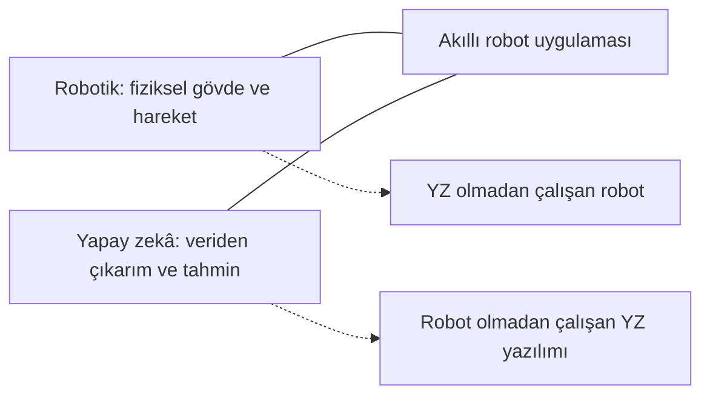

# Hafta 1: Robotik ve Yapay Zekâya Giriş

Robotlar ve yapay zekâ çoğu zaman birlikte anılsa da aynı şey değildir. Robotik, fiziksel dünyada görev yapan makinelerin tasarımı ve kontrolüyle ilgilenir. Yapay zekâ ise veriden öğrenme, örüntü tanıma veya karar verme gibi işleri yazılımla gerçekleştirmeyi amaçlayan yöntemleri kapsar. Bir robot yapay zekâ kullanmadan çalışabilir; yapay zekâ da fiziksel bir robot olmadan, örneğin bir bilgisayardaki yazılım olarak kullanılabilir.

Bu ayrımı anlamak, robotik sistemlerin nasıl kurulduğunu ve günlük hayattaki örneklerin hangi teknolojilerden yararlandığını değerlendirmeyi kolaylaştırır. Bir robot süpürgeyi ele alalım: Tekerlekleri ve fırçaları fiziksel hareketi sağlar, sensörleri çevresindeki engelleri ölçer, kontrol yazılımı hareket komutlarını üretir. Görüntü tanıma veya öğrenmeye dayalı rota planlama eklenmişse sistem yapay zekâ yöntemlerinden de yararlanabilir.

## Robot kavramı

**Robot**, fiziksel çevresiyle etkileşime girerek belirli görevleri otomatik veya yarı otomatik biçimde yerine getirebilen makinedir. Bir robotun görevi, çalışma ortamı ve yetenekleri farklı olabilir. Fabrikadaki robot kolu tekrarlanan kaynak işlemleri yaparken, mobil robot bir binada malzeme taşıyabilir; robot süpürge de zemini temizleyebilir.

Bir robotik sistem çoğunlukla üç alanın birlikte çalışmasıyla oluşur:

- **Mekanik yapı:** Gövde, tekerlek, eklem ve bağlantılar gibi fiziksel parçalar robotun biçimini ve hareket sınırlarını belirler.
- **Elektronik donanım:** Sensörler, kontrol kartları, motor sürücüleri ve kablolar ölçüm ve kontrol sinyallerini taşır.
- **Yazılım:** Sensör verilerini işler, davranış kurallarını uygular ve donanıma komut gönderir.

Bu parçalar birbirinden bağımsız düşünülemez. Güçlü bir motoru bulunan fakat onu ne zaman ve nasıl çalıştıracağı belirlenmemiş bir sistem görevini yerine getiremez. Benzer biçimde, iyi yazılmış bir program da uygun sensör ve mekanik düzenek olmadan fiziksel çevreyi algılayıp etkileyemez.

Bir makinenin robot sayılması için mutlaka insan biçiminde olması gerekmez. Robot kolu, otomatik yönlendirilen depo aracı ve insansız hava aracı farklı şekillere sahip olsalar da çevreleriyle etkileşerek belirli görevleri yerine getirir.

## Otomasyon ve robot arasındaki fark

**Otomasyon**, bir işin insan müdahalesi az olacak biçimde otomatik gerçekleştirilmesidir. Her otomasyon sistemi robot değildir. Örneğin belirli bir saatte ışıkları açan zamanlayıcı otomatik çalışır, ancak çevresini ölçüp fiziksel bir görev yapmadığı için genellikle robot olarak değerlendirilmez.

Robotlar da otomatik çalışabilir; fakat bazıları çevresinden ölçüm alır, hareket eder ve değişen koşullara tepki verir. Robotun ne kadar bağımsız davranabildiği tasarımına bağlıdır. Uzaktan kumandalı bir araç hareket eden bir robottur, ancak kararların çoğunu insan verir. Otonom bir araç ise belirli sınırlar içinde çevresini algılayıp bazı kararları kendi verebilir.

**Otonomi**, bir sistemin görevini sürdürürken insan yönlendirmesine ne ölçüde ihtiyaç duyduğunu anlatır. Otonomi, sınırsız veya hatasız çalışma anlamına gelmez. Her otonom sistem belirli sensörlere, kurallara, çalışma koşullarına ve güvenlik sınırlarına bağlıdır.

## Yapay zekâ kavramı

**Yapay zekâ (YZ)**, bilgisayar sistemlerinin algılama, sınıflandırma, tahmin veya karar desteği gibi görevleri yerine getirmesini sağlayan yöntemlerin genel adıdır. Yapay zekâ tek bir program veya tek bir teknik değildir. Farklı yöntemler, farklı türdeki problemler için kullanılır.

Geleneksel bir programda geliştirici, uygulanacak kuralları doğrudan tanımlar. Örneğin bir robotun önündeki mesafe 10 santimetreden azsa durmasını sağlayan program açık bir koşula dayanır. Makine öğrenmesi gibi yapay zekâ yöntemlerinde ise sistem, örnek verilerdeki örüntülerden bir model oluşturur. Bu model daha sonra yeni bir girdiyi sınıflandırmak veya tahmin yapmak için kullanılabilir.

Bu fark, her yapay zekâ uygulamasının kendi başına öğrenmeye devam ettiği anlamına gelmez. Birçok model eğitim aşamasında veriden öğrenir, ardından sabit bir model olarak çalışır. Kullanım sırasında yeni verilerle güncellenip güncellenmeyeceği ayrıca tasarlanır.

Yapay zekâ kullanan bir sistemin insan gibi bilinçli veya duygulu olduğu sonucuna varılamaz. Sistem, kendisine verilen girdiler ve tasarlanan yöntemler doğrultusunda çıktı üretir. Sonucun güvenilirliği; kullanılan veriye, modelin sınırlarına, uygulama biçimine ve test sürecine bağlıdır.

## Robotik ve yapay zekâ ilişkisi

Robotik, fiziksel makineyi ve bu makinenin çevresiyle etkileşimini kapsar. Yapay zekâ ise robotun kullanabileceği yazılımsal yöntemlerden biridir. İki alan kesiştiğinde robot, kamera görüntülerindeki nesneleri tanımak veya birden fazla olası hareket arasından uygun olanı seçmek için yapay zekâdan yararlanabilir.

*Şekil 1: Robotik ve yapay zekânın ayrı alanlar olduğunu ve birlikte kullanılabildiğini gösteren şema.*

Bir fabrika robot kolu, önceden belirlenmiş noktalar arasında hareket ederek yapay zekâ olmadan da kaynak yapabilir. Buna karşılık bir görüntü sınıflandırma modeli, bir sunucuda çalışıp fotoğraflardaki nesneleri etiketleyebilir; fiziksel bir robota ihtiyaç duymaz. Kamera ile nesne tanıyan ve motorlarıyla nesneye yaklaşan bir mobil robot ise iki alanın birlikte kullanıldığı bir örnektir.

Robotun yaptığı her karar yapay zekâ kararı değildir. Bir mesafe eşiğini kontrol eden `if` koşulu, önceden yazılmış bir kuralı uygular. Görüntülerden nesne türünü tahmin eden öğrenilmiş bir model ise yapay zekâ yöntemlerinden yararlanabilir. Bu ayrım, sistemin nasıl çalıştığını açıklarken önemlidir.

## Robotik ve yapay zekânın tarihsel gelişimi

Robotların gelişimi tek bir buluşla başlamamıştır. İnsanlar yüzyıllar boyunca su, hava, ağırlık ve dişli mekanizmaları kullanarak belirli hareketleri tekrar edebilen otomatik düzenekler tasarlamıştır. Bu düzenekler modern anlamda programlanabilir robotlarla aynı yeteneklere sahip olmasa da otomatik hareket fikrinin tarihsel örnekleridir.

### İlk otomatik mekanizmalar

Antik dönemden itibaren su saatleri, kendiliğinden açılan kapılar ve hareketli figürler gibi mekanik düzenekler geliştirilmiştir. Bu sistemler genellikle önceden belirlenen fiziksel bir mekanizmaya göre çalışır; çevreden veri toplayıp yeni bir plan oluşturmaz.

12. yüzyılda yaşamış mühendis El-Cezerî, su ve mekanik düzeneklerle çalışan çeşitli makineler tasarlamıştır. Bu çalışmalar, mekanik hareketlerin belirli bir amaç doğrultusunda düzenlenmesine ilişkin önemli tarihsel örnekler arasında yer alır.

### Rönesans dönemi tasarımları

Leonardo da Vinci, insan ve hayvan hareketlerini inceleyerek çeşitli mekanik tasarımlar geliştirmiştir. Tasarımları arasında, mekanik parçalarla hareket etmesi düşünülen zırhlı bir figür de bulunur. Bu tür çizimler, insan hareketini mekanik sistemlerle modelleme düşüncesinin tarihsel gelişimini gösterir.

### Endüstriyel robotların ortaya çıkışı

Elektrik motorları, kontrol sistemleri ve bilgisayarların gelişmesi, otomatik makinelerin üretimde daha esnek görevler üstlenmesini sağladı. 20. yüzyılın ortalarında endüstriyel robotlar fabrikalarda kullanılmaya başladı. Unimate, üretim hattında kullanılan ilk endüstriyel robot örneklerinden biri olarak bilinir; 1961'de General Motors'un üretim tesisinde çalışmaya başlamıştır.

Endüstriyel robotlar özellikle ağır, tehlikeli veya çok tekrarlanan işlerde kullanıldı. Kaynak, malzeme taşıma ve montaj gibi görevlerde aynı hareketi yüksek tekrarlanabilirlikle yapmaları üretim süreçlerini değiştirdi.

### Günümüz sistemleri

Günümüzde robotlar üretim hatlarının yanı sıra evlerde, depolarda, hastanelerde, tarımda ve araştırma çalışmalarında kullanılır. Otonom araçlar, insansız hava araçları ve robot süpürgeler farklı düzeylerde çevre algılama ve otomatik hareket yeteneklerine sahiptir. Yapay zekâdaki gelişmeler; görüntü tanıma, konuşma işleme ve veriye dayalı tahmin gibi işlevleri bu sistemlere ekleyebilir.

Modern bir sistemin daha gelişmiş olması, her zaman her ortamda güvenilir olacağı anlamına gelmez. Hava koşulları, sensörlerin görüş alanı, veri kalitesi ve çalışma sınırları sonuçları etkileyebilir. Bu nedenle tarihsel gelişim yalnızca daha fazla işlem gücü kazanımı olarak değil, güvenilirlik ve sorumlu kullanım gereksinimlerinin de artması olarak ele alınmalıdır.

## Günlük hayatta robotik ve yapay zekâ

Robotik ve yapay zekâ farklı ürünlerde farklı biçimlerde karşımıza çıkar:

| Uygulama | Robotik bileşen | Yapay zekânın olası rolü |
|---|---|---|
| Robot süpürge | Tekerlekler, fırça motoru, mesafe ve düşme sensörleri | Oda haritası çıkarma veya temizlik rotasını iyileştirme |
| Endüstriyel robot kolu | Eklem, motor, kontrol kartı ve tutucu | Kamera ile nesne veya kusur tanıma |
| Sesli asistan | Genellikle fiziksel robot gövdesi yoktur | Konuşmayı tanıma ve uygun yanıt üretme |
| Otonom araç | Direksiyon, fren, tekerlek ve çevre sensörleri | Görüntü ve diğer ölçümlerden trafik durumunu yorumlama |

Bu örneklerde bir ürünün reklamında “akıllı” olarak tanıtılması, hangi yapay zekâ yönteminin kullanıldığını tek başına açıklamaz. Sistemin gerçekten hangi sensörlere sahip olduğu, hangi kararları otomatik verdiği ve bu kararların hangi sınırlar içinde geçerli olduğu ayrıca incelenmelidir.

## Robotik ve yapay zekânın sağladığı katkılar

Robotlar, uygun görevlerde insanların yaptığı ağır veya tekrarlanan işleri üstlenebilir. Bir üretim robotu aynı montaj hareketini çok sayıda kez uygulayabilir; uzaktan kumandalı bir robot ise insanın doğrudan girmesinin tehlikeli olduğu bir alanda inceleme yapabilir.

Otomasyon, bir işin tamamlanma süresini kısaltabilir ve süreçlerin daha tutarlı yürütülmesine yardımcı olabilir. Ölçüm ve kontrol adımları doğru tasarlandığında, bazı tekrarlı işlemlerde insan kaynaklı değişkenlik de azalabilir. Yapay zekâ yöntemleri büyük miktarda veride örüntü bulmayı veya görüntülerdeki belirli nesneleri ayırt etmeyi kolaylaştırabilir.

Bu katkılar koşulsuz değildir. Robotun görevi doğru tanımlanmamışsa, sensörleri uygun değilse veya bakım yapılmıyorsa otomasyon hataları ortadan kaldırmak yerine yeni hatalar oluşturabilir. Bir sistemin zaman ve kalite açısından sağlayacağı yarar, gerçek çalışma koşullarında ölçülmelidir.

## Riskler ve sorumlu kullanım

Robotik ve yapay zekâ toplumsal ve teknik riskleri de beraberinde getirir. Bu riskler tasarımın başından itibaren değerlendirilmelidir.

### İşlerin dönüşümü

Otomasyon bazı görevlerin daha az insan emeğiyle yapılmasını sağlayabilir; bu durum belirli iş alanlarının dönüşmesine veya bazı işlerin azalmasına yol açabilir. Bununla birlikte yeni sistemlerin kurulması, denetlenmesi ve bakımı için farklı becerilere ihtiyaç duyulabilir. Etki, sektörlere ve bölgelere göre değişir; bu nedenle sonucu yalnızca “bütün işler yok olur” veya “hiçbir iş etkilenmez” şeklinde açıklamak doğru değildir.

### Güvenlik ve sorumluluk

Fiziksel bir robot yanlış hareket ettiğinde insanlara veya çevreye zarar verebilir. Hareket sınırları, acil durdurma imkânı, çalışma alanı ve hata durumundaki güvenli davranış tasarımın parçası olmalıdır. Bir sistemin hangi koşullarda güvenle çalıştığı açıkça belirlenmeli ve düzenli olarak test edilmelidir.

Yapay zekâ destekli bir kararın hatalı çıkması durumunda sorumluluk konusu da önem kazanır. Veriyi toplayan, modeli geliştiren, sistemi kullanan ve çalışma koşullarını belirleyen tarafların rolleri açık olmalıdır. Yapay zekâ çıktısı, özellikle yüksek etkili kararlarda, otomatik olarak doğru kabul edilmemelidir.

### Gizlilik ve veri güvenliği

Kameralar, mikrofonlar ve konum sensörleri kişisel veya hassas bilgiler toplayabilir. Bu bilgilerin neden toplandığı, nerede saklandığı, kimlerle paylaşıldığı ve ne zaman silindiği açık biçimde belirlenmelidir. Gereksiz veri toplamak hem gizlilik riskini hem de korunması gereken bilgi miktarını artırır.

### Önyargı ve adalet

Yapay zekâ modeli, eğitiminde kullanılan verideki eksik veya dengesiz temsilleri öğrenebilir. Bunun sonucunda bazı kişi veya koşullar için daha hatalı sonuçlar üretebilir. Modelin farklı gruplar ve gerçek çalışma koşulları üzerinde sınanması, sonuçlarının izlenmesi ve gerektiğinde insan denetiminin korunması önemlidir.

## Robotik ve yapay zekâya bütüncül bakış

Bir robotu anlamak için yalnızca gövdesine veya programına bakmak yeterli değildir. Mekanik yapı, elektronik donanım, sensörler, yazılım, çalışma ortamı ve insanlarla etkileşim birlikte değerlendirilir. Yapay zekâ bu sistemin algılama veya karar verme yeteneğini geliştirebilir, ancak her robot için zorunlu değildir ve kendi başına fiziksel bir robot oluşturmaz.

Robotik sistemleri değerlendirirken görevin ne olduğu, hangi ölçümlerin kullanıldığı, kararların nasıl alındığı ve hata durumlarında sistemin nasıl davrandığı açıklığa kavuşturulmalıdır. Bu temel bakış, sonraki konularda sensörleri, kontrol ünitelerini, aktüatörleri ve bu bileşenlerin birlikte nasıl çalıştığını anlamak için zemin oluşturur.
