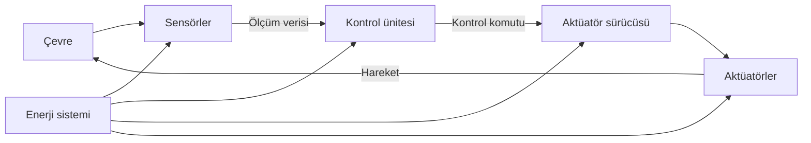

# Hafta 2: Robotik Sistemlerin Temel Bileşenleri ve Entegrasyonu

Bir robotu tek bir makine gibi görmek kolaydır; ancak çalışma biçimi, farklı bileşenlerin birlikte oluşturduğu bir sistemdir. Sensörler çevreden ölçüm alır, kontrol ünitesi bu ölçümleri yorumlar, aktüatörler fiziksel hareket üretir ve enerji sistemi tüm bileşenleri besler. Haberleşme bağlantıları bu parçaların bilgi paylaşmasını sağlar.

Bu bileşenlerden biri uygun seçilmediğinde veya diğerleriyle doğru bağlanmadığında robot beklenen görevi yerine getiremez. Örneğin sensör doğru ölçüm yapsa bile kontrol ünitesi bu veriyi geç işliyorsa robot engele zamanında tepki veremeyebilir. Bu nedenle robot tasarımında her parçanın özellikleri kadar bileşenlerin nasıl entegre edildiği de önemlidir.

## Robotik sistemin mimarisi

Bir robotun temel işleyişi aşağıdaki veri akışıyla açıklanabilir:

1. **Sensörler** çevreden veya robotun kendi hareketinden ölçüm toplar.
2. **Kontrol ünitesi** ölçümleri işler ve uygulanacak davranışı belirler.
3. **Aktüatörler** kontrol komutlarını hareket veya kuvvete dönüştürür.
4. **Geri besleme** sensörler aracılığıyla yeni durumu kontrol ünitesine iletir.

Enerji sistemi bu zincirin bütün parçalarına gerekli gücü sağlar. Haberleşme protokolleri ise sensörler, kontrol üniteleri ve sürücüler arasında veri alışverişini düzenler.



*Şekil 1: Robotik sistemde ölçüm, karar, hareket ve enerji akışının temel ilişkisi.*

Örneğin mobil robottaki tekerlek enkoderleri tekerleklerin ne kadar döndüğünü ölçer. Kontrol ünitesi bu ölçümü hedef hızla karşılaştırır ve motor sürücüsüne hız komutu gönderir. Tekerlekler hareket ettikten sonra enkoderler yeni dönüş miktarını bildirir. Bu tekrar eden ölçüm ve düzeltme süreci **geri besleme** olarak adlandırılır.

## Sensörler: çevreden ve robottan ölçüm alma

**Sensör**, fiziksel bir büyüklüğü ölçerek kontrol sisteminin kullanabileceği bir sinyal veya veri üreten bileşendir. Mesafe, sıcaklık, basınç, ışık, ivme ve dönme hızı sensörlerle ölçülebilen büyüklüklere örnektir. Sensör, çevreyi “anlamaz”; ölçüm üretir. Bu ölçümün ne ifade ettiğini kontrol yazılımı değerlendirir.

### Sensör performansını belirleyen özellikler

Sensör seçerken yalnızca ölçtüğü büyüklüğe bakılmaz. Ölçümün hangi koşullarda ne kadar güvenilir olduğu da incelenir.

- **Ölçüm aralığı**, sensörün güvenilir biçimde ölçebildiği en küçük ve en büyük değerleri belirtir. 2–400 cm aralığındaki bir sensör, bu sınırların dışında aynı doğrulukta ölçüm yapacağı anlamına gelmez.
- **Çözünürlük**, sensörün ayırt edebildiği en küçük değişimdir. Bir mesafe sensörü 1 cm aralıklarla değer üretiyorsa, birbirine çok yakın iki mesafeyi ayırmakta yetersiz kalabilir.
- **Doğruluk**, ölçümün gerçek değere ne kadar yakın olduğunu anlatır. Sensörün sürekli benzer sonuçlar üretmesi, sonuçların gerçek değere yakın olduğunu tek başına göstermez.
- **Hassasiyet ve tekrarlanabilirlik**, girişteki değişime verilen tepkiyi ve aynı koşul tekrarlandığında benzer ölçüm elde edilmesini açıklar. Teknik belgelerde bu terimlerin kesin kullanımı sensörün özelliklerine göre incelenmelidir.
- **Örnekleme hızı**, sensörün bir saniyede kaç ölçüm üretebildiğini belirtir. Hızlı hareket eden bir robotta yavaş ölçüm, önemli değişimlerin geç fark edilmesine yol açabilir.
- **Gürültü**, ölçüm değerinde gerçek fiziksel değişimden kaynaklanmayan dalgalanmalardır. Elektriksel parazit, titreşim, yansıma ve çevre koşulları ölçümleri etkileyebilir.
- **Gecikme**, ölçülen olay ile verinin kontrol ünitesinde kullanılabilir hâle gelmesi arasındaki süredir. Güvenlik ve hızlı kontrol görevlerinde gecikme hesaba katılmalıdır.

Geniş ölçüm aralığı her zaman yüksek çözünürlük, yüksek örnekleme hızı da otomatik olarak daha iyi kontrol anlamına gelmez. Sensör, gerçek görevin ve ortamın gereksinimlerine göre seçilir.

### Mesafe ve çarpışma algılama

**Ultrasonik sensör**, ses darbesi gönderip yankının geri dönme süresini ölçerek uzaklık tahmin eder. Uygun koşullarda, robotun önündeki duvar gibi nesneleri algılamada kullanışlı ve ekonomik bir seçenektir. Yüzeyin açısı veya malzemesi yankıyı sensöre geri göndermeyebilir; dar alanlarda yansımalar birden fazla yol izleyerek hatalı ölçüme neden olabilir.

**Kızılötesi (IR) mesafe sensörleri**, yayılan veya yansıyan ışığı kullanarak yakın mesafeleri algılayabilir. Yüzey rengi, parlaklık ve ortam ışığı bazı IR sensörlerinin sonucunu etkiler. Sensörün türüne göre ölçüm biçimi ve güvenilir çalışma aralığı değişir.

**LiDAR**, lazer ışığı kullanarak çevredeki nesnelere olan mesafeleri ölçer. Tek bir yöndeki mesafeyi ölçen modeller de, dönen lazerle çevrenin bir bölümünü tarayan modeller de bulunur. Haritalama ve çevre algılama için ayrıntılı ölçüm sağlayabilir; maliyet, güç tüketimi, görüş alanı ve çalışma ortamı model seçimini etkiler.

**Temas sensörü** veya tampon anahtarı, robot bir nesneye fiziksel olarak değdiğinde sinyal üretir. Temassız mesafe sensörünün yerine geçmez; erken uyarı sağlayan sensörlerin algılayamadığı durumda ek bir koruma katmanı olabilir.

### Hareket ve konum sensörleri

**IMU (Inertial Measurement Unit)**, çoğunlukla ivmeölçer ve jiroskop içerir. İvmeölçer doğrusal ivmeyi, jiroskop açısal hızı ölçer. Bazı IMU birimlerinde yön tahmini için manyetometre de bulunur. Bu ölçümler robotun dönme ve hareket değişimlerini takip etmeye yardımcı olur.

IMU ölçümleri zaman içinde küçük hatalar biriktirebilir. Örneğin jiroskopun ölçtüğü açısal hızdan yön açısı hesaplanırken küçük bir sabit hata da sürekli toplandığından tahmin zamanla kayabilir. Bu birikime **drift** denir. IMU bu nedenle çoğunlukla enkoder, kamera veya uydu konum bilgisi gibi başka kaynaklarla birlikte kullanılır.

**Enkoder**, motor milinin veya tekerleğin dönüş miktarını ölçer. Artımlı enkoder hareket oldukça darbe üretir; kontrol ünitesi darbeleri sayarak dönüş miktarını hesaplar. Enkoder, motorun ne kadar döndüğünü gösterir; tekerleğin zemin üzerinde kayıp kaymadığını her zaman doğrudan göstermez.

**GPS/GNSS**, açık alanda uydu sinyallerinden konum tahmini sağlar. Binalar arasında, kapalı alanlarda veya sinyalin engellendiği yerlerde doğruluk düşebilir. **RTK (Real-Time Kinematic)**, uydu konumlamasını düzeltme verileriyle iyileştiren bir tekniktir; uygun alıcı, bağlantı ve çalışma koşullarında standart uydu konumlamasından daha hassas sonuçlar sağlayabilir. Her uygulamada RTK kullanmak zorunlu değildir.

### Görüntü sensörleri ve bilgisayarlı görü

Kamera, görüntü sensörü aracılığıyla sahneden ışık bilgisi toplar. Ham görüntü, doğrudan nesne veya anlam içermez; yazılımın bu veriyi işlemesi gerekir. Görüntü tabanlı bir iş akışı genellikle şu aşamalardan oluşur:

1. Görüntünün kamerayla alınması.
2. Gerekirse parlaklık, renk veya gürültü düzeltmesi yapılması.
3. Nesne, kenar veya özelliklerin belirlenmesi.
4. Sonucun takip, sınıflandırma veya kontrol görevi için kullanılması.

Örneğin üretim hattındaki kamera, ürünün belirli bir parçasının eksik olup olmadığını denetleyebilir. Görüntü işlemenin başarısı yalnızca algoritmaya bağlı değildir; kamera çözünürlüğü, lens, aydınlatma, görüş açısı ve nesnenin hareket hızı da sonucu etkiler.

## Kalibrasyon ve filtreleme

Sensörün verdiği değer, fiziksel büyüklüğün kusursuz karşılığı olmayabilir. **Kalibrasyon**, ölçümü bilinen bir referansla karşılaştırıp sensörün sistematik hatalarını belirleme ve gerektiğinde düzeltme sürecidir. Mesafe sensörünün gerçek uzaklığı sürekli 2 cm eksik ölçtüğü fark edilirse, montaj ve ölçüm yöntemi incelenir; uygun düzeltme belirlenir.

Kalibrasyon yalnızca yazılımda sabit bir sayı eklemek değildir. Sensörün yönü, robot üzerindeki konumu, sıcaklık, titreşim ve üretici sınırları da ölçümü etkileyebilir. Birden fazla sensör birlikte kullanıldığında her sensörün robot koordinat sistemindeki konumu ve yönü de doğru tanımlanmalıdır.

**Filtreleme**, ölçümdeki istenmeyen dalgalanmaların etkisini azaltmaya çalışır. En basit yöntemlerden biri, son birkaç ölçümün ortalamasını almaktır. Bu yöntem ani küçük dalgalanmaları yumuşatabilir; ancak değişen duruma tepkiyi geciktirir ve uç değerlerden etkilenebilir.

**Alçak geçiren filtre**, hızlı değişen bileşenleri azaltıp daha yavaş değişen sinyali öne çıkarır. **Kalman filtresi** ise sistemin hareketine ilişkin bir model ile sensör ölçümlerini birleştirerek durum tahmini yapar. Kalman filtresi, tüm sensör hatalarını kendiliğinden gideren sihirli bir araç değildir; kullanılabilmesi için sistem modeli ve ölçüm varsayımları uygun olmalıdır.

Filtreleme öncesinde sistematik hatalar ve montaj sorunları düzeltilmelidir. Hatalı bir ölçümü filtrelemek, değeri daha düzgün gösterebilir ama gerçek ölçüm doğruluğunu artırmayabilir. Ayrıca güvenlik açısından kritik sinyallerin gereksiz biçimde geciktirilmemesi gerekir.

## Aktüatörler: komutu fiziksel harekete dönüştürme

**Aktüatör**, kontrol ünitesinden gelen komutu fiziksel hareket veya kuvvet olarak uygulayan bileşendir. Elektrik motorları, servo sistemler, pnömatik silindirler ve hidrolik silindirler farklı türde aktüatör örnekleridir.

### Elektrik motorları

- **DC motor**, doğru akımla çalışır ve basit hız kontrolü için kullanılır. Tek başına belirli bir açıda durduğunu güvenilir biçimde bildirmez; konum kontrolü için enkoder gibi geri besleme bileşenleri eklenebilir.
- **BLDC motor**, fırçasız DC motor olarak bilinir ve elektronik bir sürücüyle çalıştırılır. Verimlilik, ağırlık ve yüksek devir gibi özellikleri nedeniyle drone ve mobil robot uygulamalarında sık kullanılır.
- **Step motor**, elektriksel adımlara karşılık belirli açılarla dönmesi için tasarlanır. Açık çevrimde adım komutlarını saymak konum tahmini sağlar; yük fazla olduğunda motor adım kaçırabilir ve gerçek konum komuttan sapabilir.
- **Servo sistem**, motoru, sürücüyü ve genellikle konum veya hız geri beslemesini birlikte kullanarak hedefe göre kontrol sağlar. “Servo” tek bir motor çeşidinden çok, geri beslemeli kontrol düzenini de ifade eder.

Bir motorun seçimi tork, hız, hassasiyet, yük, çalışma süresi ve sürücü gereksinimlerine bağlıdır. **Tork**, döndürme etkisinin ölçüsüdür. Dişli kutusu motorun hızını azaltıp çıkış torkunu artırabilir; bunun karşılığında ağırlık, verim kaybı ve mekanik boşluk gibi etkenler oluşabilir.

### Pnömatik ve hidrolik aktüatörler

**Pnömatik aktüatörler**, sıkıştırılmış havayı kullanarak hareket üretir. Hızlı ve tekrarlanan açma-kapama hareketlerinde kullanılabilir. Bununla birlikte hava kaynağı ve valf sistemi gerekir; hassas konum kontrolü uygulamaya göre zorlaşabilir.

**Hidrolik aktüatörler**, basınçlı sıvıyla yüksek kuvvet oluşturabilir. Ağır yük ve yüksek kuvvet gerektiren endüstriyel uygulamalarda tercih edilebilir. Pompa, hortum, valf ve sıvı yönetimi gerektirir; sızıntı ve bakım koşulları tasarımda dikkate alınmalıdır.

### Mekanik güç aktarımı

Motorun ürettiği hareket, görev için doğrudan uygun olmayabilir. **Dişli kutusu**, **kayış-kasnak** veya **vida-somun** gibi mekanizmalar hareketin hızını, yönünü veya biçimini değiştirebilir.

- Dişli mekanizması dönme hızını ve torku değiştirebilir; dişler arasındaki boşluk hassasiyeti etkileyebilir.
- Kayış-kasnak sistemi uzak miller arasında hareket aktarabilir; kayış gerginliği ve kayma kontrol edilmelidir.
- Vida-somun mekanizması dönme hareketini doğrusal harekete çevirebilir; doğrusal konumlama için CNC makineleri ve 3B yazıcılarda kullanılır.

Aktüatörü yalnızca motor gücüne bakarak seçmek yeterli değildir. Hareketin istenen hızı, yükün ağırlığı, ivmelenme, çalışma süresi, mekanik aktarım ve frenleme ihtiyacı birlikte değerlendirilir.

## Kontrol üniteleri

**Kontrol ünitesi**, sensör verilerini işleyen ve aktüatörlere komut gönderen bilgisayar veya elektronik birimdir. Robotlarda sık karşılaşılan iki tür kontrol birimi mikrodenetleyici ve tek kartlı bilgisayardır.

**Mikrodenetleyici (MCU)**, işlemciyi, belleği ve giriş/çıkış birimlerini tek bir yongada birleştirir. Genellikle düşük güç tüketir ve pinleri doğrudan okuyup kontrol etmeye uygundur. Sensör örnekleme, motor PWM sinyali ve kısa kontrol döngüleri için kullanılabilir.

**Tek kartlı bilgisayar (SBC, Single-Board Computer)**, daha fazla işlem gücü ve bellek sağlayabilen küçük bir bilgisayardır. Linux gibi genel amaçlı işletim sistemleri çalıştırabilir; kamera görüntüsü işleme, haritalama ve daha karmaşık yazılımlar için elverişlidir. Genel amaçlı işletim sistemlerinde zamanlama, özel gerçek zamanlı düzenleme yapılmadıkça MCU kadar öngörülebilir olmayabilir.

Bir robotta bu iki birim birlikte kullanılabilir. Örneğin SBC kamera görüntülerini işler ve yüksek seviyeli hedef belirler; MCU motor kontrolünü ve zamanlaması hassas giriş/çıkışları yürütür. Acil durdurma ve çarpışma önleme gibi güvenlik işlevleri yalnızca gecikmesi değişken olabilecek uzak bir bilgisayara veya bulut bağlantısına bırakılmamalıdır.

## Haberleşme protokolleri

Bir robotun bileşenleri veriyi farklı elektriksel bağlantılar ve iletişim kurallarıyla aktarır. **Haberleşme protokolü**, cihazların veriyi nasıl gönderip alacağını belirleyen kurallar bütünüdür.

| Protokol | Temel özellik | Yaygın kullanım |
|---|---|---|
| **I²C** | Saat ve veri için iki ortak hat kullanır; aynı hatta birden fazla adreslenebilir cihaz bağlanabilir. | Düşük ve orta hızlı sensörler, küçük ekranlar |
| **SPI** | Saat, veri hatları ve cihaz seçimi kullanır; kısa bağlantılarda yüksek hız sağlayabilir. | Bellek, hızlı sensör ve çevre birimleri |
| **UART** | Saat hattı paylaşmadan belirlenen baud hızında seri veri aktarır; gönderme ve alma hatları kullanılır. | Seri konsol, GPS alıcısı, bazı modüller |
| **CAN** | Diferansiyel haberleşme ve mesaj önceliği gibi özelliklerle gürültülü ortamlarda çoklu cihaz iletişimini destekler. | Araç sistemleri ve dağıtık kontrol birimleri |

Her protokol her cihazla doğrudan uyumlu değildir. Gerilim seviyeleri, kablo uzunluğu, veri hızı, bağlantı sayısı, adresleme ve elektromanyetik parazit koşulları kontrol edilmelidir. Protokol seçiminde yalnızca en yüksek hız değil, sistemin güvenilirliği ve kablolama gereksinimleri de önem taşır.

## Enerji sistemi ve bataryalar

Robotun enerji sistemi bataryadan ibaret değildir. Batarya, gerilim dönüştürücüler, sigortalar, kablolar, şarj düzeni ve gerekiyorsa batarya yönetim sistemi birlikte değerlendirilir. Motorlar hızlanırken yüksek akım çekebilir; bu sırada gerilim düşmesi yaşanırsa kontrol kartı yeniden başlayabilir veya sensör ölçümleri bozulabilir.

**Li-ion** hücreler enerji yoğunluğu ve uzun çalışma süresi için kullanılabilir. **LiPo** adı genellikle daha hafif ve farklı biçimde paketlenebilen lityum-polimer bataryaları anlatır; ikisi de lityum tabanlı şarj edilebilir batarya ailesindedir ve gerçek özellikler ürünün hücre kimyasına ve üretici verilerine göre incelenmelidir.

Batarya seçiminde nominal gerilim, kapasite, sürekli ve anlık akım sınırları, ağırlık, boyut, şarj yöntemi ve güvenlik özellikleri dikkate alınır. Yüksek kapasiteli batarya her zaman daha uygun değildir; fazla ağırlık robotun hareket ve enerji gereksinimini artırabilir.

**BMS (Battery Management System)**, batarya hücrelerinin gerilim ve sıcaklığını izleyerek aşırı şarj, aşırı deşarj veya aşırı akım gibi durumlara karşı koruma sağlayabilir. Kullanılan bataryanın gerektirdiği koruma ve şarj düzeni üretici talimatlarına uygun olmalıdır. Lityum bataryalar yanlış şarj veya fiziksel hasar halinde tehlike oluşturabileceğinden güvenli kullanım koşulları göz ardı edilmemelidir.

Robotun toplam enerji ihtiyacı hesaplanırken kontrol kartı ve sensörlerin yanında motorların normal ve tepe akımları da hesaba katılır. Motorlara uygun güç kaynağı sağlanır; kontrol kartının ihtiyaç duyduğu gerilim ise uygun regülatörle elde edilir. Ortak sinyal referansı gereken sistemlerde bağlantıların elektriksel düzeni şemaya göre kurulmalıdır.

## Bileşenlerin birlikte çalışması

### Robot süpürge

Robot süpürge mesafe sensörleri, temas anahtarları veya düşme sensörleriyle çevresinden ölçüm alabilir. Kontrol ünitesi bu ölçümleri kullanarak tekerlek motorlarına komut gönderir; fırça ve emiş motorları temizlik işini gerçekleştirir. Bazı modeller çevrenin haritasını çıkarır ve temizlik rotasını planlar.

Bir sensörün engeli algılayamaması, diğer ölçümlerin önemini artırır. Bu nedenle sistem yalnızca tek bir ölçüm türüne güvenmek yerine sensörleri, hareket kontrolünü ve güvenli duruş davranışını birlikte tasarlar.

### Endüstriyel robot kolu

Endüstriyel robot kolunda her eklem hareketi motor ve mekanik aktarım bileşenleriyle üretilir. Enkoderler eklem konumunu ölçerek kontrol ünitesine geri bildirim sağlar. Kontrol sistemi hedef konumla ölçülen konumu karşılaştırır ve sürücüye düzeltme komutu verir. Böylece kol kaynak veya montaj noktasına tekrarlanabilir biçimde ulaşabilir.

Robot kolunun taşıyabileceği yük, erişim mesafesi, hız ve hassasiyet birlikte değerlendirilir. Çalışma alanı çevresindeki insanlar için fiziksel koruma, hız sınırı ve acil durdurma gibi önlemler de hücrenin tasarımına dâhildir.

### Drone

Drone'larda IMU açısal hız ve ivme ölçümleri sağlar; barometre irtifa tahminine, GPS/GNSS ise açık alandaki konum tahminine katkıda bulunabilir. Kontrol ünitesi bu verileri birleştirerek pervaneleri döndüren BLDC motor sürücülerine komut gönderir. Batarya kapasitesi ve motorların çektiği akım uçuş süresini etkiler.

Bu örneklerde tek bir bileşen tüm görevi çözmez. Sensör, kontrol yazılımı, sürücü, mekanik yapı ve enerji sistemi birlikte çalışır. Bileşenler arasındaki gecikme veya ölçüm hatası, robotun hareket kalitesini etkileyebilir.

## Arduino ile basit mesafe tabanlı hareket kontrolü

Aşağıdaki C++ örneği, Arduino uyumlu bir kartın HC-SR04 ultrasonik mesafe sensörünü okumasını ve bir motor sürücüsüne durma veya ileri gitme komutu göndermesini gösterir. Bu, algılama, kontrol ve hareket bileşenlerinin birlikte çalışmasını açıklayan temel bir örnektir.

Örnek bağlantılar:

- Sensörün `TRIG` pini 7 numaralı pine, `ECHO` pini 6 numaralı pine bağlanır.
- Motor sürücüsünün yön girişleri 8, 9, 10 ve 11 numaralı pinlere bağlanır.
- Motorlar Arduino'nun güç pinlerinden beslenmez. Motor sürücüsü ve uygun harici güç kaynağı kullanılır; bağlantılar sürücü üreticisinin şemasına göre yapılır.

```cpp
const int trigPin = 7;
const int echoPin = 6;

const int leftMotorIn1 = 8;
const int leftMotorIn2 = 9;
const int rightMotorIn1 = 10;
const int rightMotorIn2 = 11;

const float stopDistanceCm = 15.0;

bool readDistanceCm(float& distanceCm) {
  digitalWrite(trigPin, LOW);
  delayMicroseconds(2);
  digitalWrite(trigPin, HIGH);
  delayMicroseconds(10);
  digitalWrite(trigPin, LOW);

  const unsigned long durationUs = pulseIn(echoPin, HIGH, 30000UL);

  if (durationUs == 0) {
    return false;
  }

  distanceCm = durationUs * 0.0343 / 2.0;
  return true;
}

void stopMotors() {
  digitalWrite(leftMotorIn1, LOW);
  digitalWrite(leftMotorIn2, LOW);
  digitalWrite(rightMotorIn1, LOW);
  digitalWrite(rightMotorIn2, LOW);
}

void moveForward() {
  digitalWrite(leftMotorIn1, HIGH);
  digitalWrite(leftMotorIn2, LOW);
  digitalWrite(rightMotorIn1, HIGH);
  digitalWrite(rightMotorIn2, LOW);
}

void setup() {
  pinMode(trigPin, OUTPUT);
  pinMode(echoPin, INPUT);

  pinMode(leftMotorIn1, OUTPUT);
  pinMode(leftMotorIn2, OUTPUT);
  pinMode(rightMotorIn1, OUTPUT);
  pinMode(rightMotorIn2, OUTPUT);

  stopMotors();
}

void loop() {
  float distanceCm = 0.0;
  const bool measurementValid = readDistanceCm(distanceCm);

  if (!measurementValid || distanceCm < stopDistanceCm) {
    stopMotors();
  } else {
    moveForward();
  }

  delay(50);
}
```

`readDistanceCm` sensöre tetikleme sinyali gönderir ve yankının dönüş süresini ölçer. Sesin sensörden nesneye gidip geri dönmesi nedeniyle, ölçülen süre ses hızına çevrilirken ikiye bölünür. `pulseIn` belirlenen sürede yankı alamazsa sıfır döndürür; fonksiyon bu durumu `false` ile bildirir.

`loop()` her çalıştığında sensör yeni ölçüm alır. Ölçüm geçersizse veya mesafe 15 santimetreden azsa motorlar durdurulur. Geçerli mesafe daha büyükse robot ileri hareket eder. Bu örnek temel mimariyi gösterir; seçilen motor sürücüsüne göre giriş pinlerinin durdurma ve yön davranışı değişebilir. Gerçek donanımda pin düzeni, motor beslemesi ve güvenlik davranışı veri sayfalarına göre doğrulanmalıdır.

Bu örnek, profesyonel bir robotun güvenlik kontrolü yerine geçmez. Sensörün ölçemediği nesneler, tepki gecikmesi ve motorun durma mesafesi gerçek testlerde değerlendirilmelidir. İlk denemeler robot sabitlenmiş veya tekerlekleri zeminden kaldırılmış durumdayken yapılmalıdır.

## Güvenlik, fail-safe ve etik konular

Robotik sistemlerde güvenlik, yalnızca programın sonunda eklenen bir özellik değildir; bileşen seçimi ve mimari tasarım sırasında ele alınır. **Fail-safe**, sistem bir hata algıladığında riski azaltacak güvenli duruma geçme yaklaşımıdır. Örneğin sensörden geçerli veri gelmediğinde hareketi durdurmak bir fail-safe davranış olabilir.

**Acil durdurma**, operatörün tehlikeli veya beklenmeyen durumda sistemi hızlı biçimde durdurmasını sağlar. Gerçek uygulamalarda acil durdurma gereksinimleri, risk analizi ve kullanılacak makinenin standartlarına göre tasarlanır. Yazılım üzerinden verilen normal dur komutu ile donanımsal acil durdurma aynı işlev olarak kabul edilmemelidir.

Robotlar kamera, mikrofon veya konum verisi topluyorsa bu bilgilerin korunması da tasarımın parçasıdır. Gereksiz veri toplamamak, erişimi sınırlamak ve verinin saklama süresini belirlemek gizlilik riskini azaltır. Otonom kararların insanlara etkisi ve hata durumundaki sorumluluk da sistemin kullanım amacıyla birlikte değerlendirilmelidir.

## Bileşen seçimini gereksinimlere göre yapmak

Robot geliştirmeye başlamadan önce görev ve ortam gereksinimleri belirlenir. Robotun neyi ölçeceği, ne kadar hızlı tepki vermesi gerektiği, hangi yükü taşıyacağı, ne kadar süre çalışacağı ve hangi güvenlik sınırlarına uyması gerektiği açık olmalıdır.

Bu gereksinimler sensörün aralığını ve doğruluğunu, kontrol ünitesinin işlem kapasitesini, aktüatörün tork ve hızını, enerji sisteminin gerilim ve akım değerlerini etkiler. Haberleşme protokolü, kablo uzunluğu ve çevresel parazit koşullarına göre seçilir. Parçalar tek tek doğru seçilmiş olsa bile elektriksel, mekanik ve yazılımsal uyum doğrulanmalıdır.

Robotun güvenilir çalışması, bileşenlerin veri ve enerji akışlarının doğru kurulmasına bağlıdır. Ölçüm alınır, kontrol kararı verilir, aktüatör hareket üretir ve yeni durum tekrar ölçülür. Bu zincirde kalibrasyon, zamanlama, enerji yönetimi ve hata durumları birlikte ele alındığında robot sistemi daha öngörülebilir ve güvenli hâle gelir.
