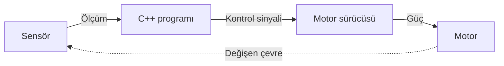

# Hafta 3: Robotları Akıllı Yapan Yazılım

Bir robotun gövdesi, motorları ve sensörleri fiziksel bir sistem oluşturur; ancak bu parçaların hangi durumda ne yapacağını yazılım belirler. Sensörden gelen ölçümü okuyup yorumlayan, bir sonraki adımı seçen ve motora komut gönderen programdır. Robotik programlama, elektronik ve mekanik bileşenleri belirli bir görevi yerine getiren sisteme dönüştürür.

Örneğin bir mobil robotun önünde duvar bulunduğunda durması gerekir. Mesafe sensörü duvara olan uzaklığı ölçer, program bu değeri güvenli mesafeyle karşılaştırır ve motor sürücüsüne durma komutu gönderir. Bu karar tekrar tekrar verildiği için robot çevresi değiştikçe hareketini de günceller.

## Robotun algılama, karar verme ve hareket etme zinciri

Robotik yazılımın temel akışı üç adımdan oluşur:

1. **Algılama:** Sensör, fiziksel dünyadaki bir özelliği ölçer. Mesafe sensörü uzaklığı, sıcaklık sensörü ısıyı, enkoder ise motor milinin dönüşünü ölçebilir.
2. **Karar verme:** Program, ölçümü bir kuralla veya algoritmayla değerlendirir. Örneğin mesafe 10 santimetreden azsa robotun durması seçilebilir.
3. **Hareket etme:** Programın seçtiği davranış, motor veya başka bir aktüatör üzerinden fiziksel harekete dönüşür.

**Aktüatör**, elektriksel bir komutu hareket, kuvvet veya başka bir fiziksel etkiye dönüştüren bileşendir. Motor, robotlarda sık kullanılan bir aktüatördür. Mikrodenetleyicinin çıkış pini genellikle motorun ihtiyaç duyduğu akımı doğrudan sağlayamaz. Bu nedenle mikrodenetleyici, **motor sürücüsü** adı verilen ara bileşene düşük güçlü bir kontrol sinyali gönderir; motor sürücüsü de ayrı güç kaynağından aldığı enerjiyi motora iletir.

Bu sistem kapalı bir döngü gibi çalışır: robot hareket ettikten sonra sensörler yeni durumu tekrar ölçer ve program bir sonraki hareketi belirler.



*Şekil 1: Sensör ölçümünün C++ programında karara dönüştürülerek motorlara iletilmesi ve yeni durumun tekrar ölçülmesi.*

## Robotik programlamada kullanılan temel kavramlar

Bir robot programı, bilgisayardaki diğer programlar gibi veriler ve bu veriler üzerinde işlem yapan komutlardan oluşur. Robotikte bu komutlar fiziksel dünyayla etkileştiğinden, ölçüm birimleri, zamanlama ve hata durumları da önem kazanır.

### Değişkenler ve veri türleri

**Değişken**, program çalışırken kullanılacak bir değeri saklayan isimlendirilmiş alandır. Sensörün ölçtüğü mesafe bir değişkende tutulabilir. **Veri türü**, değişkenin hangi tür bilgiyi sakladığını ve bu bilgiyle hangi işlemlerin yapılabileceğini belirtir.

```cpp
float distanceCm = 18.5;
int motorSpeed = 120;
bool obstacleDetected = false;
```

Burada `distanceCm` ondalıklı bir mesafeyi `float` türünde, `motorSpeed` tam sayı değerini `int` türünde, `obstacleDetected` ise doğru veya yanlış bilgisini `bool` türünde saklar. Değişken adları, tuttukları bilgiyi anlatacak şekilde seçildiğinde programı okumak kolaylaşır. `distanceCm` adındaki `Cm`, değerin santimetre olduğunu belirtir; ölçü birimini açık tutmak santimetre ile metre gibi farklı değerlerin yanlışlıkla karşılaştırılmasını önler.

### Koşullu ifadeler

**Koşullu ifade**, programın bir koşulun doğru veya yanlış olmasına göre farklı komutlar çalıştırmasını sağlar. C++ dilinde yaygın koşullu ifade `if` ve isteğe bağlı `else` bloklarıyla yazılır:

```cpp
if (distanceCm < 10.0) {
  stopMotors();
} else {
  moveForward();
}
```

Program önce `distanceCm < 10.0` karşılaştırmasını yapar. Sonuç doğruysa `stopMotors()` çağrılır; değilse `moveForward()` çağrılır. Süslü parantezler `{ }`, koşula bağlı olarak çalışacak komutları bir blok hâlinde tutar.

Robotlarda koşul yalnızca karar vermek için değil, ölçümün kullanılabilir olup olmadığını kontrol etmek için de kullanılır. Örneğin sensör veri üretemediyse, bu durum “önüm açık” olarak yorumlanmamalıdır. Güvenli bir program, geçersiz ölçümde motorları durdurabilir.

### Döngüler ve tekrar eden ölçümler

**Döngü**, belirli komutların yeniden çalıştırılmasını sağlayan programlama yapısıdır. Robotun sensörleri yalnızca başlangıçta bir kez okuması yeterli değildir; hareket sırasında çevre sürekli değişebilir. Bu nedenle ölçme, değerlendirme ve motor komutu üretme adımları tekrarlanır.

C++ dilinde `while` döngüsü, koşul doğru kaldığı sürece içindeki komutları tekrar çalıştırır:

```cpp
while (true) {
  float distanceCm = readDistanceCm();

  if (distanceCm < 10.0) {
    stopMotors();
  } else {
    moveForward();
  }

  delay(50);
}
```

Bu örnekte `while (true)` koşulu sürekli doğru olduğu için döngü bitmez. Her turda sensör yeniden okunur; mesafe 10 santimetreden azsa motorlar durur, değilse robot ileri gider. `delay(50)` programı 50 milisaniye bekletir. Böylece döngü kontrolsüz biçimde olabildiğince hızlı dönmek yerine ölçümler arasında kısa bir süre bırakır. Gerçek bir sistemde uygun bekleme süresi sensörün hızına, robotun hızına ve güvenlik gereksinimlerine göre belirlenir.

Arduino programlarında `setup()` ve `loop()` işlevleri bu tekrar düzenini sağlar. Kart açıldığında `setup()` bir kez çalışır. Ardından Arduino çalışma ortamı `loop()` işlevini sürekli çağırır. Bu nedenle aşağıdaki programda sensör okuma ve karar adımları `loop()` içine yazılır:

```cpp
void setup() {
  // Başlangıç ayarları burada yapılır.
}

void loop() {
  // Sensör okunur ve robotun davranışı güncellenir.
}
```

`while (true)` örneği ve Arduino'nun `loop()` işlevi, tekrar mantığını göstermek için iki ayrı biçimdir. Arduino uygulamasında genellikle kendi sonsuz `while` döngüsünü yazmak yerine `loop()` işlevi kullanılır.

### Fonksiyonlar ve kodun bölümlere ayrılması

**Fonksiyon**, belirli bir işi yapan ve gerektiğinde adıyla çağrılabilen kod bloğudur. Sensör okuma, motorları durdurma ve ileri gitme gibi işlemleri ayrı fonksiyonlara ayırmak, ana programın ne yaptığını daha anlaşılır kılar.

```cpp
void stopMotors() {
  // Motor sürücüsüne durma sinyalleri gönderilir.
}

void moveForward() {
  // Motor sürücüsüne ileri hareket sinyalleri gönderilir.
}
```

`void`, bu fonksiyonların çağıran programa bir sonuç değeri döndürmediğini belirtir. Fonksiyon çağrısı, adın yazılması ve parantezlerin eklenmesiyle yapılır: `stopMotors();`. Bu örneklerde motor sürücüsüne gönderilen sinyaller açıklama satırlarıyla temsil edilmiştir; gerçek pin bağlantıları ve sürücü modeli seçilen donanıma göre belirlenir.

Fonksiyonlar tekrar kullanılabilirliği de artırır. Örneğin robotun farklı bölümlerinde durması gerektiğinde her seferinde motor pinlerini ayrı ayrı değiştirmek yerine `stopMotors()` çağrılır. Motor bağlantı yöntemi değiştiğinde düzenleme tek fonksiyonda yapılabilir.

## Arduino ile mesafe ölçüp robotu durdurma

Aşağıdaki örnek, Arduino uyumlu bir kartın HC-SR04 ultrasonik mesafe sensöründen ölçüm alıp motor sürücüsüne komut göndermesini gösterir. Robot, ölçüm geçersiz olduğunda veya önündeki engel 10 santimetreden yakına geldiğinde durur; diğer geçerli ölçümlerde ileri gider.

Örnek bağlantı varsayımları şöyledir:

- HC-SR04 sensörünün `TRIG` pini Arduino'nun 7 numaralı pinine, `ECHO` pini 6 numaralı pinine bağlanır.
- Motor sürücüsünün sol motor yön girişleri 8 ve 9 numaralı pinlere, sağ motor yön girişleri 10 ve 11 numaralı pinlere bağlanır.
- Kod, motor sürücüsünün `IN1`–`IN4` yön girişlerini kontrol eder; sürücünün etkinleştirme pinleri donanımın gerektirdiği biçimde etkinleştirilmiş olmalıdır.
- Motorlar Arduino'nun güç pinlerinden beslenmez. Motorlar uygun harici güç kaynağından beslenir ve güç kaynağının eksi ucu ile Arduino'nun `GND` ucu ortaklanır.

```cpp
const int trigPin = 7;
const int echoPin = 6;

const int leftMotorIn1 = 8;
const int leftMotorIn2 = 9;
const int rightMotorIn1 = 10;
const int rightMotorIn2 = 11;

const float stopDistanceCm = 10.0;

bool readDistanceCm(float& distanceCm) {
  digitalWrite(trigPin, LOW);
  delayMicroseconds(2);
  digitalWrite(trigPin, HIGH);
  delayMicroseconds(10);
  digitalWrite(trigPin, LOW);

  const unsigned long durationUs = pulseIn(echoPin, HIGH, 30000UL);

  if (durationUs == 0) {
    return false;
  }

  distanceCm = durationUs * 0.0343 / 2.0;
  return true;
}

void stopMotors() {
  digitalWrite(leftMotorIn1, LOW);
  digitalWrite(leftMotorIn2, LOW);
  digitalWrite(rightMotorIn1, LOW);
  digitalWrite(rightMotorIn2, LOW);
}

void moveForward() {
  digitalWrite(leftMotorIn1, HIGH);
  digitalWrite(leftMotorIn2, LOW);
  digitalWrite(rightMotorIn1, HIGH);
  digitalWrite(rightMotorIn2, LOW);
}

void setup() {
  pinMode(trigPin, OUTPUT);
  pinMode(echoPin, INPUT);

  pinMode(leftMotorIn1, OUTPUT);
  pinMode(leftMotorIn2, OUTPUT);
  pinMode(rightMotorIn1, OUTPUT);
  pinMode(rightMotorIn2, OUTPUT);

  stopMotors();
}

void loop() {
  float distanceCm = 0.0;
  const bool measurementValid = readDistanceCm(distanceCm);

  if (!measurementValid || distanceCm < stopDistanceCm) {
    stopMotors();
  } else {
    moveForward();
  }

  delay(50);
}
```

Programın başlangıcındaki `const int` tanımları, sensör ve motor sürücüsü pinlerinin numaralarını sabitler. `const`, programın çalışması sırasında bu pin değerlerinin değiştirilmesini önler. `stopDistanceCm`, robotun duracağı sınırı santimetre cinsinden belirtir.

`readDistanceCm` fonksiyonu sensöre kısa bir tetikleme sinyali gönderir ve `pulseIn` ile `ECHO` pinindeki sinyalin süresini mikrosaniye cinsinden ölçer. HC-SR04 ses darbesinin gidip sensöre dönme süresini ölçtüğü için, süre ses hızına çevrilirken ikiye bölünür. Kodda kullanılan `0.0343`, sesin yaklaşık santimetre/mikrosaniye cinsinden hızıdır. `pulseIn` 30.000 mikrosaniye içinde yankı alamazsa sıfır döndürür; fonksiyon bu durumu geçersiz ölçüm olarak bildirir.

Fonksiyonun dönüş türü `bool` olduğu için sonuç iki değerden biridir: `true` ölçümün geçerli, `false` ölçümün geçersiz olduğunu belirtir. `float& distanceCm` parametresi, ölçülen mesafeyi fonksiyonun çağrıldığı yerdeki `distanceCm` değişkenine aktarır. Böylece ölçümün geçerli olup olmadığı ile ölçüm değeri ayrı ayrı elde edilir.

Arduino, kart başladığında `setup()` fonksiyonunu bir kez çalıştırır. `pinMode` çağrıları pinleri giriş veya çıkış olarak ayarlar. `loop()` fonksiyonu daha sonra tekrar tekrar çalışır. Her tekrarda ölçüm alınır ve `if` koşulu değerlendirilir. Sensör yankı alamadıysa `measurementValid` değeri `false` olur ve `!measurementValid` koşulu motorları durdurur. Ölçüm geçerliyse mesafe durma sınırıyla karşılaştırılır.

Motor sürücülerinin pin düzenleri ve çalışma biçimleri modele göre değişebilir. Bu nedenle örnekteki pin eşleştirmesi, kullanılan sürücünün veri sayfasına göre doğrulanmalıdır. Robot gerçek ortamda çalıştırılmadan önce tekerlekler yerden kesilerek yön komutları ve durma davranışı düşük riskli koşullarda sınanmalıdır.

## C++ dilinin robotikteki yeri

C++, donanıma yakın çalışabilmesi ve hızlı yürütülebilmesi nedeniyle mikrodenetleyicilerde ve performans gerektiren robotik yazılımlarda yaygın olarak kullanılır. Arduino kartları C++ tabanlı bir geliştirme ortamı sunar. Program doğrudan sensör pinlerini okuyabilir, motor sürücüsüne sinyal gönderebilir ve kontrol döngüsünün ne sıklıkla çalışacağını düzenleyebilir.

Robotik projelerde başka diller de kullanılır. Python hızlı prototipleme, görüntü işleme ve veri analizi için; Java robotlarla iletişim kuran Android uygulamaları için; MATLAB kontrol algoritmalarını modellemek ve analiz etmek için tercih edilebilir. Büyük bir robot sistemi bu dilleri farklı bileşenlerde birlikte kullanabilir. Bu makaledeki programlama örnekleri C++ ile verilmiştir; dil seçimi ise her bileşenin donanımına ve gereksinimlerine göre yapılır.

## ROS ile robot yazılımlarını düzenlemek

**ROS (Robot Operating System)**, robot yazılımlarının geliştirilmesi ve bileşenlerinin haberleşmesi için kullanılan açık kaynaklı bir yazılım ekosistemidir. Adında “Operating System” geçmesine rağmen ROS, Linux'un yerine geçen bir işletim sistemi değildir. Genellikle Linux üzerinde çalışan araçlar, kütüphaneler ve iletişim altyapısı sağlar.

ROS kullanan bir projede yazılım, ayrı görevleri yerine getiren **node** adı verilen süreçlere ayrılabilir. Bir node sensör verisini okuyabilir, başka bir node bu veriden robotun konumunu tahmin edebilir, bir diğeri de motor komutlarını gönderebilir. Node'lar, tanımlanmış mesajlar üzerinden veri paylaşır. Böylece her işlevin tek ve büyük bir programda toplanması gerekmez.

Bu modüler yapı, bileşenleri ayrı geliştirmeyi ve test etmeyi kolaylaştırır. ROS ekosistemindeki paketler algılama, haritalama, konum belirleme ve hareket planlama gibi görevlerde kullanılabilir. Küçük bir mikrodenetleyici projesinde ROS zorunlu değildir; basit bir C++ programı yeterli olabilir. ROS, çok sayıda yazılım bileşeninin birlikte çalıştığı daha büyük sistemlerde yarar sağlar.

## Simülasyonla güvenli test

**Simülasyon**, robotun ve çalışma ortamının bilgisayarda modellenerek yazılımın sanal ortamda denenmesidir. Gerçek robotla her deneme zaman alabilir, donanıma zarar verebilir veya güvenli olmayabilir. Simülasyonda robotun sensör ve hareket davranışları sanal ortamda incelenir.

Gazebo ve Webots robotları ve çalışma ortamlarını simüle etmek için kullanılan araçlardandır. V-REP adıyla bilinen yazılımın güncel adı **CoppeliaSim**'dir. Bu araçlarla farklı robot modelleri ve engel düzenleri üzerinde deney yapılabilir.

Örneğin engelden kaçınma programı, sanal ortamda duvarın farklı uzaklıklara yerleştirildiği senaryolarda denenebilir. Robotun durma sınırına uyup uymadığı ve geçersiz ölçümde nasıl davrandığı gözlenebilir. Hata gerçek donanıma geçmeden yakalanırsa düzeltme daha kolay ve düşük maliyetli olur.

Simülasyon gerçek dünyanın kusursuz bir kopyası değildir. Sensör gürültüsü, tekerlek kayması, titreşim, kablo bağlantısı ve güç dalgalanması gerçek donanımda farklı ortaya çıkabilir. Bu nedenle simülasyon, gerçek robot testinin yerine geçmez; donanım testinden önce ve onunla birlikte kullanılan bir doğrulama aşamasıdır.

## Güvenilir robot yazılımı geliştirmenin temel zorlukları

Robotik bir programın doğru karar vermesi kadar bu kararı zamanında ve güvenilir biçimde uygulaması da önemlidir. Sensörler hatalı değer üretebilir, işlemci sınırlı kalabilir veya bir bileşenle iletişim kesilebilir. Program bu durumlar için de belirli bir davranışa sahip olmalıdır.

### Gerçek zamanlı tepki

**Gerçek zamanlı çalışma**, bir işlemin doğru sonucu belirlenen süre içinde üretmesidir. Engeli algılayan bir robot doğru biçimde durma kararı verse bile komut geç uygulanırsa çarpışma önlenemeyebilir. Bu yüzden sensör ölçümü, programın kararı ve motorun tepki süresi birlikte değerlendirilir.

`delay(50)` örnekte döngüler arasında 50 milisaniye bekler. Bu, yaklaşık olarak saniyede 20 ölçüm yapılması anlamına gelir; her ölçüm ve komutun süresi de toplam döngü süresine eklenir. Bu hız küçük bir gösterim robotu için yeterli olabilir, ancak daha hızlı hareket eden veya güvenlik gereksinimi yüksek bir robot için uygun olmayabilir. Gerçek sistemde kontrol hızı, sensörün güncelleme hızı ve robotun hareket özellikleriyle uyumlu seçilir.

### Sensör gürültüsü ve veri filtreleme

**Gürültü**, sensör ölçümüne karışan ve gerçek değer dışındaki değişimlerdir. Sabit bir nesneye bakan sensör, yüzeyin açısı veya çevresel etkiler nedeniyle birbiriyle tam aynı olmayan ölçümler verebilir. **Veri filtreleme**, ölçümlerdeki rastgele değişimlerin kararları gereksiz yere değiştirmesini azaltır.

Basit bir yöntem, son birkaç ölçümün ortalamasını almaktır. Örneğin 19, 20 ve 21 santimetre ölçümlerinin ortalaması 20 santimetredir. Ancak tek bir ölçümde 55 santimetre gibi ani bir sıçrama varsa ortalama bu hatalı değerden etkilenebilir. Daha gelişmiş yöntemlerde aykırı değerler elenir veya ölçümün güvenilirliği hesaba katılır.

Filtreleme ölçümlerdeki dalgalanmayı azaltırken tepkiye gecikme ekleyebilir. Bu nedenle acil durdurma gibi güvenlik işlevleri, gereksiz gecikme yaratacak uzun bir filtreleme zincirine bağlanmamalıdır. Filtre türü ve ölçüm sayısı, robotun hızı ve sensörün çalışma koşullarına göre seçilir.

### İşlem gücü ve enerji

Robotun işlemcisi ve bataryası sınırlı kaynaklara sahiptir. Gereksiz hesaplamalar kontrol komutlarını geciktirebilir ve enerji tüketimini artırabilir. **Algoritma optimizasyonu**, aynı görevi daha az işlem veya enerjiyle tamamlayacak biçimde programı iyileştirmektir.

Örneğin yalnızca öndeki engel mesafesine göre durması gereken basit bir robotun her döngüde yüksek çözünürlüklü kamera görüntülerini işlemesi gerekmez. Görev için gerekli sensörleri ve hesaplamaları seçmek, sistemi daha verimli hâle getirir. Optimizasyon, güvenlik kontrollerini kaldırmak anlamına gelmez; gereksiz işi azaltırken gerekli davranış korunur.

### Hatalara dayanıklılık

**Hata toleransı**, bileşenlerden biri beklenmedik davrandığında sistemin tehlikeli veya öngörülemez bir duruma geçmesini önleyecek şekilde tasarlanmasıdır. Mesafe sensöründen ölçüm gelmemesi, ölçümün gerçekçi aralık dışında olması veya motor sürücüsüyle iletişimin kesilmesi bu tür durumlara örnektir.

Örnek programda sensör yankı alamadığında `readDistanceCm` başarısızlık bildirir ve robot motorları durdurur. Bu, hatalı ölçümü “yol açık” olarak yorumlamaktan daha güvenli bir davranıştır. Gerçek uygulamalarda hata durumu ayrıca kaydedilebilir, uyarı verilebilir ve yeniden başlatma koşulları tanımlanabilir.

## Robot yazılımı donanımla birlikte doğrulanır

Robotik programlama, sensör ölçümlerini kurallara ve algoritmalara göre değerlendirip fiziksel eyleme dönüştürür. Koşullar farklı durumlarda karar verir, döngüler bu kararları tekrarlar, fonksiyonlar programı yönetilebilir parçalara ayırır. C++ mikrodenetleyici ve donanım kontrolü için yaygın bir seçenektir; ROS daha büyük sistemlerin bileşenlerini düzenlemeye yardımcı olur; simülasyon ise yazılımı gerçek donanımdan önce denemeyi sağlar.

Güvenilir sonuç için kodun yanı sıra sensör bağlantıları, motor sürücüsü, güç kaynağı ve mekanik yapı da kontrol edilir. Önce simülasyonda veya sınırlı bir test düzeneğinde davranış doğrulanır, ardından robot düşük riskli koşullarda denenir. Böylece robotun yalnızca normal çalışma sırasında değil, geçersiz ölçüm ve bağlantı hatası gibi durumlarda da nasıl davranacağı belirlenmiş olur.
