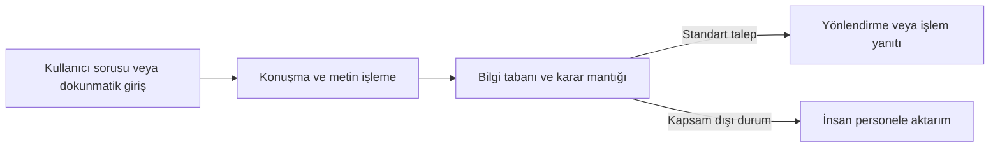

# Hafta 5: Hizmet Robotları: Günlük Yaşamdaki Rolü ve Geleceği

Endüstriyel robotlar genellikle fabrika ve depolarda tanımlı üretim adımlarını yerine getirirken, **hizmet robotları** evlerde, hastanelerde, okullarda ve kamusal alanlarda insanlara doğrudan veya dolaylı destek sağlamak üzere tasarlanır. Bu sistemlerin çalışma ortamı bir üretim hattı kadar düzenli ve öngörülebilir değildir. Evdeki eşyaların yeri değişebilir, hastane koridorlarında insanlar hareket edebilir veya bir havaalanında farklı sorular yönelten yolcular bulunabilir. Bu nedenle hizmet robotlarını incelerken yalnızca hangi görevi yaptıklarına değil, değişken ortamlarda nasıl algılama yaptıklarına, insanlarla nasıl etkileşim kurduklarına ve hangi sınırlar içinde güvenli çalıştıklarına da bakmak gerekir.

## Hizmet robotları ne yapar?

**Hizmet robotu**, endüstriyel üretim dışındaki ortamlarda insanlara yardımcı olan, belirli görevleri otomatik veya yarı otomatik biçimde yürüten robotik sistemdir. Bazı hizmet robotları zemin temizleme ya da malzeme taşıma gibi fiziksel işleri üstlenir; bazıları bilgi verme, yönlendirme veya eğitim süreçlerini destekleme amacıyla kullanılır; bazıları ise cerrahi operasyonlarda olduğu gibi uzman bir kullanıcının kontrolünde hassas işlemler yapılmasına aracılık eder.

Hizmet robotlarının temel amacı, tekrarlayan ya da zaman alan işleri üstlenerek kullanıcıların zamanını daha verimli kullanmasına yardımcı olmak ve hizmet süreçlerini desteklemektir. Bununla birlikte her hizmet robotu aynı düzeyde bağımsız çalışmaz:

- **Otonom çalışan sistemler:** Robot süpürge veya bina içi teslimat robotu gibi sistemler, sensörlerinden gelen verilerle engelleri algılayıp tanımlı alan içinde kendi rotasını izleyebilir.
- **Yarı otonom ve etkileşimli sistemler:** Karşılama ve müşteri hizmetleri robotları, belirli soruları yanıtlayıp yönlendirme yapabilir; ancak kapsam dışı durumlarda insan personele devretmesi gerekir.
- **Uzaktan kontrol edilen (tele-operasyon) sistemler:** Cerrahi robotlar kendi başına ameliyat kararı vermez; cerrahın konsoldan yaptığı el hareketlerini hastadaki cerrahi uçlara hassas biçimde aktarır.

## Hizmet robotu türleri ve kullanım alanları

Hizmet robotları görev yaptıkları ortama ve hedefledikleri ihtiyaca göre farklı donanım ve yazılım özellikleriyle tasarlanır.

| Kategori | Temel görev ve kullanım amacı | Örnek uygulama | Öne çıkan teknik gereksinim |
|---|---|---|---|
| Ev robotları | Günlük ev işlerini otomatikleştirerek zaman tasarrufu sağlamak | Robot süpürgeler, zemin silme ve çim biçme robotları | Engel ve düşme algılama, oda haritalama, güvenli batarya ve şarj yönetimi |
| Sağlık robotları | Cerrahi işlemlerde hassasiyeti artırmak, rehabilitasyon ve hasta/yaşlı bakımını desteklemek | Cerrahi robot sistemleri, hasta taşıma ve yaşlı bakım destek robotları | Yüksek konum hassasiyeti, sterilizasyon uyumu, kuvvet sınırlandırma ve güvenilir kontrol |
| Eğitim robotları | Öğrencilerin algoritmik düşünme, mekanik ve programlama becerilerini uygulamalı olarak geliştirmek | Programlanabilir eğitim kitleri (ör. LEGO tabanlı setler), sınıf içi etkileşimli robotlar | Modüler donanım, anlaşılır programlama arayüzü, dayanıklılık ve güvenli kullanım |
| Müşteri hizmetleri robotları | Kamusal ve ticari alanlarda ziyaretçileri karşılamak, bilgi sağlamak ve yönlendirme yapmak | Havaalanı, banka, otel ve alışveriş merkezi danışma robotları | Konuşma ve ekran arayüzü, gürültülü ortamda iletişim, kalabalıkta güvenli hareket |

### Ev robotları

Ev ortamında en yaygın kullanılan hizmet robotları robot süpürgelerdir. Bu cihazlar mesafe sensörleri, tampon anahtarları, düşme (merdiven) sensörleri ve modeline göre kamera veya LiDAR kullanarak odanın yapısını algılar. Tekerlek motorları hareketi sağlarken fırça ve vakum motorları temizlik görevini yürütür. Ev ortamında kablo, halı saçağı, evcil hayvan veya yerde unutulan küçük nesneler bulunabildiğinden, robotun algılama kapasitesi ve sıkışma durumlarında güvenli biçimde durabilmesi önemlidir.

### Sağlık robotları

Sağlık alanındaki robotlar çok farklı görevler üstlenir ve hepsi aynı biçimde çalışmaz. Cerrahi robotlar, cerrahın kontrol ettiği kollar ve görüntüleme sistemleriyle dar alanlarda hassas işlem yapılmasına olanak tanır. Yaşlı bakım ve hasta destek robotları ise ilaç saatlerini hatırlatma, temel izleme, malzeme taşıma veya fiziksel destek sağlama gibi amaçlarla kullanılır. Sağlık uygulamalarında hasta güvenliği birincil öncelik olduğundan, robotun hata durumunda güvenli konumda kalması ve uzman denetiminin korunması şarttır.

### Eğitim robotları

Eğitim robotları, sensör okuma, koşul değerlendirme ve motor kontrolü gibi kavramların somut olarak deneyimlenmesi için tasarlanır. Öğrenciler tekerlekli veya eklemli bir eğitim kiti üzerinde yazdıkları kodun fiziksel dünyadaki sonucunu doğrudan gözlemler. Bu robotlar endüstriyel sistemler kadar yüksek hız veya güç sunmaz; ancak modüler yapıları sayesinde donanım ve yazılım entegrasyonunu öğrenmek için güvenli bir deney ortamı sağlar.

### Müşteri hizmetleri robotları

Bankalar, havaalanları, hastaneler, oteller ve mağazalar gibi yoğun insan trafiği olan alanlarda müşteri hizmetleri robotlarından yararlanılır. Bu sistemler tekrarlanan bilgi taleplerini karşılamak ve ziyaretçileri doğru noktalara yönlendirmek üzere konumlandırılır.

*Şekil 1: Müşteri hizmetleri robotlarında kullanıcı talebinin işlenmesi ve gerektiğinde insan personele devredilmesi.*

## Müşteri hizmetleri robotlarının işleyişi

Müşteri hizmetleri robotlarının kamusal alanlarda üstlendiği rol üç başlık altında incelenebilir:

1. **Bilgi sağlama ve yönlendirme:** Havaalanında kapı numarasını soran bir yolcuya veya bankada sıra almak isteyen bir müşteriye ekran, ses ve görsel işaretlerle hızlı yanıt verilir. Sabit danışma noktalarının yanında bazı robotlar belirli bir alan içinde hareket ederek ziyaretçilere eşlik edebilir.
2. **Yapay zekâ destekli etkileşim:** Kullanıcıların doğal dilde sorduğu soruları işlemek için ses tanıma ve doğal dil işleme yöntemleri kullanılabilir. Sistem, soruyu önceden tanımlı bilgi tabanıyla eşleştirerek uygun yanıtı seçer veya ilgili işlemi başlatır. Ancak gürültülü ortamlar, farklı aksanlar veya belirsiz ifadeler konuşma tanıma başarısını düşürebilir; bu nedenle dokunmatik ekran gibi alternatif arayüzler çoğunlukla sesli iletişimi tamamlar.
3. **İnsan personelin iş yükünü hafifletme:** Sık sorulan ve standart yanıtı olan soruların robot tarafından karşılanması, bekleme sürelerini azaltabilir. Böylece insan personel, empati, karmaşık problem çözme veya özel değerlendirme gerektiren durumlara daha fazla zaman ayırabilir. Buradaki hedef insan çalışanları tamamen devre dışı bırakmak değil, rutin yükü azaltarak hizmet akışını desteklemektir.

## Güncel hizmet robotu örnekleri

Farklı görevler için geliştirilen hizmet robotları, mekanik tasarımın ve kontrol yönteminin göreve göre nasıl değiştiğini açıkça gösterir:

| Robot sistemi | Mekanik yapı ve çalışma biçimi | Başlıca kullanım alanı | İnsan-robot etkileşimi |
|---|---|---|---|
| **Boston Dynamics Spot** | Dört bacaklı (quadruped) mobil platform; engebeli zeminde denge ve hareket kontrolü sağlar | Saha keşfi, endüstriyel tesis denetimi, güvenlik ve veri toplama | Uzaktan operatör kontrolü veya tanımlı rotalarda otonom devriye |
| **Pepper** | Tekerlekli taban üzerinde insansı üst gövde ve göğüs ekranı | Karşılama, müşteri bilgilendirme ve eğitim ortamlarında sosyal etkileşim | Ses, dokunmatik ekran ve kamera tabanlı yüz/ifade analizi ile iletişim |
| **Da Vinci Cerrahi Sistemi** | Cerrah konsolu ve hasta başı çok kollu cerrahi manipülatör | Minimal invaziv cerrahi operasyonlar | Cerrahın doğrudan kontrol ettiği tele-operasyon (otonom ameliyat yapmaz) |

### Boston Dynamics Spot

Spot, tekerlekli robotların ilerlemekte zorlandığı merdiven, bozuk zemin ve dar geçitlerde hareket edebilen dört bacaklı bir mobil robottur. Bacaklı yapısı, çevredeki engellere uyum sağlamasını kolaylaştırır. Üzerine eklenen kameralar, termal sensörler veya gaz algılayıcılarla inşaat sahalarında, enerji tesislerinde ve tehlikeli alanlarda veri toplama ve devriye görevlerinde kullanılır. Spot'un hareket kabiliyeti insan anatomisinin kopyası olmaktan değil, dört bacaklı denge algoritmaları ve gelişmiş aktüatör kontrolünden kaynaklanır.

### Pepper

Pepper, insanlarla yüz yüze iletişim kurmak üzere tasarlanmış bir sosyal robottur. Üzerindeki kameralar, mikrofonlar ve dokunmatik ekran aracılığıyla kullanıcıyla etkileşime girer. Tanıtımlarda sıkça geçen “duyguları algılama” özelliği, robotun insan gibi hissettiği anlamına gelmez; yazılımın yüz ifadelerindeki ve ses tonundaki belirli örüntüleri sınıflandırarak buna uygun hazır tepkiler seçmesini ifade eder. Bu sınıflandırma her zaman hatasız olmadığından, robotun iletişimi açık ve anlaşılır ekran seçenekleriyle desteklenir.

### Da Vinci Cerrahi Robotu

Da Vinci sistemi, cerrahi müdahalelerde küçük kesilerden girilerek yüksek hassasiyetle işlem yapılmasını sağlayan bir tıp robotudur. Sistemde cerrah, ameliyat masasının yanındaki bir konsoldan üç boyutlu görüntüyü izler ve kontrol kollarını hareket ettirir. Robot, cerrahın el hareketlerini ölçeklendirip olası el titremelerini filtreleyerek cerrahi uçlara iletir. Dolayısıyla ameliyat kararlarını ve hareketlerini yapan yapay zekâ değil, sistemi kullanan cerrahtır. Küçük kesilerle çalışılması, uygun vakalarda hastanın iyileşme süresinin kısalmasına yardımcı olabilir.

## Karşılaşılan engeller: maliyet, teknik sınırlar ve etik

Hizmet robotlarının günlük yaşamda daha geniş yer bulmasını sınırlayan çeşitli mühendislik ve toplum boyutları vardır:

- **Yüksek maliyetler:** Gelişmiş sensörler, güvenilir aktüatörler, batarya sistemleri ve yazılım geliştirme süreçleri robotların üretim maliyetini artırır. Satın alma bedelinin yanı sıra kurulum, periyodik bakım, parça değişimi, yazılım güncellemeleri ve teknik destek giderleri de hem bireysel kullanıcılar hem de işletmeler için önemli bir yatırım kalemidir.
- **Teknik sınırlamalar:** Günlük yaşam ortamları sürekli değişir. Aydınlatmanın değişmesi, gürültü, zemindeki beklenmedik engeller, farklı nesne biçimleri ve sınırlı batarya süresi robotların başarımını kısıtlayabilir. Bir alanda başarıyla çalışan robot, ince motor becerisi veya bağlam yorumlama gerektiren başka bir görevde yetersiz kalabilir.
- **Güvenlik gereksinimleri:** Hizmet robotları güvenlik kafeslerinin ardında değil, insanların hemen yanında çalışır. Özellikle çocuklar, yaşlılar veya hastalarla aynı ortamı paylaşan bir robotun çarpışma önleme, hız sınırlama, dengeli duruş ve acil durdurma özelliklerine sahip olması gerekir.
- **Mahremiyet ve etik sorunlar:** Evlerde, hastanelerde ve kamusal alanlarda çalışan robotlar kamera, mikrofon ve haritalama sensörleriyle veri toplar. Ev içi yerleşim planının, ses kayıtlarının veya görüntülerin nasıl işlendiği, nerede saklandığı ve kimlerle paylaşıldığı gizlilik açısından kritik bir konudur. Ayrıca bir hizmet robotunun yanlış yönlendirme yapması veya fiziksel bir kazaya karışması durumunda sorumluluğun kime ait olacağı açık kurallarla tanımlanmalıdır.

## Gelecek perspektifi ve insan-robot iş birliği

Gelecekte hizmet robotlarının gelişimi, insanları sistem dışına çıkarmaktan çok **insan-robot iş birliğini** güçlendirmeye odaklanmaktadır. Sensör maliyetlerinin düşmesi, batarya verimliliğinin artması ve daha güvenilir algılama yazılımlarının geliştirilmesiyle hizmet robotlarının sağlık, eğitim, lojistik ve ev içi destek alanlarında daha erişilebilir hâle gelmesi beklenmektedir.

Başarılı bir hizmet robotu uygulaması, robotun güçlü olduğu tekrarlı, veri odaklı veya fiziksel olarak yorucu görevlerle insanın güçlü olduğu muhakeme, empati ve beklenmedik durumlara uyum yeteneğini bir araya getirir. Bu denge kurulduğunda hizmet robotları hem çalışanların iş yükünü hafifleten güvenilir birer yardımcı olabilir hem de robot bakımı, sistem entegrasyonu ve etkileşim tasarımı gibi alanlarda yeni çalışma fırsatları oluşturabilir.
