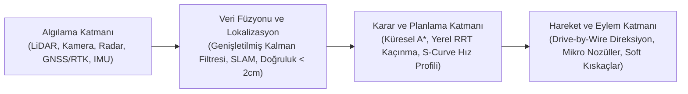

# Otonom Araçlar ve Tarım Robotları: Geleceğin Mobil Teknolojileri

Endüstriyel robot kolları fabrikaların kontrollü ortamlarında, hizmet robotları ise binaların iç mekanlarında tanımlı görevleri yerine getirirken; **otonom mobil sistemler** dinamik, öngörülemez ve geniş açık alanlarda faaliyet göstermek üzere geliştirilmektedir. Şehir içi trafiğinde seyreden sürücüsüz otomobillerden zorlu arazi koşullarında görev yapan tarım makinelerine kadar uzanan bu teknolojiler, robotiğin mekanik sınırlarını mobilite ve yapay zekâ ile birleştirmektedir. Açık dünyada görev yapan bu sistemleri incelerken yalnızca mekanik hareket kabiliyetlerine değil; çevreyi yüksek doğrulukla nasıl algıladıklarına, karmaşık karar mekanizmalarını nasıl işlettiklerine, kaynak verimliliğini nasıl sağladıklarına ve beraberinde getirdikleri etik-hukuki sorumluluklara odaklanmak gerekir.

## Otonom Araçlar ve Tarım Robotlarının Kapsamı

**Otonom araçlar**; insan müdahalesine ihtiyaç duymadan çevresini algılayabilen, güvenli yörünge planlaması yapabilen ve kendini yönlendirebilen tekerlekli, paletli veya uçan robotik sistemlerdir. Bu kategori; şehir içi yolcu taşımacılığında kullanılan sürücüsüz otomobilleri (robotaksi), hava sahasında görev yapan insansız hava araçlarını (İHA / drone) ve lojistik tesislerinde malzeme aktaran otonom yük taşıyıcılarını kapsar.

**Tarım robotları (Agri-robotics)** ise geleneksel tarım makinelerinden farklı olarak; ekim, çapalama, sulama, hassas ilaçlama, gübreleme ve ürün hasadı gibi operasyonları otonom veya yarı otonom olarak icra eden özel mobil platformlardır. Tarım arazileri; engebeli zemin yapısı, değişken hava şartları, toz, çamur ve sürekli büyüyen bitki örtüsü sebebiyle yapılandırılmamış (unstructured) dinamik çevreler olarak kabul edilir. Bu nedenle tarım robotları, endüstriyel muadillerine kıyasla çok daha dayanıklı algılama ve uyarlanabilir hareket algoritmalarına ihtiyaç duyar.

*Şekil 1: Otonom mobil sistemlerde ve tarım robotlarında algılamadan fiziksel eyleme uzanan kapalı çevrim kontrol mimarisi.*

## Temel Donanım ve Algılama Teknolojileri

Açık alanlarda tek bir sensör türü tüm çevre koşullarını modellemek için yeterli değildir. Optik kameralar sis ve karanlıkta zorlanırken, radar hassas nesne sınırlarını ayırt etmekte yetersiz kalabilir. Bu sebeple otonom sistemlerde **sensör füzyonu (sensor fusion)** yaklaşımı uygulanır:

- **LiDAR (Light Detection and Ranging):**
  - *Nedir:* Saniyede yüz binlerce görünmez lazer darbesi gönderen ve ışığın nesnelere çarpıp geri dönme süresini (Time-of-Flight) ölçen optik algılayıcıdır.
  - *Neden Önemlidir:* Kameralar 2 boyutlu düz fotoğraf çekerken LiDAR, çevrenin milimetrik derinliğe sahip 3 boyutlu nokta bulutunu (point cloud) çıkarır. Kendi ışık kaynağını kullandığı için zifiri karanlıkta da kusursuz çalışır.
  - *Mühendislik Sınırı:* Şiddetli sis, yoğun toz veya yağmur damlalarında lazer ışınları saçıldığı için gürültülü veri üretebilir.
- **Radar (Radio Detection and Ranging):**
  - *Nedir:* Radyo dalgaları yayarak nesnelerden yansıyan elektromanyetik yankıyı toplayan sensördür.
  - *Neden Önemlidir:* Doppler etkisinden yararlanarak öndeki engelin yalnızca mesafesini değil, aracımıza göre anlık yaklaşma/uzaklaşma bağıl hızını milisaniyeler içinde doğrudan hesaplar. Kar, sis, çamur ve tozu delip geçebilir.
- **GNSS ve RTK-GPS (Real-Time Kinematic):**
  - *Nedir:* Standart uydu konumlandırmasındaki (GNSS) atmosferik gecikmelerden kaynaklanan 2 ila 4 metrelik sapmayı, tarlanın kenarına yerleştirilen sabit bir yer istasyonuyla (RTK Baz İstasyonu) gerçek zamanlı düzelten diferansiyel sistemdir.
  - *Neden Önemlidir:* Tarlada 2 metrelik bir sapma traktörün ekili mahsulü ezmesi demektir. RTK düzeltme sinyali sayesinde robotun konum hatası **2 santimetrenin altına** indirilir.
- **IMU (Inertial Measurement Unit) ve Odometri:**
  - *Nedir:* 3 eksenli ivmeölçer ve 3 eksenli jiroskop barındıran ataletsel sensördür. Tekerlek enkoderlerinin tur sayılarıyla (odometri) birleştirilir.
  - *Neden Önemlidir:* Robot ağaçların altına, tünele veya uydu sinyalinin kesildiği kör noktalara girdiğinde katettiği mesafeyi ve açısal yönelimini aracın kendi iç dinamikleriyle hesaplamaya (Dead Reckoning) devam eder.
- **Sensör Füzyonu (Genişletilmiş Kalman Filtresi - EKF):**
  - *Nedir:* Tek bir sensörün eksik ya da hatalı bilgisini, diğer sensörlerin verileriyle olasılıksal olarak birleştiren matematiksel algoritmadır.
  - *Nasıl Çalışır:* Kamera nesnenin bir insan olduğunu tespit eder, LiDAR mesafesini (18.4 metre) netleştirir, Radar ise o insanın araca doğru 4 km/s hızla yaklaştığını doğrular.

## Yapay Zekâ, Yol Algılama ve Yörünge Planlama

Sensörlerden akan ham veriler, derin öğrenme ve evrişimli sinir ağları (CNN) modelleriyle anlamlandırılır:

- **Semantik Segmentasyon (Semantic Segmentation):** Bilgisayarlı görüde kamera görüntüsündeki her bir pikselin ait olduğu sınıfa (mavi: yol, beyaz: şerit çizgisi, kırmızı: yaya, yeşil: kültür bitkisi, sarı: yabani ot) göre etiketlenmesidir. Robotun "öndeki alan sürülebilir yoldur, kenardaki ise kaldırımdır" şeklinde bağlam kurmasını sağlar.
- **Küresel Yörünge Planlama (Global Path Planning):** Statik harita üzerinde A noktasından B noktasına en az yakıt veya en kısa mesafeli rotanın belirlenmesidir (A* veya Dijkstra algoritmaları).
- **Yerel Yörünge Planlama (Local Path Planning):** Yolda aniden beliren çukur, insan veya taş gibi dinamik engeller karşısında robotun şerit dışına taşmadan anlık kaçınma manevrası üreten algoritmadır (RRT - Rapidly-exploring Random Tree).
- **S-Curve Hız Profili:** İvmenin ani değişimini (sarsıntı / jerk) sınırlandırarak robotun mekanik aksamını koruyan ve sarsıntısız hızlanıp durmasını sağlayan hız eğrisidir.

## Tarım Robotları: Akıllı Teknolojiler ve Sürdürülebilirlik

Tarım sektörü; küresel iklim krizi, su kaynaklarının azalması, verimli toprak kaybı ve tarımsal iş gücündeki dramatik düşüş gibi kritik meydan okumalarla karşı karşıyadır. Tarım robotları, bu sorunlara **hassas tarım (precision agriculture)** yöntemleriyle çözüm üretmektedir.

- **Noktasal İlaçlama (Spot Spraying):** Tarlanın tamamına homojen kimyasal püskürtmek yerine, robotun altındaki yüksek hızlı yapay zekâ kameralarıyla sadece yabani otu tespit edip mikro nozüllerle üzerine birkaç damla ilaç bırakma işlemidir. Kimyasal kullanımını %80–%90 azaltır.
- **Yumuşak Robotik Tutucular (Soft Grippers):** Sert metal kıskaçlar yerine silikon veya esnek pnömatik körüklerle çalışan parmaklardır. Domates, çilek ve şeftali gibi narin meyveleri zedelemeden ve ezmeden toplar.
- **Değişken Oranlı Sulama:** Toprak nem sensörleri ve İHA termal haritaları birleştirilerek yalnızca kuruma tehlikesi yaşayan bölgelere hedefli sulama yapılır; su tüketimi %40 oranında azaltılır.

## Gerçek Hayat Uygulamaları ve Tarihsel Gelişim (2020–2026)

- **2020 — "Pure Vision" Tartışması ve FSD Beta:** Tesla, radar donanımını araçlardan kaldırarak yalnızca kameralara ve yapay sinir ağlarına dayanan yaklaşımı geniş kullanıcı kitleleriyle test etmeye başladı.
- **2021 — Seviye 4 Ticari Robotaksi Dönemi:** Waymo, Phoenix ve San Francisco'da direksiyonunda güvenlik sürücüsü dahi bulunmayan tamamen otonom ticari taksi seferlerini halka açtı.
- **2022 — Seri Üretim Otonom Traktörler ve Lazerle Tarım:** John Deere, akıllı telefon üzerinden 24 saat kesintisiz yönetilebilen ticari 8R otonom traktörünü duyurdu. Carbon Robotics, yabani otları mikrosaniyede lazerle imha eden LaserWeeder sistemini tarlalara indirdi.
- **2023 — Ağır Yük Tarım Droneları:** DJI Agras T40/T50 gibi 50 kg taşıma kapasiteli tarımsal İHA'lar dik yamaçlarda, bağlarda ve pirinç tarlalarında tohumlama ve hedefli ilaçlamada ana akım haline geldi.
- **2024 — Uçtan Uca Sinir Ağları (End-to-End AI) ve Filo Büyümesi:** Tesla, yüz binlerce satır C++ kural kodunu devreden çıkararak doğrudan video verileriyle eğitilen FSD V12 mimarisine geçti ve direksiyonsuz Cybercab robotaksiyi tanıttı. Waymo, haftalık 100.000+ ücretli ticari sürüş barajını aştı.
- **2025 — Yasal Mevzuatlar ve "Full Autonomy Farm" Konsepti:** Avrupa ve ABD'de Seviye 3 ve Seviye 4 ticari otonom araç regülasyonları standartlaştı. Tarımda tohum ekiminden ürün hasadına kadar tüm döngünün insansız otonom filolarla yürütüldüğü pilot çiftlikler devreye girdi.
- **2026 (Günümüz) — Edge AI, Swarm Robotics ve Hukuki Sorumluluk:** Uçta NPU işlemcileriyle internet bağımsız multimodal çıkarımlar standartlaştı; tekil dev makineler yerine sürü robotiği (Swarm Robotics) filoları yaygınlaştı. Hukuk sistemlerinde kaza sorumluluğu "sürücü kusuru" kavramından tamamen "ürün kusuru ve yazılım sorumluluğu" rejimine oturtuldu.

## Karşılaştırmalı Değerlendirme

| Kriter | Geleneksel Yöntem | Robotik ve Hassas Tarım | Sağlanan Somut Kazanım |
|---|---|---|---|
| **Çalışma Süresi** | Günde 8-10 saat (İnsan operatör yorgunluğu) | 7/24 Kesintisiz (Gece termal ve aydınlatma) | + %150 Zaman Kapasitesi |
| **Konum Hassasiyeti** | Göz kararı veya standart GPS (2-3 metre sapma) | RTK-GPS ve Bilgisayarlı Görü (< 2 cm sapma) | Sıfır Sıra Çakışması |
| **Kimyasal Kullanımı** | Tarlanın tamamına homojen püskürtme | Noktasal mikro hedefleme (Spot Spraying) | %70 - %80 İlaç Tasarrufu |
| **Su Tüketimi** | Salma sulama veya sabit zamanlı fıskiye | Nem sensörleri ve multispektral harita kontrolü | %40 Su Tasarrufu |
| **Toprak Sıkışması** | Ağır traktörler kök gelişimini engeller | Hafif otonom platformlar ve palet optimizasyonu | Toprak Verimi Korunur |

## Etik, Hukuki ve Sosyal Boyutlar

- **Kaza Durumlarında Hukuki Sorumluluk:** Sürücüsüz aracın yaptığı kazada sorumluluk araç sahibinde mi, algoritmayı yazan yazılım ekibinde mi yoksa sensör üreticisinde midir? Hukuk sistemleri geleneksel sürücü kusurundan **"ürün kusuru ve yazılım sorumluluğu"** rejimine geçmektedir.
- **Tramvay Problemi (Trolley Problem):** Kaçınılmaz bir çarpışma anında yapay zekâ araç içindeki yolcuyu mu yoksa yayaları mı feda etmelidir? Matematiksel optimizasyon ile insan ahlakının kesiştiği bu ikilem uluslararası etik komitelerince denetlenmektedir.
- **Küçük Çiftçiler ve Tarımsal Eşitsizlik:** Milyon liralık robotik sistemleri yalnızca dev tarım şirketleri satın alabilirse küçük aile çiftlikleri iflas edebilir. Bu nedenle teknolojinin modüler, kiralanabilir veya kooperatif temelli paylaşım modelleriyle tabana yayılması gerekmektedir.

## Mobil Robotiğin Geleceği

- **C-V2X (Cellular Vehicle-to-Everything):** 5G ve 6G hücresel altyapısıyla aracın diğer araçlarla (V2V), trafik ışıklarıyla (V2I) ve yayalarla (V2P) doğrudan mikrosaniyelik hızla konuşmasıdır. Kör noktaları tamamen ortadan kaldırır.
- **Edge AI (Uçta Yapay Zekâ) ve NPU:** Bulut sunucusuna internet üzerinden veri göndermeden, robot üzerindeki 15W NPU yongalarıyla milisaniyeler seviyesinde derin öğrenme çıkarımı yapılmasıdır.
- **Sürü Robotiği (Swarm Robotics):** Devasa tek bir traktör yerine, aynı tarlada haberleşerek görev paylaşımı yapan onlarca hafif, elektrikli mini robotun koordineli çalışmasıdır.
