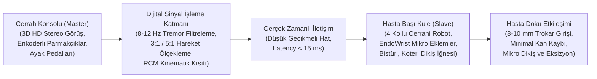

# Tıbbi Robotlar ve Sağlık Uygulamaları: Geleceğin Sıhhiye Sistemleri

Endüstriyel robotlar fabrikaların kontrollü kafeslerinde, mobil robotlar ise tarla ve otoyolların dinamik coğrafyalarında faaliyet gösterirken; **tıbbi robotik sistemler** mühendisliğin hata payı kabul etmeyen en kritik sınırında, doğrudan insan biyolojisi üzerinde görev yapmaktadır. Sanayi tesisinde meydana gelen bir mekanik arıza veya yazılımsal sapma yalnızca üretimin aksamasına veya parçanın hurdaya çıkmasına yol açarken; ameliyathanede milimetrik bir sensör kayması, geciken bir tele-operasyon sinyali veya aşırı uygulanan bir tork doğrudan insan yaşamına mal olabilmektedir. Bu nedenle tıbbi robotik; yalnızca ileri mekanik eklemlerden ibaret olmayıp, mikron düzeyinde hassasiyet sağlayan sinyal filtreleme algoritmalarını, biyomekatronik rehabilitasyon mekanizmalarını, otonom hastane içi lojistik ağlarını ve tıbbi malpraktis hukukunun getirdiği katı güvenlik normlarını bünyesinde barındıran çok disiplinli bir alandır.

## Tıbbi Robotların Kapsamı ve Klinik Sınıflandırma

Tıbbi robotik sistemler, sağlık ekosisteminde üstlendikleri klinik görevlere ve insan-makine etkileşim biçimlerine göre dört ana kategoride ele alınır:

1. **Cerrahi Tele-Operasyon Sistemleri:** Cerrahın vücut dışındaki bir konsoldan yönettiği, minimal invaziv deliklerden (trokarlardan) vücut içine giren çok kollu köle (slave) robotik platformlardır (Örn: Da Vinci Cerrahi Sistemi, Senhance).
2. **Hedefli ve Ortopedik Müdahale Robotları:** Önceden çekilen bilgisayarlı tomografi (BT) ve manyetik rezonans (MR) taramalarına dayanarak kemik kesimi yapan veya radyasyon ışınını kanserli tümöre milimetrik odaklayan haptik sınırlı robotlardır (Örn: Stryker Mako, CyberKnife).
3. **Rehabilitasyon ve Biyomekatronik Sistemler:** Omurilik felci (parapleji), inme veya nörolojik travma geçirmiş bireylere motor yetilerini yeniden kazandırmak amacıyla yürüme ve uzuv egzersizi yaptıran giyilebilir dış iskeletler (egzoskeletonlar) ve askılı yürüme platformlarıdır (Örn: ReWalk, EksoNR, Lokomat).
4. **Hastane İçi Destek ve Lojistik Robotları:** Sağlık personelinin fiziksel yükünü azaltmak amacıyla koridorlarda otonom seyrederek ilaç, kan tüpü, yemek ve atık taşıyan veya yatağa bağımlı hastaları transfer eden servis robotlarıdır (Örn: Aethon TUG, Diligent Moxi, RIBA).

*Şekil 1: Minimal invaziv cerrahide Master konsoldan Slave hasta başı robotuna uzanan kapalı çevrim tele-operasyon mimarisi.*

---

## Minimal İnvaziv Cerrahi ve Master-Slave Mimarisi

Geleneksel açık cerrahi, cerrahın organa erişebilmesi için hastanın karın veya göğüs duvarında 15 ila 25 cm uzunluğunda büyük kesiler yapılmasını gerektirir. Bu durum yoğun kan kaybına, şiddetli ameliyat sonrası ağrıya ve haftalarca süren hastanede kalış sürelerine yol açar. Minimal İnvaziv Cerrahi (MIS), büyük kesiler yerine hastanın vücuduna açılan 3 veya 4 adet 8-10 mm'lik trokar deliği üzerinden icra edilir.

Bu operasyonu mümkün kılan temel mühendislik yaklaşımı **Master-Slave (Efendi-Köle) Tele-Operasyon** mimarisidir:

* **Master Ünite (Cerrah Konsolu):** Cerrah ameliyat masasından uzakta, steril olmayan alanda ergonomik bir koltukta oturur. Konsolda cerrahın her iki gözüne bağımsız yüksek çözünürlüklü optik besleme sağlayan binoküler bir 3B vizör bulunur. Cerrahın baş ve işaret parmaklarını yerleştirdiği kumanda kolları (master manipülatörler), elin 3 boyutlu uzaydaki pozisyon ve oryantasyonunu mikron hassasiyetindeki optik enkoderlerle saniyede 1000 kez ölçer.
* **Slave Ünite (Hasta Başı Robotu):** Ameliyat masasında steril sahanın üzerinde konumlanan 3 veya 4 kollu mekanik yapıdır. Bir kol 3D endoskop kamerasını taşırken, diğer kollar mikro cerrahi makası, kavrayıcı kıskaçları ve elektro-koter aletlerini yönetir.
* **Uzak Merkez Kinematiği (Remote Center of Motion - RCM):** Robot kolunun ameliyat giriş deliğini (trokar kanülünü) sanal veya mekanik bir sabit nirengi noktası kabul etmesi kuralıdır. Robot kolu uzayda hangi açıyla dönerse dönsün, giriş deliğinde sıfır yanal kuvvet oluşturur; böylece hastanın karın duvarının alet gövdesi tarafından yırtılması veya esnetilmesi fiziksel olarak engellenir.
* **Gecikme Bütçesi (Latency Budget):** Tele-operasyonda cerrahın el hareketi ile robotik ucun hareketi arasındaki toplam gecikmenin **15 milisaniyenin altında** kalması zorunludur. Gecikme 50 ms'yi aştığında cerrahın el-göz koordinasyonu bozulur; 100 ms üzerinde ise cerrah aletin hareket etmediğini sanarak aşırı kuvvet uygular ve dokuyu zedeler.

---

## Da Vinci Sistemi ve EndoWrist Teknolojisi

Laparoskopik cerrahinin en büyük dezavantajı, vücut içine sokulan aletlerin düz ve rijit çubuklar olmasıdır. Rijit laparoskopi aletleri yalnızca 4 serbestlik derecesine (DoF) sahiptir ve insan bileği gibi bükülemez; bu da derin pelvis veya göğüs kafesi gibi dar anatomik alanlarda dikiş atmayı imkânsız hale getirir.

Intuitive Surgical tarafından geliştirilen Da Vinci sistemi bu kısıtı **EndoWrist** mekanizması ile aşmıştır:

* **7 Serbestlik Dereceli Artikülasyon:** EndoWrist aletleri, insan bileğinin anatomik kabiliyetini geride bırakarak tam 7 serbestlik derecesinde hareket eder ve eksenel olarak **540 derece dönebilir**.
* **Mikro Kablo Tahriki (Tendon-Driven):** 8 mm'lik bir alet milinin ucuna elektrik motoru sığdırılamayacağından, mafsal hareketleri robot kolunun gövdesinde bulunan fırçasız DC servolardan alet ucuna uzanan yüksek dayanımlı tungsten alaşımlı mikro kablolarla iletilir.
* **15x Optik Büyütmeli 3D HD Stereo Endoskop:** Çift kanallı optik kamera sistemi cerrahın retinasına derinlik algısıyla birlikte 1080p çözünürlükte görüntü yansıtır. Cerrah, çıplak gözle ayırt edilemeyecek 1 milimetrelik kılcal sinir liflerini ve damarları devasa yapılar olarak inceler.

---

## Sinyal İşleme: Tremor Filtreleme ve Hareket Ölçekleme

İnsan fizyolojisi ne kadar kusursuz olursa olsun, en deneyimli cerrahın dahi elinde istemsiz mikro kas kasılmalarından kaynaklanan bir titreme bulunur. Tıbbi robotik kontrol ünitesi, hekimin biyolojik sınırlarını yazılımsal filtrelerle elimine eder:

### 1. Fizyolojik Tremor Filtreleme (8–12 Hz)
İnsan elinin fizyolojik el titremesi genellikle 8 ile 12 Hz frekans aralığında harmonik salınım gösterir. Cerrahın istemli ameliyat manevraları ise 0 ile 3 Hz arasındaki düşük frekans bandındadır. Konsol işlemcisi, master enkoderlerden gelen pozisyon sinyalini gerçek zamanlı bir **dijital düşük geçiren filtreden (Low-Pass Filter)** ve Kalman filtresinden geçirir. 8-12 Hz bandındaki yüksek frekanslı titreme dalgaları gürültü olarak kırpılır; geriye yalnızca cerrahın istemli hareket vektörü bırakılarak robota iletilir. Alet ucu doku üzerinde mutlak bir mekanik kararlılıkla sabit durur.

### 2. Hareket Ölçekleme (Motion Scaling)
Mikro cerrahide cerrahın konsolda yaptığı geniş ve ergonomik el hareketleri, hastanın içindeki mikro alet ucuna oranlanarak yansıtılır:

Hareket ölçekleme mekanizması, cerrahın konsoldaki geniş ve rahat el hareketlerini yazılımsal bir oranlayıcı üzerinden süzerek hastanın içindeki alet ucuna hassasça küçülterek iletir:

* **3:1 Normal Çalışma:** Cerrah konsolda elini 3 santimetre hareket ettirdiğinde, mikro bistüri doku üzerinde yalnızca 1 santimetre ilerler.
* **5:1 Mikro Cerrahi Düzeyi:** Cerrah elini 5 santimetre kaydırdığında alet ucu yalnızca 1 santimetre yer değiştirir. Bu oranlama sayesinde göz retinası veya beyin damarları gibi mikron düzeyindeki narin anatomik sahalarda hekimin el becerisi milimetrik güvenlikle korunur.

---

## Haptik (Dokunsal) Geri Bildirim Problemi ve Çözümleri

Günümüz ticari cerrahi robotlarının (Da Vinci dahil) en büyük teknik kısıtı **haptik (kuvvet) geri bildirim eksikliğidir**. Açık ameliyatta cerrah dokunun sertliğini, gerginliğini ve damardaki nabzı parmak uçlarıyla hissederken; robot konsolundaki cerrah bu histen tamamen yoksundur. Cerrah, dokuyu ne kadar gerdiğini veya sıktığını yalnızca ekrandaki görsel deformasyondan (görsel haptik) tahmin etmek zorundadır.

Alet uçlarına minyatür kuvvet sensörleri yerleştirilmesini engelleyen üç temel mühendislik bariyeri bulunur:
1. **Otoklav Dayanımı:** Cerrahi aletler her vaka sonrası 134°C sıcaklıkta yüksek basınçlı doymuş su buharıyla (otoklav) sterilize edilir; piezoelektrik veya gerinim ölçer (strain gauge) sensörler bu sıcaklık ve neme dayanamaz.
2. **Biyouyumluluk:** Sensör materyallerinin toksik madde içermemesi ve vücut sıvılarından korozyona uğramaması gerekir.
3. **Maliyet ve Boyut:** 8 mm'lik mil ucunda sterilitesi bozulmayan ve tek kullanımlık ekonomik sınırlar içinde kalan sensör üretimi zordur.

**Modern Çözüm: Fiber Bragg Izgarası (FBG):** Optik fiber lifleri alet şaftına gömülür. Dokuya kuvvet uygulandığında fiberdeki mikro ızgaraların aralığı milimetrenin milyonda biri kadar esner ve geri yansıyan ışığın dalga boyu kayar. Işık analiziyle cerrahi uca elektrikli sensör koymadan kuvvet ölçülür ve cerrahın ekranında doku gerilimi renkli bir gerilim haritası (yeşil-sarı-kırmızı) olarak görselleştirilir.

---

## Ortopedik ve Radyocerrahi Robotları: Mako ve CyberKnife

Cerrahi robotik yalnızca yumuşak doku laparoskopisinden ibaret değildir; rijit kemik dokusunda ve kesi yapılmayan radyocerrahi alanında da devrim yaratmıştır:

* **Stryker Mako (Ortopedik Robotik):** Diz ve kalça protezi ameliyatlarında kullanılır. Ameliyat öncesi hastanın eklemi 3B BT ile taranır ve protezin oturacağı kemik yuvası yazılımda tasarlanır. Cerrah kemik kesme testeresini elle tutar; ancak robot kolu cerraha **Haptik Sanal Güvenlik Duvarı (Active Constraints)** uygular. Cerrah önceden tanımlanmış güvenli kesim sınırının 1 mm dışına çıkmak istese dahi robot motorları ters tork üreterek testerenin kritik damar ve bağ dokularına kaymasını fiziksel olarak engeller.
* **CyberKnife Robotik Radyocerrahi:** Açık ameliyat kesisi yapmadan, 6 serbestlik dereceli endüstriyel bir robot kolunun ucuna monte edilmiş lineer hızlandırıcı (X-ışını kaynağı) ile kanserli tümörleri yok eden sistemdir. Işınlar hastanın çevresinde 1200 farklı açıdan tümör merkezine odaklanır. Akciğer ve karaciğer tümörleri solunumla hareket ettiğinden, sistem kızılötesi optik kameralarla hastanın göğüs kafesini izler ve radyasyon demetini nefes alışverişiyle eşzamanlı olarak milimetrik kaydırır (Solunum Takipli Telafi).

---

## Rehabilitasyon Robotiği, Egzoskeletonlar ve Nöroplastisite

Rehabilitasyon robotiği, ameliyat sonrası veya kronik nörolojik hastalıklarda hastanın kaybolan hareket kabiliyetini yeniden kazanmasını sağlayan biyomekatronik sistemler bütünüdür.

* **Giyilebilir Dış İskeletler (ReWalk, EksoNR):** Omurilik felci (parapleji) geçiren hastaların bacaklarına dışarıdan giydirilen, kalça ve diz eklemlerinde fırçasız motorlar barındıran akıllı giysilerdir. Hastanın sırt çantasında bataryalar ve ana bilgisayar yer alır. Hasta gövdesini ve koltuk değneklerini öne doğru eğdiğinde, göğüs sensörleri ağırlık merkezinin (Center of Mass - CoM) kaydığını tespit eder ve bacak aktüatörlerine adım atma komutu gönderir.
* **Askılı Yürüme Robotları (Lokomat):** Hastanın vücut ağırlığının tavana bağlı bir vinç sistemiyle taşındığı ve bacaklarına bağlanan robotik uzuvlarla yürüme bandı üzerinde fizyolojik adım deseninin işletildiği klinik platformudur.

### Nöroplastisite ve Hareket Tekrarının Gücü
İnsan beyni statik bir yapı değildir; hasar gören sinir hücrelerinin (nöronların) fonksiyonu, sağlam kalan komşu nöronlar tarafından yeni sinaps ağları kurularak devralınabilir. Bu sürece **nöroplastisite** denir. Nöroplastisitenin tetiklenmesi için beynin aynı anatomik hareketi binlerce kez doğru simetri ve açıyla deneyimlemesi gerekir:

| Parametre | Geleneksel Fizyoterapi | Robotik Rehabilitasyon (Lokomat) |
|---|---|---|
| **Seans Başına Adım Sayısı** | 100 – 150 Adım (Terapist yorulur) | **1000 – 1500 Adım (10 kat yoğunluk)** |
| **Adım Açısı ve Simetrisi** | Değişken (İnsan yorgunluğu ve hata) | **Kusursuz Simetrik ve Kinematik Sabit** |
| **Geri Bildirim (Feedback)** | Sözlü uyarı | **Tork sensörlü dijital biofeedback ve VR** |
| **Hasta Katılım Modu** | Pasif sürüklenme riski | **Assist-as-Needed (Sadece gerektiğinde destek)** |

---

## Hasta Bakım, Servis ve Hastane İçi Lojistik Robotları

Modern bir hastanede sağlık personelinin zamanının yaklaşık %25 ila %30'u kan tüpü, ilaç, serum, ameliyathane tekstili ve yemek taşımak gibi rutin lojistik operasyonlarla harcanmaktadır. Bu durum personelin doğrudan hasta bakımına ayırabileceği vakti kısıtlar.

* **Aethon TUG (Otonom Mobil Taşıyıcı):** Dahili LiDAR sensörleri, ultrasonik tamponlar ve Wi-Fi köprüsüyle hastanenin dijital haritasında gezinir. Otomatik kapıları açar, asansör çağırarak katlar arasında otonom dolaşır ve günde 20 kilometreden fazla yol kat ederek ameliyathanelere steril malzeme ve laboratuvara kan örnekleri taşır.
* **Diligent Moxi & Florence:** Sosyal robot başlığı ve tekli esnek manipülatör kolu ile hemşire bankolarında görev yapar. Sayısal tuş takımlarını tuşlayarak kilitli ilaç dolaplarını açar ve eksilen malzemeleri kat servislerine dağıtır.
* **RIBA ve Robear (Hasta Transfer Robotları):** Yatağa bağımlı ağır hastaları (80–100 kg) incitmeden kucaklayarak tekerlekli sandalyeye veya banyo sedyesine aktaran, yumuşak dokunsal sensörlerle kaplı emniyetli taşıyıcı robotlardır.

---

## Karşılaştırmalı Değerlendirme: Cerrahi Metotlar Matrisi

| Kriter | Geleneksel Açık Cerrahi | Standart Laparoskopi | Robotik Cerrahi (Da Vinci) |
|---|---|---|---|
| **Kesi Geometrisi** | 15 – 25 cm büyük açık kesi | 3 – 5 adet 10 mm trokar | **3 – 4 adet 8 mm mikro kesi** |
| **Görüntüleme** | Çıplak göz, gölgeli alanlar | 2D Düz Ekran (Derinliksiz) | **3D HD Stereo (15x Büyütme)** |
| **Alet Ucu DoF** | İnsan bileğiyle sınırlı açı | 4 DoF (Düz çubuk, bileksiz) | **7 DoF (EndoWrist, 540° dönüş)** |
| **Fizyolojik Tremor** | Mevcut (8–12 Hz yorgunluk titremesi) | Kaldıraç etkisiyle uçta büyür | **Yazılımsal olarak tamamen sıfırlanır** |
| **Hareket Ölçekleme** | Yok (1:1 birebir aktarım) | Yok (1:1 ters kaldıraç hareketi) | **3:1 ve 5:1 hassas mikro küçültme** |
| **Kan Kaybı ve Transfüzyon** | Yüksek, harici kan torbası gerekebilir | Orta seviye | **Minimal (Kılcal damar mühürleme)** |
| **Hastanede Kalış (LOS)** | 7 – 10 Gün | 3 – 5 Gün | **1 – 2 Gün (Hızlı taburcu)** |
| **Cerrahın Ergonomisi** | Ayakta öne eğik, fiziksel yorgunluk | Ayakta zorlayıcı tutuş açıları | **Oturarak, kol destekli konsol konforu** |

---

## Klinik Sınırlar, Maliyet ve Öğrenme Eğrisi

Tıbbi robotik sistemlerin sağladığı üstünlüklere rağmen küresel ölçekte her ameliyathaneye girememesinin altında yatan çok somut engeller bulunmaktadır:

1. **Yüksek Yatırım ve Sarf Maliyeti:** Bir Da Vinci sistemi yaklaşık **1.5 ila 2.5 Milyon Dolar** ilk satın alma maliyetine sahiptir. Yıllık periyodik bakım anlaşmaları 150.000–200.000 Dolar civarındadır. Ayrıca patentli EndoWrist aletleri üretici yazılımı tarafından **10 kullanımla sınırlandırılmıştır**; her 10 ameliyatta bir aletler kilitlenir ve ameliyat başına ortalama 1.500–2.500 Dolar ilave sarf malzeme maliyeti biner.
2. **Öğrenme Eğrisi (Learning Curve):** Cerrahın konsolda derinlik hissini oturtması, alet koordinasyonunu sağlaması ve dokunma hissi olmadan sadece görerek güvenli dikiş atabilmesi için en az **50 ila 100 vaka** tamamlaması gerekir. Deneyimsiz cerrahların ilk vakalarında ameliyat süreleri açık cerrahiye göre 1.5-2 kat daha uzun sürebilmektedir.
3. **Acil Açık Cerrahiye Geçiş Riski (Conversion to Open):** Beklenmedik bir ana damar yırtılmasında veya masif iç kanamada, robot kollarının hastadan ayrılması (docking'in çözülmesi) ve cerrahın steril elbiseyle masaya geçip neşteri alması 1 ila 2 dakika sürebilir. Bu süre kritik hemorajilerde hayati tehlike yaratır.

---

## Etik, Malpraktis ve Hukuki Sorumluluk Zinciri

Ameliyathane ortamında robotik bir aletin bir arteri yırtması veya hastanın hayatını kaybetmesi durumunda kusur ve ceza hukuku üçlü bir sorumluluk ayrımı uygular:

* **Cerrahın Tıbbi Malpraktisi:** Sistem doğru çalıştığı halde cerrah konsolda yanlış pedala basmış, yanlış yapıyı kesmiş veya sisteme dair yeterli sertifikasyon eğitimini almadan operasyona girmişse sorumluluk doğrudan hekime aittir.
* **Üreticinin Kusursuz Ürün Sorumluluğu (Strict Liability):** Cerrah aleti geri çek komutu verdiği halde robotik kol yazılımsal bir donma (freeze), kontrolsüz elektrik deşarjı veya mikro kablo kopması sebebiyle hastanın organına zarar vermişse kusur hekime yüklenemez. Sorumluluk tasarım, üretim ve yazılım kusuru sebebiyle cihazı üreten firmadadır.
* **Hastanenin İdari Sorumluluğu:** Cihazın periyodik biyomedikal kalibrasyonu aksatılmışsa, ameliyathane elektrik altyapısında regülatör arızası yaşanmışsa veya trokarlar usulüne uygun sterilize edilmeyip doku enfeksiyonu gelişmişse hastane yönetimi kurumsal olarak tazminatla yükümlüdür.
* **Aydınlatılmış Onam (Informed Consent):** Hekim ameliyattan önce hastaya operasyonun bir robotik tele-operatör ile yapılacağını, cerrahın masadan uzakta oturacağını, sistemin olası teknik risklerini ve kendisinin robotik vaka tecrübesini yazılı olarak açıklamak ve hastanın imzasını almak zorundadır.

---

## Tıbbi Robotiğin Geleceği: Nanorobotlar ve Otonomi

Önümüzdeki on yıllık perspektifte tıbbi robotik ekosistemi makro mekanik kollardan hücresel ve mikroskobik boyutlara evrilmektedir:

* **Damar İçi Mikro ve Nanorobotlar:** Boyutları 1 mikron ile 100 nanometre arasında değişen, kan dolaşımına enjekte edilen akıllı parçacıklardır. Dışarıdan uygulanan döner manyetik alanlarla yönlendirilen nanorobotlar, doğrudan tümör dokusuna giderek kemoterapi moleküllerini yalnızca kanserli hücreye salgılar. Böylece sağlıklı hücreler korunur ve kemoterapinin saç dökülmesi, organ yetmezliği gibi ağır yan etkileri sıfırlanır.
* **Otonom Yumuşak Doku Cerrahisi (STAR):** Johns Hopkins Üniversitesi tarafından geliştirilen Smart Tissue Autonomous Robot (STAR), yakın kızılötesi floresan işaretleyiciler ve 3D yapay zekâ görüsü kullanarak domuz bağırsak dokusunu insan müdahalesi olmadan tamamen otonom olarak dikmeyi başarmıştır. STAR'ın attığı dikişlerin sızdırmazlık basıncı ve milimetrik aralık düzeni uzman insan cerrahların dikiş kalitesini geride bırakmıştır.
* **5G ve 6G ile Kıtalararası Tele-Cerrahi (URLLC):** Hücresel ağların sunduğu Ultra Güvenilir Düşük Gecikmeli İletişim (URLLC) dilimleme mimarisi sayesinde, New York veya İstanbul'daki dünya çapında bir cerrahın Afrika'daki veya savaş bölgesindeki bir sahra hastanesinde bulunan hastayı 10 milisaniyenin altında gecikmeyle uzaktan ameliyat edebilmesi mümkün hale gelmektedir.
