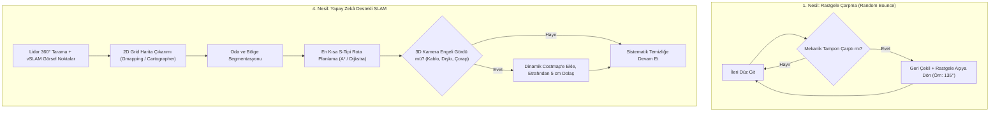
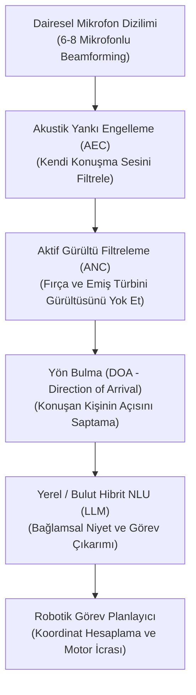
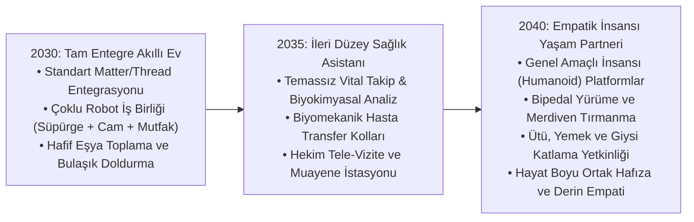

# Ev ve Kişisel Asistan Robotları: Akıllı Yaşam Alanlarında Otonom Hizmet ve Sosyal Etkileşim

Endüstriyel robotik sistemler sınırları kesin olarak çizilmiş, insan girişine kapatılmış ve güvenlik kafesleriyle çevrili fabrikalarda faaliyet gösterirken; **ev ve kişisel asistan robotları** mühendisliğin en karmaşık, dinamik ve kestirilemez çalışma sahasında, doğrudan insanların özel yaşam alanlarında görev yapmaktadır. Bir otomotiv montaj hattında parçanın koordinatı, ortam aydınlatması ve çevrim süresi milimetrik ve mikrosaniyelik hassasiyetle sabitlenmiştir. Buna karşılık bir evin oturma odasında sandalyelerin konumu her an değişebilir, yerde ışığı yansıtmayan ince bir şarj kablosu unutulmuş olabilir, bir evcil hayvan aniden robotun önüne atlayabilir veya küçük bir çocuk merakla robota dokunabilir. Bu nedenle ev robotiği; yalnızca mekanik süpürme veya hareket mekanizmalarından ibaret olmayıp, çok katmanlı sensör füzyonunu, eşzamanlı konumlandırma ve haritalama (SLAM) algoritmalarını, akustik sinyal işlemeyi, uçta çalışan yapay zekâ (Edge AI) modellerini ve en önemlisi mahremiyet odaklı siber güvenlik mimarilerini bünyesinde barındıran çok disiplinli bir alandır.

---

## Ev ve Kişisel Asistan Robotlarının Taksonomisi

Ev ortamında faaliyet gösteren robotik sistemler, üstlendikleri temel mühendislik görevine ve insanla kurdukları etkileşim düzeyine göre dört temel kategoride sınıflandırılır:

1. **Otonom Zemin ve Ev Bakım Robotları (Domestic Service):** İnsan müdahalesi olmaksızın zemin süpürme, paspaslama, çim biçme, havuz temizleme ve cam silme gibi fiziksel çevre bakımını icra eden mobil elektromekanik platformlardır (Örn: iRobot Roomba, Roborock, Ecovacs Deebot).
2. **Kişisel Bilişsel Asistanlar (Smart Personal Assistants):** Sesli, görsel ve dokunsal arayüzlerle kullanıcının günlük takvimini, hatırlatıcılarını, bilgi erişimini ve akıllı ev senaryolarını yöneten hareketli veya sabit istasyonlardır (Örn: Amazon Astro, Amazon Echo Show, Apple HomePod entegrasyonları).
3. **Geriatrik ve Fiziksel Destek Robotları (Assistive & Healthcare):** Yaşlı, hareket kısıtlı veya engelli bireylerin evde bağımsız yaşamalarını (Aging in Place) sağlamak amacıyla yataktan sandalyeye transfer, akıllı yürüteç desteği, temassız yaşamsal bulgu takibi ve otonom ilaç dağıtımı sağlayan biyomekatronik sistemlerdir (Örn: Toyota HSR, Labrador Retriever, Panasonic HOSPI).
4. **Sosyal ve Terapötik Etkileşim Robotları (Social & Companion):** Bireysel kullanıcılarla duygusal bağ kurabilen, yalnızlık hissini azaltan, otizmli çocuklarda sosyal beceri eğitimini ve demans hastalarında sakinleştirici terapiyi destekleyen insan-robot etkileşimi (HRI) odaklı robotlardır (Örn: Paro, SoftBank Pepper, Aldebaran Nao, ElliQ).

*Şekil 1: Ev ve kişisel asistan robotlarında sensör füzyonundan uç yapay zekâya, IoT orkestrasyonundan fiziksel eyleme uzanan kapalı çevrim sistem mimarisi.*

---

## Otonom Zemin Temizleme: Robot Süpürgelerin Mekatronik Anatomisi

Tüketici robotiğinin ticarileşmiş en olgun örneği olan robot süpürgeler, basit bir elektrikli süpürge motorunun tekerlekli gövdeye yerleştirilmesinden ibaret değildir. Sistem, birbirine sıkı sıkıya bağlı dört temel mekatronik alt sistemden meydana gelir:

### 1. Sensör Füzyonu ve Güvenlik Donanımı
* **LDS Lidar Kulesi:** Robotun en üst noktasında yer alan optik modül, dakikada 300 ila 360 devir hızla dönerek saniyede 2.000'den fazla lazer mesafe noktası okur. Milimetrik hassasiyetle odanın duvar konturlarını ve sabit mobilyaları çıkarır.
* **Kızılötesi Cliff (Uçurum) Sensörleri:** Robotun alt taban çevresine simetrik yerleştirilmiş 4 ila 6 adet kızılötesi transdüser, zemine sürekli ışık demeti gönderir. Zemin mesafesi aniden 5 cm'yi aştığında (merdiven boşluğu, basamak), optik sinyal kesilir ve ana kontrolör sürüş motorlarına donanımsal acil fren (E-Stop) sinyali gönderir.
* **Optik Zemin Odometrisi (Optical Flow):** Halı veya parlak parke gibi tekerleklerin kayabileceği yüzeylerde, farenin optik okuyucusu gibi zemini mikron seviyesinde tarayan sensörler sayesinde kayma (slip) hataları sıfırlanır.

### 2. Aktüasyon ve Vakum Türbini
* **Bağımsız Süspansiyonlu BLDC Tekerlekler:** İki ana tahrik tekerleği, güçlü yay mekanizmalarına sahip bağımsız kollara bağlıdır. Bu sayede robot 20 mm yüksekliğindeki halı ve kapı eşiklerini tırmanarak aşabilir.
* **Fırçasız Emiş Türbini:** 14.4V lityum bataryadan beslenen fırçasız DC (BLDC) motor, dakikada 25.000 devire kadar dönerek 2.500 ile 8.000 Pascal (Pa) arasında statik vakum emiş basıncı üretir.
* **Sonik Paspaslama Modülü:** Zemin lekelerini çıkartmak amacıyla dakikada 3.000 kez yüksek frekanslı mekanik titreşim üreten piezoelektrik veya eksantrik motorlu paspas plakaları kullanılır.

### 3. Akıllı Taban İstasyonu (Multi-Dock)
Geleneksel şarj üniteleri yalnızca iki bakır pin üzerinden akım aktarırken; modern istasyonlar tam teşekküllü birer bakım tesisidir:
* Kızılötesi kılavuz ışınları (homing beacon) ile robot istasyona milimetrik yanaşır.
* İstasyon içindeki 20.000 Pa gücündeki ikinci bir motor, robotun toz haznesini 10 saniye içinde emerek 3 litrelik antibakteriyel torbaya aktarır.
* Temiz ve kirli su tankları sayesinde robotun paspası 60°C sıcak suyla yıkanır ve koku/bakteri oluşumunu önlemek için 45°C sıcak hava tünelinde kurutulur.

---

## Navigasyon Mimarisi: Rastgele Harekettendir SLAM'e Geçiş

Robot süpürgelerin 2000'li yılların başındaki ilk prototiplerinden günümüz sistemlerine geçişinde en büyük kırılma navigasyon yazılımlarında yaşanmıştır.

*Şekil 2: Rastgele çarparak ilerleyen 1. nesil temizlik yaklaşımı ile dinamik engelleri tanıyan 4. nesil SLAM mimarisinin karar karşılaştırması.*

### 1. Rastgele Çarpma (Random Bounce)
İlk nesil robotlar çevre haritası tutmazdı. Robot ileri doğru hareket eder; mekanik tamponu duvara veya eşyaya çarptığında rastgele bir açı seçip yön değiştirirdi. Bu yaklaşım matematiksel olarak odanın %60-70'ini kapsamak için bataryanın %90'ını tüketir, bazı bölgeleri onlarca kez süpürürken diğer bölgeleri tamamen atlardı.

### 2. Eşzamanlı Konumlandırma ve Haritalama (SLAM)
Modern sistemlerde standart olan SLAM yaklaşımı; robotun bilinmeyen bir ortama bırakıldığında bir yandan ortamın metrik haritasını çıkarmasını, diğer yandan bu harita içinde kendi koordinatını kestirmesini sağlar.
* **Görsel SLAM (vSLAM):** Robotun tavan yönündeki kamerası, tavandaki köşe, avize ve kapı pervazı gibi kalıcı optik referans noktalarını (landmark) izleyerek konum kestirimi yapar. Ancak loş ışıkta veya desensiz tavanlarda optik izleme kaybolur.
* **Lidar SLAM:** LDS sensörü duvarlara lazer darbeleri gönderir ve yansıma sürelerini (Time of Flight) ölçer. 2 boyutlu doluluk ızgarası haritası (Occupancy Grid Map) üzerinde boş, dolu ve bilinmeyen hücreler olasılıksal olarak (Bayes filtresi) işaretlenir.
* **Derinlik ve Yapay Zekâ Görüşü:** Lidar 10 cm'den yüksek nesneleri mükemmel görür ancak yerdeki 5 mm'lik şarj kablosunu veya dökülmüş sıvıyı algılayamaz. Bu nedenle ön tampona yerleştirilen 3D Yapay Zekâ stereo kameraları ve NPU işlemcileri devreye girer. Eğitilmiş derin sinir ağları (YOLO, MobileNet) yerdeki objeyi sınıflandırır (kablo, çorap, evcil hayvan dışkısı) ve engelin etrafından 5-10 cm emniyet mesafesi bırakarak geçiş rotası çizer.

---

## Akıllı Ev Ekosistemi ve Standart IoT Entegrasyonu

Geleneksel ev otomasyonunda cihazlar kapalı kutu (vendor lock-in) mantığıyla çalışırken; modern ev robotları **Matter** ve **Thread** açık protokolleri sayesinde tüm ekosistemin merkezi aktörü haline gelmiştir:

* **Matter & Thread Protokolü:** Apple HomeKit, Google Home, Amazon Alexa ve Samsung SmartThings platformlarının ortak dili olan Matter, IP tabanlı yerel bir haberleşme standardıdır. Bulut sunucularına ihtiyaç duymadan, yerel Wi-Fi veya Thread mesh ağı üzerinden mikro saniyeler içinde komut alışverişi yapılır.
* **Bağlamsal Otonom Senaryolar:**
  * Akıllı kapı kilidi kapandığında veya dış mekan hareket sensörleri evde kimsenin kalmadığını doğruladığında, robot otomatik olarak 'Tam Ev Temizliği' moduna geçer.
  * Mutfaktaki duman detektörü veya zemin su baskını sensörü tetiklendiğinde; robot derhal ilgili koordinata intikal eder, üzerindeki kamerayı yukarı kaldırarak kullanıcının akıllı telefonuna canlı video yayını açar.
* **Mobil Wi-Fi Sinyal Analizi (Heatmap):** Robot ev içinde gezinirken her metrekaredeki Wi-Fi RSSI (alınan sinyal gücü) değerlerini kayıt altına alır. Temizlik bittiğinde kullanıcıya evin neresinde sinyal kırılması veya internet kör noktası olduğunu gösteren 3D Wi-Fi ısı haritası sunar.

---

## Yaşlı ve Engelli Bireyler İçin Destek Robotları

Dünya genelinde demografik yaşlanmanın hızlanması ve bakıcı iş gücünün yetersizliği, sağlık ve destek robotlarını kritik bir zorunluluk haline getirmiştir. 'Aging in Place' prensibi, yaşlı bireylerin huzurevlerine veya hastanelere transfer edilmeden kendi yaşam alanlarında bağımsız kalabilmelerini savunur.

Destek robotları üç kritik işlevi kesintisiz yürütür:

### 1. Biyomekatronik Mobilite Desteği
Yataktan tekerlekli sandalyeye veya koltuğa geçiş esnasında insan omurgasına binen yükü hafifleten, tork sensörlü yumuşak robotik kollar kullanılır. Akıllı yürüteçler (Smart Walkers), kullanıcının adımlama frekansını ve denge salınımını IMU sensörleriyle takip eder; kullanıcının öne veya geriye devrilme ivmesi tespit edildiğinde elektromanyetik tekerlek frenlerini devreye sokarak düşmeyi fiziksel olarak engeller.

### 2. Temassız Yaşamsal Bulgu Takibi
Robotun üzerine entegre edilen **milimetre dalga (mmWave) radarları**, giysilerden ve battaniyeden geçerek göğüs kafesinin mikrometre düzeyindeki hareketlerini yakalar. Hastaya hiçbir elektrot bağlamadan; otururken veya uyurken solunum ritmi, nabız değişkenliği (HRV) ve aritmi durumları 7/24 izlenir.

### 3. Düşme Algılama ve Acil Durum Protokolü
Ev kazalarında ölümcül risk, yaşlı bireyin düştükten sonra saatlerce yerde hareketsiz kalmasıdır. Derinlik kameraları, odada aniden yatay konuma geçen insan vücudunu ve yere çarpma kinetiğini algılar. Robot hastanın yanına yaklaşarak sesli iletişim kurar: *“İyi misiniz? Yardım çağırmamı ister misiniz?”*. 30 saniye içinde sözel veya dokunsal yanıt alınamazsa; sistem derhal aile yakınlarını ve 112 acil servisi arar, evin konumunu GPS ve açık adres olarak aktarır ve sağlık personelinin içeri girebilmesi için akıllı kapı kilidini açar.

---

## Sesli Asistan Entegrasyonu ve Akustik Sinyal İşleme

Bir mobil robot için doğal dil ile iletişim kurmak, masaüstü bir akıllı hoparlörden çok daha karmaşık bir akustik filtreleme problemi barındırır. Robotun altında dönen yan fırçalar, hava tahliye türbini ve tekerlek redüktörleri yüksek genlikli arka plan gürültüsü üretir.

Bu kısıt aşağıdaki sinyal işleme mimarisiyle aşılır:

*Şekil 3: Gürültülü motor ortamında insan sesini ayrıştıran akustik sinyal zinciri ve robotik niyet çıkarım mimarisi.*

* **Akustik Yankı ve Gürültü Engelleme (AEC & ANC):** Robot kendi hoparlöründen konuşurken veya emiş motoru çalışırken, bu referans ses sinyalleri mikrofondan gelen toplam sesten anlık olarak çıkarılır.
* **DOA (Direction of Arrival):** Ses dalgasının mikrofon dizilimindeki farklı kapsüllere ulaşma gecikmesi (mikrosaniyeler düzeyinde faz farkı) analiz edilerek, konuşan kişinin oda içindeki polar açısı hesaplanır. Robot gövdesini veya kafasını derhal o açıya çevirerek konuşmacıyla görsel-işitsel hizalanma sağlar.
* **LLM Destekli Çok Adımlı Planlama:** Klasik sesli asistanlar yalnızca tekil sözcükleri eşleştirirken, robotik dil modelleri sözel niyetleri harita koordinatlarına dönüştürür. *“Salonda sehpanın yanındaki kırıntıları temizle”* ifadesi çözümlenerek; haritadaki 'Salon' odası bulunur, 'Sehpa' nesnesi taranır ve o bölgeye özel spot temizlik fonksiyonu tetiklenir.

---

## İnsan-Robot Etkileşimi (HRI) ve Sosyal Robotik

Sosyal robotlar yalnızca birer iş makinesi değil; insan psikolojisini gözeten yapay sosyal aktörlerdir. İnsan-Robot Etkileşimi (HRI) disiplini, makinelerin insan dünyasına uyum sağlamasını yöneten davranışsal kurallar tanımlar:

* **Proksemik (Sosyal Mesafe) Kuralı:** Edward T. Hall'un antropolojik alan kuramına dayanan bu mimaride, robot insana yaklaşırken 4 bölgeyi gözetir:
  * *Mahrem Alan (< 45 cm):* Yalnızca fiziksel destek veya acil müdahalede girilir.
  * *Kişisel Alan (45 cm - 1.2 m):* Birebir diyalog ve ekran etkileşimi mesafesidir.
  * *Sosyal Alan (1.2 m - 3.6 m):* Robotun oturma odasında beklerken koruduğu refakat mesafesidir.
* **Göz Teması ve Baş Yönelimi:** Konuşma sırasında kullanıcının yüzünü ve göz bebeği hareketlerini takip eden robotlar, insanın makineye karşı hissettiği güvensizliği ve yapaylık algısını önemli ölçüde kırar.
* **Terapötik Başarı Vakaları:**
  * **Paro:** Antibakteriyel yapay kürkle kaplı, dokunma ve ses sensörlü robotik fok balığı; Alzheimer hastalarında agresyon nöbetlerini ilaç kullanmadan düşürdüğü klinik deneylerle kanıtlanmış bir medikal cihazdır.
  * **Pepper & Nao:** Otizmli çocukların göz teması kurma ve duygusal ifadeleri tanıma eğitiminde, insanlara kıyasla çok daha öngörülebilir ve tehditsiz bir sosyal partner olarak kabul görmektedir.

---

## Siber Güvenlik, Veri Mahremiyeti ve Uçta Yapay Zekâ (Edge AI)

Ev robotları doğaları gereği evlerin yatak odalarına, banyolarına ve oturma alanlarına kadar erişen mobil gözetleme potansiyeline sahiptir. Kameraların ve sürekli dinleyen mikrofonların internete bağlı olması, siber saldırganlar ve veri madenciliği şirketleri için büyük bir istismar alanı yaratır.

Bu tehdit karşısında çağdaş robotik mühendisliği **Tasarımda Gizlilik (Privacy by Design)** ilkelerini benimsemektedir:

### 1. Bulut Bağımlılığının Elenmesi ve Uçta Yapay Zekâ (Edge AI)
Geleneksel sistemlerde çekilen kamera fotoğrafları yapay zekâ sunucularına (Cloud) gönderilerek nesne tanıma yapılırdı. Bu durum, sunucu ihlallerinde kullanıcıların özel yaşam görüntülerinin internete sızmasına yol açmıştır.
Modern mühendislik standardında, robotun ana kartına entegre edilen 2 ila 8 TOPS gücündeki **Nöral İşlem Birimleri (NPU)** sayesinde görüntüler doğrudan cihazın belleğinde (On-Device) işlenir. Çorap, kablo veya evcil hayvan sınıflandırması mikrosaniyeler içinde biter ve **ham görüntü diske dahi kaydedilmeden bellekten anında silinir**. Buluta yalnızca şifrelenmiş koordinat verisi iletilir.

### 2. Donanımsal Kesiciler (Hardware Kill-Switch)
Yazılımsal güvenlik yamalarına olan güvensizliği gidermek adına; kamera lensinin önüne motorlu mekanik bir kapak (Privacy Shutter) konulur. Robot şarj istasyonuna park ettiğinde veya kullanıcı 'Gizlilik Modu'nu seçtiğinde, kapak fiziksel olarak kapanır ve mikrofonların güç hattı bir röle üzerinden donanımsal olarak kesilir.

---

## 2030 - 2040 Gelecek Vizyonu ve Yol Haritası

Yapay zekâ modellerinin mantıksal planlama gücü ile ileri mekatronik aktüatörlerin birleşimi, ev robotlarını önümüzdeki yirmi yıl içinde köklü bir evrime sürükleyecektir:

*Şekil 4: Ev robotik teknolojilerinin 2030'dan 2040'a uzanan otonom kabiliyet ve sosyalleşme yol haritası.*

* **2030 Kilometre Taşı:** Evdeki tüm akıllı cihazlar tek bir heterojen sürü gibi çalışacaktır. Çamaşır makinesi bittiğinde mobil asistan çamaşırları sepete aktaracak, süpürge yerdeki engeli mutfak robotuna bildirecek ve çoklu robotlar birbirlerinin şarj istasyonlarını koordine edecektir.
* **2035 Kilometre Taşı:** Sağlık sisteminin merkezi hastanelerden evlere kayacaktır. Zemin robotları ve akıllı banyolar idrar/ter tahlilleriyle şeker ve enfeksiyon başlangıçlarını semptomlar belirmeden yakalayacak; yaşlı bakımında fiziksel refakat insan gücünün yerini alacaktır.
* **2040 Kilometre Taşı:** Tekerlekli kısıtlı araçların yerini iki ayak üzerinde merdiven çıkabilen, esnek parmaklarıyla giysileri katlayıp ütü yapabilen genel amaçlı insansı (humanoid) robotlar alacaktır. Bu sistemler insanın yalnızca fiziksel hizmetkarı değil, duygu durumunu anlayan ve hayat boyu ortak tecrübeyi paylaşan birer yaşam yoldaşı olacaktır.

---

## Mühendislik Karar Matrisi

Ev robotiği projelerinde mühendislerin donanım maliyeti, hesaplama kapasitesi, batarya ömrü ve güvenlik gereksinimleri arasında kurması gereken tasarım dengesi aşağıdaki tabloda özetlenmiştir:

| Robot Kategorisi | Temel Algılama (Sensör Grubu) | Birincil Kontrol ve Karar Mimarisi | Batarya & Güç Profili | Sahadaki Kritik Risk / Tehdit |
| :--- | :--- | :--- | :--- | :--- |
| **Robot Süpürge / Paspas** | LDS Lidar, Cliff Sensörleri, 3D ToF Derinlik | 2D SLAM, Dynamic Costmap, Yerel Engel Kaçınma | Orta Seviye (14.4V / 5200 mAh Li-ion, 40-60W) | İnce kablolara dolanma, merdivenden düşme, ıslak zemin arızası |
| **Masaüstü Sosyal Asistan** | Beamforming Mikrofon Dizilimi, RGB Yüz Kamerası | Yerel NLU + Bulut LLM, DOA Yön Analizi | Düşük / Sabit Şebeke Beslemesi (12V DC Adaptör) | Sürekli dinleyen mikrofondan kaynaklı ses ve mahremiyet sızıntısı |
| **Yaşlı / Hasta Destek Robotu** | Derinlik Kamerası, mmWave Radar, Tork Sensörleri | Düşme Tespiti, Tele-Tıp Köprüsü, Hibrit Otonom | Yüksek Kapasite + Yedek Akü (24V / 40Ah LiFePO4) | Yanlış acil durum alarmı, transfer sırasında hastaya aşırı tork uygulama |
| **Genel İnsansı (Humanoid)** | 3D Lidar, Stereo Vision Kameralar, Çok Eksenli IMU | Bipedal Denge Kontrolü, Pekiştirmeli Öğrenme (RL), LLM Planlayıcı | Çok Yüksek (48V / 2 kWh Yüksek Akımlı Batarya Paketi) | Denge kaybı ile devrilme, mekanik kırılma, aşırı yüksek tedarik maliyeti |

*Tablo 1: Ev ve kişisel asistan robotik kategorilerinin mekatronik gereksinimler ve operasyonel riskler matrisi.*
