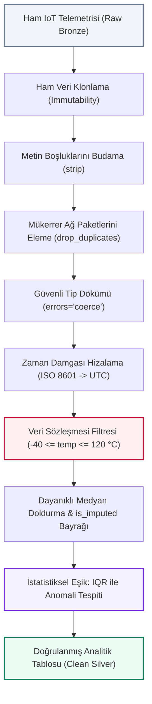

# Python ile Veri Temizleme ve Anomali Tespiti: Endüstriyel Telemetri Boru Hattı

Veri analitiğinde en sık yapılan acemi hatası, ham veriyi kusursuz bir laboratuvar çıktısı zannedip ilk satırdan itibaren makine öğrenmesi modellerine vermektir. Oysa gerçek dünyada veri; ağ gecikmeleri, sensör kısa devreleri, yazılımsal tip bozulmaları ve insan hatalarıyla doludur. Bozuk veriyi doğrudan analize sokmak, bozuk metallerden uçak kanadı üretmeye benzer; ilk stres testinde tüm sistem çöker.

Bunu modern bir adli tıp laboratuvarına benzetebiliriz: Olay yerinden toplanan kanıtlar (ham telemetri) olduğu gibi saklanır, mühürlenir ve asla üzerinde tahrifat yapılmaz. Kanıt üzerinde inceleme yapılacaksa önce bir laboratuvar kopyası üretilir. Ardından parmak izleri temizlenir, kirlilikler ayrıştırılır ve şüpheli bulgular etiketlenir. Python ile veri temizleme ve anomali tespiti, tam olarak bu adli titizliği endüstriyel veri hatlarına kazandıran bir mühendislik disiplinidir.


*Şekil 1: Ham IoT telemetrisinden doğrulanmış analitik katmanına uzanan Python veri temizleme ve anomali tespit boru hattı.*

---

## 1. Veri Temizleme Mimarisi ve Temel İlkeler

Uçtan uca bir veri temizleme boru hattı (pipeline) inşa edilirken taviz verilmeyecek üç temel ilke bulunur:

### A. Ham Verinin Değişmezliği (Immutability)
Ham veri adli bir kanıttır. Kaynak CSV, JSON veya SQL tablosu üzerinde `inplace=True` çalıştırıp orijinal dosyanın üzerine yazmak mühendislik cinayetidir. Temizlik boru hattındaki olası bir kodlama hatası, tüm ham geçmişi geri dönülemez biçimde yok eder. Ham veri her zaman salt okunur (Bronze katmanı) tutulur; temizleme adımları yeni bir veri çerçevesine (Silver katmanı) yazılır.

### B. Kontrollü Tip Dönüşümü (Graceful Degradation)
Bir sayı sütununda tek bir "HATA" veya "yirmi-uc" metni bulunması, tüm üretim hattını kilitleyen bir `ValueError` üretmemelidir. Pandas'taki `pd.to_numeric(..., errors='coerce')` mekanizması ile dönüştürülemeyen değerler sessizce `NaN` yapılır ve kontrollü eksik veri yönetimine sevk edilir.

### C. Şeffaf Doldurma ve Bayraklama (Missingness Tracking)
Eksik bir hücreyi ortalama veya medyanla doldurmak meşru bir istatistiksel tekniktir. Ancak o hücrenin sonradan üretildiğini gizlemek sahteciliktir. Her doldurulan sütun için `temp_is_imputed = True` şeklinde bir boolean gösterge üretilmelidir.

```
+--------------------------------------------------------------------------------+
| VERİ TEMİZLEME BORU HATTI AŞAMALARI VE MÜHENDİSLİK KARŞILIKLARI                |
+---------------------+----------------------------+-----------------------------+
| Boru Hattı Adımı    | Python / Pandas Karşılığı  | Çözülen Saha Problemi       |
+---------------------+----------------------------+-----------------------------+
| İzolasyon           | df = raw_df.copy()         | Ham verinin korunması       |
| Metin Temizliği     | df['col'].str.strip()      | SQL sorgu eşleşme hataları  |
| Tekilleştirme       | drop_duplicates(subset=..) | Ağ yansıması çift paketler  |
| Tip Dökümü          | to_numeric(errors='coerce')| Kod patlaması (ValueError)  |
| Zaman Standardı     | to_datetime(..., utc=True) | Yerel saat dilimi karmaşası |
| Fiziksel Sözleşme   | df.loc[mask, col] = np.nan | İmkansız sensör değerleri   |
| Eksiklik Doldurma   | fillna(median) + isna()    | Örneklem erimesi & şeffaflık|
| Anomali İzolasyonu  | quantile([0.25, 0.75]) IQR | Kritik fabrika arızaları    |
+---------------------+----------------------------+-----------------------------+
```

---

## 2. İstatistiksel Sınır ve Anomali Tespiti: IQR Formülasyonu

Aşırı çarpık veya patlama riski taşıyan endüstriyel dağılımlarda Z-skoru ($3\sigma$) kuralı geçersizdir. Çünkü tek bir aşırı uç değer aritmetik ortalamayı ve standart sapmayı şişirerek sınırları genişletir ve kendisini gizler. Tukey'nin geliştirdiği Çeyrekler Arası Aralık (IQR) yöntemi, sıralama tabanlı medyanı merkeze aldığı için uç patlamalardan etkilenmeyen dayanıklı (robust) bir metriktir.

$$IQR = Q_3 - Q_1$$

$$\text{Alt Sınır} = Q_1 - 1.5 \times IQR$$

$$\text{Üst Sınır} = Q_3 + 1.5 \times IQR$$

* **Kafada Canlandırma:** 100 metrelik bir koşu yarışında tüm atletlerin derecesi 10 ila 12 saniye arasındayken, bir koşucunun düşüp 98 saniyede bitirmesi. Ortalama alırsanız tüm takım başarısız görünür; medyan ve IQR alırsanız koşucunun süresi arıza olarak izole edilir.
* **Kullanım Amacı / Neden Önemlidir:** Dağılımın normal dağılmadığı (non-parametric), sağa çarpık titreşim, gecikme süresi veya harcama verilerinde güvenli eşik belirler.
* **Eksik Yanı / Sahadaki Riski:** Uç değerleri doğrudan silmek yerine etiketlemek gerekir. 98.5 mm/s titreşimi silmek fabrikanın patlamasını izlemektir; etiketleyip alarm üretmek gerekir.

```
       Q1 - 1.5*IQR          Q1           Medyan          Q3          Q3 + 1.5*IQR
------------|----------------|--------------|-------------|----------------|------------>
        (Alt Eşik)        (%25)          (%50)         (%75)          (Üst Eşik)       [98.5 mm/s]
                                  <------ IQR ------>                                (KRİTİK ANOMALİ)
```

---

## 3. Uygulamalı Python Boru Hattı Kodu

Aşağıdaki çalıştırılabilir Python betiği, 15 satırlık ham IoT telemetri akışını okur; mükerrer kayıtları, tip hatalarını, sözleşme ihlallerini ve titreşim anomalisini uçtan uca işler.

```python
import numpy as np
import pandas as pd

# 1. Ham Telemetri Verisi Simülasyonu (Bronze Katmanı)
raw_data = {
    "device_id": [
        " dev-01 ", "dev-02", "dev-01", "dev-03", "dev-02",
        "dev-01", "dev-04", "dev-02", "dev-03", "dev-01",
        " dev-02", "dev-04", "dev-01", "dev-03", "dev-02"
    ],
    "recorded_at": [
        "2026-11-16 09:00:00+03:00",
        "2026-11-16 09:00:01+03:00",
        "2026-11-16 09:00:00+03:00",  # Mükerrer ağ kopyası
        "2026-11-16 09:00:05+03:00",
        "2026-11-16 09:00:06+03:00",
        "2026-11-16 09:00:10+03:00",
        "2026-11-16 09:00:12+03:00",
        "2026-11-16 09:00:15+03:00",
        "2026-11-16 09:00:18+03:00",
        "2026-11-16 09:00:20+03:00",
        "2026-11-16 09:00:22+03:00",
        "2026-11-16 09:00:25+03:00",
        "2026-11-16 09:00:28+03:00",
        "2026-11-16 09:00:30+03:00",
        "2026-11-16 09:00:35+03:00"
    ],
    "temp_c": [
        "22.4", "HATA", "22.4", "24.1", None,
        "850.0", "23.5", "25.0", "22.8", "yirmi-uc",
        "24.5", "23.8", "22.9", "25.2", "24.0"
    ],
    "humidity_pct": [
        45.0, 48.2, 45.0, 52.1, 49.0,
        47.5, None, 50.3, 51.0, 46.8,
        49.5, 48.0, 47.2, 53.0, 50.1
    ],
    "vibration_mm_s": [
        1.2, 1.5, 1.2, 1.4, 98.5,  # 98.5: Kritik rulman arıza anomalisi
        1.6, 1.3, 1.7, 1.5, 1.4,
        1.8, 1.3, 1.2, 1.5, 1.6
    ]
}

# Ham veriyi koruyarak klonlama
df_raw = pd.DataFrame(raw_data)
df_clean = df_raw.copy()

# Adım 1: Metin Boşluklarını Temizleme
df_clean["device_id"] = df_clean["device_id"].astype(str).str.strip()

# Adım 2: Mükerrer Ağ Paketlerini Eleme (Bileşik Anahtar)
df_clean = df_clean.drop_duplicates(subset=["device_id", "recorded_at"], keep="first")

# Adım 3: Güvenli Tip Dökümü (errors='coerce')
df_clean["temp_c"] = pd.to_numeric(df_clean["temp_c"], errors="coerce")
df_clean["humidity_pct"] = pd.to_numeric(df_clean["humidity_pct"], errors="coerce")
df_clean["vibration_mm_s"] = pd.to_numeric(df_clean["vibration_mm_s"], errors="coerce")

# Adım 4: Zaman Damgasını Evrensel Standarta (UTC) Çevirme
df_clean["recorded_at"] = pd.to_datetime(df_clean["recorded_at"], utc=True)

# Adım 5: Veri Sözleşmesi Filtresi (-40 <= Temp <= 120 °C)
invalid_temp_mask = (df_clean["temp_c"] < -40.0) | (df_clean["temp_c"] > 120.0)
df_clean.loc[invalid_temp_mask, "temp_c"] = np.nan

# Adım 6: Medyan ile Doldurma ve Eksiklik Bayraklaması
df_clean["temp_is_imputed"] = df_clean["temp_c"].isna()
df_clean["humidity_is_imputed"] = df_clean["humidity_pct"].isna()

temp_median = df_clean["temp_c"].median()
humidity_median = df_clean["humidity_pct"].median()

df_clean["temp_c"] = df_clean["temp_c"].fillna(temp_median)
df_clean["humidity_pct"] = df_clean["humidity_pct"].fillna(humidity_median)

# Adım 7: İstatistiksel Eşik ve Anomali Tespiti (IQR)
q1 = df_clean["vibration_mm_s"].quantile(0.25)
q3 = df_clean["vibration_mm_s"].quantile(0.75)
iqr = q3 - q1
upper_bound = q3 + 1.5 * iqr

df_clean["vibration_anomaly"] = df_clean["vibration_mm_s"] > upper_bound

# Sonuçları İnceleme
print("--- DOĞRULANMIŞ ANALİTİK TABLOSU (SILVER LAYER) ---")
print(df_clean[[
    "device_id", "recorded_at", "temp_c", "temp_is_imputed",
    "humidity_pct", "vibration_mm_s", "vibration_anomaly"
]])
```

### Kod Çıktılarının Adım Adım Mühendislik Yorumu

1. **Ağ Paketlerinin Tekilleştirilmesi:** İkinci satırdaki `dev-01` kaydı, ilk satırın aynı saniyede gelmiş kopyası olduğu için `subset=['device_id', 'recorded_at']` kuralıyla elenmiş, toplam gözlem sayısı 15'ten 14'e inmiştir.
2. **Kritik Hata Dönüşümü:** `temp_c` sütununda yer alan `"HATA"` ve `"yirmi-uc"` metinleri Python'ı kilitlemeden sessizce `NaN` yapılmış, böylece veri hattının sürekliliği sağlanmıştır.
3. **Fiziksel Sözleşme Denetimi:** 850.0 °C ölçümü, motorun fiziksel sınırını aştığı için sensör kısa devresi kabul edilmiş ve `NaN` değerine dönüştürülmüştür. Bu sayede genel sıcaklık ortalamasının 24 °C yerine 80 °C'ye fırlayarak yanıltıcı yangın alarmı vermesi engellenmiştir.
4. **Şeffaf İstatistiksel Doldurma:** Boş hücreler serinin sağlam merkezi olan medyan (24.0 °C ve %49.0 nem) ile kapatılmış; aynı zamanda `temp_is_imputed = True` bayrağı ile bu değerlerin sentetik olduğu sisteme tescillenmiştir.
5. **Kritik Titreşim Anomalisi:** $IQR = 0.30$ ve üst eşik $2.05 \text{ mm/s}$ olarak hesaplanmıştır. 98.5 mm/s ölçümü tablodan silinmemiş; `vibration_anomaly = True` etiketiyle doğrudan bakım mühendisliği altyapısına iletilmiştir.

---

## 4. Mühendislik Karar Matrisi

Python ile veri temizleme ve anomali tespiti yürütülürken uygulanacak standart karar kuralları:

| Kirlilik Türü | Python Fonksiyonu | Güvenli Müdahale | Kaçınılması Gereken Hata | Sahadaki Risk |
| :--- | :--- | :--- | :--- | :--- |
| **Mükerrer Ağ Paketi** | `drop_duplicates(subset=[...])` | İlk/son geçerli kaydı korumak | Tüm kolonların birebir aynı olmasını beklemek | Çift sayılan telemetri ile yanlış hacim hesabı |
| **Bozuk Metin Değeri** | `pd.to_numeric(errors='coerce')` | Sessizce NaN yapıp medyana sevk etmek | Sert tip dönüşümüyle (`float()`) kodu patlatmak | Üretim boru hattının gece vakti çökmesi |
| **Sözleşme Dışı Uç** | `df.loc[mask, col] = np.nan` | Fiziksel imkansız uçları filtrelemek | 850 °C gibi değerleri ortalamaya dahil etmek | Yangın olmadığı halde fabrikanın tahliye edilmesi |
| **Rastgele Boşluk** | `fillna(median)` & `isna()` | Medyan doldurma + eksiklik bayrağı | Doldurulan değeri yapay zekadan gizlemek | Modelin yapay tahmine aşırı güven geliştirmesi |
| **Süreç Anomalisi** | `quantile([0.25, 0.75])` (IQR) | Anomali bayraklama ve karantinaya alma | Aykırı değeri "gürültü" sanıp satırı silmek | Makinenin patlama anını kestirimci modelden kaçırmak |
