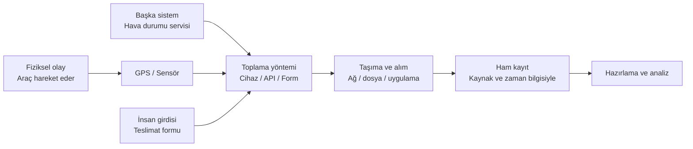
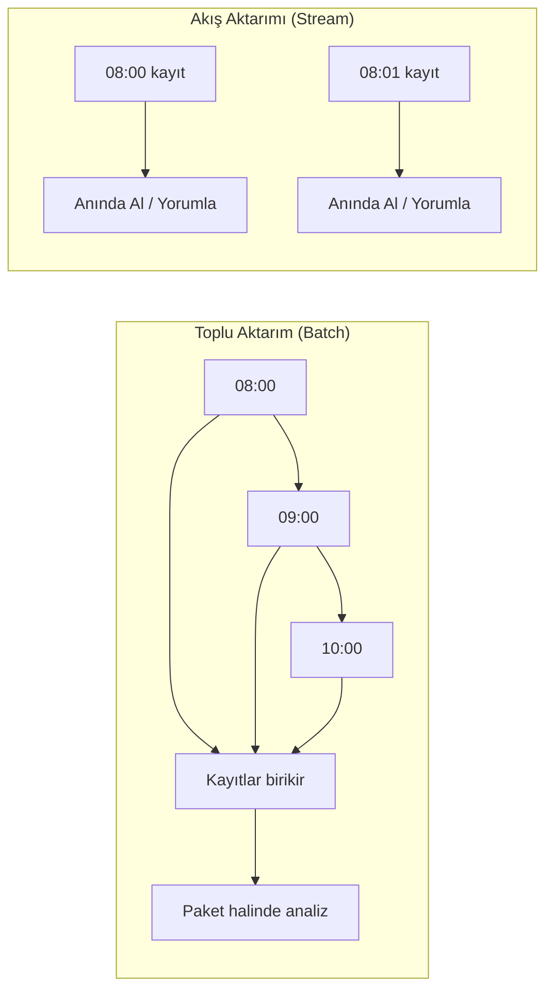

# Veri Toplama Yöntemleri ve Kaynakları: Sistemlerin Duyu Organları

Geçen hafta, verinin yapısal, yarı yapılandırılmış veya yapısal olmayan biçimlerde tutulabileceğini; farklı kaynaklardan gelen kayıtların ortak kimlik ve zaman bilgileriyle düzenlenebileceğini gördük. Bu hafta bir adım geriye gidip şu soruyu soruyoruz: **Bu kayıtlar sisteme ilk olarak nereden ve nasıl geliyor?**

Bir teslimat filosunu düşünelim. 1042 numaralı aracın konumunu GPS üretebilir, sert fren bilgisini ivmeölçer sağlayabilir, hava durumunu bir web servisi verebilir, teslimatın gerçekleşip gerçekleşmediğini sürücü uygulaması kaydedebilir. Bunlar aynı iş sorusuna katkıda bulunur ama aynı yöntemle toplanmazlar. Kaynağı ve toplama biçimini doğru seçmek; verinin neyi temsil ettiğini ve hangi sınırlara sahip olduğunu anlamanın ilk adımıdır.

## Veriyi Kaynaktan Analize Taşıyan Hat

Veri toplama yalnızca bir dosyayı indirmek veya sensörden bir sayı okumak değildir. Kaydın hangi kaynaktan geldiğini, ne zaman üretildiğini ve sisteme hangi yoldan aktarıldığını korumak gerekir.



*Şekil 1: Farklı kaynaklar farklı yollarla sisteme girer; kayıtların kaynağı ve zamanı korunur.*

Bu aşamada amacımız veriyi ayrıntılı biçimde temizlemek değil, **nasıl ve hangi koşullarda toplandığını** anlamaktır.

## 1. Donanımdan Gelen Veri: Sensörler ve IoT

Sensör, fiziksel dünyadaki bir özelliği ölçüp elektronik bir sinyale dönüştürür. GPS konum ve zaman; sıcaklık sensörü derece; ivmeölçer hareket ve sarsıntı bilgisi üretebilir. Mikrodenetleyici veya kontrol ünitesi bu ölçümü okuyup kayda ya da iletilebilir mesaja dönüştürür.

1042 numaralı araçta GPS modülü her 30 saniyede bir konum ölçsün. Bir ivmeölçer de ani yavaşlamayı algılasın. Bu iki sensör farklı türde kayıt üretir:

| Kaynak | Örnek kayıt | Kayıt neyi anlatır? | Dikkat edilmesi gereken |
| --- | --- | --- | --- |
| GPS | `08:12:30, 41.0205, 29.0000` | Araç nerede? | Kapalı alan ve uydu görünürlüğü ölçümü etkileyebilir. |
| İvmeölçer | `08:12:31, sert fren` | Ani yavaşlama oldu mu? | Eşik ve cihazın araca sabitlenmesi önemlidir. |
| Sıcaklık sensörü | `08:12:31, 6.8 °C` | Araç içindeki sıcaklık neydi? | Sensörün kalibrasyonu ve ölçüm konumu önemlidir. |

Sensörün verdiği sayı fiziksel gerçeğin kendisi değil, **ölçümüdür**. Bu yüzden cihaz kimliği, ölçüm zamanı ve birim mutlaka kayıtla ilişkilendirilmelidir. Sensörlerden veri alırken sistem **Aralıklı Ölçüm** (örneğin her 30 saniyede bir) veya **Olay Tetiklemeli Ölçüm** (örneğin ani yavaşlama algılandığında) yapabilir.

## 2. Sistemler Arası Veri: API

Bir uygulama veya cihaz, başka bir sistemin sunduğu veriye **API** (Application Programming Interface) üzerinden erişebilir. API, bir sistemin hangi isteklere nasıl yanıt vereceğini tanımlar; genellikle karşı sistemin veritabanına doğrudan erişim vermez.

Örneğin filonun hava durumu servisi, konum ve zaman bilgisi gönderildiğinde yağış bilgisini döndürebilir. Uygulama, servisin yayımladığı kurallara göre bir istek (Request) yapar:

```text
İstek (temsili):
GET /weather?lat=41.0205&lon=29.0000&time=2026-03-10T08:12:30

Yanıt (temsili JSON):
{
  "temperature_c": 14,
  "precipitation": true,
  "observed_at": "2026-03-10T08:10:00+03:00"
}
```

API kullanırken, karşı sunucudan gelen yanıtın anlamı iyi değerlendirilmelidir. API'den dönen `observed_at` zamanı araç ölçümünden birkaç dakika önce olabilir; ayrıca hava durumu bilgisi aracın tam bulunduğu noktayı değil, yakın bir bölgeyi temsil edebilir. Kayıtları birleştirirken zaman ve konumlarının ne kadar örtüştüğü kontrol edilmelidir.

## 3. Web Kazıma (Web Scraping)

İhtiyaç duyulan bilgi için kullanılabilir bir API veya açık bir veri kümesi yoksa, web sayfasındaki herkese açık içerikten otomatik olarak veri çıkarmak (Web Scraping) gündeme gelir. Kazıyıcı bot, bir ürünün fiyatını HTML etiketleri arasından bulup çıkarabilir.

Örneğin bir program, izin verilen bir sayfadan ürün adını ve fiyatını alıp tarih bilgisiyle bir tabloya kaydedebilir. Böylece fiyatın zaman içinde nasıl değiştiği takip edilebilir. Web sayfasının tasarımı değişirse kazıyıcı doğru alanı bulamayabilir; sonuçlar örnek kayıtlarla kontrol edilmelidir.

Web kazıma kırılgandır ve etik sınırları vardır. Siteye gereksiz istek yükü bindirmemek, erişim ve kullanım kurallarına uymak, verinin yeniden kullanım iznini kontrol etmek gerekir. Mümkünse resmi API veya açık veri indirme yöntemi tercih edilmelidir.

## 4. İnsanlardan Gelen Veriler

Bazı sorular sensörle yanıtlanamaz. Müşteri memnuniyeti, sürücünün karşılaştığı bir zorluk veya bir kullanıcının uygulamayı neden terk ettiği gibi konularda form, anket, görüşme veya işlem kaydı (log) gerekebilir.

Örneğin teslimat sonrasında müşteriye “Teslimat deneyiminizi 1 ile 5 arasında puanlayın” sorusu yöneltilebilir. Bu puan, müşterinin deneyimine dair bir yanıtıdır; GPS'in ölçtüğü konum veya hız bilgisinden farklı bir yolla elde edilir. Yanıt seçeneklerinin açık yazılması ve aynı sorunun herkese aynı biçimde yöneltilmesi, sonuçları karşılaştırmayı kolaylaştırır.

| Yöntem | Örnek | Güçlü yanı | Sınırlılığı |
| --- | --- | --- | --- |
| Anket / form | Teslimat deneyimini 1–5 arasında puanlama | Aynı soru çok kişiye yöneltilebilir. | Yanıtlamayanların görüşü eksik kalabilir. |
| Görüşme | Gecikmenin nedenini sürücüden öğrenme | Deneyimin ayrıntısını verir. | Zaman alır ve yanıtları özetlemek gerekir. |
| Gözlem | Teslimat sırasında yaşanan adımları kaydetme | Süreci gerçekleştiği ortamda gösterir. | Gözlem ve kayıt biçimi kişiden kişiye değişebilir. |
| İşlem kaydı | Teslimatın tamamlandığı zamanı kaydetme | Süreçte doğal olarak oluşur. | Kayıt eksik veya yanlış girilmiş olabilir. |

İnsanlardan veri toplarken amaç açıkça belirtilmeli, yalnızca gerekli bilgiler alınmalı ve erişim/saklama kuralları belirlenmelidir. Kişisel veri söz konusuysa ilgili izin ve koruma yükümlülükleri de değerlendirilmelidir.

## 5. Veri Değişim Biçimleri: JSON, XML ve CSV

Verinin kaynağı, **hangi biçimde taşınacağını** tek başına belirlemez. API JSON döndürebilir; sensör mesajı XML veya ikili bir protokol kullanabilir; aynı ölçümler daha sonra birleştirilip CSV dosyasına aktarılabilir.

*   **JSON (JavaScript Object Notation):** Anahtar-değer çiftleri ve iç içe nesnelerle veri ifade eder. Web API'lerinde yaygındır ve olay tetiklemeli (esnek alanlı) telemetri kayıtları için çok uygundur.
*   **XML (eXtensible Markup Language):** Veriyi etiketlerle ifade eder. Hiyerarşik yapıyı ve katı şema kurallarını tanımlamak için elverişlidir; bazı eski kurumsal sistemler XML kullanır.
*   **CSV (Comma-Separated Values):** Satır ve sütunlardan oluşan tablolu veriyi metin dosyasında taşımak için kullanılır. Binlerce tekrarlı ölçümün istatistiksel paket programlara (veya Python/R gibi dillere) toplu olarak aktarılmasında son derece pratiktir.

## 6. Veri Akışı: Batch ve Stream

Verinin **hangi aralıkla işleneceği ve aktarılacağı**, sonucun ne kadar güncel olması gerektiğine göre seçilir.

- **Toplu İşleme (Batch):** Kayıtlar bir süre birikir ve belirli aralıklarla paket halinde alınır. Örneğin günlük teslimat kayıtları gece aktarılıp sabah raporlanabilir.
- **Akış İşleme (Stream):** Kayıtlar geldikçe küçük parçalar halinde işlenir. Örneğin sert fren olayı kısa sürede merkeze iletilip sürücüye uyarı göndermek için kullanılabilir.



## 7. Sorumuza Göre Toplama Planı Oluşturmak

“Sert frenler yağışlı havalarda daha sık mı görülüyor?” sorusu için birden fazla kaynaktan kayıt toplamamız gerekir:

1. **Hangi kayıtlar gerekli?** Sert fren olayları, aracın konumu ve o konumdaki hava durumu.
2. **Hangi kaynaklar kullanılacak?** İvmeölçer sert fren olayını, GPS konumu, hava durumu servisi ise yağış bilgisini sağlayabilir.
3. **Kayıtlar nasıl eşleştirilecek?** Ortak araç kimliği, zaman ve konum bilgileri kullanılabilir. Hava durumu kaydı birkaç dakika eski veya daha geniş bir bölgeye ait olabilir; bu fark not edilmelidir.
4. **Ne sıklıkta veri alınacak?** Sert fren için olay anında kayıt yararlı olabilir; hava durumu servisi daha seyrek güncellenebilir.
5. **Hangi sınırlılıklar var?** Sensör eşiği, bağlantı kesintisi, eksik kayıt ve hava durumu bilgisinin kapsamı sonuçları etkileyebilir.
6. **İzin ve koruma gerekiyor mu?** Araç konumu veya sürücüyle ilişkilendirilebilecek bilgiler için erişim ve saklama kuralları belirlenmelidir.

## Sonuç

Sensörler fiziksel ölçüm, API'ler sistemler arası veri, web kazıma web sayfasındaki içerik, anketler ve görüşmeler ise insan yanıtlarını sağlayabilir. Bu kaynaklar farklı yöntemlerle toplanır; biçimleri, güncellikleri ve sınırlılıkları da farklıdır. Güvenilir bir sonuç için verinin nereden, ne zaman ve hangi koşullarda geldiğini kaydetmek gerekir.

Bir sonraki yazıda, topladığımız kayıtlardaki eksik, uyumsuz veya hatalı değerleri nasıl fark edip analize hazırlayacağımızı inceleyeceğiz.