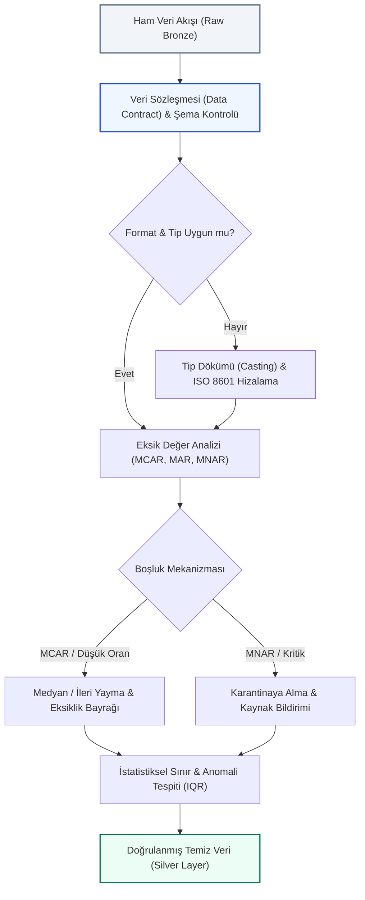

# Veri Temizleme, Düzenleme ve Tip Dönüşümleri: Ham Kayıttan Güvenilir Karar Mimarisine

Veri analitiğinde sıkça tekrarlanan bir yanılgı vardır: Analitik başarısının en karmaşık makine öğrenmesi algoritmaları veya en derin sinir ağlarıyla elde edileceği düşünülür. Oysa endüstriyel gerçeklik tam tersini söyler; analiz süreçlerine harcanan eforun yüzde seksenini veri temizleme, biçimlendirme ve doğrulama adımları oluşturur. Yanlış, eksik veya biçimi bozuk veriyle beslenen en sofistike matematiksel model, yalnızca hatayı yüksek bir özgüvenle üretir (*Garbage In, Garbage Out*).

Bunu bir su arıtma tesisine benzetebiliriz: Kaynaktan gelen ham nehir suyu içinde çamur, kimyasal atıklar, ağır metaller ve organik tortular barındırır. Bu suyu doğrudan içme suyu şebekesine veremezsiniz. İlk olarak kaba filtrelerle tortuları ayıklar, kimyasal çöktürmeyle bulanıklığı giderir, ardından mikrobiyolojik arıtmadan geçirip pH dengesini sağlarsınız. Veri temizleme de telemetri, API ve veri tabanı akışlarından gelen ham veriyi güvenilir bir analitik zemine kavuşturan çok katmanlı mühendislik filtresidir.


*Şekil 1: Ham veriden doğrulanmış analitik katmanına uzanan mantıksal veri temizleme ve doğrulama boru hattı.*

---

## 1. Temizliğe Başlamadan Önce: Veri Sözleşmesi (Data Contract)

Kod yazmaya başlamadan önceki en kritik hata, sütunların neyi temsil ettiğini ve fiziksel sınırlarını bilmeden ezbere temizlik fonksiyonları çalıştırmaktır.

Bir sensör tablosundaki `sicaklik` sütununda `850` değerini gördüğünüzde, bunu doğrudan silmeli misiniz, yoksa ortalamayla mı doldurmalısınız? Eğer ölçülen ortam bir döküm fırınıysa 850 °C olağan bir çalışma sıcaklığıdır; ancak bir sunucu odasıysa bu değer ya bir yangın felaketidir ya da sensörün donanımsal arıza kodudur.

Veri sözleşmesi; veriyi üreten kaynak sistem (IoT sensör, mobil uygulama, mikroservis) ile veriyi tüketen analitik sistemi arasındaki mutabakat belgesidir. Sözleşme şu asgari bileşenleri içerir:
* **Sütun Kimliği ve Tipi:** Örneğin `recorded_at` alanı ISO 8601 biçiminde ve saat dilimi (+03:00 / UTC) içeren bir zaman damgası olmalıdır.
* **Fiziksel ve Teknik Eşikler:** Bir motor devir sayısı (RPM) negatif olamaz; oda sıcaklığı -40 °C ile 85 °C arasında kalmalıdır.
* **Zorunluluk Kriterleri:** Hangi alanlar `NULL` kalabilir, hangi alanlar boş bırakıldığı an kaydı geçersiz kılar?

```
+--------------------------------------------------------------------------------+
| VERİ SÖZLEŞMESİ (DATA CONTRACT) KONTROL ŞEMASI                                 |
+---------------------+-------------------+---------------------+----------------+
| Sütun Adı           | Beklenen Tip      | Fiziksel Sınır      | Hata Aksiyonu  |
+---------------------+-------------------+---------------------+----------------+
| device_id           | String (UUIDv4)   | Boş Olamaz          | Satırı Reddet  |
| recorded_at         | Datetime (UTC)    | Geçmiş <= Şimdi     | Karantinaya Al |
| temperature_c       | Float64           | -40.0 <= X <= 85.0  | NaN Yap & Uyar |
| vibration_mm_s      | Float64           | 0.0 <= X <= 150.0   | Anomali İncele |
+---------------------+-------------------+---------------------+----------------+
```

---

## 2. Eksik Değerlerin Anatomisi: MCAR, MAR ve MNAR

Boş bir hücre (`NaN`, `None`, `null`) tek başına bir şey ifade etmez. Eksiklik bir sonuçtur; asıl incelenmesi gereken, verinin neden kaybolduğudur. Hücrenin eksik kalma mekanizmasını teşhis etmeden uygulanan her doldurma kararı istatistiksel dağılımı bozar.

İstatistikte eksik veriler üç temel mekanizmayla sınıflandırılır:

### A. Tamamen Rastgele Eksiklik: MCAR (Missing Completely at Random)

$$P(Y_{\text{kayip}} \mid Y, X) = P(Y_{\text{kayip}})$$

* **Kafada Canlandırma:** Fabrikadaki ağ anahtarının (switch) aşırı gerilim dalgalanması sebebiyle 5 saniye kapanması ve o anda geçen tüm paketlerin kaybolması.
* **Kullanım Amacı / Neden Önemlidir:** Eksiklik tamamen rastgeledir; ne kaybolan değerin büyüklüğüne ne de tablodaki başka bir sütuna bağlıdır. 
* **Eksik Yanı / Sahadaki Riski:** Satırları tablodan çıkarmak (listwise deletion) yanlılık yaratmaz fakat örneklem büyüklüğünü küçülterek analiz gücünü (statistical power) düşürür.

### B. Rastgele Eksiklik: MAR (Missing at Random)

$$P(Y_{\text{kayip}} \mid Y, X) = P(Y_{\text{kayip}} \mid X)$$

* **Kafada Canlandırma:** Düşük pil seviyesine sahip mobil cihazların pil tasarruf moduna geçerek GPS konum güncellemelerini göndermeyi durdurması.
* **Kullanım Amacı / Neden Önemlidir:** Eksiklik doğrudan kaybolan verinin kendisine bağlı değildir; ancak tablodaki gözlemlenen başka bir değişkenle (`battery_level < 15`) güçlü korelasyona sahiptir.
* **Eksik Yanı / Sahadaki Riski:** Eğer pil seviyesi dikkate alınmadan doğrudan genel medyan atanırsa, hareketsiz cihazların konumu yanlış hesaplanır. Şartlı doldurma (örneğin pil ve cihaz modeline göre kümeleme) zorunludur.

### C. Rastgele Olmayan Eksiklik: MNAR (Missing Not at Random)

$$P(Y_{\text{kayip}} \mid Y, X) \neq P(Y_{\text{kayip}} \mid X)$$

* **Kafada Canlandırma:** Bir ankette yüksek gelir grubundaki yöneticilerin gelir hanesini kasten boş bırakması veya sıcaklık sensörünün 120 °C üzerindeki aşırı ısıda eriyerek veri iletememesi.
* **Kullanım Amacı / Neden Önemlidir:** Verinin eksik kalma sebebi bizzat o değerin aşırı yüksek veya hassas olmasıdır.
* **Eksik Yanı / Sahadaki Riski:** Bu satırları silmek ya da serinin medyanıyla doldurmak felaketle sonuçlanır; serideki en kritik olaylar tamamen görünmez kılınır. Mutlaka bir eksiklik bayrağı (`is_missing = True`) üretilmeli ve sistem kural tabanlı incelenmelidir.

```
+--------------------------------------------------------------------------------+
| EKSİK VERİ DOLDURMA TAKTİKLERİ VE RİSK ANALİZİ                                 |
+--------------------+----------------------------+------------------------------+
| Strateji           | Doğru Kullanım             | Taşıdığı Kritik Risk         |
+--------------------+----------------------------+------------------------------+
| Satır Çıkarma      | MCAR & Kayıp < %2          | Örneklem erimesi, varyans    |
| Medyan Atama       | Çarpık sayısal dağılım     | Doğal varyansı yapay kısma   |
| İleri Yayma (ffill)| Yüksek frekanslı zaman serisi| Son değerin bayatlaması     |
| Eksiklik Bayrağı   | MNAR veya operasyonel boşluk| Modelde yeni boyut yükü     |
+--------------------+----------------------------+------------------------------+
```

---

## 3. Aykırı Değer vs. Anomali vs. Ölçüm Hatası

Saha mühendisliğinde en sık yapılan kavramsal hata, sıra dışı her veriyi doğrudan "silinecek aykırı değer" olarak yaftalamaktır. Bu üç kavram birbirinden kesin çizgilerle ayrılmalıdır:

```
+--------------------------------------------------------------------------------+
| SIRA DIŞI VERİNİN ÜÇ FARKLI YÜZÜ                                               |
+-------------------+----------------------------+-------------------------------+
| Kavram            | Matematiksel / Fiziksel Neden| Yapılması Gereken Müdahale   |
+-------------------+----------------------------+-------------------------------+
| Ölçüm Hatası      | Fiziksel imkansızlık, gürültü| Veri sözleşmesine göre sil/düzelt|
| Aykırı Değer      | Dağılım kuyruğundaki uç nokta| IQR ile baskıla (Winsorize)   |
| Anomali           | Sürecin değişmesi (Arıza/Atak)| SAKLA, bayrakla ve alarm üret |
+-------------------+----------------------------+-------------------------------+
```

### Dayanıklı İstatistiksel Eşik: IQR (Çeyrekler Arası Aralık) Yöntemi

Normallik varsayımı taşımayan ve aşırı uçlardan etkilenmeyen sağlam (robust) sınır tespiti için Tukey'nin IQR formülasyonu kullanılır:

$$IQR = Q_3 - Q_1$$

$$\text{Alt Eşik} = Q_1 - 1.5 \times IQR$$

$$\text{Üst Eşik} = Q_3 + 1.5 \times IQR$$

Aşırı çarpık gelir, gecikme süresi (latency) veya sensör titreşimi verilerinde Z-skoru ($3\sigma$) yanıltıcıdır; çünkü aşırı bir değer aritmetik ortalamayı ve standart sapmayı da şişirerek sınırları genişletir. IQR ise medyan tabanlı sıralamaya dayandığından uç patlamalara karşı tam dirençlidir.

---

## 4. Mühendislik Karar Matrisi

Veri kirliliği türüne göre uygulanacak doğru teşhis, müdahale stratejisi ve kaçınılması gereken mühendislik hataları aşağıdaki tabloda özetlenmiştir:

| Kirlilik Türü | Tespit Yöntemi | Güvenli Mühendislik Müdahalesi | Kaçınılması Gereken Hata | Sahadaki Risk |
| :--- | :--- | :--- | :--- | :--- |
| **MCAR Boşluk** | Boşluk oran matrisi ($< \%3$) | Medyan atama veya satır çıkarma | Tüm seriyi genel ortalamayla doldurmak | Doğal varyansın yapay biçimde daralması |
| **MAR Boşluk** | Çapraz korelasyon / Lojistik regresyon | Alt gruplara göre şartlı doldurma | Grup farklılıklarını yok sayıp tek değer atamak | Alt kümelerdeki örüntülerin silinmesi |
| **MNAR Boşluk** | Domain uzmanlığı ve eşik analizi | Eksiklik bayrağı (`is_imputed`) üretme | Boş satırları tablodan tamamen silmek | En kritik kriz anlarının kör noktada kalması |
| **Format Kusuru** | Regex ve tip döküm kontrolleri | ISO 8601 ve UTC zaman standardizasyonu | Yerel saat farklarını dikkate almamak | Zaman serisi analizinde saat kaymaları |
| **Mükerrer Kayıt** | Mantıksal anahtar (`subset`) kontrolü | En son/ilk geçerli kaydı seçip tekilleştirme | Tüm sütunların birebir aynı olmasını beklemek | Ağ gecikmesi kopyalarının çift sayılması |
| **Aşırı Anomali** | IQR ($Q_3 + 1.5 \times IQR$) tespiti | Anomali bayraklama ve ayrı modelleme | Aykırı değeri doğrudan silmek | Dolandırıcılık veya cihaz patlama sinyalini kaybetmek |
