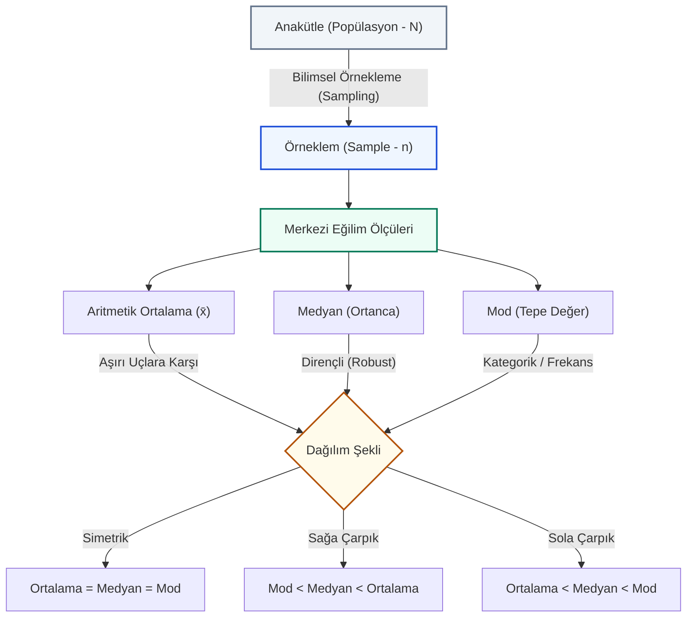

# İstatistiğe Giriş ve Merkezi Eğilim Ölçüleri: Sayı Yığınından Temsili Merkeze Ulaşma Sanatı

Veri tabanlarında saklanan milyonlarca satırlık ham kayıt, tek başına bir karar üretmez. Bir fabrikanın kalite kontrol mühendisi, bir günde üretilen 500.000 adet parçanın milimetrik toleranslarını tek tek inceleyemez; bir mobil uygulamanın ürün yöneticisi, sunucuya gelen 10 milyon API isteğinin gecikme sürelerini satır satır okuyamaz. İnsan zihni ve karar mekanizmaları, devasa sayı yığınlarını özetleyen, o yığını dürüstçe temsil eden "tek bir değere" ihtiyaç duyar. İstatistiğin doğuşu ve merkezi eğilim ölçülerinin varlık sebebi tam olarak bu indirgeme ihtiyacıdır.

Bunu bir tencere çorbanın tadına bakmaya benzetebiliriz: Bir aşçı, pişirdiği devasa kazandaki çorbanın tuzunu, kıvamını ve lezzetini anlamak için kazanın tamamını içmez. Çorbayı homojen biçimde karıştırır ve küçük bir kaşık alır. O tek kaşık, tüm kazanı temsil eder. Ancak çorba karıştırılmamışsa, tuz dibe çökmüş veya yağ üste çıkmışsa alınan o kaşık tüm gerçeği saptırır. İşte istatistikte anakütle ile örneklem, ortalama ile medyan arasındaki ilişki, tam olarak bu doğru kaşığı alma ve temsil gücünü koruma sanatıdır.


*Şekil 1: Anakütleden örnekleme, merkezi eğilim ölçülerinin mekanizması ve dağılım çarpıklığı arasındaki geometrik ilişki.*

---

## 1. Temel Kavramsal İkilem: Anakütle vs. Örneklem

Veri analitiğinde yapılan en büyük metodolojik hata, üzerinde çalışılan veri kümesinin sınırlarını doğru tanımlamamaktır.

### Anakütle (Popülasyon — N)
Hakkında çıkarım yapılmak istenen, belirli bir tanıma uyan tüm birimlerin eksiksiz bütünüdür. Bir ülkedeki tüm kayıtlı seçmenler, bir fabrikada o gün üretilen tüm cıvatalar veya bir bankanın tüm aktif kredi kartı müşterileri birer anakütledir. Anakütleyi oluşturan birimlerin tamamını ölçmek çoğu zaman imkânsızdır:
* **Tahribatlı Testler:** Bir akü fabrikasında batarya ömrünü test etmek için bataryayı tamamen tüketmek gerekir; anakütlenin tamamını test ederseniz satacak ürün kalmaz.
* **Maliyet ve Zaman:** 85 milyonluk bir ülkede her gün nüfus sayımı yapmak operasyonel ve finansal olarak sürdürülemez.

### Örneklem (Sample — n)
Anakütlenin içinden belirli bilimsel kurallarla seçilen ve anakütleyi yansıtma yeteneği (temsil gücü) olan sınırlı alt kümedir. Doğru bir örneklem, devasa bir anakütlenin karakteristiklerini çok küçük bir örneklem hacmiyle (`%95` veya `%99` güven düzeyinde) yüksek doğrulukla kestirmeyi sağlar.

```
+--------------------------------------------------------------------------------+
| ANAKÜTLE VS. ÖRNEKLEM KARŞILAŞTIRMA ŞEMASI                                     |
+---------------------+-----------------------------+----------------------------+
| Kriter              | Anakütle (Popülasyon)       | Örneklem (Sample)          |
+---------------------+-----------------------------+----------------------------+
| Büyüklük Simgesi    | N (Büyük N)                 | n (Küçük n)                |
| Özet Metrik Adı     | Parametre                   | İstatistik (Tahmin Edici)  |
| Ortalama Simgesi    | μ (Yunan harfi Mu)          | x̄ (x-bar)                  |
| Standart Sapma      | σ (Yunan harfi Sigma)       | s (Latin harfi s)          |
| Bilinebilirlik      | Genellikle bilinmez / gizli | Gözlenir ve hesaplanır     |
+---------------------+-----------------------------+----------------------------+
```

---

## 2. Aritmetik Ortalama (x̄): Denge Merkezi ve Kırılganlık

Aritmetik ortalama, bir veri kümesindeki tüm sayısal değerlerin toplanıp toplam gözlem sayısına bölünmesiyle elde edilen matematiksel denge merkezidir:

$$\bar{x} = \frac{1}{n} \sum_{i=1}^{n} x_i$$

* **Kafada Canlandırma:** Bir tahterevalli düşünün. Aritmetik ortalama, tahterevallinin tam dayanak noktasıdır (pivot). Sayıların dayanak noktasına olan uzaklıklarının toplamı her iki tarafta birbirini sıfırlar:

$$\sum_{i=1}^{n} (x_i - \bar{x}) = 0$$

* **Kullanım Amacı / Neden Önemlidir:** Veri kümesindeki her bir elemanın büyüklüğünü hesaba katar. Matematiksel olarak türetilebilir ve ileri istatistiksel analizlerde (varyans analizi, regresyon, hipotez testleri) en temel yapı taşıdır.
* **Eksik Yanı / Sahadaki Riski:** **Aşırı uç değerlere karşı sıfır dirence sahiptir.** Tek bir anormal uç değer (outlier), ortalamayı kendi yönüne doğru sürükler ve verinin çoğunluğunun bulunduğu gerçek merkezi tamamen maskeler.

```
           Gözlemler: [ 10, 12, 14, 16, 500 ]
           Medyan = 14  (Verinin gerçek merkezi)
           Ortalama = 110.4 (Aşırı uç 500 ortalamayı 14'ten 110'a fırlattı!)

10   12   14   16                                                                  500
---|----|---|---|-------------------------------------------------------------------|
          ▲                                    ▲
       (Medyan)                            (Ortalama)
```

---

## 3. Medyan (Ortanca): Aşırı Uçlara Karşı Dirençli Merkez

Medyan, küçükten büyüğe sıralanmış bir sayı dizisini tam ortadan iki eşit parçaya bölen değerdir. Verilerin `%50`'si medyandan küçük veya eşittir, `%50`'si ise medyandan büyük veya eşittir.

$$n \text{ tek ise:} \quad \text{Medyan} = x_{\left(\frac{n+1}{2}\right)}$$

$$n \text{ çift ise:} \quad \text{Medyan} = \frac{x_{\left(\frac{n}{2}\right)} + x_{\left(\frac{n}{2} + 1\right)}}{2}$$

* **Kafada Canlandırma:** Bir kuyrukta yan yana dizilmiş insanlar düşünün. Medyan, kuyruğun tam ortasında duran kişidir. Kuyruğun en sonundaki kişinin cebinde `100 TL` olması ile `100 milyar TL` olması, ortadaki kişinin kim olduğunu zerre kadar değiştirmez.
* **Kullanım Amacı / Neden Önemlidir:** Medyan sıralama tabanlı olduğu için aşırı uçlara karşı **tam dirençlidir (robust statistic)**. Gelir dağılımları, konut satış fiyatları, kullanıcı oturum süreleri ve sunucu yanıt gecikmelerinde (latency) dünya genelinde varsayılan merkez ölçüsüdür.
* **Eksik Yanı / Sahadaki Riski:** Cebirsel olarak manipüle edilmesi zordur; tüm gözlemlerin bireysel sayısal değerini değil, sadece ortadaki sıralamayı dikkate alır.

---

## 4. Mod (Tepe Değer): Kategorik Verinin ve Frekansın Merkezi

Mod, bir veri kümesinde en yüksek frekansa sahip olan, yani en çok tekrarlanan değerdir.

* **Kafada Canlandırma:** Bir giyim mağazasının deposu düşünün. "Ortalama müşteri beden ölçüsü `39.4`" bilgisi bir mağaza müdürünün hiçbir işine yaramaz. Çünkü `39.4` beden elbise üretilmez. Mağaza müdürünün bilmesi gereken, en çok satılan bedendir (Örn: `"M"` beden).
* **Kullanım Amacı / Neden Önemlidir:** Sayısal olmayan, nominal ve kategorik verilerde (renk, hata kodu, şehir, cinsiyet) hesaplanabilen **yegane** merkezi eğilim ölçüsüdür.
* **Çoklu Tepe Değer (Multimodal Dağılım):** Bir veri setinde iki farklı mod bulunuyorsa (bimodal), bu durum veri kümesinin homojen olmadığını, içinde iki farklı alt anakütlenin birbirine karıştığını gösterir (Örn: Sabah `08:30` ve akşam `18:00` saatlerinde iki ayrı trafik yoğunluk modu oluşması).
* **Eksik Yanı / Sahadaki Riski:** Sürekli ondalıklı ölçümlerde (örneğin 14 haneli float sensör telemetrisinde) hiçbir değer birbirinin aynısı olmayabilir; bu durumda seri modsuz kalır.

---

## 5. Dağılımın Geometrisi: Çarpıklık (Skewness) ve Merkezlerin Ayrışması

Bir veri kümesinin simetrik mi yoksa asimetrik mi olduğunu anlamanın en pratik yolu, aritmetik ortalama ile medyan arasındaki makası incelemektir.

```
       Sağa Çarpık (Pozitif)              Simetrik (Normal)              Sola Çarpık (Negatif)
             /\                                  /\                                  /\
            /  \                                /  \                                /  \
           /    \                              /    \                              /    \
          /      \----                        /      \                        ----/      \
       Mod < Medyan < Ortalama             Ort = Med = Mod                 Ortalama < Medyan < Mod
```

### A. Simetrik (Normal) Dağılım
Veriler merkezin etrafında kusursuz bir dengeyle yayılmıştır. Çan eğrisi biçimindedir. Bu durumda her üç merkez ölçüsü birbirine eşittir:
$$\text{Ortalama} = \text{Medyan} = \text{Mod}$$

### B. Sağa (Pozitif) Çarpık Dağılım
Dağılımın sağ kuyruğu uzundur. Verilerin büyük kısmı sol tarafta küçük değerlerde toplanmışken, sağ taraftaki az sayıda aşırı büyük değer ortalamayı yukarıya doğru sürükler:
$$\text{Mod} < \text{Medyan} < \text{Ortalama}$$
*Örnek:* Gelir dağılımı, e-ticaret sepet tutarları, web sitelerinde geçirilen süreler. Bu verilerde aritmetik ortalamaya bakmak halkın veya müşterilerin durumunu olduğundan çok daha zengin veya büyük gösterir.

### C. Sola (Negatif) Çarpık Dağılım
Dağılımın sol kuyruğu uzundur. Verilerin büyük kısmı sağ tarafta yüksek değerlerde toplanmışken, sol taraftaki az sayıda aşırı küçük değer ortalamayı aşağıya çeker:
$$\text{Ortalama} < \text{Medyan} < \text{Mod}$$
*Örnek:* Kolay bir sınavda alınan notlar, emeklilik yaşları, insan ömrü dağılımı.

---

## 6. Merkez Tek Başına Neden Yetmez? "1 Metrelik Nehir" İkilemi

İstatistikte sıkça anlatılan bir uyarı hikayesi vardır: *"Ortalama derinliği 1 metre olan bir nehirde binlerce insan boğulmuştur."*

Nehrin girişinde su `10 santimetre`, ortasında ise `6 metrelik` ölümcül bir çukur olabilir. Ortalama alındığında nehir `1 metre` çıkar; ancak yüzme bilmeyen bir kişi bu ortalamaya güvenip suya adım attığında hayatını kaybeder.

Aynı ilke endüstriyel sistemler için de geçerlidir:
* **Sunucu A Gecikmesi:** `[49 ms, 50 ms, 51 ms]` → Ortalama: **`50 ms`**, Medyan: **`50 ms`**
* **Sunucu B Gecikmesi:** `[1 ms, 50 ms, 99 ms]` → Ortalama: **`50 ms`**, Medyan: **`50 ms`**

İki sunucunun da merkezi birebir aynıdır. Ancak Sunucu A istikrarlı bir saat gibi çalışırken, Sunucu B periyodik donmalar ve paket kayıpları yaşamaktadır. Merkezi eğilim ölçüleri verinin nerede kümelendiğini söyler; ancak o kümenin etrafındaki **dağılımı ve varyansı (saçılımı)** tek başına açıklayamaz. Bu nedenle merkezi eğilim ölçüleri, bir sonraki aşamada mutlaka dağılım ölçüleriyle (varyans, standart sapma) birlikte kullanılmalıdır.

---

## 7. Mühendislik Karar Matrisi

Veri analitiği projelerinde karşılaşılan veri tipine, dağılım formuna ve iş hedefine göre uygulanması gereken doğru merkezi eğilim pusulası:

| Ölçü Türü | En Uygun Veri Tipi | Aşırı Uçlara Direnç (Robustness) | Sahadaki Tercih Alanı | Kaçınılması Gereken Hata | Taşıdığı Saha Riski |
| :--- | :--- | :--- | :--- | :--- | :--- |
| **Aritmetik Ortalama** | Simetrik, Sürekli Sayısal | Çok Düşük (Sıfır Direnç) | Kalibre üretim bantları, bütçe dengeleme, fiziksel ölçümler | Çarpık gelir serilerinde veya gecikme loglarında kullanmak | Birkaç aşırı değer yüzünden tüm sistemi yanlış boyutlandırmak |
| **Medyan (Ortanca)** | Çarpık Sayısal, Sıralı (Ordinal) | Çok Yüksek (Tam Dirençli) | Gelir dağılımı, ev fiyatları, sunucu latency, arıza süreleri | Aşırı homojen ve küçük örneklemlerde medyan aramak | Uç değerlerin yarattığı gerçek krizleri gözden kaçırmak |
| **Mod (Tepe Değer)** | Kategorik, Nominal Metin | Yüksek | En çok satan ürün bedeni, hata tipi sınıflama, müşteri tercihleri | Sürekli ondalıklı sensör akışlarında mod aramak | Hiçbir değer tekrarlanmadığında tanımsız kalmak |
