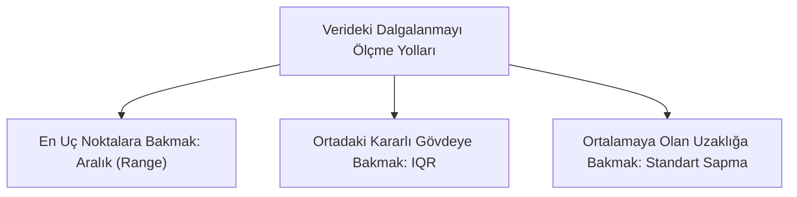
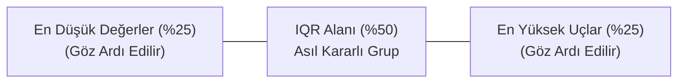
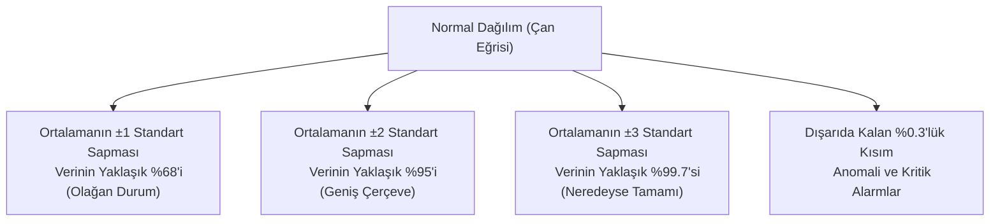
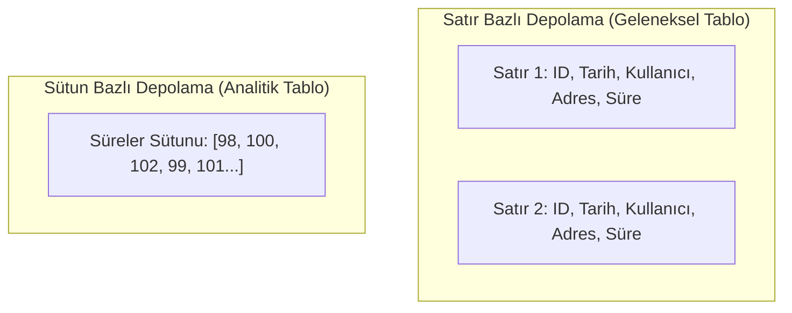

# Veri Dağılımı ve Olasılık Kavramları: Ortalamanın Ötesindeki Değişkenliği Anlamak

İstatistikle yeni tanışanların en sık düştüğü yanılgı, bir veri grubunu yalnızca aritmetik ortalamaya bakarak değerlendirmektir. Oysa ortalama, tablonun yalnızca yarısını anlatır. Popüler bir istatistik analojisinde belirtildiği gibi: *Ortalama derinliği 1 metre olan bir nehirde yüzme bilmeyen bir insan boğulabilir.* Nehrin çoğu yeri 30 santimetre olsa bile, ortadaki 4 metrelik tek bir çukur hayati tehlike yaratır.

Benzer bir durum dijital sistemlerde de geçerlidir. İki farklı kargo firmasının ortalama teslimat süresi `30 dakika` olabilir. Ancak ilk firma siparişleri her zaman `28 ile 32 dakika` arasında teslim ederken; ikinci firma siparişlerin yarısını `10 dakikada`, diğer yarısını ise `50 dakikada` teslim ediyorsa, ortalama ikisinde de aynı görünür. İlk firma güvenilir bir hizmet sunarken, ikinci firma müşterilerine randevu saati veremez.

Verinin yalnızca **nerede toplandığını (merkezi)** değil, merkezin çevresine **ne kadar yayıldığını (dağılımı)** ve olayların **hangi ihtimallerle gerçekleştiğini (olasılığı)** bilmek analizin temelini oluşturur.

---

## Dağılım Ölçüleri: Veri Ne Kadar Dalgalanıyor?

Dağılım ölçüleri, bir tablodaki sayıların birbirine ne kadar benzediğini veya birbirinden ne kadar savrulduğunu ölçer.


*Şekil 1: Veri dağılımını incelemede kullanılan üç temel yaklaşım.*

### 1. Değişim Aralığı (Range / Ranj): En Basit Genişlik

Verideki en büyük değerden en küçük değerin çıkarılmasıyla bulunur:

$$\text{Aralık} = \text{En Büyük Değer} - \text{En Küçük Değer}$$

* **Kafada Canlandırma:** Bir gün içindeki en yüksek hava sıcaklığı ile en düşük sıcaklık arasındaki makastır.
* **Kullanım Amacı:** Sürecin sınırlarını tek bakışta görmek.
* **Eksik Yanı:** Aradaki değerlerin nasıl davrandığını söylemez ve tek bir aşırı uç değerden hemen etkilenir. Örneğin 5 teslimat süresi `20, 21, 22, 23, 180` dakika ise, tek bir aksaklık yüzünden aralık `160 dakika` çıkar; oysa siparişlerin çoğu birbirine çok yakındır.

### 2. Çeyrekler Arası Açıklık (IQR): Aşırı Uçları Eleyen Sağlam Ölçü

Tek bir uç kaydın tüm resmi bozmasını engellemek için veriler küçükten büyüğe dizilir ve dört eşit parçaya (%25'lik dilimlere) bölünür. Bu dilimleme noktalarına **çeyrekler** denir:

* **$Q_1$ (İlk %25):** Verinin en düşük dörtte birlik sınırıdır.
* **Medyan ($Q_2$):** Tam ortadaki değerdir (%50).
* **$Q_3$ (İlk %75):** Verinin en yüksek dörtte birlik dilime girdiği sınırdır.

**IQR (Çeyrekler Arası Açıklık)**, $Q_3$ ile $Q_1$ arasındaki farktır:

$$IQR = Q_3 - Q_1$$


*Şekil 2: Çeyrekler arası açıklığın (IQR) aşırı uçları dışarıda bırakıp merkezdeki çekirdek gruba odaklanması.*

* **Kafada Canlandırma:** Bir yarışmada jürinin verdiği en düşük ve en yüksek puanları atıp ortadaki kararlı puanların farkına bakmak gibidir.
* **Neden Önemlidir:** Sisteme yanlışlıkla girilen hatalı kayıtlar veya olağan dışı patlamalar IQR değerini sarsamaz. Bu nedenle finans, e-ticaret ve sunucu kayıtlarında anomali filtrelemek için standart bir araçtır.

### 3. Standart Sapma: Ortalamadan Ortalama Uzaklık

Standart sapma, verilerin aritmetik ortalamadan ortalama ne kadar saptığını gösteren en temel ölçüdür.

Matematiksel olarak her bir değerin ortalamadan farkı hesaplanır ve bu farkların karesi alınarak toplanır (buna **varyans** denir). Ancak karesel değerler günlük hayattaki birimlerle (dakika, TL, derece) doğrudan okunamadığı için, varyansın karekökü alınarak orijinal birime dönülür. Bu nihai değer **standart sapmadır**.

* **Küçük Standart Sapma:** Sayılar ortalamaya çok yakındır. Süreç istikrarlıdır, tahmin etmesi kolaydır, sürpriz azdır.
* **Büyük Standart Sapma:** Sayılar geniş bir alana dağılmıştır. Süreç dalgalıdır, risk yüksektir, sürpriz fazladır.

```
Firma A (Standart Sapma = 1 dk):   ---[29]---[30]---[31]---       (Yüksek İstikrar)
Firma B (Standart Sapma = 15 dk):  [15]-------[30]-------[45]     (Yüksek Dalgalanma)
```

Yukarıdaki örnekte iki firmanın da ortalaması `30 dakika` olmasına rağmen, standart sapma tek bir bakışta Firma A'nın dakik, Firma B'nin ise tutarsız olduğunu ortaya koyar.

---

## Temel Olasılık: Geleceği Tahmin Etmenin Altyapısı

İstatistik geçmişte ne olduğunu kaydeder; **olasılık** ise gelecekte ne olabileceğini modeller.

Olasılık her zaman `0` (imkânsız) ile `1` (%100 kesin) arasında bir sayıdır:

$$P(\text{Olay}) = \frac{\text{İlgilenilen Durum Sayısı}}{\text{Tüm Olası Durumların Sayısı}}$$

Örneğin bir çağrı merkezine gelen 1.000 çağrının 50'si şikayet içeriyorsa, sisteme düşecek yeni bir aramanın şikayet olma olasılığı $\frac{50}{1000} = 0.05$ (%5) olarak değerlendirilir.

### Koşullu Olasılık: Yeni Bir Bilgi Geldiğinde İhtimal Nasıl Değişir?

Bir olayın gerçekleşme şansı, arka plandaki şartlar değiştiğinde farklılaşır. Buna **koşullu olasılık** denir.

* Bir web sitesinde rastgele bir kullanıcının sepeti terk etme olasılığı %15 olabilir.
* Ancak kullanıcının *"ödeme sayfasında hata mesajı aldığı"* biliniyorsa, sepeti terk etme olasılığı aniden %80'e çıkabilir.

Eklenen her yeni bilgi (hata logları, hava durumu, saat dilimi), geleceğe yönelik risk tahminlerini daha keskin hale getirir.

---

## Normal Dağılım: Doğanın ve Sistemlerin Çan Eğrisi

Boy uzunlukları, kahve otomatından akan kahvenin sıcaklığı, kargoların teslimat süreleri veya bir fabrikanın ürettiği cıvataların ağırlıkları incelendiğinde şaşırtıcı bir düzen görülür: **Değerlerin büyük çoğunluğu ortalamanın hemen yakınında toplanır; aşırı düşük veya aşırı yüksek değerler çok nadir görülür.**

Bu dengeli ve simetrik yayılıma **Normal Dağılım (Çan Eğrisi)** adı verilir.


*Şekil 3: Normal dağılımda pratik sınır kuralları.*

### Pratik Kural (68 – 95 Kuralı):
Normal dağılan bir süreçte karmaşık formüllere gerek kalmadan iki basit eşik akılda tutulabilir:

1. **Ortalamanın $\pm 1$ standart sapma içi:** Olayların yaklaşık **üçte ikisi (%68)** bu güvenli bantta gerçekleşir.
2. **Ortalamanın $\pm 2$ standart sapma içi:** Olayların neredeyse **tamamı (%95)** bu aralıktadır.
3. **$\pm 3$ standart sapmanın ötesi:** Binde üçten daha az rastlanan istisnai durumlardır. Sistem izleme araçlarında doğrudan arıza veya alarm eşiği olarak işaretlenir.

### Z-Skoru: Farklı Ölçüleri Aynı Cetvele Koymak

Bazen birimler farklı olduğu için iki değer doğrudan kıyaslanamaz. Örneğin bir veri merkezinde:
* Sunucu sıcaklığı ortalamanın `2 standart sapma` üstünde,
* Bellek kullanımı ise ortalamanın `3.5 standart sapma` üstünde olsun.

Herhangi bir ham değeri "ortalamadan kaç standart sapma uzakta" olduğunu gösteren standart bir ölçeğe dönüştüren sayıya **Z-skoru** denir:

$$\text{Z-Skoru} = \frac{\text{Ölçülen Değer} - \text{Ortalama}}{\text{Standart Sapma}}$$

* Z-skoru `0` ise değer tam ortalamadadır.
* Z-skoru `+1` ise ortalamanın 1 standart sapma üzerindedir.
* Z-skoru `+3`'ü aştığında, ortada normal bir durum olmadığı, incelenmesi gereken sıra dışı bir olay (anomali) yaşandığı hemen anlaşılır.

---

## Örnek Senaryo: İki Sunucunun Yanıt Sürelerini Kıyaslama

Aşağıdaki tabloda aynı işi yapan iki bağımsız sunucunun son 5 istekteki yanıt süreleri (milisaniye cinsinden) yer almaktadır:

| İstek No | `server_alpha` (ms) | `server_beta` (ms) |
| :---: | :---: | :---: |
| 1 | 98 | 50 |
| 2 | 100 | 70 |
| 3 | 102 | 100 |
| 4 | 99 | 130 |
| 5 | 101 | 150 |

İki sunucu için temel metrikler hesaplandığında:

* **`server_alpha`:**
  * Ortalama: $\frac{98+100+102+99+101}{5} = 100\text{ ms}$
  * Değişim Aralığı: $102 - 98 = 4\text{ ms}$
  * Standart Sapma: $\approx 1.58\text{ ms}$
* **`server_beta`:**
  * Ortalama: $\frac{50+70+100+130+150}{5} = 100\text{ ms}$
  * Değişim Aralığı: $150 - 50 = 100\text{ ms}$
  * Standart Sapma: $\approx 41.23\text{ ms}$

Sadece ortalamaya bakılsaydı iki sunucu da `100 ms` olduğu için eşdeğer kabul edilecekti. Oysa dağılım incelendiğinde `server_alpha` saatin tik-takları gibi düzenli çalışırken, `server_beta`'nın geniş dalgalanmalar yaşadığı ve her an kullanıcıyı bekleterek sistem kesintisi yaratabileceği açıkça görülür.

---

## Veri Depolama Mantığı: Dalgalanmaları Kolayca Hesaplamak

Milyonlarca satırlık kayıtta standart sapma veya çeyrek hesaplamak bilgisayarlar için yorucu bir iştir. Bu verimlilik problemini aşmak için modern veri tabanları depolama biçimini değiştirir:


*Şekil 4: Satır bazlı depolamada gereksiz tüm sütunların okunması ile sütun bazlı depolamada yalnızca ilgili sayıların çekilmesi.*

* **Satır Bazlı Depolama:** Bir market fişinin tamamını baştan sona okumaya benzer. Sadece fiyatların dalgalanması aranırken müşteri adı, kasiyer kodu ve tarih gibi ilgisiz tüm alanlar da okunur; işlem yavaşlar.
* **Sütun Bazlı Depolama:** Sadece ilgilenilen sayısal sütunu (örneğin sadece `sure_ms`) tek bir şerit halinde yan yana tutar. Bilgisayar aradaki gereksiz metinleri atlayarak yalnızca sayıları okur; saniyeler içinde yüz milyonlarca verinin dağılımını ve standart sapmasını hesaplar.

---

## Sonuç

Veri analitiğinde ortalama bir binanın kat yüksekliğini veriyorsa, dağılım o binanın ne kadar sallandığını gösterir.

* **Aralık ve IQR**, dalgalanmanın genel sınırlarını ve uç değerlerden arındırılmış gövdesini gösterir.
* **Standart sapma**, sürecin ne kadar güvenilir veya riskli olduğunu tek bir sayıyla ifade eder.
* **Normal dağılım ve Z-skoru**, olağan ile sıra dışı olanı birbirinden net çizgilerle ayırır.

Merkezi eğilim ve dağılım ölçüleri birlikte değerlendirildiğinde, verinin hem genel seviyesi hem de kararlılık düzeyi netleşir. Böylece tekil sayılara takılmadan tablonun bütünü güvenle yorumlanabilir.

Bir sonraki aşamada, veride gözlemlenen bu fark ve değişimlerin istatistiksel olarak anlamlı olup olmadığını belirleyen hipotez testleri ele alınacaktır.
