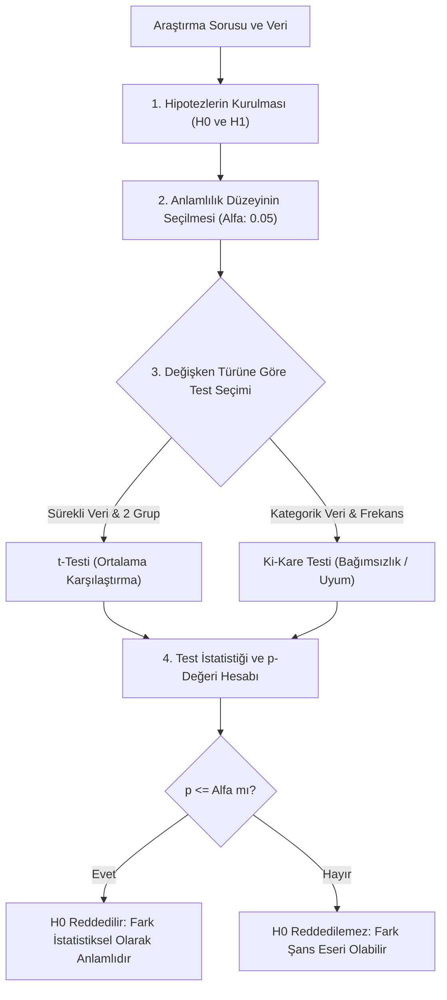
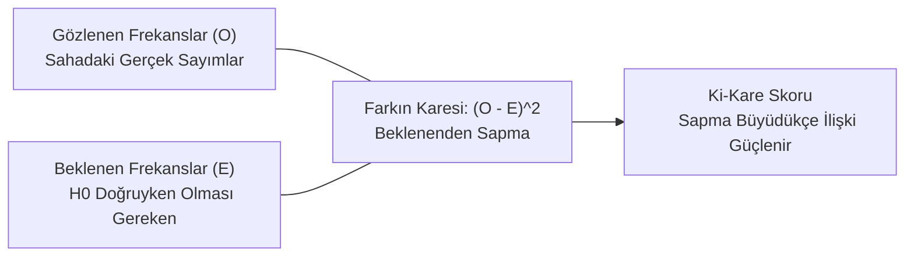

# İstatistiksel Analiz Yöntemleri ve Hipotez Testleri: Şans ile Gerçek Etkiyi Birbirinden Ayırmak

Veri analitiğinde iki farklı grubun ortalamaları karşılaştırıldığında, sayıların birbirine birebir eşit çıkması neredeyse imkânsızdır. Örneğin bir e-ticaret platformunda eski ödeme butonunu kullanan kullanıcıların sepet onaylama oranı `%12.4`, yeni tasarlanan yeşil butonu kullananların ise `%13.1` olarak ölçülmüş olsun. Ortada `%0.7`'lik bir fark vardır. Peki bu fark, yapılan tasarım iyileştirmesinin gerçek bir sonucu mudur; yoksa o gün sisteme denk gelen kullanıcıların rastlantısal tercihlerinden ibaret bir şans eseri midir?

İstatistiğin temel yaklaşımı, aksi güçlü kanıtlarla ispatlanana kadar mevcut durumun değişmediğini varsaymaktır. Mahkemelerdeki ispat yükümlülüğü gibi; bir iddiada bulunan taraf, savını şüpheye yer bırakmayacak delillerle kanıtlamak zorundadır. İstatistikte de yeni geliştirilen bir özellik veya yapılan bir müdahale baştan "etkisiz" kabul edilir; yani gruplar arasında gerçek bir fark olmadığı varsayılır. Elimizdeki verinin bu farkı şansla açıklanamayacak düzeyde güçlü kanıtlarla destekleyip desteklemediğini sınama sürecine **hipotez testi** denir.

Hipotez testleri; yazılım testlerinde A/B deney sonuçlarını doğrulamaktan, tıp alanında yeni bir ilacın etkinliğini kanıtlamaya kadar modern analitiğin temel doğrulama mekanizmasıdır.

---

## Hipotez Testi Mantığı ve Yol Haritası

Hipotez testleri, örneklemden elde edilen bulguların tüm kitleye genellenip genellenemeyeceğini matematiksel olasılık kurallarıyla karara bağlar.


*Şekil 1: Hipotez testlerinin kavramsal adımları ve karar mekanizması.*

---

## Temel Yapı Taşları: Hipotezler, Anlamlılık ve p-Değeri

Bir hipotez testi yürütülürken süreç her zaman iki zıt iddianın matematiksel olarak tanımlanmasıyla başlar.

### 1. Sıfır Hipotezi (H₀) ve Alternatif Hipotez (H₁)

* **Sıfır Hipotezi (H₀):** Varsayılan temel durumdur. Gruplar arasında gerçek bir fark olmadığını, yeni uygulanan yöntemin herhangi bir etki yaratmadığını ve gözlenen küçük farkların tamamen rastlantısal dalgalanmalardan kaynaklandığını savunur.
* **Alternatif Hipotez (H₁):** Araştırmacının veya mühendisin kanıtlamaya çalıştığı iddiadır. Gruplar arasında şansla açıklanamayacak gerçek ve anlamlı bir farkın bulunduğunu öne sürer.

$$H_0: \mu_1 = \mu_2 \quad (\text{Gruplar arasında ortalama farkı yoktur})$$
$$H_1: \mu_1 \neq \mu_2 \quad (\text{Gruplar arasında anlamlı bir fark vardır})$$

* **Kafada Canlandırma:** H₀ "ortada yeni bir durum yok, her şey eskisi gibi" der. H₁ ise "yeni yöntem fark yarattı, elimizde güçlü veriler var" iddiasındadır.
* **Kullanım Amacı:** Tarafsız bir sıfır noktası belirleyerek analistin kendi önyargılarına kapılmasını engellemek.
* **Eksik Yanı / Sahadaki Riski:** H₀ reddedilemediğinde bu durum H₀'ın kesinlikle "doğru" olduğunu kanıtlamaz; yalnızca eldeki verinin farkı ispatlamak için yetersiz olduğunu gösterir.

### 2. Anlamlılık Düzeyi (α) ve p-Değeri

* **Anlamlılık Düzeyi (α):** Gerçekte bir fark yokken yanlışlıkla "fark var" deme riskine verilen toleranstır. Endüstri standardı olarak genellikle `%5` (α = 0.05) veya kritik güvenlik süreçlerinde `%1` (α = 0.01) seçilir.
* **p-Değeri (Probability Value):** Eğer sıfır hipotezi gerçekten doğruysa, elimizdeki veya bundan daha uç bir veri tablosuyla karşılaşma olasılığıdır.

$$\text{Karar Kuralı:} \quad \begin{cases} p \le \alpha & \longrightarrow H_0 \text{ Reddedilir (Fark anlamlıdır)} \\ p > \alpha & \longrightarrow H_0 \text{ Reddedilemez (Yetersiz kanıt)} \end{cases}$$

```
p-Değeri Skalası (Alfa = 0.05 Sınırı):
[0.000]===================[0.05]---------------------------[1.000]
<--- H0 Red (Anlamlı Fark) ---> | <--- H0 Reddedilemez (Belirsiz / Şans) --->
```

* **Kafada Canlandırma:** Bir madeni para 10 kez havaya atılıp 10 kez tura gelirse, paranın hilesiz olduğunu söyleyen sıfır hipotezinin doğru olma olasılığı p = 0.00098'dir. Bu olasılık eşik değer olan 0.05'ten çok küçük olduğu için "Bu para hilesizdir" iddiası reddedilir.
* **Kullanım Amacı:** Karar alma sürecini sübjektif yorumlardan kurtarıp nesnel bir olasılık eşiğine bağlamak.
* **Eksik Yanı / Sahadaki Riski:** p-değeri etkinin büyüklüğünü söylemez; yalnızca etkinin şans eseri ortaya çıkıp çıkmadığını test eder. Örneklem boyutu on binlerce satıra ulaştığında çok önemsiz minik farklar bile p < 0.05 çıkabilir.

### 3. İstatistiksel Karar Hataları: Tip I ve Tip II Hata

İstatistiksel kararlar olasılıklara dayandığı için her zaman hata payı barındırır:

| Gerçek Durum \ Alınan Karar | H₀ Reddedilemez (Fark Yok Dendi) | H₀ Reddedildi (Fark Var Dendi) |
| :--- | :--- | :--- |
| **H₀ Gerçekte Doğru (Fark Yok)** | Doğru Karar (Güvenilirlik: 1 - α) | **Tip I Hata (α)** — *Yalancı Pozitif* |
| **H₀ Gerçekte Yanlış (Fark Var)** | **Tip II Hata (β)** — *Yalancı Negatif* | Doğru Karar (Testin Gücü: 1 - β) |

* **Tip I Hata (Yalancı Pozitif):** Sistemde hiçbir iyileşme yokken yeni yazılım sürümünün daha hızlı olduğunu ilan etmektir. Mahkemede masum bir insanın hapse atılmasıdır.
* **Tip II Hata (Yalancı Negatif):** Yeni geliştirilen bir algoritma gerçekten daha başarılıyken, veri yetersizliği yüzünden bu başarının fark edilemeyip projenin çöpe atılmasıdır. Mahkemede suçlu birinin serbest kalmasıdır.

---

## İki Ortalama Karşılaştırması: t-Testi

Sürekli bir değişkenin (süre, harcama tutarı, sunucu yanıt gecikmesi) iki farklı grup arasındaki ortalamalarını kıyaslamak için **Student's t-testi** kullanılır.

### 1. Bağımsız İki Örneklem t-Testi (Independent Samples t-test)

Birbirinden bağımsız iki grubun ortalamalarını kıyaslar. Örneğin: A şubesi kuryeleri ile B şubesi kuryelerinin teslimat süreleri.

$$t = \frac{\bar{X}_1 - \bar{X}_2}{\sqrt{\frac{s_1^2}{n_1} + \frac{s_2^2}{n_2}}}$$

* **Kafada Canlandırma:** İki farklı sporcunun antrenman sürelerini karşılaştırmak gibidir; birinin performansı diğerini doğrudan etkilemez.
* **Kullanım Amacı:** A/B testlerinde iki farklı kullanıcı grubuna sunulan özelliklerin (eski vs. yeni) performansını ölçmek.
* **Eksik Yanı / Sahadaki Riski:** Verilerin normal dağılıma yakın olmasını ve grupların birbirinden bağımsız olmasını şart koşar. Aşırı uç değerler varsa test yanıltıcı sonuç verir.

```
Grup A (Eski Tasarım): Ort = 4.2 sn, Sapma = 0.8 sn
Grup B (Yeni Tasarım): Ort = 3.6 sn, Sapma = 0.7 sn
Fark: 0.6 sn. Bu fark t-testi ile test edilir -> t = 3.12, p = 0.002 (p < 0.05, Fark Anlamlı)
```

### 2. Bağımlı (Eşleştirilmiş) Örneklem t-Testi (Paired Samples t-test)

Aynı deneklerin iki farklı andaki ölçümlerini (önce vs. sonra) karşılaştırır.

$$t = \frac{\bar{D}}{\frac{s_D}{\sqrt{n}}}$$

Burada D̄, her bir birey için "Sonra - Önce" farklarının ortalamasıdır.

* **Kafada Canlandırma:** Aynı personelin analitik eğitiminden önceki performans puanları ile eğitimden sonraki puanlarını eşleştirerek incelemek.
* **Kullanım Amacı:** Dış faktörlerin etkisini sıfırlayarak yalnızca uygulanan müdahalenin (eğitim, optimizasyon yaması, diyet) etkisini ölçmek.
* **Eksik Yanı / Sahadaki Riski:** İlk ölçümün ikinci ölçümü etkilemesi (öğrenme etkisi veya yorulma) sonucu saptırabilir.

---

## Kategorik Değişkenler Arasındaki İlişki: Ki-Kare (χ²) Testi

Sayısal ortalamalar yerine kategorik frekanslar incelendiğinde (örneğin kullanıcı cihaz türü ile satın alma durumu arasındaki ilişki) t-testi uygulanamaz. Bunun yerine **Ki-Kare Bağımsızlık Testi** kullanılır.

Ki-Kare testi, sahada gerçekte sayılan **gözlenen değerler (O)** ile iki değişken arasında hiçbir bağ olmasaydı ortaya çıkması beklenen teorik **beklenen değerler (E)** arasındaki makası ölçer:

$$\chi^2 = \sum \frac{(O - E)^2}{E}$$


*Şekil 2: Ki-kare testinde gözlenen ve beklenen frekansların kıyaslama mantığı.*

* **Kafada Canlandırma:** Bir zarın 60 atışta her yüzünün 10'ar defa gelmesi beklenir (E=10). Eğer zar 30 kez 6 gelmişse (O=30), aradaki büyük sapma zarın hileli olduğunu gösterir.
* **Kullanım Amacı:** Çapraz tablolarda iki kategorik özelliğin birbirinden bağımsız mı olduğunu, yoksa birbirine bağımlı mı hareket ettiğini tespit etmek.
* **Eksik Yanı / Sahadaki Riski:** Hücrelerdeki beklenen değerlerin en az 5 olması gerekir. Çok küçük örneklemlerde Ki-Kare yerine Fisher Kesin Testi (Fisher's Exact Test) tercih edilmelidir.

---

## İstatistiksel Anlamlılık ve Etki Büyüklüğü (Effect Size)

Bir analizde p < 0.05 bulunması her zaman operasyonel olarak büyük bir başarı kazanıldığı anlamına gelmez. Milyonlarca satırlık büyük veri setlerinde milisaniyelik bir hız farkı bile istatistiksel olarak anlamlı (p < 0.001) çıkabilir.

Bu sebeple kararın büyüklüğünü ölçmek için **Etki Büyüklüğü** (örneğin iki ortalama arasındaki standartlaştırılmış fark olan **Cohen's d**) raporlanmalıdır:

$$d = \frac{\bar{X}_1 - \bar{X}_2}{s_{\text{havuz}}}$$

* **Küçük Etki (d ≈ 0.2):** İstatistiksel olarak fark vardır fakat günlük hayatta insan gözüyle fark edilmesi zordur.
* **Orta Etki (d ≈ 0.5):** Sahada net olarak hissedilen operasyonel iyileşme.
* **Büyük Etki (d ≥ 0.8):** Sistemi kökten değiştiren belirgin fark.

---

## Mühendislik Karar Matrisi

| Hipotez Testi | İncelenen Değişken Türü | Karşılaştırma Amacı | Temel Karar Kriteri | Sahadaki Tipik Kullanım Alanı |
| :--- | :--- | :--- | :--- | :--- |
| **Bağımsız t-Testi** | Sürekli veri + 2 bağımsız grup | İki farklı kitlenin ortalaması eşit mi? | p ≤ 0.05 → Ortalamalar farklıdır | A/B Testi performans kıyaslaması, iki makine parçasının dayanıklılık testi |
| **Bağımlı t-Testi** | Sürekli veri + Eşleştirilmiş gruplar | Aynı grubun öncesi ve sonrası farklı mı? | p ≤ 0.05 → Müdahale etki etmiştir | Sunucu güncellemesi öncesi ve sonrası yanıt süreleri, eğitim etkisi |
| **Ki-Kare Bağımsızlık** | 2 Kategorik değişken (Frekanslar) | İki nitelik arasında bağımlılık var mı? | p ≤ 0.05 → Nitelikler ilişkilidir | Müşteri segmenti ile kampanya tercihi, cihaz türü ile hata alma ilişkisi |
| **Ki-Kare Uyum İyiliği** | Tek Kategorik değişken (Frekans) | Gözlenen dağılım teorik dağılıma uyuyor mu? | p ≤ 0.05 → Dağılım beklentiden sapmıştır | Sahte işlem / dolandırıcılık tespiti, donanım arıza frekansı doğrulaması |
| **Mann-Whitney U** | Sürekli / Sıralı (Non-parametrik) | Normal dağılmayan iki grup farklı mı? | p ≤ 0.05 → Sıra medyanları farklıdır | Aşırı uç değer içeren bekleme süreleri, kullanıcı memnuniyet anketleri (Likert) |
