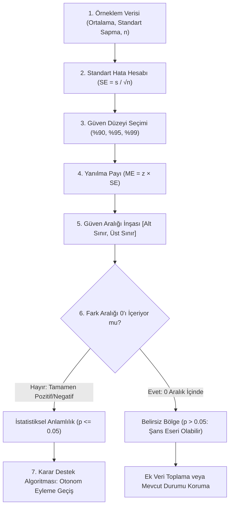
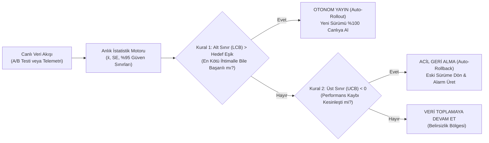

# Güven Aralıkları ve İleri Hipotez Kavramları: Nokta Tahmininden Karar Destek Algoritmalarına

Veri analitiğinde bir örneklemden tek bir ortalama hesaplamak, okyanusta balık avlamak için suya tek bir zıpkın atmaya benzer. Örneklem ortalaması ne kadar titiz hesaplanırsa hesaplansın, gerçek anakütle ortalamasını virgülden sonraki tüm basamaklarıyla birebir tutturma olasılığı neredeyse sıfırdır. Örneğin bir bulut sunucu kümesinden alınan 100 isteklik örneklemde ortalama yanıt süresi `42.0 ms` çıkmış olsun. Sistemdeki milyonlarca isteğin gerçek ortalaması tam olarak `42.0 ms` midir; yoksa `39 ms` ile `45 ms` arasında bir yerde mi durmaktadır?

Tek bir sayıya (**nokta tahmini**) körü körüne bağlanmak, mühendislik ve iş kararlarında büyük bir belirsizlik riski yaratır. Bunun yerine suya tek bir zıpkın atmak yerine belirli genişlikte bir balık ağı (**aralık tahmini**) atılır. İşte örneklemden elde edilen tekil tahminin etrafına, yanılma payını da hesaba katarak gerçek değeri belirli bir olasılıkla (`%95` veya `%99`) kapsayacak şekilde örülen bu güvenli matematiksel ağa **güven aralığı (confidence interval)** denir.

Güven aralıkları ve ileri hipotez kavramları; yalnızca raporlarda birer doğrulama aracı olarak kalmaz, modern yazılımlarda otomatik sürüm geçişlerinden (auto-rollout) e-ticaret sıralama algoritmalarına kadar tüm karar destek sistemlerinin çekirdeğini oluşturur.

---

## İstatistiksel Güven ve Karar Entegrasyonu Yol Haritası

Örneklem verisinden başlanarak belirsizliğin ölçülmesi, güven sınırlarının inşası ve bu sınırların yazılım karar motorlarına bağlanması süreci adım adım ilerler.


*Şekil 1: Standart hatadan güven aralığına ve karar destek sistemlerinde otonom eyleme geçiş mimarisi.*

---

## 1. Standart Hata (SE) ve Karekök (`√n`) Yasası

Bir anakütlenin gerçek ortalamasını (`μ`) tahmin ederken elimizdeki ilk değer örneklem ortalamasıdır (`x̄`). Ancak sistemden her yeni örneklem çektiğimizde biraz farklı bir ortalama çıkar.

**Standart Sapma (`s`)**, veri setindeki tekil ölçümlerin birbirinden ne kadar uzaklaştığını gösterirken; **Standart Hata (`SE`)**, hesapladığımız örneklem ortalamasının gerçek kitle ortalaması etrafında ne kadar dalgalandığını (tahminimizin hassasiyetini) ölçer:

$$\text{Standart Hata (SE)} = \frac{\text{Standart Sapma (s)}}{\sqrt{\text{Örneklem Sayısı (n)}}}$$

* **Kafada Canlandırma:** Bir hedef tahtasına yapılan tekil atışların kendi arasındaki saçılımı standart sapmadır (`s`). Atış sayısı (`n`) arttıkça bu atışların ağırlık merkezinin hedefin tam ortasına ne kadar yaklaştığının ölçüsü ise standart hatadır (`SE`).
* **Kullanım Amacı:** Örneklem büyüklüğünün (`n`) tahmin güvenilirliğine katkısını sayısallaştırmak.
* **Eksik Yanı / Sahadaki Riski:** Formüldeki karekök (`√n`) nedeniyle veri miktarı ile hata düşüşü doğrusal değildir. **Hata payını yarıya indirmek için örneklem sayısını 2 katına değil, 4 katına çıkarmak gerekir.**

### Senaryo ve Sayısal İspat: Mobil Uygulama Açılış Süresi Testi

Bir mobil uygulamanın soğuk açılış (cold start) süresini ölçmek istiyoruz. Kullanıcı cihazlarının çeşitliliğinden dolayı açılış sürelerinin standart sapması `s = 20 ms` olarak biliniyor. Farklı büyüklükte kullanıcı gruplarını test ettiğimizde tahmin hatamızın nasıl değiştiğini adım adım hesaplayalım:

1. **Senaryo A (`n = 25` kullanıcı test edildiğinde):**
   $$\text{Standart Hata} = \frac{20}{\sqrt{25}} = \frac{20}{5} = 4.0\text{ ms}$$
2. **Senaryo B (`n = 100` kullanıcı test edildiğinde — 4 kat veri):**
   $$\text{Standart Hata} = \frac{20}{\sqrt{100}} = \frac{20}{10} = 2.0\text{ ms}$$
3. **Senaryo C (`n = 400` kullanıcı test edildiğinde — 16 kat veri):**
   $$\text{Standart Hata} = \frac{20}{\sqrt{400}} = \frac{20}{20} = 1.0\text{ ms}$$

```
Karekök Yasasının Sayısal İspatı (s = 20 ms sabitken):
n = 25  kullanıcı  -->  SE = 4.0 ms  (Başlangıç hata düzeyi)
n = 100 kullanıcı  -->  SE = 2.0 ms  (4 kat veri toplandı  --> Hata yarıya indi)
n = 400 kullanıcı  -->  SE = 1.0 ms  (16 kat veri toplandı --> Hata dörtte bire indi)
```

**Mühendislik Çıkarımı:** Test bütçesini 4 katına çıkarmak hatayı yarıya indirir; hatayı 10 kat küçültmek için ise 100 kat daha fazla veri toplamak gerekir.

---

## 2. Yanılma Payı (ME) ve Güven Aralığı İnşası

Örneklem ortalamasının (`x̄`) iki yanına, standart hatanın (**`SE`**) normal dağılım çan eğrisindeki **Kritik z-Değeri (`z-Skoru`)** ile çarpımı eklenerek **Yanılma Payı (Margin of Error — `ME`)** ve **Güven Aralığı (`CI`)** kurulur:

$$\text{Yanılma Payı (ME)} = z \times \text{Standart Hata (SE)}$$

$$\text{Güven Aralığı} = \left[ \text{Ortalama} - \text{Yanılma Payı}, \quad \text{Ortalama} + \text{Yanılma Payı} \right]$$

### Kritik `z`-Değeri (`z`-Skoru) Nedir ve Nereden Gelir?

Önceki konularda normal dağılım çan eğrisinde verilerin yaklaşık `%95`'inin ortalamanın `± 2` standart sapma aralığında toplandığını görmüştük. İşte **`z`-değeri**, çan eğrisinin tam merkezinden sağa ve sola **kaç Standart Hata (`SE`) uzaklaşmamız gerektiğini** söyleyen standart dağılım katsayısıdır:
* **`%90` Güven Düzeyi (`z = 1.65`):** Çan eğrisinin ortasından her iki yana `1.65` standart hata açılırsanız olasılıkların `%90`'ını kapsarsınız (Hızlı ön keşif testleri).
* **`%95` Güven Düzeyi (`z = 1.96`):** Çan eğrisinin ortasından her iki yana `1.96` (yaklaşık `2`) standart hata açılırsanız olasılıkların `%95`'ini kapsarsınız (Endüstri ve yazılım dünyası altın standardı).
* **`%99` Güven Düzeyi (`z = 2.58`):** Çan eğrisinin ortasından her iki yana `2.58` standart hata açılırsanız olasılıkların `%99`'unu kapsarsınız (Tıbbi cihazlar, havacılık ve finansal güvenlik sistemleri).

* **Kafada Canlandırma:** Bir kurye teslimat algoritması ortalama süreyi `30 dakika`, yanılma payını ise `%95` güvenle `± 4 dakika` hesaplamışsa; müşteriye gösterilen `[26 dk, 34 dk]` penceresi güven aralığıdır.
* **Kullanım Amacı:** Karar vericilere yalnızca ortalama beklentiyi değil, **en iyi (`Alt Sınır`) ve en kötü (`Üst Sınır`) senaryoları** aynı anda sunmak.
* **Eksik Yanı / Sahadaki Riski:** Güven düzeyi (`%95`'ten `%99`'a) yükseltildiğinde aralık genişler. Çok geniş bir aralık yüksek güven taşır ama tahmin keskinliğini azaltır.

### Senaryo ve Sayısal İspat 1: Bulut Sunucu Performans Garantisi (SLA) Testi

Bir bulut bilişim şirketi, kurumsal bankacılık müşterisine **"API ortalama yanıt süremiz 45.0 ms sınırını aşmayacaktır"** maddesini içeren bir SLA (Hizmet Kalitesi Garantisi) sunmak üzeredir. Limit aşılırsa şirket tazminat ödeyecektir.

Canlı sistemden rastgele `n = 100` API isteği çekilmiş; örneklem ortalaması `x̄ = 42.0 ms`, standart sapması ise `s = 15.0 ms` ölçülmüştür. Şirket bu performans garantisini `%95` güvenle verebilir mi?

* **Adım 1 (Standart Hata Hesabı):**
  $$\text{SE} = \frac{15.0}{\sqrt{100}} = \frac{15.0}{10} = 1.5\text{ ms}$$
* **Adım 2 (`%95` Yanılma Payı Hesabı — `z = 1.96`):**
  $$\text{ME} = 1.96 \times 1.5 = 2.94\text{ ms}$$
* **Adım 3 (Güven Sınırlarının Belirlenmesi):**
  * **Alt Güven Sınırı (`LCB`):** `42.0 - 2.94 = 39.06 ms` (En iyi senaryo)
  * **Üst Güven Sınırı (`UCB`):** `42.0 + 2.94 = 44.94 ms` (En kötü senaryo)

**İspat ve Karar:** Sistemimizin `%95` güven aralığı **`[39.06 ms, 44.94 ms]`** olarak bulunmuştur. En kötü senaryo ucumuz olan `44.94 ms` dahi taahhüt edilen `45.0 ms` ceza sınırının altında kaldığı için bu garanti güvenle verilir.

### Senaryo ve Sayısal İspat 2: Aynı Veride `%90`, `%95` ve `%99` Güven Ödünleşimi

Yukarıdaki sunucu verisinde (`Ortalama = 42.0 ms`, `SE = 1.5 ms`), banka müşterisi `%95` yerine **`%99` güvence** talep etseydi karar nasıl değişirdi? Üç güven düzeyini yan yana hesaplayıp deneyelim:

| Güven Düzeyi | Kritik z-Değeri (`z`) | Yanılma Payı (`z × 1.5`) | Hesaplanan Güven Aralığı | Aralık Genişliği | `45.0 ms` SLA Onay Kararı |
| :--- | :--- | :--- | :--- | :--- | :--- |
| **`%90` Güven** | `1.65` | `± 2.48 ms` | **`[39.52 ms, 44.48 ms]`** | `4.96 ms` (Dar) | **Onay** (`44.48 < 45.0`, fakat `%10` risk var) |
| **`%95` Güven** | `1.96` | `± 2.94 ms` | **`[39.06 ms, 44.94 ms]`** | `5.88 ms` (Dengeli) | **Onay** (`44.94 < 45.0`, endüstri standardı) |
| **`%99` Güven** | `2.58` | `± 3.87 ms` | **`[38.13 ms, 45.87 ms]`** | `7.74 ms` (Geniş) | **RED!** (Üst sınır `45.87 ms` limiti aşıyor!) |

**İspat:** Tabloda açıkça görüldüğü gibi, güven düzeyi `%95`'ten `%99`'a çıkarıldığında yanılma payı `2.94 ms`'den `3.87 ms`'ye büyümüş ve üst sınır `45.87 ms`'ye çıkarak garanti sınırını aşmıştır. `%99` güven düzeyinde dahi `45.0 ms` altında kalmak isteniyorsa ya sunucu hızlandırılmalı ya da örneklem sayısı (`n`) artırılarak standart hata küçültülmelidir.

### `%95` Güven Aralığının Doğru Yorumlanması

Sahada en sık yapılan kavramsal hata, "`%95` güven aralığı `[39.06, 44.94]` çıktığına göre gerçek ortalamanın bu aralıkta bulunma olasılığı `%95`'tir" demektir. Oysa gerçek anakütle ortalaması (`μ`) hareket eden bir zar değildir; sabit bir sayıdır. Sabit bir sayı ya o aralığın içindedir (`%100`) ya da dışındadır (`%0`).

**Doğru Mühendislik Yorumu:** Lunaparktaki halka atma oyununda yerdeki demir çubuk (`μ`) sabit durur; her örneklem çektiğimizde bizim attığımız halka (`Güven Aralığı`) farklı yere düşer. Aynı yöntemle 100 farklı örneklem çekip 100 ayrı aralık inşa etsek, bu aralıkların yaklaşık **95 tanesi gerçek anakütle ortalamasını kendi sınırları içinde yakalar**, 5 tanesi ise şans eseri ıskalar.

---

## 3. İleri Hipotez Kavramları: Güven Aralığı ile `p-Değeri` İkizliği

Bir A/B testinde iki grubun (Yeni Tasarım B ile Eski Tasarım A) ortalamaları arasındaki farkı incelerken, hipotez testindeki `p-değeri` ile farkın `%95` güven aralığı birbirinin matematiksel ikizidir:

$$\text{Farkın Güven Aralığı} = \text{Gözlenen Ortalama Fark} \pm \text{Farkın Yanılma Payı}$$

### Sıfır (`0`) Değerinin Kesişim Kuralı

İki sistem arasında gerçekte hiçbir fark olmaması durumu (`H₀` sıfır hipotezi), farkın **`0`** olması demektir:
* **Durum 1 (`0` Aralık İçindeyse):** Farkın `%95` güven aralığı negatiften pozitife geçerken `0` değerini içeriyorsa, gerçek fark sıfır da olabilir. Bu durumda **`p > 0.05` çıkar ve `H₀` reddedilemez** (fark şans eseri olabilir).
* **Durum 2 (`0` Aralık Dışındaysa):** Farkın `%95` güven aralığının tamamı pozitifse (veya tamamı negatifse), aralık `0` değerini kesmez. Bu durumda **`p ≤ 0.05` çıkar ve `H₀` kesin olarak reddedilir** (fark istatistiksel olarak anlamlıdır).

### Senaryo ve Sayısal İspat: İki A/B Testinin Sıfır Kuralıyla Karara Bağlanması

Bir e-ticaret platformunda kullanıcı başına ortalama sepet tutarını (`200 TL`) artırmak için iki ayrı yazılım ekibi iki farklı özellik geliştiriyor. Her iki özelliğin A/B testi sonuçlarını hesaplayıp karşılaştıralım:

#### Deney 1: Arama Çubuğu Rengi Değişikliği (Şans Eseri Farkın İspatı)
* Eski Sürüm Ortalaması: `200 TL`, Yeni Sürüm Ortalaması: `204 TL`.
* **Gözlenen Ortalama Fark:** `+4 TL` artış.
* Testteki örneklem üzerinden hesaplanan `%95` Yanılma Payı: `± 7 TL`.
* **Farkın `%95` Güven Aralığı:**
  $$[4 - 7, \quad 4 + 7] = \mathbf{[-3\text{ TL}, \; +11\text{ TL}]}$$
* **İspat ve Karar:** Aralık `-3 TL` (kullanıcı başına 3 TL kayıp) ile `+11 TL` (11 TL kazanç) arasında uzanmaktadır. **`0 TL` noktası bu aralığın tam içindedir!** Yani yeni tasarımın hiçbir etki yaratmama (`0 TL`) hatta zarar ettirme (`-3 TL`) ihtimali devam etmektedir (`p > 0.05`). Özellik canlıya alınmaz.

#### Deney 2: Tek Tıkla Hızlı Ödeme Özelliği (Gerçek Farkın İspatı)
* Eski Sürüm Ortalaması: `200 TL`, Yeni Sürüm Ortalaması: `212 TL`.
* **Gözlenen Ortalama Fark:** `+12 TL` artış.
* Testteki örneklem üzerinden hesaplanan `%95` Yanılma Payı: `± 5 TL`.
* **Farkın `%95` Güven Aralığı:**
  $$[12 - 5, \quad 12 + 5] = \mathbf{[+7\text{ TL}, \; +17\text{ TL}]}$$
* **İspat ve Karar:** Aralığın tamamı sıfırın sağındadır; **`0 TL` değeri aralığın dışındadır!** En kötü senaryoda bile kullanıcı başına en az `+7 TL`, en iyi senaryoda `+17 TL` sepet artışı sağlandığı matematiksel olarak kanıtlanmıştır (`p ≤ 0.05`). Özellik tüm kullanıcılara açılır.

```
Deney 1 (Arama Rengi):     [----- (-3 TL) ----- (0 TL) ----- (+11 TL) -----]  --> 0 İçeride (p > 0.05, Şans Eseri)
Deney 2 (Hızlı Ödeme):                          (0 TL)   [--- (+7 TL) --- (+17 TL) ---] --> 0 Dışarıda (p <= 0.05, Kesin Kazanç)
```

### `p-Değerinin` Sahadaki İki Büyük Tuzağı

Yalnızca `p < 0.05` koşuluna bakarak karar almak sahada iki ciddi yanılgıya yol açar:

1. **Büyük Veri Şişkinliği (İstatistiksel Anlamlı ama Pratikte Önemsiz):**
   10 milyon kullanıcılı dev bir platformda yapılan testte örneklem sayısı (`n`) o kadar büyüktür ki standart hata (`s / √n`) neredeyse sıfırlanır. Yeni bir kodun sayfa açılışını yalnızca **`0.05 milisaniye`** hızlandırdığı bir deneyde `p = 0.0001` çıkabilir. `p-değeri` "fark kesinlikle var" der; ancak güven aralığına baktığınızda kazancın `[+0.03 ms, +0.07 ms]` olduğunu görürsünüz. Gözle hissedilmeyen `0.05 ms` için tüm yazılım mimarisini değiştirmek mühendislik israfıdır.
2. **Çoklu Test Yanılgısı (`p-Hacking` / Veri Cımbızlama):**
   Hiçbir etkisi olmayan bir özelliği aynı anda 20 farklı müşteri kırılımında (yaş, şehir, tarayıcı, saat dilimi) `%5` yanılma payıyla (`α = 0.05`) test ederseniz, `20 × 0.05 = 1` adet kırılımın **sırf şans eseri `p < 0.05` çıkması** kaçınılmazdır. Bu tuzağı önlemek için aynı anda `m` adet test yapılıyorsa anlamlılık eşiği test sayısına bölünerek sıkılaştırılır (**Bonferroni Kuralı:** `Yeni Eşik = 0.05 / m`). Örneğin 20 kırılım test ediliyorsa eşik `0.05 / 20 = 0.0025` olarak uygulanır.

---

## 4. Karar Destek Modellerine İstatistiksel Entegrasyon

Geliştirilen yazılımlarda, öneri motorlarında veya otonom dağıtım (CI/CD) boru hatlarında karar algoritmaları kurulurken ham ortalamalar (`if yeni_ort > eski_ort`) üzerinden eyleme geçilmez. Ham ortalama gürültüye açıktır; bunun yerine güven aralığının **Alt Sınırı (`LCB`)** ve **Üst Sınırı (`UCB`)** doğrudan üretim koduna entegre edilir.


*Şekil 2: Yazılım karar destek sistemlerinde alt ve üst güven sınırlarına (LCB / UCB) dayalı otonom eylem akışı.*

### Senaryo ve Sayısal İspat 1: E-Ticaret Sıralama Algoritmasında Alt Güven Sınırı (`LCB`)

Bir pazaryeri uygulamasında kullanıcılar "Kablosuz Kulaklık" arattığında iki farklı satıcı listeleniyor. Yazılımımız hangi satıcıyı 1. sıraya koyacağına karar verecek:
* **Satıcı A (Yeni Açılan Mağaza):** Toplam `4` sipariş almış, ortalama puanı **`4.90`** (`5` üzerinden). Ancak değerlendirme sayısı çok az (`n = 4`) olduğu için `%95` yanılma payı çok geniştir: **`± 1.40 puan`**.
* **Satıcı B (Köklü Mağaza):** Toplam `2.500` sipariş almış, ortalama puanı **`4.75`**. Değerlendirme sayısı çok yüksek (`n = 2500`) olduğu için `%95` yanılma payı çok dardır: **`± 0.05 puan`**.

Şimdi iki farklı yazılım algoritmasının bu iki satıcıyı nasıl sıraladığını hesaplayıp karşılaştıralım:

1. **Hatalı Algoritma (Ham Ortalamaya Göre Sıralama — `ORDER BY avg_score DESC`):**
   * Satıcı A (`4.90`) > Satıcı B (`4.75`) olduğu için henüz 4 satış yapmış Satıcı A'yı 1. sıraya, 2.500 satışlık güvenilir Satıcı B'yi 2. sıraya koyar.
2. **İstatistiksel Karar Algoritması (Alt Güven Sınırına Göre Sıralama — `ORDER BY LCB DESC`):**
   Algoritma her satıcı için *"En kötü ihtimalle gerçek puanı kaçtır?"* sorusunu yanıtlayan **`Alt Güven Sınırı (LCB) = Ortalama - Yanılma Payı`** değerini hesaplar:
   * **Satıcı A `LCB` Skoru:** **`4.90 - 1.40 = 3.50 puan`** (Güven Aralığı: `[3.50, 5.00]`)
   * **Satıcı B `LCB` Skoru:** **`4.75 - 0.05 = 4.70 puan`** (Güven Aralığı: `[4.70, 4.80]`)

```
Sıralama Motoru Karşılaştırması:
Satıcı A (n = 4):     Ham Ortalama = 4.90  |  %95 Alt Güven Sınırı (LCB) = 3.50  --> 2. Sıra
Satıcı B (n = 2500):  Ham Ortalama = 4.75  |  %95 Alt Güven Sınırı (LCB) = 4.70  --> 1. Sıra (Kazanan!)
```

**İspat:** İstatistiksel karar algoritması `4.70 > 3.50` olduğu için **Satıcı B'yi 1. sıraya yerleştirir.** Böylece az sayıda oyla şişirilmiş yanıltıcı kayıtların sıralamayı manipüle etmesi matematiksel olarak engellenir.

### Senaryo ve Sayısal İspat 2: Canlı Sunucu Dağıtımında (Canary Release) Otonom Karar Kapısı

Bir yazılım ekibi, öneri servisinin yeni sürümünü (`v2.1`) canlı ortamda trafiğin `%5`'ine açıyor (Canary Release). Dağıtım boru hattındaki (CI/CD) otonom karar algoritmasına şu mühendislik kuralları tanımlanmıştır:
* **Minimum Operasyonel Hedef (`MDE`):** Yeni sürüm yanıt süresini **en az `+3.0 ms`** hızlandırmalıdır.
* **Kural 1 (Auto-Rollout):** Farkın `%95` Alt Güven Sınırı (`LCB`) > `+3.0 ms` olursa sürümü `%100` trafiğe aç.
* **Kural 2 (Auto-Rollback):** Farkın `%95` Üst Güven Sınırı (`UCB`) < `0 ms` olursa (yavaşlama kesinleşirse) sürümü anında geri al.
* **Kural 3 (Bekle):** Diğer tüm durumlarda `%5` trafikte veri toplamaya devam et.

Canlı yayındaki üç farklı zaman diliminde algoritmanın nasıl karar verdiğini adım adım çalıştıralım:

| Zaman / Senaryo | Toplanan Örneklem (`n`) | Gözlenen Hızlanma (`x̄`) | `%95` Yanılma Payı (`ME`) | Hesaplanan `%95` Güven Aralığı `[LCB, UCB]` | Algoritmanın Kontrol Ettiği Koşul | Otonom Sistem Kararı |
| :--- | :--- | :--- | :--- | :--- | :--- | :--- |
| **1. Saat (Erken Faz)** | `50` istek | `+6.0 ms` | `± 8.0 ms` | **`[-2.0 ms, +14.0 ms]`** | `LCB (-2.0) < 3.0` ve `UCB (+14.0) > 0` | **BEKLE VE VERİ TOPLA** (Henüz belirsiz) |
| **4. Saat (Olgun Faz)** | `800` istek | `+6.0 ms` | `± 2.0 ms` | **`[+4.0 ms, +8.0 ms]`** | **`LCB (+4.0 ms) > Hedef (+3.0 ms)`** | **OTONOM YAYIN (`%100` Auto-Rollout)** |
| **Arıza Senaryosu** | `400` istek | `-5.0 ms` | `± 2.5 ms` | **`[-7.5 ms, -2.5 ms]`** | **`UCB (-2.5 ms) < 0 ms`** | **ACİL GERİ ALMA (Auto-Rollback)** |

**İspat ve Mühendislik Yorumu:**
1. **1. Saatte** ortalama hızlanma `+6.0 ms` görünmesine rağmen, örneklem henüz `50` olduğu için yanılma payı `± 8.0 ms`'dir ve alt sınır `-2.0 ms`'ye uzanmaktadır. Ham ortalamaya bakan bir sistem burada hemen yayına geçip hata yapardı; güven aralığı algoritması ise belirsizliği fark edip beklemiştir.
2. **4. Saatte** örneklem sayısı `50`'den `800`'e (16 katına) çıktığı için karekök yasası gereği yanılma payı 4 kat küçülerek `± 8.0 ms`'den `± 2.0 ms`'ye düşmüştür. Alt Güven Sınırı `+4.0 ms` olarak `+3.0 ms` hedefini aşmış ve sistem insan müdahalesi olmadan yeni sürümü `%100` canlıya almıştır.
3. **Arıza Senaryosunda** ise üst sınır dahi `-2.5 ms` çıktığı için en iyi ihtimalle bile yeni sürümün sistemi yavaşlattığı kanıtlanmış ve saniyeler içinde eski sürüme dönülmüştür.

---

## 5. Mühendislik Karar Matrisi

| Metrik / Kavram | Nasıl Hesaplanır | Çözdüğü Mühendislik Problemi | Karar Algoritması Kuralı | Sahadaki Uygulama Alanı |
| :--- | :--- | :--- | :--- | :--- |
| **Standart Hata (`SE`)** | `s / √n` | Ortalama tahmininin oynaklığını ölçmek | `SE > Hedef` ise örneklem (`n`) toplamaya devam et | Sensör örnekleme ve test bütçesi optimizasyonu |
| **Güven Aralığı (`CI`)** | `x̄ ± (z × SE)` | Tekil tahminin en iyi ve en kötü sınırlarını görmek | Fark aralığı `0`'ı içermiyorsa fark anlamlıdır (`p ≤ 0.05`) | A/B testi raporları, gelir ve kapasite tahminleri |
| **Alt Güven Sınırı (`LCB`)** | `x̄ - Yanılma Payı` | Az oylu şişirilmiş ortalamaların yanıltmasını önlemek | `ORDER BY LCB DESC` veya `if LCB > MDE` | E-ticaret ürün/satıcı sıralama, Canary sürüm onayı |
| **Üst Güven Sınırı (`UCB`)** | `x̄ + Yanılma Payı` | En kötü senaryo gecikme/maliyet tavanını bulmak | `if UCB < SLA_Limit` ise garantiyi onayla | Bulut SLA taahhütleri, otonom sürüm geri alma (`UCB < 0`) |
| **Bonferroni Eşiği** | `α / Test Sayısı (m)` | Çoklu testlerde şans eseri yalancı pozitifi engellemek | `p ≤ (0.05 / m)` ise anlamlı kabul et | Çok kırılımlı kampanya ve özellik tarama deneyleri |
