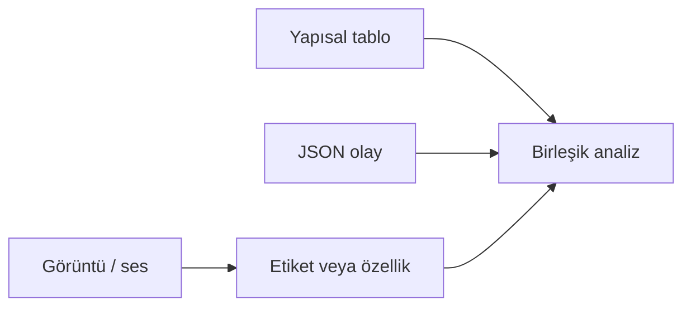
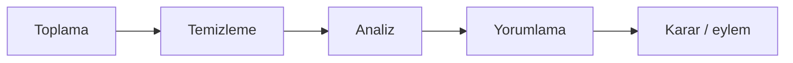

# Veri Türleri ve Organizasyon Süreci

Önceki yazı, kurmaca bir teslimat aracına ait iki konum satırı üzerinden ham kaydın tek başına karar üretmediğini gösterdi. Aynı filo düşünüldüğünde soru değişir: Kayıtlar hangi biçimde gelir, nerede birleştirilir, analize girmeden önce hangi adımlardan geçer? Bu metin yapısal ile yapısal olmayan veriyi ayırır; toplama, temizleme, analiz ve yorumlama hattını tek bir organizasyon çerçevesinde ele alır.

## Yapısal veri: satır, sütun ve şema

**Yapısal veri**, önceden tanımlı alanlara (sütunlara) oturan kayıtlardır. Her satır aynı şemayı paylaşır; alan türleri bellidir: `recorded_at` zaman damgası, `latitude` ondalık sayı, `vehicle_id` tamsayı gibi.

Teslimat filosunda tipik yapısal kayıtlar tabloda durur:

| vehicle_id | recorded_at | latitude | longitude | speed_kmh |
|-----------:|-------------|---------:|----------:|----------:|
| 1042 | 2026-03-10 08:12:00 | 41.0100 | 29.0000 | null |
| 1042 | 2026-03-10 08:12:30 | 41.0205 | 29.0000 | null |

**Şema**, hangi alanların bulunacağını ve nasıl yorumlanacağını tanımlar. Şema net olduğunda filtreleme, birleştirme ve toplama (aggregation) doğrudan SQL veya eşdeğer sorgularla yapılabilir. İlişkisel veritabanı, bu tür verinin doğal barındırma yeridir.

Yapısal verinin gücü tekrarlanabilirliktir: bin araca ait milyon satır aynı sütun düzeninde gelir; “geçen hafta kaç hız aşımı?” sorusu satır sayımına indirgenebilir. Zayıf yanı esnekliktir: şemaya sığmayan içerik ya dar bir sütuna sıkıştırılır ya da başka bir depoya aktarılır.

## Yapısal olmayan ve yarı yapılandırılmış veri

**Yapısal olmayan veri**, sabit bir tablo ızgarasına zorlanmadan gelir. Kamera görüntüsü, sürücünün sesli notu, ham sensör akışı veya uzun metin bu gruba girer. Ortalama hız hesabına doğrudan katılmaz; önce anlamlı bir ölçüme veya etikete dönüştürülmesi gerekir.

**Yarı yapılandırılmış veri** arada durur: alanlar vardır, ancak her kayıt aynı alan kümesini taşımak zorunda değildir. **JSON** bu sınıfta sık görülür. Aynı filoda bir olay şöyle yazılabilir:

```json
{
  "vehicle_id": 1042,
  "event": "hard_brake",
  "recorded_at": "2026-03-10T08:12:45+03:00",
  "extras": { "g_force": 0.42, "road_wet": true }
}
```

`extras` içindeki anahtarlar her olayda aynı olmayabilir; bu, klasik tek tablo şemasından farklıdır. Yine de `vehicle_id` ve `recorded_at` sayesinde yapısal konum tablosuyla birleştirme mümkündür.

| Boyut | Yapısal | Yarı yapılandırılmış | Yapısal olmayan |
| --- | --- | --- | --- |
| Düzen | Sabit sütunlar | Alanlar var, esnek | Dosya / akış odaklı |
| Sorgu | SQL benzeri | JSON sorgusu, dönüşüm | Önce çıkarım gerekir |
| Filo örneği | Konum satırı | Olay JSON’u | Dashcam karesi |



*Şekil 1: Yapısal kayıtlar doğrudan analize katılır; yapısal olmayan içerik önce etiket veya özellik basamağından geçer.*

## Dört adım: toplama, temizleme, analiz, yorumlama

Önceki yazıdaki yaşam döngüsünde **hazırlama** ve **analiz** adları geçmişti. Operasyonel ekipler aynı hattı çoğu zaman dört sözcükle anlatır: toplama, temizleme, analiz, yorumlama. Eşleme şöyledir:

| Dört adım | Döngüdeki karşılık | Filo örneğinde ne olur |
| --- | --- | --- |
| Toplama | Üretim + toplama | Araçtan GPS, olay JSON’u, merkeze aktarım |
| Temizleme | Hazırlama | Eksik `speed_kmh`, saat dilimi, GPS sıçraması |
| Analiz | Analiz | Hız dağılımı, rampa bazlı aşım sayısı |
| Yorumlama | İçgörü + karar bağlamı | “Bu rampada sistematik aşım var” ve eylem seçimi |

**Toplama**, kaynağın sistemde görünür olmasıdır. Veri gecikmeli toplu dosyayla da, saniyede bir **API** çağrısıyla da gelebilir; önemli olan kaynağın, zaman damgasının ve kimlik alanlarının (`vehicle_id` gibi) izlenebilir kalmasıdır.

**Temizleme**, analize güvenmek için kaydı düzeltmek veya işaretlemektir. `null` hız alanı, hesaplanabilir konumdan doldurulabilir; mantıksız koordinat satırı çıkarılır veya “hatalı” bayrağı alır. Temizleme, veriyi güzel göstermek değil; yanlış sonucu engellemektir.

**Analiz**, sayısal veya istatistiksel işlemdir: gruplama, ortalama, eşik aşımı sayısı. **Yorumlama**, çıktının cümleye ve bağlama bağlanmasıdır; “128 aşım” ile “yağmur + rampa” birleşince tanısal bir aday ortaya çıkar. Yorumlama olmadan analiz çıktısı panoda kalır; karar üretmez.



*Şekil 2: Organizasyon hattı yorumlamada anlamlı bir cümle üretir; ardından karara bağlanır.*

## Veriyi organize etmek: kimlik, zaman ve birleştirme

Farklı biçimler, tek bir soruya cevap verebilmek için ortak anahtarlar etrafında hizalanır. Filo analitiğinde üç alan neredeyse evrenseldir:

**Kimlik** (`vehicle_id`, `driver_id`) — aynı varlığa ait kayıtlar bir araya getirilir.

**Zaman** (`recorded_at`, olay zamanı) — sıra korunur; “30 saniye arayla iki konum” gibi hesaplar mümkün olur. Saat dilimi tutarlı değilse, düzeltme temizleme adımında yapılır.

**Olay türü** — kaydın konum satırı mı, `hard_brake` JSON’u mu, uyarı log’u mu olduğu ayrılır.

İki yapısal tablo birleştirilirken çoğu zaman **anahtar** alanlar kullanılır. Örneğin `vehicle_id` ile tarih aralığı, konum tablosunu günlük özet tablosuna bağlar. Yarı yapılandırılmış JSON, `vehicle_id` ve `recorded_at` üzerinden konum satırlarına **join** edilir; görüntü ise önce “kamera olayı mı, kaza mı?” etiketini taşıyan bir tabloya indirgenir.

Organizasyon katmanları pratikte şöyle ayrılır:

| Katman | Ne tutulur | Filo örneği |
| --- | --- | --- |
| Ham | Olduğu gibi gelen kayıt | CSV dump, ham JSON, video dosyası |
| İşlenmiş | Temizlenmiş, tipleri net | `speed_kmh` doldurulmuş konum tablosu |
| Özet / analitik | Soruya özel türetilmiş | Günlük aşım sayısı, rampa karnesi |

Ham katman silinmeden saklanır; temizleme yanlışsa geriye dönülüp yeniden işlemek gerekir. Özet ve analitik katman yeniden üretilebilir; asıl kaynak ham katmandır.

## Aynı filo, üç kaynak

Teslimat örneği, biçim çeşitliliğini somutlaştırır:

**Yapısal:** Her 30 saniyede bir konum satırı; PostgreSQL veya benzeri ilişkisel veritabanında.

**Yarı yapılandırılmış:** Telemetri kutusundan gelen JSON olaylar (fren, kapı açılması); alan kümesi olay türüne göre değişir.

**Yapısal olmayan:** Acil durumda dashcam karesi; filo analitiğinde önce “olay anı görüntüsü” metadata’sı tutulur, piksel verisi ayrı nesne depolamada durur.

Üç kaynak birleştiğinde betimsel soru (“Kaç sert fren?”) JSON ve log’dan, konum soruları tablodan, görsel kanıt yapısal olmayan katmandan gelir. Organizasyon hatası — örneğin `vehicle_id` değerinin bir yerde metin, diğer yerde sayı olması — birleştirmeyi kırar; temizleme burada devreye girer.

## Sonraki yazılarda ele alınacak konular

Bu yazı biçimleri ve organizasyon iskeletini kurar. **Verinin kaynaktan nasıl çekildiği** (anket, sensör, web kazıma, API) bir sonraki yazının konusudur. Temizlemenin algoritmik ayrıntıları (anomali, tip dönüşümü) de ilerleyen bölümlerde açılır. Meslek pratiği açısından çıkarım net: analize gitmeden önce verinin türünü bilmek, ortak anahtarlarla hizalamak ve dört adımlı hattı bilinçli uygulamak gerekir.
